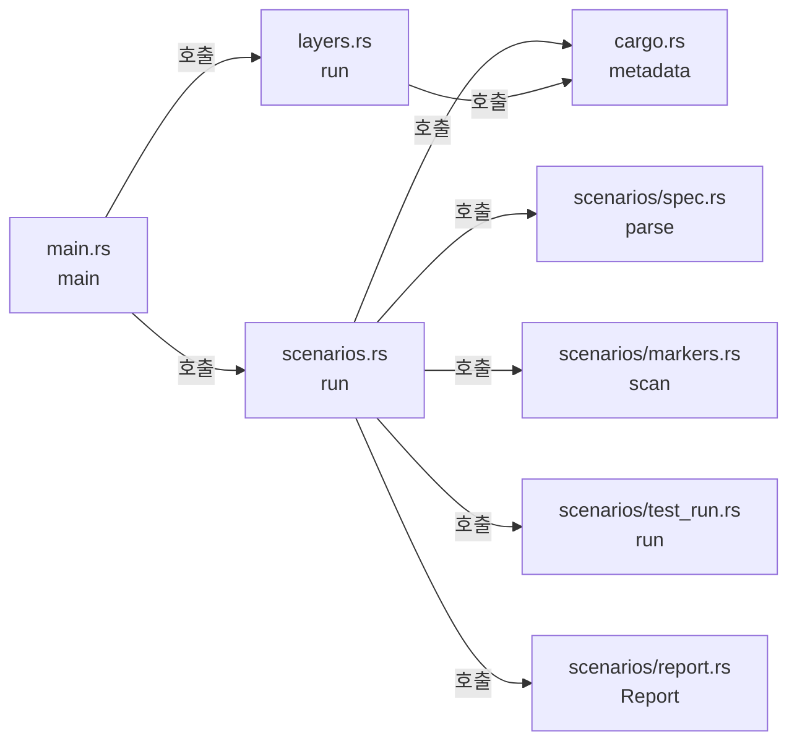

# xtask 개발 도구 모듈 설계

`xtask`는 저장소 검증용 명령 두 개를 제공하는 개발 전용 crate다. `cargo xtask scenarios`는 스펙 수용 테스트 표, 테스트 코드의 시나리오 표식, `cargo test` 결과를 대조해 시나리오별 상태 보고서를 만든다. `cargo xtask layers`는 `cargo metadata`의 crate 의존을 코드 지도의 레이어 표와 대조한다. 두 명령 모두 Cargo가 주는 정보(`cargo metadata`, 테스트 빌드 JSON 메시지, 테스트 출력)만 읽고 제품 crate를 링크하지 않는다.

| 항목 | 값 |
| --- | --- |
| 구조 시점 | Current |
| 문서 상태 | Draft |
| 구현 대조 | Verified — [대조 기록](#대조-기록) |
| 코드 위치 | `xtask/` |
| 코드 지도 | [코드 지도 2절](code-map.md#2-코드-위치와-구성요소) |
| 관련 스펙 | 없음. 모든 스펙의 수용 테스트 표를 읽는다. |
| 관련 계약 | 없음 |
| 관련 ADR | 없음 |

## 1. 책임과 경계

- 맡는 책임:
  - 시나리오 ID 수집, 표식 해석, 테스트 결과 대조, 보고서 작성([테스트 컨벤션 7절](../conventions/testing.md#7-테스트와-스펙-시나리오-연결))
  - 작업 공간 crate 의존 검사([코드 지도 레이어 표](code-map.md#레이어와-의존-방향))
- 맡지 않는 책임:
  - 라이선스 검사. [의존성 라이선스 검사](../how-to/check-dependency-licenses.md)의 `cargo deny`가 맡는다.
  - 모듈 안의 입출력 타입 금지. `crates/app/clippy.toml`과 `cargo clippy`가 맡는다.
  - 대시보드 테스트 결과 수집. 프런트엔드 컨벤션(작업 0.9)에서 정한다.
- 다른 모듈에 공개하는 기능: 없음. 명령행 `cargo xtask scenarios [--require-all]`, `cargo xtask layers`만 있다. 별칭은 `.cargo/config.toml`의 `[alias] xtask`다.

## 2. 내부 구조

화살표는 실행 중 호출이다.

| 요소(파일·심볼) | 역할 | 만들어지는 시점과 소유자 | 의존 대상 |
| --- | --- | --- | --- |
| `xtask/src/main.rs` `main`, `Error` | 하위 명령 선택, 사용법 오류(종료 코드 2), 오류 출력 | 명령 실행마다 | `scenarios`, `layers` |
| `xtask/src/cargo.rs` `metadata`, `Workspace`, `command` | `cargo metadata --no-deps`를 읽어 패키지·대상·의존 목록을 만든다. 하위 Cargo 명령은 환경 변수 `CARGO`의 Cargo로 실행한다. | 명령마다 한 번 | serde_json |
| `xtask/src/scenarios.rs` `run`, `locate`, `link` | 보고 순서 조정, 표식 파일을 테스트 대상과 모듈 경로로 바꾸기, 시나리오별 테스트 연결 | `scenarios` 실행마다 | 하위 모듈, `cargo` |
| `xtask/src/scenarios/spec.rs` `parse` | `## ` 제목에 "수용 테스트"가 들어간 절의 표에서 첫 칸이 `<접두어>-<숫자>`인 행을 시나리오로 읽는다. | 스펙 파일마다 | 없음 |
| `xtask/src/scenarios/markers.rs` `scan`, `Marker` | 주석·문자열·문자 리터럴을 건너뛰는 작은 어휘 분석기로 `/// spec:` 표식, 테스트 속성, 인라인 `mod` 중첩, 함수 이름을 찾는다. 표식 끝의 ` partial`은 `Marker::partial`이 된다. 다른 낱말이 붙으면 표식 오류다. | `.rs` 파일마다 | `spec::is_scenario_id` |
| `xtask/src/scenarios/test_run.rs` `run` | 테스트 빌드 JSON에서 실행파일과 대상 소스 파일을 짝짓고, `cargo test` 출력에서 테스트별 결과를 읽는다. | `scenarios` 실행마다 | `cargo` |
| `xtask/src/scenarios/report.rs` `Report`, `Status` | 시나리오 상태 판정, 판정 사유, Markdown 보고서 작성 | `scenarios` 실행마다 | 없음 |
| `xtask/src/layers.rs` `RULES`, `APPROVED`, `check` | 패키지별 허용 내부 crate·외부 crate 규칙, 같은 외부 crate의 버전 요구 일치 검사 | `layers` 실행마다 | `cargo` |

## 3. 데이터 모델

| 이름 | 필드·형태 | 저장 위치 | 제약과 항상 지켜야 할 조건 |
| --- | --- | --- | --- |
| `TestKey` | (테스트 대상 루트 소스 파일 경로, 대상 안 테스트 경로 `a::b::fn`) | 메모리 | 표식 쪽 키와 `cargo test` 출력 쪽 키가 같은 규칙으로 만들어진다. |
| `Outcome` | `Passed`, `Failed`, `Ignored` | 메모리 | `cargo test` 출력 한 줄에서 하나 |
| `TestEntry` | 파일, 테스트 경로, `Outcome`(없으면 이번 실행에 없음), `partial` | 메모리 | `partial`은 그 테스트를 시나리오에 연결한 표식의 값이다. 한 테스트가 시나리오마다 다른 값을 가질 수 있다. |
| `Status` | `Passed`(통과), `Partial`(부분), `Failed`(실패), `NotRun`(미실행), `Unlinked`(미연결) | 메모리 | 이 순서로 판정한다. 실패가 하나라도 있으면 실패, ` partial`이 없는 통과가 있으면 통과, 통과가 모두 ` partial`이면 부분, 테스트는 있으나 실행 결과가 없거나 무시되면 미실행, 테스트가 없으면 미연결 |
| `Problem` | 위치(`파일:줄`), 내용 | 메모리 | 보고서의 `오류`. 1건이라도 있으면 판정은 실패다. |
| 보고서 | Markdown | `<Cargo 대상 디렉터리>/scenario-report.md` | 저장소에 넣지 않는다. 실행마다 덮어쓴다. |

## 4. 처리 순서

대표 흐름은 `cargo xtask scenarios`다.

| 순서 | 코드 위치(파일·심볼) | 조건·계산 | 바뀌는 상태 | 결과를 쓰는 곳 |
| --- | --- | --- | --- | --- |
| 1 | `xtask/src/cargo.rs` `metadata` | `cargo metadata --format-version 1 --no-deps` | 작업 공간 루트, 대상 디렉터리, 패키지 목록 | 2~4단계 |
| 2 | `xtask/src/scenarios.rs` `load_specs`, `spec::parse` | `docs/specs/` 아래 `.md` 중 `README.md`·`AGENTS.md`를 뺀 파일. 수용 테스트 절이 없거나, 시나리오가 없거나, ID가 중복되면 오류 | 스펙별 시나리오 ID 목록 | 5단계 |
| 3 | `xtask/src/scenarios.rs` `collect_marked_tests`, `markers::scan`, `locate` | `xtask`를 뺀 패키지의 `src/`·`tests/` 아래 `.rs` 파일. 파일 위치로 테스트 대상과 모듈 경로를 정한다. `foo/mod.rs`는 `foo`다. | 표식이 붙은 테스트와 `TestKey`, 표식 오류 | 5단계 |
| 4 | `xtask/src/scenarios/test_run.rs` `build`, `run` | `cargo test --workspace --no-run --message-format=json-render-diagnostics`로 실행파일 이름을 대상 소스 파일에 짝짓는다. 이어 `cargo test --workspace --no-fail-fast`를 실행하고 표준 출력과 표준 오류를 한 파이프로 읽는다. `Running ... (<실행파일>)` 줄이 다음 테스트 결과의 대상을 정한다. 문서 테스트는 건너뛴다. | `TestKey`별 `Outcome`, `cargo test` 종료 상태 | 5단계. 출력은 표준 오류에 그대로 보인다. |
| 5 | `xtask/src/scenarios.rs` `link` | 표식의 스펙 경로와 ID가 2단계 목록에 없으면 오류 | 시나리오별 테스트와 `Status` | 6단계 |
| 6 | `xtask/src/scenarios/report.rs` `Report::render`, `verdict_text` | 판정 실패 사유: 오류, 실패 시나리오, `cargo test` 실패, `--require-all`이면 부분·미실행·미연결 | 보고서 파일 | 표준 출력에 요약·보고서 경로·판정, 종료 코드 0(통과) 또는 1(실패) |

`cargo xtask layers`는 1단계 다음에 `layers::check`를 실행한다. 패키지마다 `RULES`의 허용 내부 crate와 외부 crate 규칙을 적용하고, 같은 외부 crate의 버전 요구가 패키지마다 다르면 위반으로 본다. `RULES`에 없는 패키지도 위반이다.

## 5. 상태와 초기화

- 초기화·로딩 시점: 명령 실행마다 처음부터 읽는다. 캐시는 없다.
- 상태 소유자와 제거 시점: 모든 상태는 명령 실행 동안 메모리에만 있다. 보고서 파일만 남는다.
- 동시 실행과 순서: 같은 대상 디렉터리에서 두 번 동시에 실행하면 Cargo 빌드 잠금을 기다리고 보고서는 나중에 끝난 실행이 덮어쓴다.

## 6. 오류 처리

| 실패 지점 | 처리 방법 | 남는 상태 | 관련 스펙 시나리오 |
| --- | --- | --- | --- |
| `xtask/src/cargo.rs` `metadata` | `cargo metadata` 실패나 JSON 해석 실패면 중단, 종료 코드 1 | 없음 | 없음 |
| `xtask/src/scenarios/test_run.rs` `build` | 테스트 빌드 실패면 중단, 종료 코드 1. 컴파일 오류는 표준 오류에 보인다. | 이전 보고서 그대로 | 없음 |
| `xtask/src/scenarios/markers.rs` `scan` | 형식이 틀린 표식, 테스트 함수에 붙지 않은 표식은 `오류`로 기록하고 계속 | 보고서에 오류 행 | 없음 |
| `xtask/src/scenarios.rs` `locate` | 파일이 속한 테스트 대상을 정할 수 없으면(예: `tests/common/mod.rs`) `오류`로 기록하고 계속 | 보고서에 오류 행 | 없음 |
| `xtask/src/scenarios/test_run.rs` `run` | 표식이 붙은 테스트가 출력에 없으면(예: 이 OS에서 `#[cfg]`로 빠짐) 그 테스트를 `미실행(이번 실행에 없음)`으로 표시 | 보고서에 미실행 | 없음 |

## 7. 설계 선택

| 선택 | 이유 | 검토한 다른 방법 | 근거 |
| --- | --- | --- | --- |
| 시나리오 보고를 Rust `xtask`로 구현 | 두 OS에서 Rust 도구만으로 실행한다. 별도 스크립트 언어를 설치하지 않는다. | Python·셸 스크립트. 두 OS 실행 환경이 갈린다. | 사용자 결정(2026-10-20) |
| 표식을 직접 어휘 분석 | 외부 파서 crate 없이 주석·문자열 안의 중괄호를 구분하면 충분하다. 승인 목록 밖 crate(`syn`)를 직접 쓰지 않는다. | `syn`으로 구문 분석. PRD 승인 목록에 없다. | [PRD "구현 기술" 행](../requirements/PRD.md#확정-기준) |
| 실행파일 이름으로 테스트 대상 식별 | `cargo test` 출력의 `Running` 줄은 패키지 기준 상대 경로만 보여 같은 이름의 테스트 파일을 구분하지 못한다. 실행파일 이름에는 해시가 붙어 유일하다. | 패키지마다 `cargo test -p` 실행. 빌드가 반복되고 기능 통합이 달라진다. | 이 문서 4절 4단계 |
| 안정판 테스트 출력 형식만 사용 | libtest JSON 출력은 불안정 옵션(`-Z unstable-options`)이다. | `--format json`. 안정판에서 쓸 수 없다. | 고정 도구 모음 Rust 1.99.1 |
| `layers`의 승인 crate 목록을 코드 상수로 유지 | PRD 표는 사람이 읽는 문장이라 기계적으로 읽기 어렵다. 목록을 바꿀 때 PRD 행과 같은 변경에서 고친다. | PRD 문장 해석. 문구가 바뀌면 깨진다. | `xtask/src/layers.rs` `APPROVED` 주석 |
| 일부만 확인하는 테스트를 ` partial` 표식과 `부분` 상태로 구분 | 시스템 동작보다 먼저 만든 계약 테스트가 시나리오의 일부만 확인해도 보고서가 시나리오 전체를 `통과`로 보이지 않게 한다. | 부분 테스트에 표식을 달지 않기. 문서 규칙상 연결해야 할 테스트가 보고서에서 빠진다. 표식은 그대로 두고 `통과`로 읽기. 완료 여부를 오해한다. | 사용자 결정(2026-10-20) |

## 대조 기록

| 대조 범위 | 환경 | 확인 방법 | 결과 |
| --- | --- | --- | --- |
| 이 문서를 추가한 커밋의 `xtask/` | Ubuntu 24.04.4(WSL2), Rust 1.99.1 | 2·4절의 파일·심볼과 실제 코드를 대조했다. 단위 테스트 12건(`cargo test --workspace`)과 [테스트 컨벤션의 보고 도구 확인 기록](../conventions/testing.md#보고-도구-확인-기록)의 시험 실행으로 처리 순서를 확인했다. | 통과 |
| 부분 표식을 추가한 변경(기준 커밋 `4fb7acb` + `xtask/src/scenarios*` 수정) | 같음 | 2·3·4절의 `Marker`·`TestEntry`·`Status`와 실제 코드를 대조했다. 단위 테스트 12건과 [보고 도구 확인 기록](../conventions/testing.md#보고-도구-확인-기록)의 부분 표식 실행으로 판정을 확인했다. | 통과 |

## 8. 미결정 사항

| 항목 | 영향 | 확정 위치 |
| --- | --- | --- |
| 대시보드 테스트 결과 수집 | 정적 HTML·JS 테스트를 보고서에 합치는 방법이 없다. DASH 시나리오 25건은 그 전까지 `미연결`이다. | 프런트엔드 컨벤션(작업 0.9) |
| Windows 실행 확인 | Windows MSVC 빌드 환경이 아직 없다. 경로 구분자 `\`와 `.exe` 처리는 단위 테스트로만 확인했다. | 작업 0.1 Windows 빌드 확인 |
