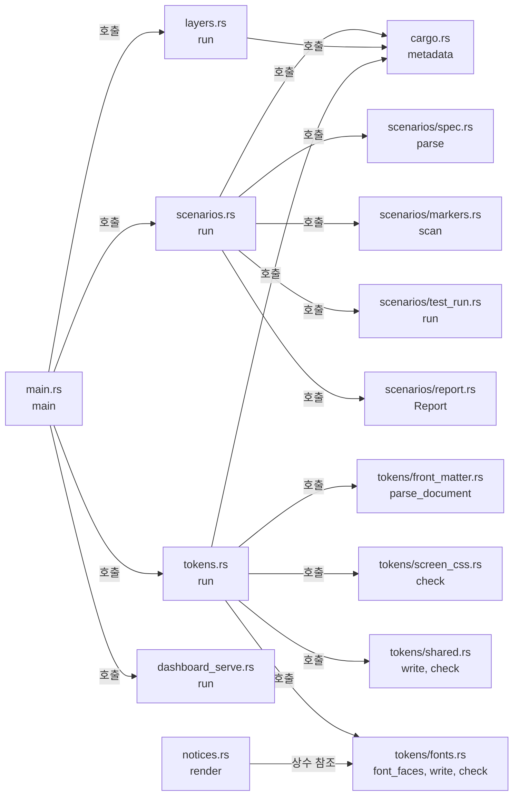

# xtask 개발 도구 모듈 설계

`xtask`는 개발 전용 crate다. `cargo xtask scenarios`는 스펙 수용 테스트 표, 테스트 코드의 시나리오 표식, `cargo test` 결과를 대조해 시나리오별 상태 보고서를 만든다. `cargo xtask layers`는 `cargo metadata`의 crate 의존을 코드 지도의 레이어 표와 대조한다. 이 두 명령은 Cargo가 주는 정보(`cargo metadata`, 테스트 빌드 JSON 메시지, 테스트 출력)만 읽고 제품 crate를 링크하지 않는다. `cargo xtask tokens`는 DESIGN.md 머리말에서 토큰 CSS를 만들고 저장된 파일과 대조한다. `cargo xtask dashboard-serve`는 `web/dashboard/`를 `127.0.0.1`에서 제공하는 로컬 미리보기 서버다.

작업 0.9의 결정에 따라 `cargo xtask tokens`와 `cargo xtask dashboard-serve`를 추가했다(사용자 결정 2026-10-22(Q32)·(Q34)). 두 명령은 작업 4.8에서 구현했다.

`cargo xtask notices [--check]`는 두 배포 대상의 일반·빌드 의존성 합집합과 라이선스 전문을 루트 `THIRD-PARTY-NOTICES.txt`에 만든다. 실행 파일에 넣는 대시보드 글꼴(Pretendard)의 라이선스 전문도 같은 파일에 넣는다. `--check`는 저장된 파일과 다시 만든 내용을 대조한다. 허용 라이선스 판정은 계속 `cargo deny`가 맡는다. 절차와 OPS-021 부분 증거는 [라이선스 검사 how-to](../how-to/check-dependency-licenses.md)에 있다.

| 항목 | 값 |
| --- | --- |
| 구조 시점 | Current |
| 문서 상태 | Draft |
| 구현 대조 | Verified — [대조 기록](#대조-기록) |
| 코드 위치 | `xtask/` |
| 코드 지도 | [코드 지도 2절](code-map.md#2-코드-위치와-구성요소) |
| 관련 스펙 | 없음. 모든 스펙의 수용 테스트 표를 읽는다. |
| 관련 계약 | 없음 |
| 관련 ADR | 없음 |

## 1. 책임과 경계

- 맡는 책임:
  - 시나리오 ID 수집, 표식 해석, 테스트 결과 대조, 보고서 작성([테스트 컨벤션 7절](../conventions/testing.md#7-테스트와-스펙-시나리오-연결))
  - 작업 공간 crate 의존 검사([코드 지도 레이어 표](code-map.md#레이어와-의존-방향))
  - 배포 의존성 고지 생성과 대조. 외부 소스 구현은 읽거나 복사하지 않고 crate 메타데이터와 고지 파일만 읽는다.
- 맡지 않는 책임:
  - 라이선스 검사. [의존성 라이선스 검사](../how-to/check-dependency-licenses.md)의 `cargo deny`가 맡는다.
  - 모듈 안의 입출력 타입 금지. `crates/app/clippy.toml`과 `cargo clippy`가 맡는다.
  - 대시보드 테스트 결과 수집. 대시보드 브라우저 테스트는 Rust 통합 테스트라서 기존 스캐너가 읽는다(사용자 결정 2026-10-22(Q35)). 이 명령이 따로 모으지 않는다.
- 다른 모듈에 공개하는 기능: 없음. 명령행은 `cargo xtask scenarios [--require-all]`, `cargo xtask layers`, `cargo xtask tokens [--check]`(사용자 결정 2026-10-22(Q32)), `cargo xtask dashboard-serve [--port N]`(사용자 결정 2026-10-22(Q34), 기본 포트 8080), `cargo xtask notices [--check]`다. 별칭은 `.cargo/config.toml`의 `[alias] xtask`다.

## 2. 내부 구조

화살표는 실행 중 호출이다.

| 요소(파일·심볼) | 역할 | 만들어지는 시점과 소유자 | 의존 대상 |
| --- | --- | --- | --- |
| `xtask/src/main.rs` `main`, `Error` | 하위 명령 선택, 사용법 오류(종료 코드 2), 오류 출력 | 명령 실행마다 | `scenarios`, `layers`, `tokens`, `dashboard_serve` |
| `xtask/src/cargo.rs` `metadata`, `Workspace`, `command` | `cargo metadata --no-deps`를 읽어 패키지·대상·의존 목록을 만든다. 하위 Cargo 명령은 환경 변수 `CARGO`의 Cargo로 실행한다. | 명령마다 한 번 | serde_json |
| `xtask/src/scenarios.rs` `run`, `locate`, `link` | 보고 순서 조정, 표식 파일을 테스트 대상과 모듈 경로로 바꾸기, 시나리오별 테스트 연결 | `scenarios` 실행마다 | 하위 모듈, `cargo` |
| `xtask/src/scenarios/spec.rs` `parse` | `## ` 제목에 "수용 테스트"가 들어간 절의 표에서 첫 칸이 `<접두어>-<숫자>`인 행을 시나리오로 읽는다. | 스펙 파일마다 | 없음 |
| `xtask/src/scenarios/markers.rs` `scan`, `Marker` | 주석·문자열·문자 리터럴을 건너뛰는 작은 어휘 분석기로 `/// spec:` 표식, 테스트 속성, 인라인 `mod` 중첩, 함수 이름을 찾는다. 표식 끝의 ` partial`은 `Marker::partial`이 된다. 다른 낱말이 붙으면 표식 오류다. | `.rs` 파일마다 | `spec::is_scenario_id` |
| `xtask/src/scenarios/test_run.rs` `run` | 테스트 빌드 JSON에서 실행파일과 대상 소스 파일을 짝짓고, `cargo test` 출력에서 테스트별 결과를 읽는다. | `scenarios` 실행마다 | `cargo` |
| `xtask/src/scenarios/report.rs` `Report`, `Status` | 시나리오 상태 판정, 판정 사유, Markdown 보고서 작성 | `scenarios` 실행마다 | 없음 |
| `xtask/src/layers.rs` `RULES`, `APPROVED`, `check` | 패키지별 허용 내부 crate·외부 crate 규칙, 같은 외부 crate의 버전 요구 일치 검사 | `layers` 실행마다 | `cargo` |
| `xtask/src/tokens.rs` `run`, `tokens_from`, `render_css`, `write_outputs`, `check_outputs` | DESIGN.md 머리말의 `colors`·`spacing`·`rounded`·`typography`를 CSS 사용자 정의 속성 목록으로 바꾸고 `:root` 블록과 글꼴 `@font-face` 규칙을 만든다. `@font-face`의 `url()` 기준만 토큰 파일(`fonts`)과 목업(`../../../web/dashboard/fonts`)이 다르다. 기본 실행은 토큰 CSS 두 파일, 목업의 표식 사이 블록, 로그인 공통 복사본(`tokens/shared.rs`), 글꼴 복사본(`tokens/fonts.rs`)을 쓴다. `--check`는 같은 곳을 비교하고 화면 CSS 검사를 더한다. | 명령마다 | `tokens/front_matter.rs`, `tokens/screen_css.rs`, `tokens/shared.rs`, `tokens/fonts.rs`, `cargo.rs`의 `metadata` |
| `xtask/src/tokens/front_matter.rs` `parse_document`, `Value` | 머리말의 YAML 부분집합(들여쓰기 맵, 한 줄 스칼라)만 읽는다. 지원하지 않는 문법은 `DESIGN.md:줄번호:` 형식의 오류로 보고한다. | 명령마다 | 없음 |
| `xtask/src/tokens/screen_css.rs` `check` | 토큰 CSS 파일을 뺀 `web/dashboard/` 아래 `.css`에서 `#` 색, `rgb(`·`hsl(`·`url(`·`@import`, `@media` 밖의 `px`·`em`·`rem`, `font-weight` 값, 정의되지 않은 `var(--…)`를 찾는다. | `--check` 실행마다 | 없음 |
| `xtask/src/tokens/shared.rs` `SHARED_FILES`, `write`, `check` | `SHARED_FILES` 목록 8개(`app/components/`·`app/styles/` 파일 7개와 `app/language.js`)를 `login/`의 같은 상대 경로에 쓴다. 파일 첫 줄에 원본 경로를 밝히는 머리말을 붙인다. `--check`는 복사본을 원본과 비교하고, 복사 디렉터리에 목록에 없는 파일이 있으면 알린다. | 명령마다 | `tokens.rs`의 `first_difference`·`read_text`, `cargo.rs`의 `display_path` |
| `xtask/src/tokens/fonts.rs` `FONT_FACES`, `font_faces`, `write`, `check`, `LICENSE_PATH`, `NOTICE_TITLE` | 글꼴 원본 `web/dashboard/fonts/`의 woff2 두 개(400·700)를 `app/fonts/`와 `login/fonts/`에 바이트 그대로 쓴다. 머리말은 붙이지 않는다. `@font-face` 규칙 문자열을 만든다. `--check`는 복사본 바이트를 원본과 비교하고, 두 `fonts/`에 목록에 없는 파일이 있으면 알린다. | 명령마다 | `cargo.rs`의 `display_path` |
| `xtask/src/dashboard_serve.rs` `run`, `serve`, `resolve`, `respond`, `content_type` | `127.0.0.1:포트`에 HTTP/1.1 정적 서버를 연다. `/`는 `/preview/index.html`로 302 보낸다. 모든 응답에 CSP(`default-src 'self'; frame-ancestors 'none'`)와 `X-Content-Type-Options: nosniff`, `Cache-Control: no-store`, `Referrer-Policy: no-referrer`를 붙인다. 정규화한 경로가 `web/dashboard/` 밖이면 404다. 확장자 `.html`·`.css`·`.js`·`.svg`·`.woff2`만 제공한다. | 명령마다, 프로세스를 끝낼 때까지 | `std::net`만 쓴다. |
| `xtask/src/notices.rs` `run`, `render`, `tree_packages`, `collect_texts` | 두 대상의 `cargo tree --edges normal,build` 합집합을 `cargo metadata`의 이름·버전·라이선스·패키지 경로와 연결한다. 고지 파일을 재귀 수집하고 정렬해 저장하거나 대조한다. crate 고지 뒤에 `tokens/fonts.rs`의 `LICENSE_PATH` 전문을 붙인다. | 명령마다 | std, serde_json, `cargo::command`·`cargo::display_path`, `tokens/fonts.rs`의 상수 |

## 3. 데이터 모델

| 이름 | 필드·형태 | 저장 위치 | 제약과 항상 지켜야 할 조건 |
| --- | --- | --- | --- |
| `TestKey` | (테스트 대상 루트 소스 파일 경로, 대상 안 테스트 경로 `a::b::fn`) | 메모리 | 표식 쪽 키와 `cargo test` 출력 쪽 키가 같은 규칙으로 만들어진다. |
| `Outcome` | `Passed`, `Failed`, `Ignored` | 메모리 | `cargo test` 출력 한 줄에서 하나 |
| `TestEntry` | 파일, 테스트 경로, `Outcome`(없으면 이번 실행에 없음), `partial` | 메모리 | `partial`은 그 테스트를 시나리오에 연결한 표식의 값이다. 한 테스트가 시나리오마다 다른 값을 가질 수 있다. |
| `Status` | `Passed`(통과), `Partial`(부분), `Failed`(실패), `NotRun`(미실행), `Unlinked`(미연결) | 메모리 | 이 순서로 판정한다. 실패가 하나라도 있으면 실패, ` partial`이 없는 통과가 있으면 통과, 통과가 모두 ` partial`이면 부분, 테스트는 있으나 실행 결과가 없거나 무시되면 미실행, 테스트가 없으면 미연결 |
| `Problem` | 위치(`파일:줄`), 내용 | 메모리 | 보고서의 `오류`. 1건이라도 있으면 판정은 실패다. |
| `Token` | `name`(`--color-…`처럼 CSS 사용자 정의 속성 이름), `value`(DESIGN.md 원문 값) | 메모리 | 머리말 순서를 따른다. 허용하지 않는 키는 오류다. |
| 보고서 | Markdown | `<Cargo 대상 디렉터리>/scenario-report.md` | 저장소에 넣지 않는다. 실행마다 덮어쓴다. |

## 4. 처리 순서

대표 흐름은 `cargo xtask scenarios`다.

| 순서 | 코드 위치(파일·심볼) | 조건·계산 | 바뀌는 상태 | 결과를 쓰는 곳 |
| --- | --- | --- | --- | --- |
| 1 | `xtask/src/cargo.rs` `metadata` | `cargo metadata --format-version 1 --no-deps` | 작업 공간 루트, 대상 디렉터리, 패키지 목록 | 2~4단계 |
| 2 | `xtask/src/scenarios.rs` `load_specs`, `spec::parse` | `docs/specs/` 아래 `.md` 중 `README.md`·`AGENTS.md`를 뺀 파일. 수용 테스트 절이 없거나, 시나리오가 없거나, ID가 중복되면 오류 | 스펙별 시나리오 ID 목록 | 5단계 |
| 3 | `xtask/src/scenarios.rs` `collect_marked_tests`, `markers::scan`, `locate` | `xtask`를 뺀 패키지의 `src/`·`tests/` 아래 `.rs` 파일. 파일 위치로 테스트 대상과 모듈 경로를 정한다. `foo/mod.rs`는 `foo`다. | 표식이 붙은 테스트와 `TestKey`, 표식 오류 | 5단계 |
| 4 | `xtask/src/scenarios/test_run.rs` `build`, `run` | `cargo test --workspace --no-run --message-format=json-render-diagnostics`로 실행파일 이름을 대상 소스 파일에 짝짓는다. 이어 `cargo test --workspace --no-fail-fast`를 실행하고 표준 출력과 표준 오류를 한 파이프로 읽는다. `Running ... (<실행파일>)` 줄이 다음 테스트 결과의 대상을 정한다. 문서 테스트는 건너뛴다. | `TestKey`별 `Outcome`, `cargo test` 종료 상태 | 5단계. 출력은 표준 오류에 그대로 보인다. |
| 5 | `xtask/src/scenarios.rs` `link` | 표식의 스펙 경로와 ID가 2단계 목록에 없으면 오류 | 시나리오별 테스트와 `Status` | 6단계 |
| 6 | `xtask/src/scenarios/report.rs` `Report::render`, `verdict_text` | 판정 실패 사유: 오류, 실패 시나리오, `cargo test` 실패, `--require-all`이면 부분·미실행·미연결 | 보고서 파일 | 표준 출력에 요약·보고서 경로·판정, 종료 코드 0(통과) 또는 1(실패) |

`cargo xtask layers`는 1단계 다음에 `layers::check`를 실행한다. 패키지마다 `RULES`의 허용 내부 crate와 외부 crate 규칙을 적용하고, 같은 외부 crate의 버전 요구가 패키지마다 다르면 위반으로 본다. `RULES`에 없는 패키지도 위반이다.

`cargo xtask tokens`와 `cargo xtask tokens --check`는 앞부분이 같다. `cargo metadata`로 루트를 찾고, DESIGN.md 머리말을 `parse_document`로 읽어 `tokens_from`으로 토큰 목록을 만든다(`version`·`name`·`description`·`components`는 뺀다). `render_css`가 `:root` 블록을 만든다. 기본 실행(`write_outputs`)은 토큰 CSS 두 파일과 목업의 `DESIGN-TOKENS:START`·`END` 표식 사이 블록을 쓴다. `shared::write`가 로그인 공통 복사본도 함께 쓴다. `--check`(`check_outputs`)는 같은 곳을 비교하고 화면 CSS 검사를 더한다. 복사본은 `shared::check`가 원본과 비교하고, 복사 디렉터리에서 목록에 없는 파일을 찾는다. 차이는 한 건씩 출력하고 `tokens --check: 실패 (N건)`, 종료 코드 1이다. 차이가 없으면 `통과`, 종료 코드 0이다.

`cargo xtask dashboard-serve`는 `web/dashboard/`를 정하고 `127.0.0.1:포트`에 연결한 뒤 연결마다 `serve`를 실행한다. 요청 머리는 8KiB까지 읽고(`MAX_HEAD`), 읽기와 쓰기 제한 시간은 5초(`IO_TIMEOUT`)다.

`cargo xtask notices`는 Cargo 메타데이터에서 루트를 찾는다. Windows·Linux 대상의 메타데이터와 일반·빌드 의존성 트리를 오프라인으로 각각 읽는다. 타깃 필터는 호스트 빌드 의존성을 빠뜨릴 수 있으므로 두 메타데이터를 먼저 합친다. 트리 합집합과 메타데이터의 빌드 의존성 하위 그래프에 있는 외부 crate를 고른다. 이 추가 합집합은 호스트별 빌드 간선 차이를 보수적으로 포함해 두 OS에서 같은 고지를 만든다. `collect_texts`는 패키지 안의 `LICENSE*`·`LICENCE*`·`COPYING*`·`NOTICE*`·`UNLICENSE*`·`COPYRIGHT*` 파일과 명시된 `license_file`을 모은다. crate·상대 경로 순으로 전문을 넣고 마지막에 Cargo.lock 입력 전체를 넣는다. 줄 끝만 LF로 통일한다. `--check`는 이 결과 전체가 같을 때만 통과한다. 경로·시각·대상 디렉터리는 산출물에 넣지 않는다.

고지 파일이 없거나 crate를 메타데이터에 연결하지 못하면 종료 코드 1로 중단한다. 읽기·쓰기 오류와 패키지 안 심볼릭 링크도 오류다. `--check`는 저장소를 바꾸지 않는다. 생성 도중 실패하면 기존 고지 파일을 덮어쓰지 않는다. 마지막 파일 쓰기 자체의 오류는 파일을 일부 바꿀 수 있으므로 다시 생성한다.

## 5. 상태와 초기화

- 초기화·로딩 시점: 명령 실행마다 처음부터 읽는다. 캐시는 없다.
- 상태 소유자와 제거 시점: 모든 상태는 명령 실행 동안 메모리에만 있다. 보고서 파일만 남는다.
- 동시 실행과 순서: 같은 대상 디렉터리에서 두 번 동시에 실행하면 Cargo 빌드 잠금을 기다리고 보고서는 나중에 끝난 실행이 덮어쓴다.

## 6. 오류 처리

| 실패 지점 | 처리 방법 | 남는 상태 | 관련 스펙 시나리오 |
| --- | --- | --- | --- |
| `xtask/src/cargo.rs` `metadata` | `cargo metadata` 실패나 JSON 해석 실패면 중단, 종료 코드 1 | 없음 | 없음 |
| `xtask/src/scenarios/test_run.rs` `build` | 테스트 빌드 실패면 중단, 종료 코드 1. 컴파일 오류는 표준 오류에 보인다. | 이전 보고서 그대로 | 없음 |
| `xtask/src/scenarios/markers.rs` `scan` | 형식이 틀린 표식, 테스트 함수에 붙지 않은 표식은 `오류`로 기록하고 계속 | 보고서에 오류 행 | 없음 |
| `xtask/src/scenarios.rs` `locate` | 파일이 속한 테스트 대상을 정할 수 없으면(예: `tests/common/mod.rs`) `오류`로 기록하고 계속 | 보고서에 오류 행 | 없음 |
| `xtask/src/scenarios/test_run.rs` `run` | 표식이 붙은 테스트가 출력에 없으면(예: 이 OS에서 `#[cfg]`로 빠짐) 그 테스트를 `미실행(이번 실행에 없음)`으로 표시 | 보고서에 미실행 | 없음 |
| `xtask/src/tokens.rs` `tokens_from` | DESIGN.md 머리말 파싱 실패, 허용하지 않는 키, `typography` 항목의 필수 키 빠짐이면 중단, 오류 출력 후 종료 코드 1 | 없음 | 없음 |
| `xtask/src/tokens.rs` `write_outputs` | 쓰기 실패면 중단, 종료 코드 1. 앞서 쓴 파일은 그대로 남는다. | 일부 파일만 갱신 | 없음 |
| `xtask/src/tokens.rs` `check_outputs` | 비교할 파일을 읽지 못하면 중단, 종료 코드 1. 차이는 모두 출력하고 `실패 (N건)`으로 끝낸다. | 없음 | 없음 |
| `xtask/src/tokens/shared.rs` `write`, `check` | 원본이나 복사본을 읽지 못하거나 복사본을 쓸 수 없으면 중단, 종료 코드 1. 오류 메시지에 파일 경로가 붙는다. `check`는 그 자리에서 멈추므로 뒤의 복사본과 목록에 없는 파일은 보고하지 않는다. | `write`는 앞서 쓴 복사본이 남는다. `check`는 없음 | 없음 |
| `xtask/src/tokens/fonts.rs` `write`, `check` | 원본이나 복사본을 읽지 못하거나 복사본을 쓸 수 없으면 중단, 종료 코드 1. 오류 메시지에 파일 경로가 붙는다. | `write`는 앞서 쓴 복사본이 남는다. `check`는 없음 | 없음 |
| `xtask/src/dashboard_serve.rs` `run` | `127.0.0.1:포트` 연결 실패면 중단, 종료 코드 1. 형식이 틀린 요청은 400, 없는 파일은 404로 답하고 서버는 계속 돈다. | 없음 | 없음 |

## 7. 설계 선택

| 선택 | 이유 | 검토한 다른 방법 | 근거 |
| --- | --- | --- | --- |
| 시나리오 보고를 Rust `xtask`로 구현 | 두 OS에서 Rust 도구만으로 실행한다. 별도 스크립트 언어를 설치하지 않는다. | Python·셸 스크립트. 두 OS 실행 환경이 갈린다. | 사용자 결정(2026-10-20) |
| 표식을 직접 어휘 분석 | 외부 파서 crate 없이 주석·문자열 안의 중괄호를 구분하면 충분하다. 승인 목록 밖 crate(`syn`)를 직접 쓰지 않는다. | `syn`으로 구문 분석. PRD 승인 목록에 없다. | [PRD "구현 기술" 행](../requirements/PRD.md#확정-기준) |
| 실행파일 이름으로 테스트 대상 식별 | `cargo test` 출력의 `Running` 줄은 패키지 기준 상대 경로만 보여 같은 이름의 테스트 파일을 구분하지 못한다. 실행파일 이름에는 해시가 붙어 유일하다. | 패키지마다 `cargo test -p` 실행. 빌드가 반복되고 기능 통합이 달라진다. | 이 문서 4절 4단계 |
| 안정판 테스트 출력 형식만 사용 | libtest JSON 출력은 불안정 옵션(`-Z unstable-options`)이다. | `--format json`. 안정판에서 쓸 수 없다. | 고정 도구 모음 Rust 1.99.1 |
| `layers`의 승인 crate 목록을 코드 상수로 유지 | PRD 표는 사람이 읽는 문장이라 기계적으로 읽기 어렵다. 목록을 바꿀 때 PRD 행과 같은 변경에서 고친다. | PRD 문장 해석. 문구가 바뀌면 깨진다. | `xtask/src/layers.rs` `APPROVED` 주석 |
| 일부만 확인하는 테스트를 ` partial` 표식과 `부분` 상태로 구분 | 시스템 동작보다 먼저 만든 계약 테스트가 시나리오의 일부만 확인해도 보고서가 시나리오 전체를 `통과`로 보이지 않게 한다. | 부분 테스트에 표식을 달지 않기. 문서 규칙상 연결해야 할 테스트가 보고서에서 빠진다. 표식은 그대로 두고 `통과`로 읽기. 완료 여부를 오해한다. | 사용자 결정(2026-10-20) |
| 대시보드 브라우저 테스트를 Rust 통합 테스트로 두고 기존 스캐너가 읽는다 | 테스트 결과를 별도 경로로 합치지 않아 보고 도구의 판정 규칙과 표식 문법을 바꾸지 않는다. Chromium을 실행하고 판정하는 일은 테스트 안에서 한다. | 별도 결과 파일을 `xtask`가 합치는 방법. 보고서가 두 곳으로 나뉜다. | 사용자 결정 2026-10-22(Q35) |
| 토큰 머리말은 xtask 안의 YAML 부분집합 파서로 읽는다 | 승인 목록 밖 crate를 쓰지 않는다. DESIGN.md가 쓰는 문법(들여쓰기 맵, 한 줄 스칼라)만 읽으면 된다. | YAML crate(예: `serde_yaml`). `layers.rs` `APPROVED`와 PRD 승인 행을 함께 바꿔야 한다. | [PRD "구현 기술" 행](../requirements/PRD.md#확정-기준). 승인 없이 부분집합 파서를 택했다(작업 4.8 지시). 승인이 필요하면 이 행을 바꾼다. |
| 미리보기 서버는 `std::net`만 쓴다 | `127.0.0.1` 전용 정적 파일 제공에 HTTP crate가 필요 없다. | `tiny_http`·`axum`. 승인 목록 밖이다. | 사용자 결정 2026-10-22(Q34): 로컬 전용, 바이너리에 넣지 않는다. |
| 목업 토큰 블록도 `tokens`가 쓰고 `--check`가 비교한다 | 토큰 값이 목업과 어긋나는 것을 같은 명령에서 잡는다. | 목업 블록을 손으로 맞춘다. 어긋남을 놓칠 수 있다. | 사용자 결정 2026-10-22(Q32). |
| 로그인 화면의 공통 컴포넌트와 스타일은 복사본으로 둔다 | `login/`은 세션 없이 받으므로 `/app/` 파일을 참조할 수 없다. 복사본은 `tokens`가 쓰고 `--check`가 원본과 비교한다. | `login/`이 `app/` 파일을 직접 가리킨다. 세션 없는 로그인 화면이 `/app/` 파일을 받지 못한다. 마크업과 스타일을 손으로 복제한다. | 구현 판단(사용자 결정 없음). 리뷰어 지시에 따른다. |
| 글꼴 원본은 제공하지 않는 `web/dashboard/fonts/`에 두고, `tokens`가 `app/fonts/`·`login/fonts/`에 바이트 그대로 복사한다 | `app/`과 `login/`은 파일을 공유하지 않는다. 원본 폴더에 둔 `LICENSE.txt`는 제공 표 대조 범위(`login/`·`app/`) 밖이라 제공되지 않는다. `@font-face`는 생성 토큰 파일에 있어 화면 CSS의 `url(` 금지를 바꾸지 않는다. | `app/fonts/`를 원본으로 두고 로그인만 복사. `LICENSE.txt`가 제공 경로 아래에 놓이거나 원본 위치가 둘로 갈린다. 화면 CSS에 `@font-face` 작성. `url(` 금지에 예외가 생긴다. | **이 문서의 판단, 사용자 결정 없음**. 글꼴 내장은 사용자 결정 2026-11-07(Q139) |
| 고지 생성은 기존 xtask의 std·serde_json만 사용 | Rust만 준비된 두 OS에서 같은 절차를 쓴다. `Cargo.lock` 원문을 넣어 해시 crate 없이 입력 변화도 감지한다. | cargo-about·cargo-license 추가 설치, Python 스크립트, 고지 수동 편집. 도구·설치 경로가 늘거나 갱신 누락을 잡기 어렵다. | **이 문서의 판단, 사용자 결정 없음**. [OPS-021](../specs/operations.md#7-수용-테스트)의 고지 의무를 구현한다. |
| 루트 통합 시험이 오프라인 `notices --check`를 실행 | xtask 시험은 시나리오 스캐너에서 제외된다. 루트 `tests/dependency_notices.rs`의 OPS-021 `partial`만 연결한다. Cargo가 실행파일 위치를 정하므로 `CARGO_TARGET_DIR` 값에 의존하지 않는다. | xtask 시험에 표식 추가. 기존 스캐너가 읽지 않는다. | **이 문서의 판단, 사용자 결정 없음**. 프로젝트 MIT LICENSE가 없으므로 전체 표식은 쓰지 않는다. |

## 대조 기록

| 대조 범위 | 환경 | 확인 방법 | 결과 |
| --- | --- | --- | --- |
| 이 문서를 추가한 커밋의 `xtask/` | Ubuntu 24.04.4(WSL2), Rust 1.99.1 | 2·4절의 파일·심볼과 실제 코드를 대조했다. 단위 테스트 12건(`cargo test --workspace`)과 [테스트 컨벤션의 보고 도구 확인 기록](../conventions/testing.md#보고-도구-확인-기록)의 시험 실행으로 처리 순서를 확인했다. | 통과 |
| 부분 표식을 추가한 변경(기준 커밋 `4fb7acb` + `xtask/src/scenarios*` 수정) | 같음 | 2·3·4절의 `Marker`·`TestEntry`·`Status`와 실제 코드를 대조했다. 단위 테스트 12건과 [보고 도구 확인 기록](../conventions/testing.md#보고-도구-확인-기록)의 부분 표식 실행으로 판정을 확인했다. | 통과 |
| Windows 실행(기준 커밋 `e1cfc4f` + Windows 경고 수정) | Windows 11 Pro 10.0.26200, Rust 1.99.1(`x86_64-pc-windows-msvc`) | `cargo xtask layers`는 `레이어 검사: 통과 (패키지 5개)`였다. `cargo xtask scenarios`가 `target\scenario-report.md`를 만들었다. 보고서의 테스트 위치는 `/` 구분자(`tests/serve.rs`)로 나왔고, `#[cfg(unix)]`로 빠진 테스트는 `미실행(이번 실행에 없음)`으로 표시됐다. | 통과 |
| 토큰 CSS와 미리보기 명령(기준 커밋 `c96b948`~`75d7906`) | Windows 10.0.26200 | 2·4·6·7절의 파일·함수·오류 경로를 실제 코드와 대조했다. `cargo xtask tokens --check`는 `tokens --check: 통과`, 종료 코드 0이었다. DESIGN.md 6행(`colors`)의 `#f4f6f5`를 `#f4f6f6`으로 바꾸면 `tokens --check: 실패 (3건)`, 종료 코드 1이었고 되돌려 다시 통과했다. `cargo xtask dashboard-serve`로 띄운 미리보기를 6폭 × ko/en 12회 캡처해 콘솔 오류와 CSP 위반이 없었다. | 통과 |
| 배포 고지 생성·대조와 루트 부분 시험(2026-11-04 작업 트리) | WSL Ubuntu·Windows, Rust 1.99.1 | `cargo test --offline --locked --test code_map --test dependency_notices`, WSL `cargo test --offline --locked -p xtask`. [출처·라이선스 실행 기록](../how-to/check-dependency-licenses.md#43-실행-기록-2026-11-04) | 통과. 두 OS에서 코드 지도 4개·고지 대조 1개. WSL 도구 단위 시험 14개. 제품 MIT LICENSE는 별도 미완료다. |

## 8. 미결정 사항

이 문서 자체에 열린 항목은 없다. 대시보드 테스트 결과 수집은 사용자 결정 2026-10-22(Q35)로 정했다(1절과 7절). 대시보드 시나리오(DASH)는 브라우저 테스트 파일에 `/// spec:` 표식이 붙기 전까지 `미연결`이다. 브라우저 시험을 WSL에서 돌릴지는 [대시보드 컴포넌트 설계 8절](dashboard-components.md#8-미결정-사항)의 결정 요청이다.
