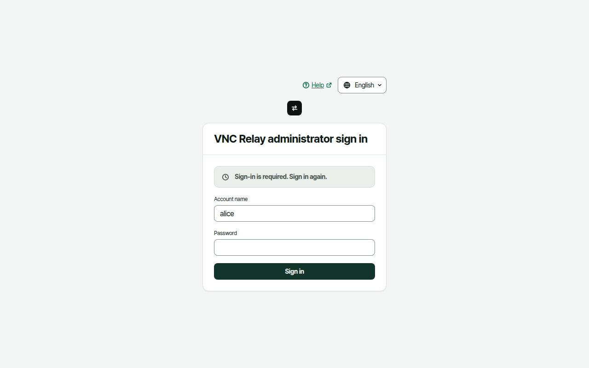
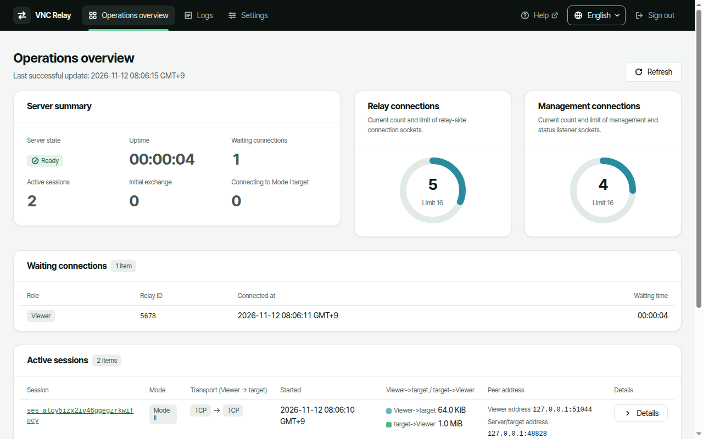
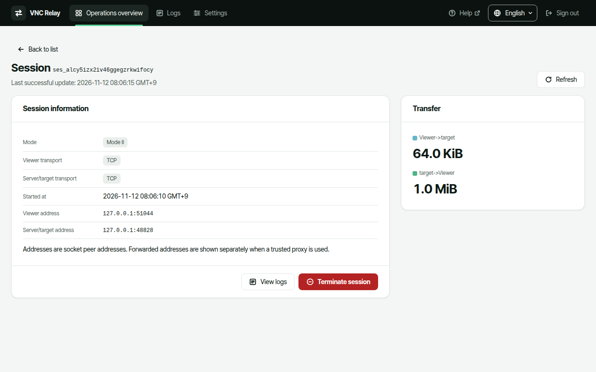
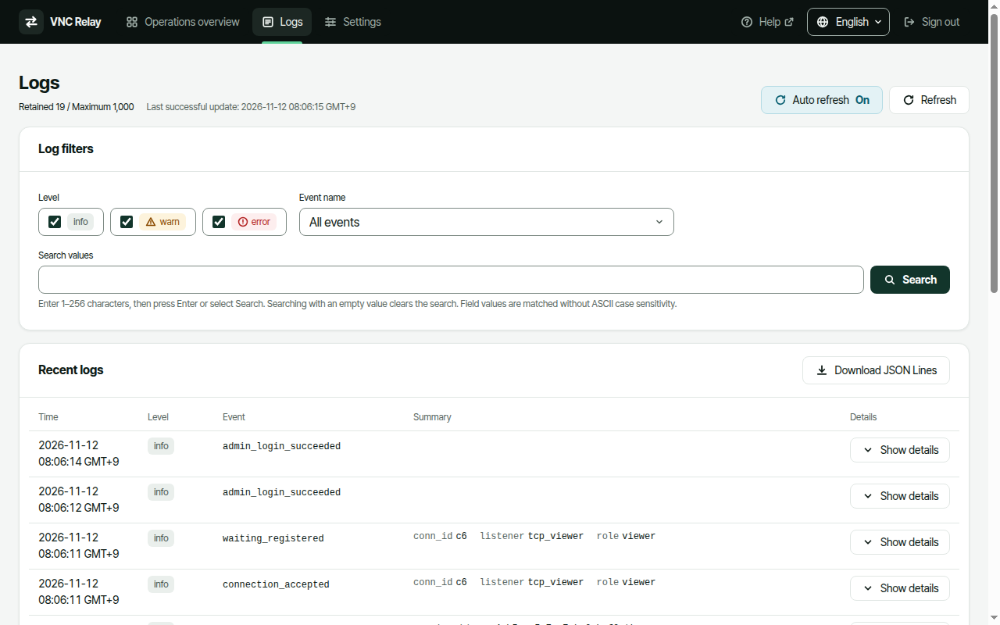
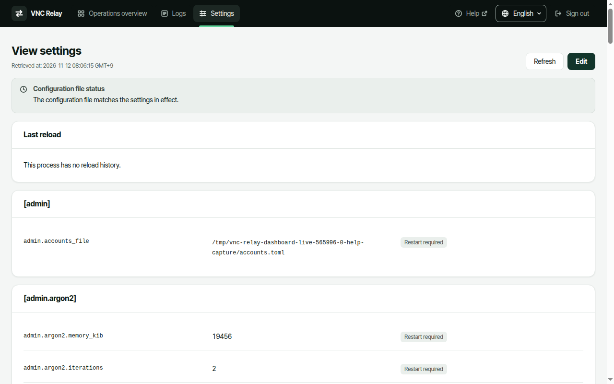
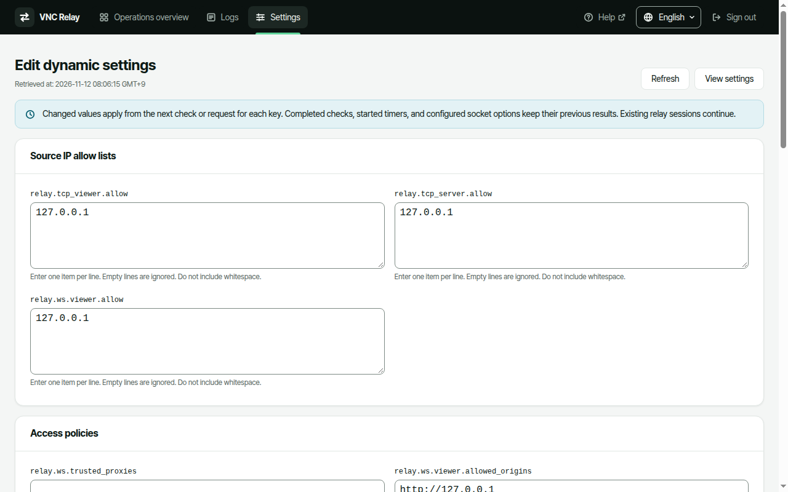

# Dashboard

Use the dashboard to inspect connections and active sessions, terminate a session, and edit dynamic settings. Use recent logs to investigate problems.

## Sign in

The dashboard is included in the executable. You do not need a separate web server. First prepare an administrator account and start the server as described in [Quick start](quick-start.md).

1. Open the management listener address in your browser. The example configuration uses `http://127.0.0.1:18080/`. For remote management, use your configured HTTPS address.
2. Enter your administrator account name in "Account name".
3. Enter its password in "Password".
4. Select "Sign in".

A successful sign-in opens "Operations overview". Authentication failure (HTTP 401) retains the account name and clears the password field. A missing account, an incorrect password, and a login limit produce the same failure message. A server error or missing response instead shows "The sign-in request could not be processed. Try again later." Add accounts and change passwords through the local CLI, not through the web interface. See [Operations](operate.md).

> **Warning:** Remote management must use built-in HTTPS. Plain HTTP is allowed only when the management listener binds to a loopback address. Do not disable certificate verification.

## Operations overview

Check "Server state" and "Uptime" in "Server summary". "Ready" means that the server is ready. "Shutting down (grace period)" means that the server is waiting for active sessions to finish after a graceful shutdown request.

- "Waiting connections" counts connections waiting for a Mode II peer.
- "Active sessions" counts connection pairs. Sessions being cleaned up remain in this count until cleanup finishes.
- "Initial exchange" and "Connecting to Mode I target" are counted separately from waiting connections.
- "Relay connections" shows the current number and limit of relay-side sockets. It is not the session count.
- "Management connections" shows the current number and limit of management and status listener sockets. This count is independent of relay connections.

"Waiting connections" lists the role, relay ID, connection time, and waiting time. Waiting connections have no details or termination action. "Active sessions" lists the mode, both transports, start time, directional transfer counts, and peer addresses. Select "Details" to open a session.

"Recently closed sessions" shows the close reason and final transfer counts of active sessions after cleanup. Find waiting timeouts in logs instead. Recently closed sessions are retained only in memory. Older entries are removed when the limit is exceeded, and restarting clears the list. Closed sessions have no historical details page.

Times use the browser's local time and show the time zone. Transfer counts use KiB/MiB. These counts measure bytes successfully written to the peer transport. They do not prove that the peer application read the data or displayed the screen.

### Polling and failed queries

Operations overview and session details poll at the `dashboard.poll_secs` interval. The default is 2 seconds. Select "Refresh" to check immediately. The dashboard does not overlap identical queries.

If a query fails, the screen retains the previous successful data and its last successful update time. Do not treat "Stale data" as current data. "Unavailable" does not mean zero. A failed list query is not shown as an empty list.

## Session details and termination

Inspect the session ID, mode, both transports, start time, and directional transfer counts. Peer addresses are actual socket addresses. Forwarded addresses appear separately when a trusted proxy is used. A session ID is not a relay ID.

Termination by administrator stops the relay for that connection pair. A closed session does not resume.

1. Select "Details" for the intended session in "Active sessions".
2. Confirm the target using its session ID and both addresses.
3. Select "Terminate session".
4. Check the target and impact in "Confirm session termination".
5. Select "Confirm termination" to proceed. Select "Cancel" to send no request.

The server responds after resource cleanup finishes. The session can remain in the active count while the request is pending. If the session has already ended, the screen shows "The current session was not found". It does not terminate another session that reconnected with the same relay ID.

If no response arrives, do not assume success. Select "Check status again" first. The dashboard does not resend termination requests automatically. Select "Back to list" to return to the overview.

## Recent logs

Select "Logs" in the top bar to inspect recent operations log events retained in memory. Select "View logs" in session details to open logs with that session's filter.

1. Select the required levels under "Level". At least one level must remain selected.
2. Select an "Event name". Select "All events" to include all names.
3. Enter a value in "Search values".
4. Press Enter or select "Search".

Search values must contain 1–256 characters. Search matches field values without ASCII case sensitivity. Search with an empty value to clear the search condition. Different filters apply together. "Clear filter" removes the session filter.

"Auto refresh" starts "On". It reads new events at the polling interval. Change it to "Off" to pause polling. "Refresh", filters, and download remain available. Select "Show details" to expand all event fields. Select "Load older logs" when more retained results are available.

"Download JSON Lines" collects all retained results using the filters set when download starts. It includes pages not yet loaded on screen. Events added after the first page are excluded. Older events can be removed during collection, so a complete history is not guaranteed. The file contains one JSON object per event line. A failed download does not save a partial file.

> **Note:** Recent logs do not replace long-term retention or audit logs. Restarting clears the list, and the retention limit removes older events. If a session start event has been removed, the session filter can miss some connection events. Seeing an event on screen does not prove that writing it to the log file succeeded.

## View settings

Select "Settings" to open "View settings". All signed-in administrators can view settings even when editing is disabled.

The table shows **values currently in effect**, including defaults. It does not show unapplied file values as current values. Certificate, private key, and access ticket public key files appear as paths only. Their contents are not shown.

Check "Configuration file status" for differences between the file and values in effect. Check "Last reload" for its result and changed keys. These are separate facts. Settings screens do not poll automatically. Select "Refresh" to read the current status again.

- `in_effect`: The file matches the values in effect.
- `pending`: The file contains unapplied reloadable changes. Wait for the reload result, then query again.
- `restart_required`: The file contains changes that need a restart. Revert those values with an external editor or restart the server.
- `invalid`: File validation failed. Correct the file with an external editor using the diagnostics.
- `unreadable`: The file cannot be read or is not UTF-8. Restore file access or encoding.

Errors leave the previous values in effect. There is no action to force a reload from the settings screen.

## Edit dynamic settings

The default `management.config_edit = false` permits viewing only. To enable editing:

1. Keep a backup of the configuration file in a protected location.
2. Use an external editor to set `config_edit` to `true` in the existing `[management]` table. Add `config_edit = true` if the key is absent. Do not duplicate the table.
3. Shut down the server gracefully and start it again.
4. Sign in to the dashboard again.
5. Select "Settings", then "Edit".

"Edit dynamic settings" provides source IP allow lists, Origin and trusted proxy policies, Mode I target policies, connection limits, timeouts, and keepalive settings. Related policy fields appear only when the corresponding entry point, role, listener, or Mode I is enabled. "Access tickets" provides `enabled`, `issuer`, `relay_host`, and `max_lifetime_secs` for each role. These fields appear when that role is enabled in WS or WSS, even if access ticket checks themselves are off.

You cannot edit restart-required keys such as listener addresses or relay role and mode switches. TLS file paths and access ticket public key file paths are also not editable. See the full editable scope and application timing in [Configuration contract §1.8](https://github.com/kayden-kim/vnc-relay/blob/main/docs/contracts/config-v4.md).

1. Change the required fields. Enter one list item per line without whitespace.
2. Select "Review changes".
3. Check previous and new values, added and removed list items, and warnings in "Confirm settings changes".
4. Select "Apply" to save.
5. Check the values in effect, file status, and last reload result in "View settings".

Saved values remain in the same configuration file after a restart. Changed values apply from the next check or request for each key. Completed checks, started timers, and configured socket options retain their previous results. Existing relay sessions continue.

> **Warning:** Do not save through an external editor and the dashboard at the same time. Agree on a save order with other administrators. Even comment or whitespace changes can cause a conflict.

After a conflict, select "Reload settings" and edit the latest configuration again. This discards your current input. Resolve restart-required differences, validation failures, and read failures externally first. For write failures, check file and directory permissions for the OS account running the server.

If the apply response is missing, do not assume success or failure. Check the current values in "View settings" first. The dashboard does not resend apply requests automatically. See [Troubleshooting](troubleshooting.md) for recovery details.

## Language, sign-out, and management session expiry

Choose "한국어" or "English" under "언어 (Language)" on the sign-in screen or top bar. Screen text changes immediately. Your choice is stored in the browser and survives sign-in and sign-out. If browser storage is unavailable, it lasts only for the current page view.

Without a saved choice, the dashboard uses the first Korean or English entry in the browser's preferred languages. If neither appears, it uses English. The server does not store the language setting.

Select "Sign out" when management work is finished. After the server invalidates the management session, the dashboard clears protected data and opens sign-in. If sign-out cannot be confirmed, it reports an unconfirmed result instead of success.

A management session has an idle expiry and an absolute maximum lifetime. Defaults are 30 minutes and 12 hours. Only user-action requests extend idle expiry. Automatic polling does not. The absolute maximum lifetime requires a new sign-in even if you remain active. Restarting the server also invalidates every management session.

Sign-out and management session expiry do not end active VNC relay sessions. See [Configuration](configure.md) for lifetime settings. See the [Management specification](https://github.com/kayden-kim/vnc-relay/blob/main/docs/specs/management.md) and [Dashboard specification](https://github.com/kayden-kim/vnc-relay/blob/main/docs/specs/dashboard.md) for detailed behavior.
