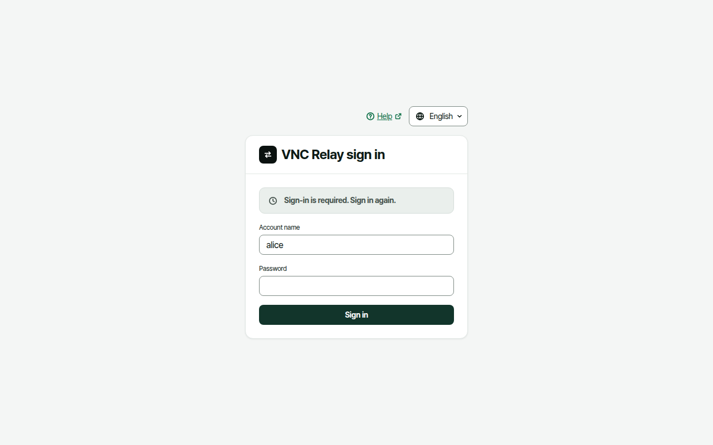
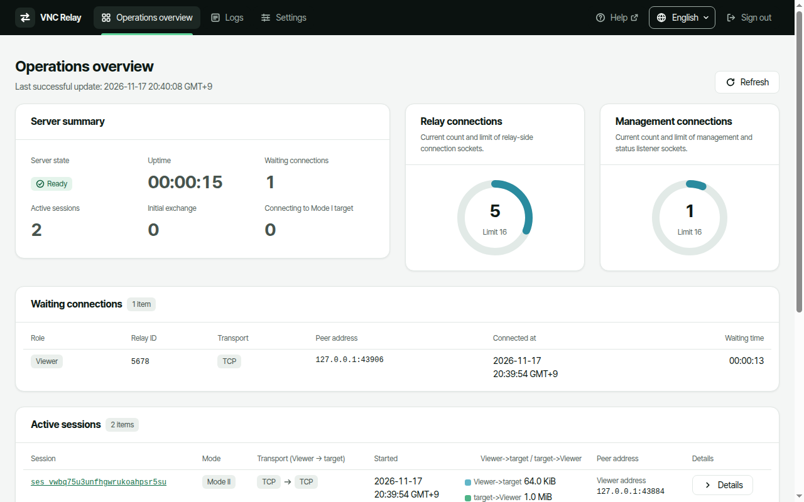
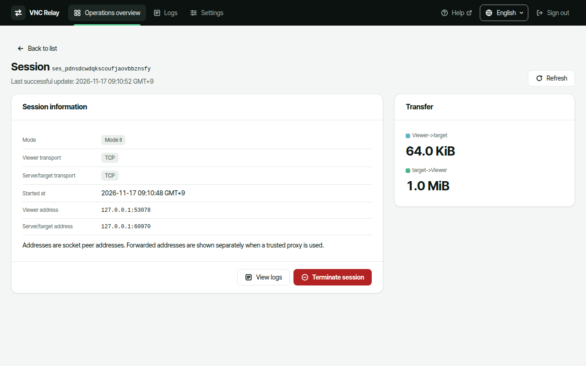
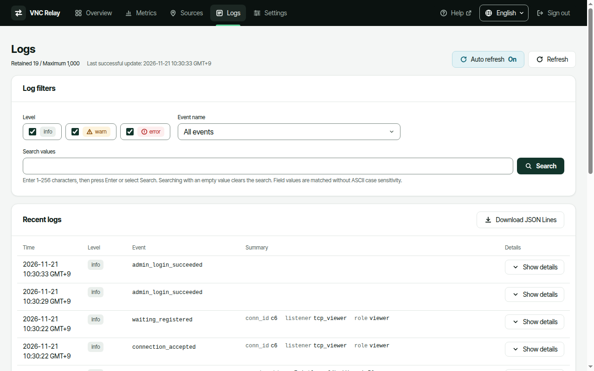
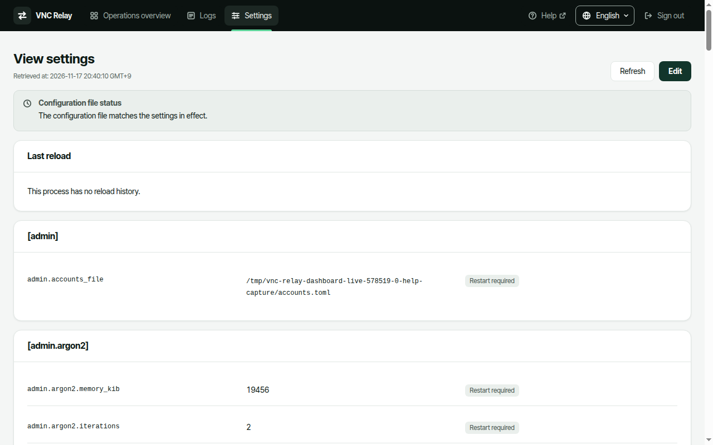
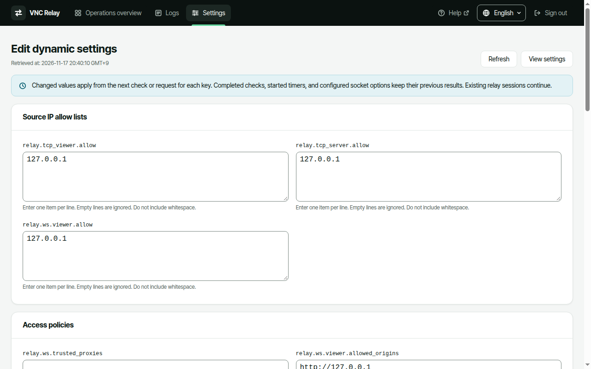

# Dashboard

Use the dashboard to inspect connections, active sessions, metrics, and connection sources, terminate a session, and edit dynamic settings. Use recent logs to investigate problems. The top navigation order is "Overview" · "Metrics" · "Sources" · "Logs" · "Settings". "Overview" opens the "Operations overview" screen.

## Sign in

The dashboard is included in the executable. You do not need a separate web server. First prepare an administrator account and start the server as described in [Quick start](quick-start.md).

1. Open the management listener address in your browser. The example configuration uses `http://127.0.0.1:18080/`. For remote management, use your configured HTTPS address.
2. Enter your administrator account name in "Account name".
3. Enter its password in "Password".
4. Select "Sign in".

A successful sign-in opens "Operations overview". Authentication failure (HTTP 401) retains the account name and clears the password field. A missing account, an incorrect password, and a login limit produce the same failure message. A server error or missing response instead shows "The sign-in request could not be processed. Try again later." Add accounts and change passwords through the local CLI, not through the web interface. See [Operations](operate.md).

> **Warning:** Remote management must use built-in HTTPS. Plain HTTP is allowed only when the management listener binds to a loopback address. Do not disable certificate verification.

## Operations overview

Check "Server state" and "Uptime" in "Server summary". "Ready" means that the server is ready. "Shutting down (grace period)" means that the server is waiting for active sessions to finish after a graceful shutdown request.

- "Waiting connections" counts connections waiting for a Mode II peer.
- "Active sessions" counts connection pairs. Sessions being cleaned up remain in this count until cleanup finishes.
- "Initial exchange" and "Connecting to Mode I target" are counted separately from waiting connections.
- "Relay connections" shows the current number and limit of relay-side sockets. It is not the session count.
- "Management connections" shows the current number and limit of management and status listener sockets. This count is independent of relay connections.

"Waiting connections" lists the role, relay ID, transport, peer address, connection time, and waiting time. The peer address is the actual socket address. A forwarded address from a trusted proxy is shown separately. Waiting connections have no details or termination action. "Active sessions" lists the mode, both transports, start time, directional transfer counts, and peer addresses. Select "Details" to open a session.

Connection times in waiting connections and start times in active sessions show the date and time on two lines. Address labels of active sessions sit above their values.

"Recently closed sessions" shows the close reason, mode, both transports, start and close times, duration, final transfer counts, and peer addresses of active sessions after cleanup. The server measures the duration independently of system clock changes, so it can differ from the difference between the start and close times. Select "View logs" to open recent logs with that session's filter. Find waiting timeouts in logs instead. Recently closed sessions are retained only in memory. Older entries are removed when the limit is exceeded, and restarting clears the list. Closed sessions have no historical details page.

Times use the browser's local time and show the time zone. Transfer counts use KiB/MiB. These counts measure bytes successfully written to the peer transport. They do not prove that the peer application read the data or displayed the screen.

### Polling and failed queries

Operations overview and session details poll at the `dashboard.poll_secs` interval. The default is 2 seconds. Select "Refresh" to check immediately. The dashboard does not overlap identical queries.

When an automatic refresh finishes within 1 second, the `Updating` and `Loading` badges and the refresh button text do not change. If it is still running after 1 second, `Updating` appears.

If a query fails, the screen retains the previous successful data and its last successful update time. Do not treat "Stale data" as current data. "Unavailable" does not mean zero. A failed list query is not shown as an empty list.

## Session details and termination

Inspect the session ID, mode, both transports, start time, and directional transfer counts. Peer addresses are actual socket addresses. Forwarded addresses appear separately when a trusted proxy is used. A session ID is not a relay ID.

Termination by administrator stops the relay for that connection pair. A closed session does not resume.

1. Select "Details" for the intended session in "Active sessions".
2. Confirm the target using its session ID and both addresses.
3. Select "Terminate session".
4. Check the target and impact in "Confirm session termination".
5. Select "Confirm termination" to proceed. Select "Cancel" to send no request.

The server responds after resource cleanup finishes. The session can remain in the active count while the request is pending. If the session has already ended, the screen shows "The current session was not found". It does not terminate another session that reconnected with the same relay ID.

If no response arrives, do not assume success. Select "Check status again" first. The dashboard does not resend termination requests automatically. Select "Back to list" to return to the overview.

## Metrics

Select "Metrics" in the top bar to open `/#/metrics`. Signed-in administrators can use this screen even when `metrics.enabled` is off. For external collection, see [Collect metrics](operate.md#collect-metrics).

- "Key indicators" contains eight cards: "Active sessions", "Waiting connections", "Relay connections", "Management connections", "Throughput", "Rejected connections (since start)", "CPU usage", and "Memory usage". Connection cards show current usage and limits. Throughput shows transferred bytes per second by direction. CPU usage of 100% equals one fully used core.
- "Trends" contains five charts: active sessions and waiting connections, accepted/rejected/aborted connections per minute, throughput, CPU usage, and memory usage. Choose "Last hour" or "Last 24 hours" in "Trend period" in the page header. "Last hour" is the first choice. The last hour uses the latest 360 points that the server records every 10 seconds, and the last 24 hours uses the latest 1440 points that it records every minute. The section title is "Trends (last hour)" or "Trends (last 24 hours)". With "Last 24 hours", the throughput and CPU usage cards also cover the last minute instead of the last 10 seconds. The server continues recording when the browser is closed. Legends show the current value and the maximum in the visible range.
- The "Connections (per minute)" chart draws one value per one-minute group. The value is the increase in accepted, rejected, or aborted connections during that group, converted to a per-minute rate and shown with one decimal place. If late recording makes a group longer than one minute, the value is still per minute.
- "Duration distribution" summarizes histograms for initial exchange, waiting, session, and Mode I target connection durations with counts, means, and the "p95 upper bound". This bound is the edge of the first bucket that holds 95% of recorded values, not an exact percentile. The last bucket beyond the final boundary uses `>`. The bars in the "Distribution" column show the count per bucket. The leftmost bar is the shortest bucket and the rightmost bar is the bucket beyond the final boundary. Compare bar heights only within the same row. Screen readers read the buckets whose count is not zero.
- "Counts by cause (since start)" contains "Rejected connections", "Aborted connections", "Closed sessions", "Administration", "Configuration changes", and "WebSocket" tables. Attribute names and values are not translated. Items or tables without records show "No records". The bar next to each count is scaled to the largest count in that table. Read the value from the number.
- "Process" shows uptime, "CPU time (user / system)", memory usage, "Virtual memory", "Threads", and version. It also shows "Open handles" on Windows or "Open file descriptors" on Linux.

The screen refreshes automatically at the `dashboard.poll_secs` interval, which defaults to 2 seconds. Regardless of that setting, the server records last-hour trend points every 10 seconds and last-24-hours trend points every minute. Select "Refresh" to read current values and the full retained history of the chosen period again. Changing "Trend period" also reads the full history of the chosen period at once. Until the read completes, the screen keeps the previous period's values and history. If the read fails, the previous period stays, and the next automatic refresh reads the chosen period again. If HTTP 400 or 405 rejects the read, automatic queries stop as described below. Leaving the screen stops automatic refresh, and coming back starts with "Last hour" again. Automatic refresh does not extend management session idle expiry.

With fewer than two trend points, the throughput and CPU usage cards in "Key indicators" show "Collecting". A chart shows "Collecting trend data. One point is added every 10 seconds." until it has enough points to draw a line. With "Last 24 hours", it shows "Collecting trend data. One point is added every minute." The active sessions and waiting connections chart and the memory chart need 2 points, and the throughput and CPU usage charts need 3 points. The "Connections (per minute)" chart needs 13 points for the last hour and 3 points for the last 24 hours, about 2 minutes in both cases. Other current values remain available. Unreadable values show "Unavailable", not zero. A chart with enough points leaves gaps only for unreadable values and keeps the other data.

If a query fails, the screen retains previous values, history, and the last successful update time. Do not treat "Stale data" as current data. Without previous successful data, the screen shows query failure, not empty tables, empty charts, or zero. Automatic queries continue at the next interval.

If HTTP 400 or 405 rejects a request, automatic queries stop and the screen shows "The metrics request could not be processed. Use Refresh to query again." Select "Refresh" or change "Trend period"; a successful query restarts automatic refresh. When the management session expires, the screen clears values and history and opens sign-in.

Values and history exist only in memory. After a server restart, cumulative values start from zero and history starts empty. Sign in again. This screen does not provide long-term retention or threshold alerts. For metric meanings and units, use the [metrics contract](https://github.com/kayden-kim/vnc-relay/blob/main/docs/contracts/metrics-v1.md).

## Sources

Select "Sources" in the top navigation to open `/#/sources`. The screen shows the connections that reached the relay listeners, counted by client address, country, and ASN. An ASN (autonomous system number) identifies the organization that operates a network route on the internet. To see countries and ASNs, the operator must configure IP information database files. Follow [Prepare and update IP information databases](operate.md#prepare-and-update-ip-information-databases). Per-address counts are available without databases.

- Choose "Last hour" or "Last 24 hours" in "Period". "Last hour" is the first choice. The header shows the start and end of the counted period and the number of stored events.
- "Summary" contains seven cards: "Connection attempts", "Rejected", "Aborted", "Sessions started", "Addresses", "Countries", and "ASNs". Connection attempts are connections that relay listeners accepted plus connections rejected at the accept stage. Rejections and aborts are counted at every stage, such as TLS, upgrade, and handshake. Connections to the management and status listeners are not counted.
- "IP information databases" shows the state of the country database and the ASN database: "In use", "Using previous file", "Load failed", or "Not configured". A database in use also shows its type, build time, and load time. The attribution of the database provider in use appears in this section. Database state is separate from query success. If a database cannot be read, other values still appear.
- The "By address", "By country", and "By ASN" tables are ordered by connection attempts, most first. The screen does not re-sort them. When fewer items than the total are received, the title shows "Top {shown} of {total}".
- The client address is the address forwarded by a trusted proxy if there is one, otherwise the socket peer address. The "Sessions" column counts sessions in which that address took part as the Viewer or the Mode II Server.
- A country or ASN that was not found shows "Unknown". Local addresses (loopback, private, link-local, and shared) carry a "Local" badge and are not looked up.

Addresses without the "Local" badge and all ASNs are ipinfo.io lookup links. Links open in a new tab, and the dashboard screen and management session stay as they are. Selecting a link sends that address or ASN to ipinfo.io. The server and the dashboard do not contact ipinfo.io before you select a link. Checking your operations policy before sending addresses to an external site is recommended.

The screen refreshes automatically at the `dashboard.poll_secs` interval. "Refresh" and a change of "Period" read the chosen period again at once. Until the read completes, the previous values stay on screen. If a query fails, the screen keeps the previous values and the last successful update time and shows "Stale data". Without previous values, it shows the query failure instead of empty tables or zero. If HTTP 400 or 405 rejects a request, automatic queries stop and the screen shows "The sources request could not be processed. Use Refresh to query again." Leaving the screen stops automatic refresh, and coming back starts with "Last hour".

The server keeps up to 100,000 counted events in memory. Beyond that, the oldest events are dropped first. If the start of the chosen period was dropped, the screen shows "The storage limit was reached, so events up to … were dropped." The table counts then do not cover the whole period. A server restart clears the statistics. A configuration reload does not. Source statistics are not included in `/metrics`, status responses, or the operations log, and only signed-in administrators can see them. For the response format, see the [management API contract, §1.17](https://github.com/kayden-kim/vnc-relay/blob/main/docs/contracts/management-api-v1.md).

## Recent logs

Select "Logs" in the top bar to inspect recent operations log events retained in memory. Select "View logs" in session details or in recently closed sessions to open logs with that session's filter.

1. Select the required levels under "Level". At least one level must remain selected.
2. Select an "Event name". Select "All events" to include all names.
3. Enter a value in "Search values".
4. Press Enter or select "Search".

Search values must contain 1–256 characters. Search matches field values without ASCII case sensitivity. Search with an empty value to clear the search condition. Different filters apply together. "Clear filter" removes the session filter.

"Auto refresh" starts "On". It reads new events at the polling interval. Change it to "Off" to pause polling. "Refresh", filters, and download remain available. Select "Show details" to expand all event fields. Select "Load older logs" when more retained results are available.

"Download JSON Lines" collects all retained results using the filters set when download starts. It includes pages not yet loaded on screen. Events added after the first page are excluded. Older events can be removed during collection, so a complete history is not guaranteed. The file contains one JSON object per event line. A failed download does not save a partial file.

> **Note:** Recent logs do not replace long-term retention or audit logs. Restarting clears the list, and the retention limit removes older events. If a session start event has been removed, the session filter can miss some connection events. Seeing an event on screen does not prove that writing it to the log file succeeded.

## View settings

Select "Settings" to open "View settings". All signed-in administrators can view settings even when editing is disabled.

The table shows **values currently in effect**, including defaults. It does not show unapplied file values as current values. Certificate, private key, and access ticket public key files appear as paths only. Their contents are not shown.

Check "Configuration file status" for differences between the file and values in effect. Check "Last reload" for its result and changed keys. These are separate facts. Settings screens do not poll automatically. Select "Refresh" to read the current status again.

- `in_effect`: The file matches the values in effect.
- `pending`: The file contains unapplied reloadable changes. Wait for the reload result, then query again.
- `restart_required`: The file contains changes that need a restart. Revert those values with an external editor or restart the server.
- `invalid`: File validation failed. Correct the file with an external editor using the diagnostics.
- `unreadable`: The file cannot be read or is not UTF-8. Restore file access or encoding.

Errors leave the previous values in effect. There is no action to force a reload from the settings screen.

## Edit dynamic settings

The default `management.config_edit = false` permits viewing only. To enable editing:

1. Keep a backup of the configuration file in a protected location.
2. Use an external editor to set `config_edit` to `true` in the existing `[management]` table. Add `config_edit = true` if the key is absent. Do not duplicate the table.
3. Shut down the server gracefully and start it again.
4. Sign in to the dashboard again.
5. Select "Settings", then "Edit".

"Edit dynamic settings" provides source IP allow lists, Origin and trusted proxy policies, Mode I target policies, connection limits, timeouts, and keepalive settings. Related policy fields appear only when the corresponding entry point, role, listener, or Mode I is enabled. "Access tickets" provides `enabled`, `issuer`, `relay_host`, and `max_lifetime_secs` for each role. These fields appear when that role is enabled in WS or WSS, even if access ticket checks themselves are off.

You cannot edit restart-required keys such as listener addresses or relay role and mode switches. TLS file paths and access ticket public key file paths are also not editable. See the full editable scope and application timing in [Configuration contract §1.8](https://github.com/kayden-kim/vnc-relay/blob/main/docs/contracts/config-v4.md).

1. Change the required fields. Enter one list item per line without whitespace.
2. Select "Review changes".
3. Check previous and new values, added and removed list items, and warnings in "Confirm settings changes".
4. Select "Apply" to save.
5. Check the values in effect, file status, and last reload result in "View settings".

Saved values remain in the same configuration file after a restart. Changed values apply from the next check or request for each key. Completed checks, started timers, and configured socket options retain their previous results. Existing relay sessions continue.

> **Warning:** Do not save through an external editor and the dashboard at the same time. Agree on a save order with other administrators. Even comment or whitespace changes can cause a conflict.

After a conflict, select "Reload settings" and edit the latest configuration again. This discards your current input. Resolve restart-required differences, validation failures, and read failures externally first. For write failures, check file and directory permissions for the OS account running the server.

If the apply response is missing, do not assume success or failure. Check the current values in "View settings" first. The dashboard does not resend apply requests automatically. See [Troubleshooting](troubleshooting.md) for recovery details.

## Language, sign-out, and management session expiry

Choose "한국어" or "English" under "언어 (Language)" on the sign-in screen or top bar. Screen text changes immediately. Your choice is stored in the browser and survives sign-in and sign-out. If browser storage is unavailable, it lasts only for the current page view.

Without a saved choice, the dashboard uses the first Korean or English entry in the browser's preferred languages. If neither appears, it uses English. The server does not store the language setting.

Select "Sign out" when management work is finished. After the server invalidates the management session, the dashboard clears protected data and opens sign-in. If sign-out cannot be confirmed, it reports an unconfirmed result instead of success.

A management session has an idle expiry and an absolute maximum lifetime. Defaults are 30 minutes and 12 hours. Only user-action requests extend idle expiry. Automatic polling does not. The absolute maximum lifetime requires a new sign-in even if you remain active. Restarting the server also invalidates every management session.

Sign-out and management session expiry do not end active VNC relay sessions. See [Configuration](configure.md) for lifetime settings. See the [Management specification](https://github.com/kayden-kim/vnc-relay/blob/main/docs/specs/management.md) and [Dashboard specification](https://github.com/kayden-kim/vnc-relay/blob/main/docs/specs/dashboard.md) for detailed behavior.
