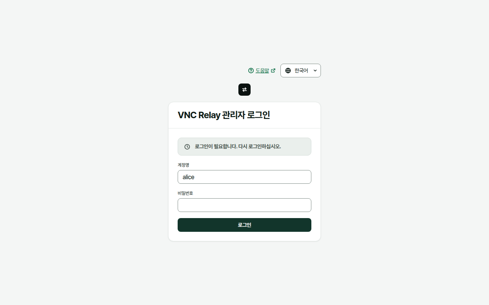
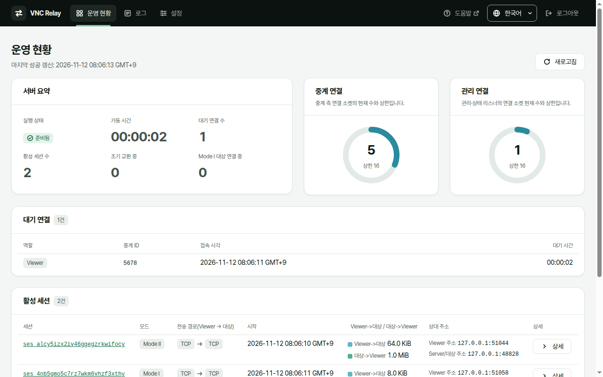
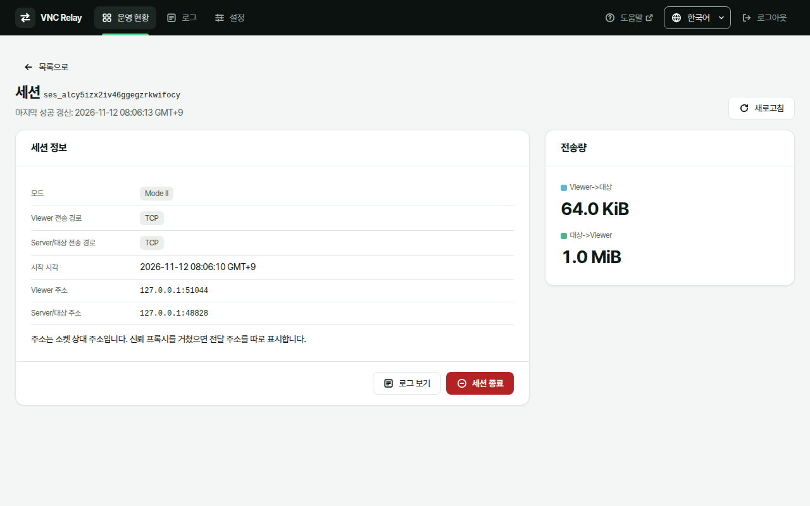
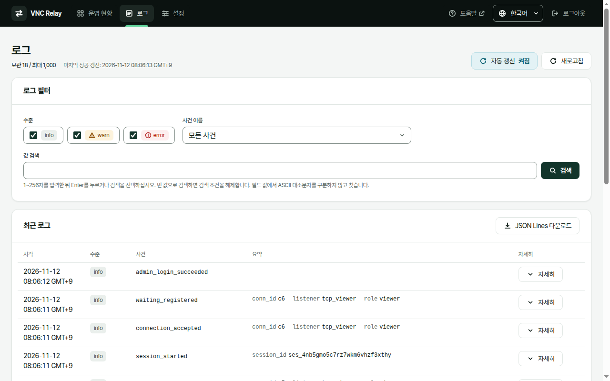
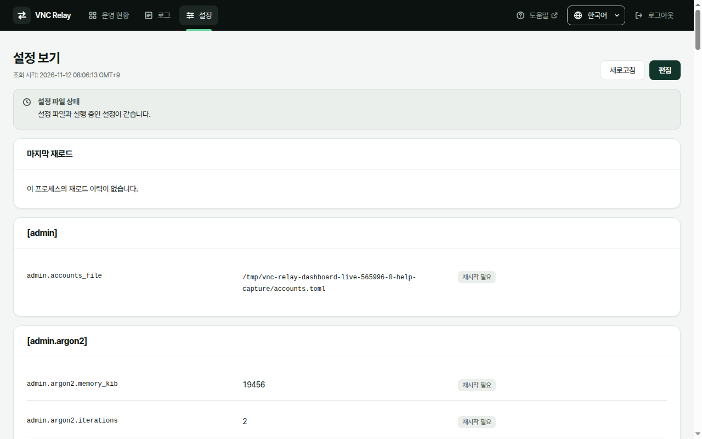
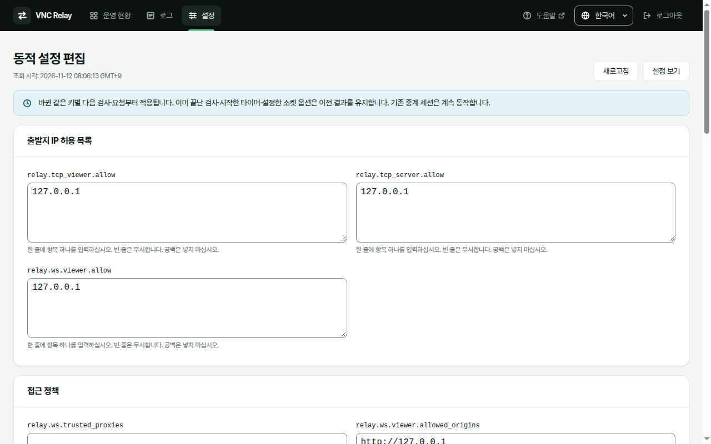

# 대시보드

대시보드에서 연결과 활성 세션을 확인하고, 관리자 종료와 동적 설정 편집을 할 수 있다. 최근 로그로 장애 원인도 찾을 수 있다.

## 로그인

대시보드는 실행파일에 포함되어 있다. 별도 웹 서버를 설치하지 않는다. 먼저 [빠른 시작](quick-start.md)에 따라 관리자 계정을 준비하고 서버를 실행해야 한다.

1. 브라우저에서 관리 리스너 주소를 연다. 기본 예시 설정은 `http://127.0.0.1:18080/`이다. 외부 관리 접속에는 설정한 HTTPS 주소를 쓴다.
2. "계정명"에 준비한 관리자 계정명을 입력한다.
3. "비밀번호"에 그 계정의 비밀번호를 입력한다.
4. "로그인"을 선택한다.

성공하면 "운영 현황"으로 이동한다. 인증 실패(HTTP 401)면 계정명은 유지하고 비밀번호 입력을 지운다. 계정이 없거나 비밀번호가 틀리거나 로그인 제한 중이어도 같은 실패 안내를 표시한다. 서버 오류나 응답 유실은 인증 실패와 구분해 "로그인 요청을 처리하지 못했습니다. 잠시 뒤 다시 시도하십시오."로 알린다. 계정 추가와 비밀번호 변경은 웹 화면이 아니라 로컬 CLI에서 한다. 절차는 [운영](operate.md)을 따른다.

> **주의:** 외부 관리 접속에는 내장 HTTPS를 써야 한다. 평문 HTTP는 루프백 주소에 바인드한 관리 리스너에서만 허용한다. 인증서 검증을 끄지 않는다.

## 운영 현황

"서버 요약"에서 "실행 상태"와 "가동 시간"을 확인한다. "준비됨"은 서버가 준비된 상태다. "종료 유예 중"은 정상 종료 요청 뒤 활성 세션이 끝나기를 기다리는 상태다.

- "대기 연결 수"는 Mode II에서 상대를 기다리는 연결 수다.
- "활성 세션 수"는 연결 쌍의 수다. 정리 중인 세션도 정리가 끝날 때까지 포함한다.
- "초기 교환 중"과 "Mode I 대상 연결 중"은 대기 연결 수와 별도로 센다.
- "중계 연결"은 중계 측 소켓의 현재 수와 상한이다. 세션 수와 같지 않다.
- "관리 연결"은 관리·상태 리스너 소켓의 현재 수와 상한이다. 중계 연결과 별도로 센다.

"대기 연결"에는 역할, 중계 ID, 접속 시각과 대기 시간이 나온다. 대기 연결에는 상세나 관리자 종료 기능이 없다. "활성 세션"에는 모드, 양쪽 전송 경로, 시작 시각, 방향별 전송량과 상대 주소가 나온다. "상세"로 세션을 연다.

"최근 종료 목록"에는 정리가 끝난 활성 세션의 종료 원인과 최종 전송량이 나온다. 대기 만료는 이 목록이 아니라 로그에서 찾는다. 최근 종료 목록은 메모리에만 보관한다. 보관 상한을 넘으면 오래된 항목을 지우며 재시작하면 비운다. 종료된 세션의 상세 이력을 여는 기능은 없다.

시각은 브라우저 현지 시각과 시간대로 표시한다. 전송량은 KiB/MiB로 표시한다. 이 값은 상대 전송 계층에 쓰기를 성공한 바이트 수다. 상대 프로그램이 데이터를 읽거나 화면에 표시했다는 증거는 아니다.

### 자동 갱신과 조회 실패

운영 현황과 세션 상세는 `dashboard.poll_secs` 주기로 폴링한다. 기본 주기는 2초다. 즉시 확인하려면 "새로고침"을 선택한다. 같은 조회를 겹쳐 보내지 않는다.

조회가 실패하면 이전 성공 데이터와 마지막 성공 시각을 유지한다. "오래된 데이터"를 현재 값으로 판단하지 않는다. "확인 불가"는 0이 아니다. 실패한 목록을 빈 목록으로 표시하지 않는다.

## 세션 상세와 관리자 종료

세션 상세에서 세션 식별자, 모드, 양쪽 전송 경로, 시작 시각과 방향별 전송량을 확인한다. 상대 주소는 실제 소켓 주소다. 신뢰 프록시를 거쳤으면 전달 주소를 따로 표시한다. 세션 식별자는 중계 ID와 다르다.

관리자 종료는 해당 연결 쌍의 중계를 멈춘다. 끊긴 세션은 다시 이어지지 않는다.

1. "활성 세션"에서 종료할 세션의 "상세"를 선택한다.
2. 세션 식별자와 양쪽 주소로 대상을 확인한다.
3. "세션 종료"를 선택한다.
4. "세션 종료 확인"에서 대상과 영향을 확인한다.
5. 종료하려면 "종료 확인"을 선택한다. 요청을 보내지 않으려면 "취소"를 선택한다.

서버는 자원 정리가 끝난 뒤 응답한다. 요청 중에는 세션이 활성 수에 남을 수 있다. 대상이 이미 끝났으면 "현재 세션을 찾을 수 없음"을 표시한다. 같은 중계 ID로 다시 접속한 다른 세션을 대신 종료하지 않는다.

응답을 받지 못하면 완료로 판단하지 않는다. "상태 재조회"로 현재 상태를 먼저 확인한다. 대시보드는 종료 요청을 자동으로 다시 보내지 않는다. 목록으로 돌아가려면 "목록으로"를 선택한다.

## 최근 로그

상단 "로그"를 선택하면 메모리에 보관한 최근 운영 로그가 나온다. 세션 상세의 "로그 보기"를 선택하면 해당 세션 필터로 연다.

1. "수준"에서 필요한 수준을 선택한다. 하나 이상 선택해야 한다.
2. "사건 이름"에서 사건을 선택한다. 전체를 보려면 "모든 사건"을 선택한다.
3. "값 검색"에 검색어를 입력한다.
4. Enter를 누르거나 "검색"을 선택한다.

검색어는 1~256자다. 필드 값에서 ASCII 대소문자를 구분하지 않고 찾는다. 빈 값으로 검색하면 검색 조건을 해제한다. 여러 필터는 함께 적용한다. "필터 해제"는 세션 필터를 해제한다.

"자동 갱신"은 처음에 "켜짐"이다. 폴링 주기로 새 사건을 읽는다. "꺼짐"으로 바꾸면 자동 갱신을 일시정지한다. 이때도 "새로고침", 필터와 다운로드를 쓸 수 있다. "자세히"로 사건의 전체 필드를 펼친다. 보관 중인 과거 결과가 더 있으면 "이전 로그 더 보기"를 선택한다.

"JSON Lines 다운로드"는 시작할 때의 필터로 보관 결과 전체를 모은다. 화면에 아직 불러오지 않은 페이지도 포함한다. 첫 페이지 뒤 새로 생긴 사건은 포함하지 않는다. 수집 중 오래된 사건이 지워질 수 있으므로 완전한 이력은 보장하지 않는다. 파일에는 사건마다 JSON 객체 한 줄을 쓴다. 다운로드에 실패하면 부분 파일을 저장하지 않는다.

> **참고:** 최근 로그는 장기 보관이나 감사 로그를 대신하지 않는다. 재시작하면 목록이 비워지고 오래된 사건은 상한에 따라 지워진다. 세션 시작 사건이 지워졌으면 세션 필터에서 연결별 사건 일부를 찾지 못할 수 있다. 화면에 사건이 보인다는 사실은 로그 파일 쓰기의 성공을 뜻하지 않는다.

## 설정 보기

"설정"을 선택하면 "설정 보기"를 연다. 편집 기능이 꺼져 있어도 로그인한 모든 관리자가 볼 수 있다.

표의 값은 기본값을 포함한 **실행 중 유효 값**이다. 파일에만 저장된 미적용 값이 아니다. 인증서·개인키·접속 ticket 공개 키 파일은 경로만 보이며 파일 내용은 보이지 않는다.

"설정 파일 상태"에서 파일과 실행값의 차이를 확인한다. "마지막 재로드"에서 결과와 바뀐 키를 확인한다. 두 정보는 별개다. 설정 화면은 자동 폴링하지 않는다. 현재 상태를 다시 읽으려면 "새로고침"을 선택한다.

- `in_effect`: 파일과 실행값이 같다.
- `pending`: 재시작 없이 적용할 파일 변경이 남아 있다. 재로드 결과를 기다린 뒤 다시 조회한다.
- `restart_required`: 재시작이 필요한 차이가 있다. 외부 편집기로 해당 값을 되돌리거나 서버를 재시작해야 한다.
- `invalid`: 파일 검증에 실패했다. 진단에 따라 외부 편집기로 고친다.
- `unreadable`: 파일을 읽지 못했거나 UTF-8이 아니다. 파일 접근이나 인코딩을 복구한다.

오류가 있어도 이전 실행값은 유지한다. 설정 화면에서 재로드를 강제로 실행하는 기능은 없다.

## 동적 설정 편집

기본값 `management.config_edit = false`에서는 읽기만 할 수 있다. 편집을 켜려면 다음 순서를 따른다.

1. 설정 파일의 복구본을 보호된 위치에 보관한다.
2. 외부 편집기로 기존 `[management]` 테이블의 `config_edit`을 `true`로 바꾼다. 키가 없으면 `config_edit = true`를 추가한다. 같은 테이블을 중복으로 만들지 않는다.
3. 서버를 정상 종료한 뒤 다시 시작한다.
4. 대시보드에 다시 로그인한다.
5. "설정"에서 "편집"을 선택한다.

"동적 설정 편집"에서는 출발지 IP 허용 목록, Origin·신뢰 프록시·Mode I 대상 허용 정책, 연결 상한, 시간 제한과 연결 유지를 바꿀 수 있다. 해당 진입점·역할·리스너·Mode I이 켜져 있어야 관련 정책 입력란을 제공한다. "접속 ticket"에서는 역할별 `enabled`, `issuer`, `relay_host`, `max_lifetime_secs`를 바꿀 수 있다. 이 입력란은 해당 역할이 WS 또는 WSS에서 하나라도 켜져 있으면 제공한다. 접속 ticket 확인 자체는 꺼져 있어도 편집할 수 있다.

리스너 주소, 중계 역할·모드 켜기/끄기와 같은 재시작 필요 키는 편집하지 못한다. TLS 파일 경로와 접속 ticket 공개 키 파일 경로도 편집하지 못한다. 전체 편집 대상과 적용 시점은 [설정 계약 1.8절](https://github.com/kayden-kim/vnc-relay/blob/main/docs/contracts/config-v4.md)을 따른다.

1. 필요한 입력란의 값을 바꾼다. 목록은 한 줄에 항목 하나를 쓰며 공백을 넣지 않는다.
2. "변경 내용 확인"을 선택한다.
3. "설정 변경 확인"에서 이전 값, 새 값, 목록의 추가·삭제와 경고를 확인한다.
4. 저장하려면 "적용"을 선택한다.
5. "설정 보기"에서 실행값, 파일 상태와 마지막 재로드 결과를 확인한다.

저장한 값은 같은 설정 파일에 남아 재시작 뒤에도 유지된다. 새 값은 키별 다음 검사나 요청부터 적용된다. 이미 끝난 검사, 시작한 타이머와 설정한 소켓 옵션은 이전 결과를 유지한다. 기존 중계 세션은 계속 동작한다.

> **주의:** 외부 편집기와 대시보드로 동시에 저장하지 않는다. 다른 관리자와도 저장 순서를 정해야 한다. 주석이나 공백만 바뀌어도 충돌할 수 있다.

충돌하면 "다시 불러오기"로 최신 설정을 읽고 다시 편집한다. 이 행동은 현재 입력을 버린다. 재시작 필요 차이, 검증 실패나 읽기 실패가 있으면 먼저 외부에서 원인을 고쳐야 한다. 쓰기 실패는 서버 실행 OS 계정의 파일·디렉터리 권한 등을 확인한다.

적용 응답을 받지 못하면 성공이나 실패로 단정하지 않는다. "설정 보기"에서 현재 값을 먼저 확인한다. 대시보드는 적용 요청을 자동으로 다시 보내지 않는다. 자세한 복구는 [문제 해결](troubleshooting.md)을 따른다.

## 언어, 로그아웃과 관리 세션 만료

로그인 화면이나 상단의 "언어 (Language)"에서 "한국어" 또는 "English"를 고른다. 화면 문구가 바로 바뀐다. 직접 고른 언어는 브라우저에 저장되며 로그인과 로그아웃 뒤에도 유지된다. 저장소를 사용할 수 없으면 현재 화면에서만 유지된다.

저장된 선택이 없으면 브라우저 선호 언어 목록에서 처음 만나는 한국어 또는 영어를 쓴다. 둘 다 없으면 영어를 쓴다. 서버 설정에는 언어를 저장하지 않는다.

관리 작업을 마치면 "로그아웃"을 선택한다. 서버가 관리 세션을 무효화하면 보호 데이터를 지우고 로그인 화면으로 이동한다. 로그아웃 결과를 확인하지 못하면 완료 안내 대신 결과 확인이 필요하다고 알린다.

관리 세션에는 유휴 만료와 절대 최대 수명이 있다. 기본값은 각각 30분과 12시간이다. 사용자 행동 요청만 유휴 만료를 연장한다. 자동 폴링은 연장하지 않는다. 절대 최대 수명이 지나면 계속 작업 중이어도 다시 로그인해야 한다. 서버 재시작도 모든 관리 세션을 무효화한다.

로그아웃과 관리 세션 만료는 활성 VNC 중계를 끝내지 않는다. 수명 설정은 [설정](configure.md)을, 상세 동작은 [관리 스펙](https://github.com/kayden-kim/vnc-relay/blob/main/docs/specs/management.md)과 [대시보드 화면 스펙](https://github.com/kayden-kim/vnc-relay/blob/main/docs/specs/dashboard.md)을 참고한다.
