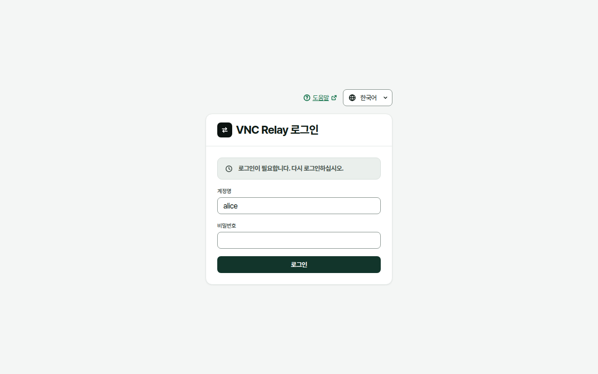
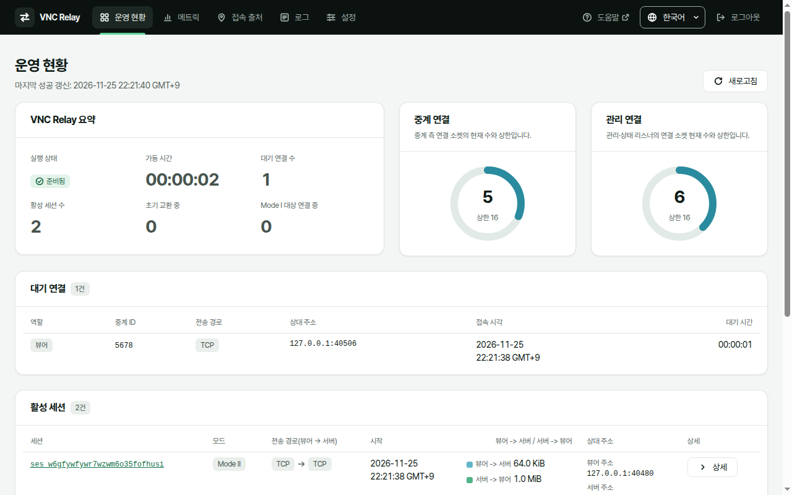
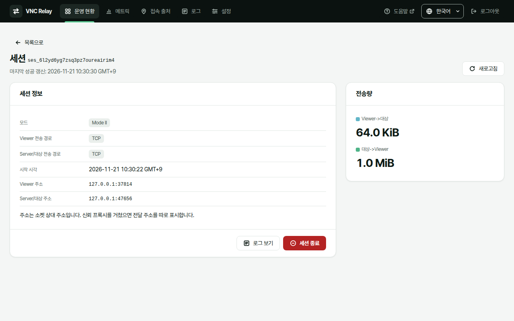
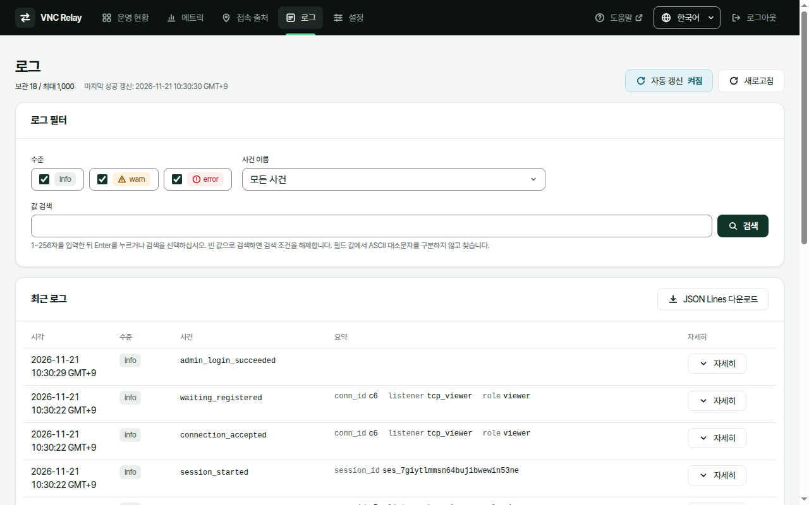
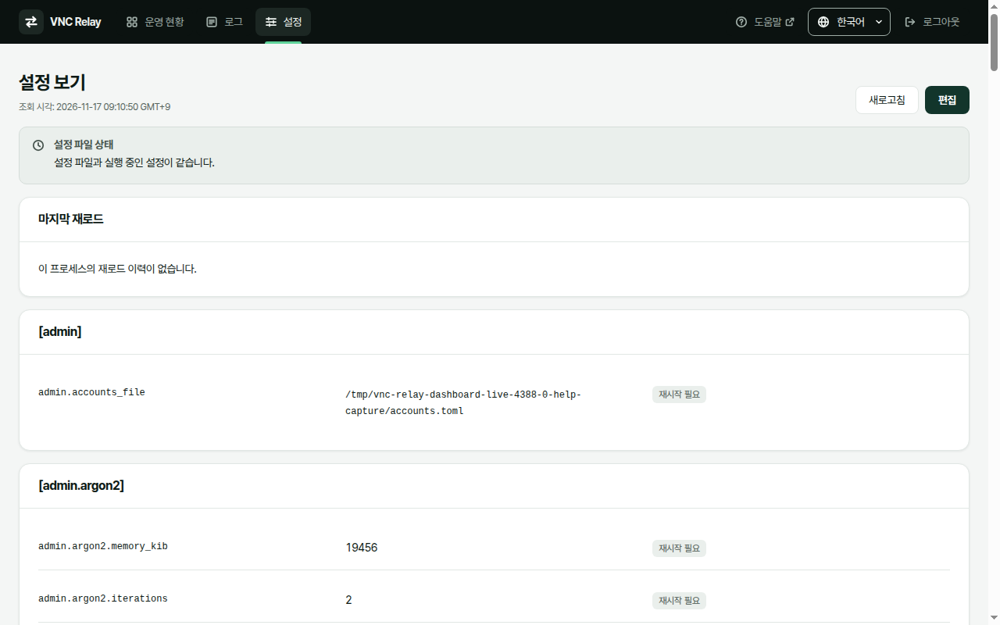
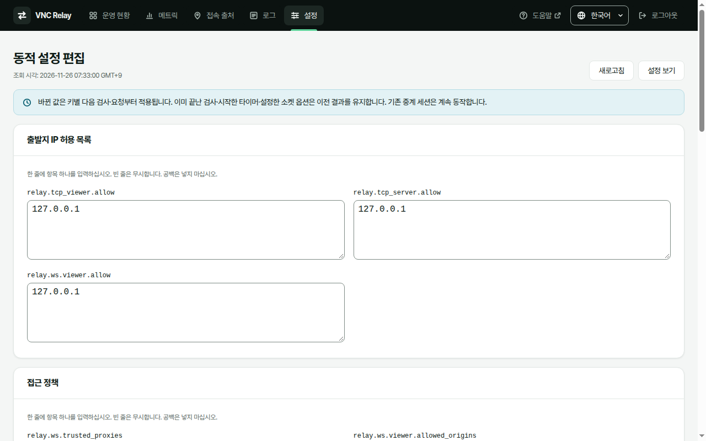

# 대시보드

대시보드에서 연결과 활성 세션, 메트릭, 접속 출처를 확인하고, 관리자 종료와 주소 차단, 동적 설정 편집을 할 수 있다. 최근 로그로 장애 원인도 찾을 수 있다. 상단 이동 항목은 "운영 현황" · "메트릭" · "접속 출처" · "로그" · "설정" 순서다.

## 로그인

대시보드는 실행파일에 포함되어 있다. 별도 웹 서버를 설치하지 않는다. 먼저 [빠른 시작](quick-start.md)에 따라 관리자 계정을 준비하고 서버를 실행해야 한다.

1. 브라우저에서 관리 리스너 주소를 연다. 기본 예시 설정은 `http://127.0.0.1:18080/`이다. 외부 관리 접속에는 설정한 HTTPS 주소를 쓴다.
2. "계정명"에 준비한 관리자 계정명을 입력한다.
3. "비밀번호"에 그 계정의 비밀번호를 입력한다.
4. "로그인"을 선택한다.

성공하면 "운영 현황"으로 이동한다. 인증 실패(HTTP 401)면 계정명은 유지하고 비밀번호 입력을 지운다. 계정이 없거나 비밀번호가 틀리거나 로그인 제한 중이어도 같은 실패 안내를 표시한다. 서버 오류나 응답 유실은 인증 실패와 구분해 "로그인 요청을 처리하지 못했습니다. 잠시 뒤 다시 시도하십시오."로 알린다. 계정 추가와 비밀번호 변경은 웹 화면이 아니라 로컬 CLI에서 한다. 절차는 [운영](operate.md)을 따른다.

> **주의:** 외부 관리 접속에는 내장 HTTPS를 써야 한다. 평문 HTTP는 루프백 주소에 바인드한 관리 리스너에서만 허용한다. 인증서 검증을 끄지 않는다.

## 운영 현황

"서버 요약"에서 "실행 상태"와 "가동 시간"을 확인한다. "준비됨"은 서버가 준비된 상태다. "종료 유예 중"은 정상 종료 요청 뒤 활성 세션이 끝나기를 기다리는 상태다.

- "대기 연결 수"는 Mode II에서 상대를 기다리는 연결 수다.
- "활성 세션 수"는 연결 쌍의 수다. 정리 중인 세션도 정리가 끝날 때까지 포함한다.
- "초기 교환 중"과 "Mode I 대상 연결 중"은 대기 연결 수와 별도로 센다.
- "중계 연결"은 중계 측 소켓의 현재 수와 상한이다. 세션 수와 같지 않다.
- "관리 연결"은 관리·상태 리스너 소켓의 현재 수와 상한이다. 중계 연결과 별도로 센다.

"대기 연결"에는 역할, 중계 ID, 전송 경로, 상대 주소, 접속 시각과 대기 시간이 나온다. 상대 주소는 실제 소켓 주소다. 신뢰 프록시를 거쳤으면 전달 주소를 따로 표시한다. 대기 연결에는 상세나 관리자 종료 기능이 없다. "활성 세션"에는 모드, 양쪽 전송 경로, 시작 시각, 방향별 전송량과 상대 주소가 나온다. "상세"로 세션을 연다.

대기 연결의 접속 시각과 활성 세션의 시작 시각은 날짜와 시각 두 줄로 표시한다. 활성 세션 상대 주소의 레이블은 값 위 줄에 있다.

"최근 종료 목록"에는 정리가 끝난 활성 세션의 종료 원인, 모드, 양쪽 전송 경로, 시작·종료 시각, 지속 시간, 최종 전송량과 상대 주소가 나온다. 지속 시간은 서버가 시스템 시각 변경과 관계없이 잰 값이다. 그래서 시작·종료 시각의 차이와 다를 수 있다. "로그 보기"를 선택하면 그 세션 필터로 최근 로그를 연다. 대기 만료는 이 목록이 아니라 로그에서 찾는다. 최근 종료 목록은 메모리에만 보관한다. 보관 상한을 넘으면 오래된 항목을 지우며 재시작하면 비운다. 종료된 세션의 상세 이력을 여는 기능은 없다.

차단 목록 교체로 끊은 세션의 종료 원인은 "차단 목록으로 종료"이다. 차단하는 방법은 [주소 차단과 해제](#주소-차단과-해제)를 따른다.

시각은 브라우저 현지 시각과 시간대로 표시한다. 전송량은 KiB/MiB로 표시한다. 이 값은 상대 전송 계층에 쓰기를 성공한 바이트 수다. 상대 프로그램이 데이터를 읽거나 화면에 표시했다는 증거는 아니다.

### 자동 갱신과 조회 실패

운영 현황과 세션 상세는 `dashboard.poll_secs` 주기로 폴링한다. 기본 주기는 2초다. 즉시 확인하려면 "새로고침"을 선택한다. 같은 조회를 겹쳐 보내지 않는다.

자동 갱신이 1초 안에 끝나면 `갱신 중`·`조회 중` 배지와 새로고침 버튼 문구를 바꾸지 않는다. 1초가 지나도 끝나지 않으면 `갱신 중`을 보인다.

조회가 실패하면 이전 성공 데이터와 마지막 성공 시각을 유지한다. "오래된 데이터"를 현재 값으로 판단하지 않는다. "확인 불가"는 0이 아니다. 실패한 목록을 빈 목록으로 표시하지 않는다.

## 세션 상세와 관리자 종료

세션 상세에서 세션 식별자, 모드, 양쪽 전송 경로, 시작 시각과 방향별 전송량을 확인한다. 상대 주소는 실제 소켓 주소다. 신뢰 프록시를 거쳤으면 전달 주소를 따로 표시한다. 세션 식별자는 중계 ID와 다르다.

관리자 종료는 해당 연결 쌍의 중계를 멈춘다. 종료한 세션은 다시 이어지지 않는다.

1. "활성 세션"에서 종료할 세션의 "상세"를 선택한다.
2. 세션 식별자와 양쪽 주소로 대상을 확인한다.
3. "세션 종료"를 선택한다.
4. "세션 종료 확인"에서 대상과 영향을 확인한다.
5. 종료하려면 "종료 확인"을 선택한다. 요청을 보내지 않으려면 "취소"를 선택한다.

서버는 자원 정리가 끝난 뒤 응답한다. 요청 중에는 세션이 활성 수에 남을 수 있다. 대상이 이미 끝났으면 "현재 세션을 찾을 수 없음"을 표시한다. 같은 중계 ID로 다시 접속한 다른 세션을 대신 종료하지 않는다.

응답을 받지 못하면 완료로 판단하지 않는다. "상태 재조회"로 현재 상태를 먼저 확인한다. 대시보드는 종료 요청을 자동으로 다시 보내지 않는다. 목록으로 돌아가려면 "목록으로"를 선택한다.

## 메트릭

상단 "메트릭"을 선택하면 `/#/metrics`를 연다. 로그인한 관리자는 `metrics.enabled`가 꺼져 있어도 이 화면을 쓸 수 있다. 외부 수집 설정은 [메트릭 수집](operate.md#메트릭-수집)을 따른다.

- "핵심 지표"에는 카드 8개가 나온다. "활성 세션 수", "대기 연결 수", "중계 연결", "관리 연결", "처리량", "거절한 연결(시작 뒤 누적)", "CPU 사용률", "메모리 사용량"이다. 연결 카드는 현재 사용량과 상한을 보여 준다. 처리량은 방향별 초당 전송량이다. CPU 사용률의 100%는 코어 1개를 모두 쓴 양이다.
- "추이"에는 활성 세션·대기 연결, 분당 연결 수락·거절·중단, 처리량, CPU 사용률, 메모리 사용량 차트 5개가 나온다. 머리말의 "추이 기간"에서 "최근 1시간"과 "최근 24시간" 가운데 고른다. 처음 값은 "최근 1시간"이다. 최근 1시간은 서버가 10초마다 기록한 최근 360개 점을 쓰고, 최근 24시간은 1분마다 기록한 최근 1440개 점을 쓴다. 구역 제목은 "추이(최근 1시간)" 또는 "추이(최근 24시간)"이다. 최근 24시간을 고르면 처리량·CPU 사용률 카드도 직전 10초 대신 직전 1분의 값이다. 브라우저를 닫아도 서버는 계속 기록한다. 범례에는 현재 값과 보이는 범위의 최댓값이 나온다.
- "연결(분당)" 차트는 1분 묶음마다 값 하나를 그린다. 값은 그 묶음 동안 늘어난 수락·거절·중단 수를 1분당 비율로 바꾼 것이며 소수 한 자리로 표시한다. 서버 기록이 늦어 묶음이 1분보다 길어도 1분당 값이다.
- "시간 분포"에는 초기 교환, 대기, 세션, Mode I 대상 연결의 히스토그램을 개수·평균·"p95 상한"으로 요약한다. p95 상한은 기록한 값의 95%가 들어가는 첫 구간의 경계다. 정확한 백분위수가 아니다. 마지막 경계보다 큰 구간이면 `>`로 표시한다. "분포" 칸의 막대는 구간별 개수다. 왼쪽이 가장 짧은 구간이고 오른쪽 끝이 마지막 경계보다 큰 구간이다. 막대 높이는 같은 행 안에서만 비교한다. 화면 낭독기는 개수가 0이 아닌 구간을 읽는다.
- "원인별 수(시작 뒤 누적)"에는 "연결 거절", "연결 중단", "세션 종료", "관리 활동", "설정 변경", "WebSocket" 표가 나온다. 속성 이름과 값은 번역하지 않는다. 기록이 없는 항목이나 표는 "기록 없음"이다. 수 옆의 막대 길이는 그 표에서 가장 큰 수와 비교한 길이다. 값은 숫자로 읽는다.
- "프로세스"에는 가동 시간, "CPU 시간(사용자 / 시스템)", 메모리 사용량, "가상 메모리", "스레드 수", 버전이 나온다. Windows에서는 "열린 핸들 수", Linux에서는 "열린 파일 기술자 수"도 나온다.

화면은 `dashboard.poll_secs` 주기로 자동 갱신한다. 기본값은 2초다. 서버는 이 값과 관계없이 최근 1시간 추이를 10초마다, 최근 24시간 추이를 1분마다 기록한다. "새로고침"은 현재 값과 고른 기간의 보관된 추이 전체를 다시 읽는다. "추이 기간"을 바꿔도 고른 기간의 추이 전체를 바로 다시 읽는다. 다 읽을 때까지는 이전 기간의 값과 추이를 그대로 보인다. 읽기에 실패해도 이전 기간을 계속 보이고, 다음 자동 갱신이 고른 기간을 다시 읽는다. 단, HTTP 400·405로 거절되면 아래와 같이 자동 조회를 멈춘다. 화면을 떠나면 자동 갱신을 멈추고, 다시 들어오면 "최근 1시간"부터 보인다. 자동 갱신은 관리 세션의 유휴 만료를 연장하지 않는다.

추이 점이 2개 미만이면 "핵심 지표"의 처리량·CPU 사용률 카드는 "수집 중"이다. 차트는 선을 그을 만큼 점이 쌓일 때까지 "추이를 모으는 중입니다. 10초마다 점이 하나씩 쌓입니다."를 표시한다. 최근 24시간에서는 "추이를 모으는 중입니다. 1분마다 점이 하나씩 쌓입니다."를 표시한다. 활성 세션·대기 연결 차트와 메모리 차트는 점 2개, 처리량 차트와 CPU 사용률 차트는 점 3개가 필요하다. "연결(분당)" 차트는 최근 1시간에서 점 13개, 최근 24시간에서 점 3개가 필요하며, 둘 다 약 2분이다. 다른 현재 값은 그대로 볼 수 있다. 읽지 못한 값은 "확인 불가"이며 0이 아니다. 점이 충분한 차트는 읽지 못한 구간의 선만 끊고 다른 값은 유지한다.

조회가 실패하면 이전 값·추이와 마지막 성공 시각을 유지한다. "오래된 데이터"를 현재 값으로 판단하지 않는다. 이전 성공 데이터가 없으면 조회 실패를 표시하며 빈 표·차트나 0으로 대신하지 않는다. 다음 자동 조회는 계속한다.

HTTP 400·405로 요청이 거절되면 자동 조회를 멈추고 "메트릭 조회 요청을 처리하지 못했습니다. 새로고침으로 다시 조회하십시오."를 표시한다. "새로고침"이나 "추이 기간" 변경으로 조회가 성공하면 자동 갱신을 다시 시작한다. 관리 세션이 만료되면 값과 추이를 지우고 로그인 화면으로 이동한다.

값과 추이는 메모리에만 있다. 서버를 재시작하면 누적 값은 0부터, 추이는 빈 목록부터 다시 시작한다. 다시 로그인해야 한다. 이 화면은 장기 보관이나 임계값 경보를 제공하지 않는다. 메트릭의 의미와 단위는 [메트릭 계약](https://github.com/kayden-kim/vnc-relay/blob/main/docs/contracts/metrics-v1.md)을 따른다.

## 접속 출처

상단 "접속 출처"를 선택하면 `/#/sources`를 연다. 중계 리스너에 들어온 연결을 클라이언트 주소·국가·ASN별로 센 값이 나온다. ASN은 인터넷 경로를 운영하는 조직의 번호다. 국가와 ASN을 보려면 운영자가 IP 정보 DB 파일을 설정해야 한다. 절차는 [IP 정보 DB 준비와 갱신](operate.md#ip-정보-db-준비와-갱신)을 따른다. DB가 없어도 주소별 수는 볼 수 있다.

- "집계 기간"에서 "최근 1시간"과 "최근 24시간" 가운데 고른다. 처음 값은 "최근 1시간"이다. 머리말 아래에 집계 시작·끝 시각과 보관 사건 수가 나온다.
- "요약"에는 카드 7개가 나온다. "연결 시도", "거절", "중단", "시작한 세션", "주소", "국가", "ASN"이다. 연결 시도는 중계 리스너가 받아들인 연결과 수락 단계에서 거절한 연결의 수다. 거절과 중단은 TLS·업그레이드·초기 교환 등 모든 단계에서 센다. 관리·상태 리스너의 연결은 세지 않는다.
- "IP 정보 DB"에는 국가 DB와 ASN DB의 상태가 "사용 중", "이전 DB 사용 중", "읽기 실패", "설정 안 됨" 가운데 하나로 나온다. 사용 중이면 DB 종류, 빌드 시각, 읽은 시각도 나온다. 쓰는 DB 제공자의 출처 표시가 이 구역에 함께 나온다. DB 상태는 조회 성공·실패와 별개다. DB를 읽지 못해도 다른 값은 그대로 보인다.
- "주소별", "국가별", "ASN별" 표는 연결 시도가 많은 순서다. 화면에서 정렬을 바꾸지 않는다. 받은 항목이 전체보다 적으면 제목 옆에 "전체 {total}개 중 상위 {shown}개"가 나온다.
- 클라이언트 주소는 신뢰 프록시가 전달한 주소가 있으면 그 주소, 없으면 소켓 상대 주소다. "세션" 열은 그 주소가 Viewer 또는 Mode II Server로 참여한 세션 수다.
- 국가나 ASN을 찾지 못한 칸은 "알 수 없음"이다. 로컬 주소(루프백·사설·링크 로컬·공유 주소)는 "로컬" 배지가 붙고 DB에서 찾지 않는다.
- "주소별" 표의 "차단 상태" 열에서 주소를 차단하거나 차단을 해제한다. 아래 [주소 차단과 해제](#주소-차단과-해제)를 따른다. 차단된 주소에는 "차단됨" 배지가 붙는다.

"로컬" 배지가 없는 주소와 ASN은 ipinfo.io 조회 링크다. 링크는 새 탭에서 열리며 대시보드 화면과 관리 세션은 그대로 남는다. 링크를 고르면 그 주소나 ASN이 ipinfo.io에 전달된다. 서버와 대시보드는 링크를 고르기 전에는 ipinfo.io에 요청하지 않는다. 외부 사이트로 주소를 보내도 되는지 운영 정책을 먼저 확인하기를 권장한다.

화면은 `dashboard.poll_secs` 주기로 자동 갱신한다. "새로고침"과 "집계 기간" 변경은 고른 기간을 바로 다시 읽는다. 다 읽을 때까지 이전 값을 그대로 보인다. 조회가 실패하면 이전 값과 마지막 성공 시각을 유지하고 "오래된 데이터"를 표시한다. 이전 값이 없으면 조회 실패를 표시하며 빈 표나 0으로 대신하지 않는다. HTTP 400·405로 거절되면 자동 조회를 멈추고 "접속 출처 조회 요청을 처리하지 못했습니다. 새로고침으로 다시 조회하십시오."를 표시한다. 화면을 떠나면 자동 갱신을 멈추고, 다시 들어오면 "최근 1시간"부터 보인다.

서버는 센 사건을 메모리에 최대 100,000개 보관한다. 넘으면 오래된 사건부터 버린다. 고른 기간의 앞부분을 버렸으면 "보관 상한에 이르러 … 사건을 버렸습니다." 안내가 나온다. 이때 표의 수는 기간 전체의 수가 아니다. 서버를 재시작하면 통계가 비워진다. 설정 재로드는 통계를 지우지 않는다. 접속 출처 통계는 `/metrics`, 상태 응답, 운영 로그에 넣지 않으며 로그인한 관리자만 볼 수 있다. 응답 형식은 [관리 API 계약 1.17절](https://github.com/kayden-kim/vnc-relay/blob/main/docs/contracts/management-api-v1.md)을 따른다.

### 주소 차단과 해제

"주소별" 표에서 주소 하나를 차단하거나 차단을 해제할 수 있다. 차단한 주소는 모든 중계 진입점에서 거절한다. 허용 목록에 있어도 거절한다. 차단 목록의 규칙은 [출발지 IP 차단 목록](configure.md#출발지-ip-차단-목록)을 따른다.

차단과 해제는 전용 기능이 아니라 동적 설정 편집이다. 같은 로그인, CSRF 확인, 충돌 검사와 파일 쓰기 규칙을 쓴다. 그래서 `management.config_edit = true`로 바꾸고 재시작해야 쓸 수 있다. 켜는 절차는 [동적 설정 편집](#동적-설정-편집)을 따른다. 대시보드는 설정의 `relay.deny.sources`를 읽어 항목을 더하거나 빼고, 목록 전체를 저장한다.

"차단 상태" 열은 주소와 설정에 따라 다르다.

| 주소와 설정 | "차단 상태" 열 |
| --- | --- |
| 차단되지 않은 주소 | "차단" 버튼 |
| 단일 주소 항목으로 차단된 주소 | "차단됨" 배지와 "차단 해제" 버튼 |
| CIDR·범위 항목이 하나라도 있는 주소 | "차단됨" 배지와 "범위 항목으로 차단되어 있습니다. 설정에서 해제하십시오." 안내. 버튼 없음 |
| 로컬 주소 | 버튼 없음. 차단된 로컬 주소에는 "차단됨" 배지만 나온다 |
| 편집 기능이 꺼진 서버 | 버튼 없음. 차단된 주소에는 "차단됨" 배지만 나온다 |

편집 기능이 꺼져 있으면 표 위에 "차단하려면 설정 파일에서 management.config_edit = true로 바꾸고 서버를 재시작하십시오."가 나온다.

주소를 차단하려면 다음 순서를 따른다.

1. "주소별" 표에서 차단할 주소의 행을 찾는다.
2. "차단"을 선택한다. 화면 낭독기는 이 버튼을 "{주소} 차단"으로 읽는다.
3. "주소 차단 확인"에서 "차단할 주소"를 확인한다. 본문은 "이 주소의 새 접속을 모든 중계 진입점에서 거절하고, 열린 세션과 대기 연결을 바로 끊습니다."이다. 처음 초점은 "취소"에 있다.
4. 차단하려면 "차단"을 선택한다. 요청을 보내지 않으려면 "취소"를 선택한다.
5. "주소를 차단했습니다: {주소}" 알림을 확인한다. 표를 다시 조회하며 그 행에 "차단됨" 배지가 나온다.

차단을 해제하려면 다음 순서를 따른다.

1. 단일 주소 항목으로 차단된 주소의 행에서 "차단 해제"를 선택한다. 화면 낭독기는 이 버튼을 "{주소} 차단 해제"로 읽는다.
2. "차단 해제 확인"에서 "차단을 해제할 주소"를 확인한다. 본문은 "이 주소의 새 접속을 다시 허용 목록으로 판정합니다. 끊은 연결은 되살아나지 않습니다."이다.
3. 해제하려면 "차단 해제"를 선택한다. 요청을 보내지 않으려면 "취소"를 선택한다.
4. "차단을 해제했습니다: {주소}" 알림을 확인한다. 그 사이 다른 관리자가 목록을 바꿔 지울 항목이 없으면 "차단 목록이 이미 바뀌어 지울 항목이 없습니다. 다시 조회한 결과를 확인하십시오."가 나온다. 다시 조회한 행이 여전히 "차단됨"이면 다른 범위 항목이 이 주소를 막고 있으므로 설정에서 확인한다.

CIDR·범위 항목으로 차단된 주소는 이 화면에서 해제하지 못한다. "설정"의 "동적 설정 편집"에서 접근 정책의 "차단 목록"을 열고 그 항목을 지운다.

요청 중에는 확인 버튼이 "차단 중…" 또는 "차단 해제 중…"으로 바뀐다. 이때 모든 행의 버튼과 대화상자의 버튼은 쓸 수 없다. 대화상자는 결과와 관계없이 요청이 끝나면 닫히고, 결과는 표 위 알림에 나온다.

> **주의:** 차단하면 그 주소의 열린 세션과 대기 연결이 바로 끊긴다. 해제해도 끊은 연결은 되살아나지 않는다. 차단은 주소 단위라서 같은 공인 IP를 쓰는 사용자도 함께 차단된다.

실패하면 알림이 원인을 알려 준다. 어느 경우에도 대시보드는 요청을 자동으로 다시 보내지 않는다.

- "설정 파일이 바뀌어 차단 목록을 바꾸지 못했습니다. 새로고침으로 다시 조회한 뒤 다시 시도하십시오." 다른 관리자나 외부 편집기가 파일을 바꾼 것이다.
- "설정 파일 상태 때문에 차단 목록을 바꾸지 못했습니다. 설정 보기에서 파일 상태를 확인하십시오." 재시작 필요 차이나 파일 오류를 먼저 고친다.
- "차단 목록을 바꾸지 못했습니다. 원인: 차단 항목이 신뢰 프록시 주소와 겹칩니다. 프록시 주소는 차단할 수 없습니다." 프록시 주소는 차단하지 않는다.
- "차단 목록이 바뀌었는지 확인하지 못했습니다. 새로고침으로 다시 조회해 확인하십시오." 결과를 단정하지 말고 표를 다시 조회한다.
- "요청을 처리하지 못했습니다. 화면을 다시 불러온 뒤 다시 시도하십시오."
- "설정을 읽지 못해 차단 목록을 바꾸지 못했습니다. 잠시 뒤 다시 시도하십시오."

## 최근 로그

상단 "로그"를 선택하면 메모리에 보관한 최근 운영 로그가 나온다. 세션 상세나 최근 종료 목록의 "로그 보기"를 선택하면 해당 세션 필터로 연다.

1. "수준"에서 필요한 수준을 선택한다. 하나 이상 선택해야 한다.
2. "사건 이름"에서 사건을 선택한다. 전체를 보려면 "모든 사건"을 선택한다.
3. "값 검색"에 검색어를 입력한다.
4. Enter를 누르거나 "검색"을 선택한다.

검색어는 1~256자다. 필드 값에서 ASCII 대소문자를 구분하지 않고 찾는다. 빈 값으로 검색하면 검색 조건을 해제한다. 여러 필터는 함께 적용한다. "필터 해제"는 세션 필터를 해제한다.

"자동 갱신"은 처음에 "켜짐"이다. 폴링 주기로 새 사건을 읽는다. "꺼짐"으로 바꾸면 자동 갱신을 일시정지한다. 이때도 "새로고침", 필터와 다운로드를 쓸 수 있다. "자세히"로 사건의 전체 필드를 펼친다. 보관 중인 과거 결과가 더 있으면 "이전 로그 더 보기"를 선택한다.

"JSON Lines 다운로드"는 시작할 때의 필터로 보관 결과 전체를 모은다. 화면에 아직 불러오지 않은 페이지도 포함한다. 첫 페이지 뒤 새로 생긴 사건은 포함하지 않는다. 수집 중 오래된 사건이 지워질 수 있으므로 완전한 이력은 보장하지 않는다. 파일에는 사건마다 JSON 객체 한 줄을 쓴다. 다운로드에 실패하면 부분 파일을 저장하지 않는다.

> **참고:** 최근 로그는 장기 보관이나 감사 로그를 대신하지 않는다. 재시작하면 목록이 비워지고 오래된 사건은 상한에 따라 지워진다. 세션 시작 사건이 지워졌으면 세션 필터에서 연결별 사건 일부를 찾지 못할 수 있다. 화면에 사건이 보인다는 사실은 로그 파일 쓰기의 성공을 뜻하지 않는다.

## 설정 보기

"설정"을 선택하면 "설정 보기"를 연다. 편집 기능이 꺼져 있어도 로그인한 모든 관리자가 볼 수 있다.

표의 값은 기본값을 포함한 **실행 중 유효 값**이다. 파일에만 저장된 미적용 값이 아니다. 인증서·개인키·접속 ticket 공개 키 파일은 경로만 보이며 파일 내용은 보이지 않는다.

`[relay.deny]`의 `sources`도 이 표에 나온다. 재시작 없이 적용되는 값으로 구분해 보여 준다.

"설정 파일 상태"에서 파일과 실행값의 차이를 확인한다. "마지막 재로드"에서 결과와 바뀐 키를 확인한다. 두 정보는 별개다. 설정 화면은 자동 폴링하지 않는다. 현재 상태를 다시 읽으려면 "새로고침"을 선택한다.

- `in_effect`: 파일과 실행값이 같다.
- `pending`: 재시작 없이 적용할 파일 변경이 남아 있다. 재로드 결과를 기다린 뒤 다시 조회한다.
- `restart_required`: 재시작이 필요한 차이가 있다. 외부 편집기로 해당 값을 되돌리거나 서버를 재시작해야 한다.
- `invalid`: 파일 검증에 실패했다. 진단에 따라 외부 편집기로 고친다.
- `unreadable`: 파일을 읽지 못했거나 UTF-8이 아니다. 파일 접근이나 인코딩을 복구한다.

오류가 있어도 이전 실행값은 유지한다. 설정 화면에서 재로드를 강제로 실행하는 기능은 없다.

## 동적 설정 편집

기본값 `management.config_edit = false`에서는 읽기만 할 수 있다. 편집을 켜려면 다음 순서를 따른다.

1. 설정 파일의 복구본을 보호된 위치에 보관한다.
2. 외부 편집기로 기존 `[management]` 테이블의 `config_edit`을 `true`로 바꾼다. 키가 없으면 `config_edit = true`를 추가한다. 같은 테이블을 중복으로 만들지 않는다.
3. 서버를 정상 종료한 뒤 다시 시작한다.
4. 대시보드에 다시 로그인한다.
5. "설정"에서 "편집"을 선택한다.

"동적 설정 편집"에서는 출발지 IP 허용 목록, Origin·신뢰 프록시·Mode I 대상 허용 정책, 연결 상한, 시간 제한과 연결 유지를 바꿀 수 있다. 해당 진입점·역할·리스너·Mode I이 켜져 있어야 관련 정책 입력란을 제공한다. "접속 ticket"에서는 역할별 `enabled`, `issuer`, `relay_host`, `max_lifetime_secs`를 바꿀 수 있다. 이 입력란은 해당 역할이 WS 또는 WSS에서 하나라도 켜져 있으면 제공한다. 접속 ticket 확인 자체는 꺼져 있어도 편집할 수 있다.

접근 정책의 "차단 목록"(`relay.deny.sources`)은 중계 진입점이 꺼져 있어도 편집할 수 있다. 입력란의 도움말은 "허용 목록보다 우선합니다. 저장하면 이 목록에 해당하는 주소의 열린 세션과 대기 연결을 바로 끊습니다. 빈 목록은 아무것도 차단하지 않습니다."이다. 항목을 더하거나 기존 항목을 바꾸면 "설정 변경 확인"에 "예외: 차단 목록에 새로 넣거나 바꾼 항목에 해당하는 주소의 열린 세션과 대기 연결은 저장 직후 끊깁니다."라는 경고가 나온다. 항목을 지우기만 하면 이 경고는 없다. 신뢰 프록시와 겹치는 항목은 그 줄에 "차단 항목이 신뢰 프록시 주소와 겹칩니다. 프록시 주소는 차단할 수 없습니다."로 알린다. 허용 목록의 빈 목록 경고는 이 목록에 나오지 않는다.

리스너 주소, 중계 역할·모드 켜기/끄기와 같은 재시작 필요 키는 편집하지 못한다. TLS 파일 경로와 접속 ticket 공개 키 파일 경로도 편집하지 못한다. 전체 편집 대상과 적용 시점은 [설정 계약 1.8절](https://github.com/kayden-kim/vnc-relay/blob/main/docs/contracts/config-v4.md)을 따른다.

1. 필요한 입력란의 값을 바꾼다. 목록은 한 줄에 항목 하나를 쓰며 공백을 넣지 않는다.
2. "변경 내용 확인"을 선택한다.
3. "설정 변경 확인"에서 이전 값, 새 값, 목록의 추가·삭제와 경고를 확인한다.
4. 저장하려면 "적용"을 선택한다.
5. "설정 보기"에서 실행값, 파일 상태와 마지막 재로드 결과를 확인한다.

저장한 값은 같은 설정 파일에 남아 재시작 뒤에도 유지된다. 새 값은 키별 다음 검사나 요청부터 적용된다. 이미 끝난 검사, 시작한 타이머와 설정한 소켓 옵션은 이전 결과를 유지한다. 기존 중계 세션은 계속 동작한다. 차단 목록만 예외다. 항목을 더해 저장하면 그 주소의 열린 세션과 대기 연결이 바로 끊긴다.

> **주의:** 외부 편집기와 대시보드로 동시에 저장하지 않는다. 다른 관리자와도 저장 순서를 정해야 한다. 주석이나 공백만 바뀌어도 충돌할 수 있다.

충돌하면 "다시 불러오기"로 최신 설정을 읽고 다시 편집한다. 이 행동은 현재 입력을 버린다. 재시작 필요 차이, 검증 실패나 읽기 실패가 있으면 먼저 외부에서 원인을 고쳐야 한다. 쓰기 실패는 서버 실행 OS 계정의 파일·디렉터리 권한 등을 확인한다.

적용 응답을 받지 못하면 성공이나 실패로 단정하지 않는다. "설정 보기"에서 현재 값을 먼저 확인한다. 대시보드는 적용 요청을 자동으로 다시 보내지 않는다. 자세한 복구는 [문제 해결](troubleshooting.md)을 따른다.

## 언어, 로그아웃과 관리 세션 만료

로그인 화면이나 상단의 "언어 (Language)"에서 "한국어" 또는 "English"를 고른다. 화면 문구가 바로 바뀐다. 직접 고른 언어는 브라우저에 저장되며 로그인과 로그아웃 뒤에도 유지된다. 저장소를 사용할 수 없으면 현재 화면에서만 유지된다.

저장된 선택이 없으면 브라우저 선호 언어 목록에서 처음 만나는 한국어 또는 영어를 쓴다. 둘 다 없으면 영어를 쓴다. 서버 설정에는 언어를 저장하지 않는다.

관리 작업을 마치면 "로그아웃"을 선택한다. 서버가 관리 세션을 무효화하면 보호 데이터를 지우고 로그인 화면으로 이동한다. 로그아웃 결과를 확인하지 못하면 완료 안내 대신 결과 확인이 필요하다고 알린다.

관리 세션에는 유휴 만료와 절대 최대 수명이 있다. 기본값은 각각 30분과 12시간이다. 사용자 행동 요청만 유휴 만료를 연장한다. 자동 폴링은 연장하지 않는다. 절대 최대 수명이 지나면 계속 작업 중이어도 다시 로그인해야 한다. 서버 재시작도 모든 관리 세션을 무효화한다.

로그아웃과 관리 세션 만료는 활성 VNC 중계를 끝내지 않는다. 수명 설정은 [설정](configure.md)을, 상세 동작은 [관리 스펙](https://github.com/kayden-kim/vnc-relay/blob/main/docs/specs/management.md)과 [대시보드 화면 스펙](https://github.com/kayden-kim/vnc-relay/blob/main/docs/specs/dashboard.md)을 참고한다.
