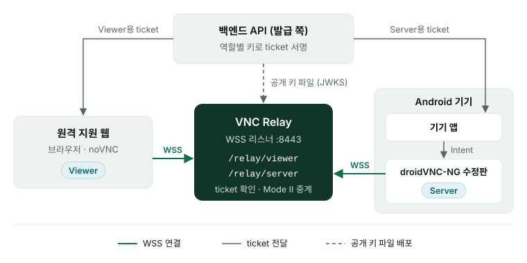

# 추천 구성 사례

이 페이지로 브라우저의 noVNC를 뷰어로, Android 기기의 [droidVNC-NG 수정판](https://github.com/kayden-kim/droidVNC-NG)을 서버로 쓰는 원격 지원 구성을 만들 수 있다. 두 역할은 모두 WSS로 접속하고 접속 ticket을 확인한다. VNC Relay 설정, ticket 발급과 확인 예시, 두 클라이언트의 준비, 운영할 때 주의할 점을 다룬다. [VNC 연결 구성](connect.md), [설정](configure.md), [접속 ticket](access-ticket.md)의 내용을 함께 쓴다.

## 이 구성을 쓰는 경우

지원 담당자가 인터넷 너머의 Android 기기를 웹 화면에서 원격으로 지원하는 경우다. 지원 담당자의 브라우저와 기기가 모두 VNC Relay로 연결을 연다. 그래서 기기는 바깥에서 들어오는 연결을 받지 않아도 된다.

이 구성을 권장하는 이유는 다음과 같다.

- 뷰어와 서버가 WSS 리스너 하나를 함께 쓴다. 인터넷에 여는 중계 포트가 하나다.
- 두 구간을 모두 TLS로 보호한다. 다만 VNC Relay 안에서는 복호화한 바이트를 중계하므로 종단 간 암호화는 아니다.
- 출발지 IP를 미리 알 수 없는 기기도 받을 수 있다. 그래도 백엔드가 권한을 확인하고 발급한 ticket이 있어야 접속한다.
- 원격 지원 세션이 만료되면 VNC Relay가 연결을 끝낸다.
- VNC 인증은 그대로 양 끝점이 한다. ticket은 VNC 인증을 대신하지 않는다.

## 구성 요소



| 구성요소 | 실행 위치 | 하는 일 |
| --- | --- | --- |
| 원격 지원 웹 | 지원 담당자의 브라우저 | noVNC를 뷰어로 쓴다. 화면을 열 때마다 백엔드 API에서 접속 정보와 뷰어용 ticket을 받는다. |
| 백엔드 API(발급 쪽) | 서버 | 지원 담당자와 기기를 인증하고 원격 지원 세션을 관리한다. 역할마다 다른 키로 ticket에 서명한다. |
| 기기 앱 | Android 기기 | 원격 지원 요청을 받는다. 서버용 ticket을 받아 droidVNC-NG 수정판에 연결을 지시한다. |
| droidVNC-NG 수정판 | Android 기기 | 기기 화면을 보내는 VNC 서버다. WSS로 VNC Relay에 역접속한다. |
| VNC Relay | 두 역할이 접속할 수 있는 호스트 | WSS 리스너 하나로 두 역할을 받고 역할별 ticket을 확인한다. 같은 중계 ID의 두 연결을 Mode II로 짝짓는다. 발급 쪽에 요청하지 않고 역할별 공개 키 파일로만 서명을 확인한다. |

## 연결 순서

1. 지원 담당자가 원격 지원 웹에서 원격 지원 세션을 시작한다. 백엔드 API는 세션마다 중계 ID를 새로 정하고 세션 만료 시각을 정한다.
2. 기기 앱이 기존 기기 관리 채널로 원격 지원 요청을 받는다. 이 요청에는 ticket을 넣지 않는다.
3. 기기 앱이 droidVNC-NG 수정판의 VNC 서버를 시작한다.
4. 기기 앱이 백엔드 API에 서버용 ticket을 요청한다. ticket 수명이 60초뿐이므로 연결 직전에 요청한다. 백엔드 API는 기기를 인증하고 세션이 유효한지 확인한 뒤 ticket과 WSS 주소를 준다.
5. 기기 앱이 droidVNC-NG 수정판에 WSS 주소, 중계 ID, ticket을 넘겨 연결을 지시한다.
6. droidVNC-NG 수정판이 `/relay/server`로 업그레이드하고 `ID:` 초기 요청을 보낸다. VNC Relay는 ticket을 확인한 뒤 이 연결을 대기 연결로 둔다.
7. 지원 담당자가 원격 화면을 열면 원격 지원 웹이 백엔드 API에 접속 정보를 요청한다. 백엔드 API는 권한과 세션 상태를 확인한 뒤 WSS 주소, 중계 ID, VNC 비밀번호, 새 뷰어용 ticket을 준다.
8. noVNC가 `/relay/viewer`로 접속한다. VNC Relay는 출발지 IP, Origin, ticket을 확인한 뒤 같은 중계 ID의 서버와 짝짓는다.
9. noVNC와 droidVNC-NG 수정판이 VNC 인증을 거쳐 화면을 주고받는다. VNC Relay는 RFB 내용을 해석하지 않고 전달한다.
10. 세션 만료 시각이 되면 VNC Relay가 두 연결에 Close 4013을 보내고 활성 세션을 끝낸다.

지원 담당자가 화면을 닫으면 VNC Relay의 활성 세션이 끝나고 서버 쪽 연결도 닫힌다. VNC Relay는 끝난 연결을 다시 짝짓지 않는다. 같은 화면을 다시 열려면 기기도 새 서버용 ticket으로 새 연결을 시작해야 한다. droidVNC-NG는 연결이 끊겨도 기기 앱에 알리지 않는다. 끊김을 감지하려면 기기 앱이 `ACTION_GET_CLIENTS`로 연결 상태를 조회해야 한다. 이 사례의 기기 앱은 연결이 성공한 뒤의 끊김을 감지하지 않는다. 그래서 백엔드가 기기에 새 연결을 지시해야 한다. 예를 들어 원격 지원 세션을 새로 시작한다.

## VNC Relay 설정

다음은 이 구성의 `relay.toml` 전체다. 예시 주소는 문서용이다. 실제 배치에서는 호스트, 출발지 IP 허용 목록, Origin, 발급 쪽 이름, 파일 경로를 맞게 바꾸어야 한다.

```toml
[admin]
accounts_file = "admin-accounts.toml"

[relay.wss]
listen = "0.0.0.0:8443"
cert_file = "tls/relay-chain.pem"
key_file = "tls/relay-key.pem"

[relay.wss.viewer]
enabled = true
allow = ["203.0.113.0/24"]
allowed_origins = ["https://viewer.example.test"]

[relay.wss.server]
enabled = true
allow = ["0.0.0.0/0"]
allowed_origins = []

[relay.ticket.viewer]
enabled = true
issuer = "issuer.example.test"
relay_host = "relay.example.test"
public_keys_file = "keys/viewer-public.jwks.json"
max_lifetime_secs = 60

[relay.ticket.server]
enabled = true
issuer = "issuer.example.test"
relay_host = "relay.example.test"
public_keys_file = "keys/server-public.jwks.json"
max_lifetime_secs = 60

[mode2]
enabled = true

[timeouts]
wait_secs = 3600

[management]
listen = "127.0.0.1:18080"

[status]
listen = "127.0.0.1:18081"

[log]
output = "relay.log"
```

| 설정 | 이 구성에서 정한 이유 |
| --- | --- |
| TCP 진입점 표 없음 | TCP 진입점은 기본으로 꺼져 있다. TCP는 ticket을 확인하지 못하므로 열지 않는다. |
| 뷰어 `allow` | 지원 담당자가 접속하는 망으로 좁힌다. 이 예시는 `203.0.113.0/24`다. |
| 서버 `allow` | 기기는 주소를 미리 알 수 없는 여러 망에서 접속한다. 그래서 모든 IPv4 출발지를 허용하고 접속 통제는 서버용 ticket에 맡긴다. 시작 때 `allow_all_source` 경고가 남는다. |
| 뷰어 `allowed_origins` | 원격 지원 웹의 origin만 허용한다. |
| 서버 `allowed_origins` | droidVNC-NG 수정판은 `Origin` 헤더를 보내지 않으므로 빈 목록으로 둔다. |
| 두 ticket 표 | `issuer`와 `relay_host`는 같고 공개 키 파일은 다르다. 두 파일에 같은 공개 키가 있으면 거절한다. |
| `relay_host` | 요청의 `Host`와 비교하지 않는다. VNC Relay의 접속 이름이 여러 개여도 고정 이름 하나를 쓸 수 있다. |
| `timeouts.wait_secs` | 대기 연결이 상대를 기다리는 최대 시간이다. 이 구성은 기기가 먼저 접속해 지원 담당자를 기다리므로 원격 지원 세션의 최대 길이 이상으로 두기를 권장한다. 그러면 뷰어가 오지 않은 대기 연결은 `sx`에 끝난다. 예시의 3600초는 기본값이다. |

`cert_file`에는 브라우저와 Android가 모두 신뢰하는 공인 CA 인증서를 쓴다. droidVNC-NG 수정판은 Android 시스템 신뢰 저장소와 호스트 이름으로 인증서를 확인한다.

1. 발급 쪽에서 역할별 공개 키 파일 두 개를 받아 `keys/`에 둔다. 파일을 만드는 예는 [ticket 발급 예시](#ticket-발급-예시)에 있다.
2. 인증서 체인과 개인키를 `tls/`에 둔다.
3. VNC Relay 호스트의 시계를 NTP로 맞춘다.
4. [빠른 시작](quick-start.md)에 따라 관리자 계정을 만든다.
5. [운영](operate.md)에 따라 VNC Relay를 시작한다.
6. 운영 로그에서 `server_ready`와 서버 역할의 `allow_all_source` 경고를 확인한다.

## ticket 발급 예시

백엔드 API는 역할마다 다른 P-256 서명 키를 쓴다. 이 사례는 개인키를 클라우드 키 관리 서비스(KMS)에 두고 서명만 요청한다. 공개 키는 역할별 JWKS 파일로 내보내 VNC Relay에 둔다. `kid`에는 키 관리 서비스의 키 식별자를 쓴다. 파일 형식과 키 교체는 [접속 ticket](access-ticket.md#공개-키-파일-구조)을 따른다.

백엔드 API는 뷰어용 ticket을 접속 정보 요청마다, 서버용 ticket을 기기의 연결 시도마다 새로 발급한다. ticket 원문은 백엔드의 DB와 로그에 남기지 않는다.

| 클레임 | 이 사례의 값 |
| --- | --- |
| `rid` | 원격 지원 세션의 중계 ID다. 이 사례는 무작위 6자리 숫자를 쓴다. |
| `iat`, `exp` | 발급 시각과 그 60초 뒤다. |
| `sx` | 원격 지원 세션의 만료 시각이다. |
| `sub` | 원격 지원 세션 ID다. 운영 로그의 `ticket_sub`에 남으므로 비밀이나 개인정보를 담지 않는 식별자여야 한다. 이 값으로 운영 로그와 백엔드 세션을 맞춰 볼 수 있다. |

`iss`와 `rh`에는 두 역할의 `issuer`·`relay_host`와 같은 고정 이름을 쓴다. 나머지 클레임 규칙은 [접속 ticket](access-ticket.md#발급-쪽과-클라이언트-준비)을 따른다.

ticket의 `iat`는 백엔드의 시각이다. VNC Relay 호스트의 시계가 5초 넘게 늦으면 새 ticket이 모두 `ticket_invalid`로 거절된다. 백엔드와 VNC Relay 호스트의 시계를 NTP로 맞춰야 한다.

### 예시 스크립트

다음 `ticket_issue.py`는 위 규칙대로 키를 만들고 ticket을 발급한다. 시험이나 발급 쪽을 만들기 전의 확인에 쓸 수 있다. 개인키를 파일로 두므로 운영에서는 개인키를 키 관리 서비스처럼 꺼낼 수 없는 곳에 두기를 권장한다. Python 3과 `cryptography` 패키지가 필요하다.

```python
"""접속 ticket 발급 예시.

python ticket_issue.py keys <역할> <kid>       역할의 서명 키와 공개 키 파일을 만든다.
python ticket_issue.py issue <역할> <중계 ID>  ticket 하나를 발급해 출력한다.
<역할>은 viewer 또는 server다.
"""
import base64
import json
import secrets
import sys
import time

from cryptography.hazmat.primitives import hashes, serialization
from cryptography.hazmat.primitives.asymmetric import ec
from cryptography.hazmat.primitives.asymmetric.utils import decode_dss_signature

ISSUER = "issuer.example.test"     # 두 역할의 issuer와 같은 값
RELAY_HOST = "relay.example.test"  # 두 역할의 relay_host와 같은 값
LIFETIME = 60                      # 역할의 max_lifetime_secs 이하
SESSION_SECS = 1800                # 예시 원격 지원 세션의 길이


def b64url(data: bytes) -> str:
    return base64.urlsafe_b64encode(data).rstrip(b"=").decode("ascii")


def b64json(value: dict) -> str:
    return b64url(json.dumps(value, separators=(",", ":")).encode("utf-8"))


def make_keys(role: str, kid: str) -> None:
    key = ec.generate_private_key(ec.SECP256R1())
    with open(f"{role}-private.pem", "wb") as f:
        f.write(key.private_bytes(serialization.Encoding.PEM,
                                  serialization.PrivateFormat.PKCS8,
                                  serialization.NoEncryption()))
    point = key.public_key().public_bytes(serialization.Encoding.X962,
                                          serialization.PublicFormat.UncompressedPoint)
    jwk = {"kty": "EC", "crv": "P-256", "kid": kid, "use": "sig", "alg": "ES256",
           "x": b64url(point[1:33]), "y": b64url(point[33:])}
    with open(f"{role}-public.jwks.json", "w", encoding="utf-8") as f:
        json.dump({"keys": [jwk]}, f)


def issue(role: str, relay_id: str, session_id: str, session_expires_at: int) -> str:
    with open(f"{role}-private.pem", "rb") as f:
        key = serialization.load_pem_private_key(f.read(), password=None)
    with open(f"{role}-public.jwks.json", encoding="utf-8") as f:
        kid = json.load(f)["keys"][0]["kid"]
    now = int(time.time())
    claims = {
        "iss": ISSUER,
        "aud": f"vnc-relay/{role}",
        "rh": RELAY_HOST,
        "rid": relay_id,
        "jti": b64url(secrets.token_bytes(16)),  # ticket마다 새 128비트 난수
        "iat": now,
        "exp": now + LIFETIME,
        "sx": session_expires_at,
        "sub": session_id,
    }
    signing_input = b64json({"alg": "ES256", "kid": kid}) + "." + b64json(claims)
    der = key.sign(signing_input.encode("ascii"), ec.ECDSA(hashes.SHA256()))
    r, s = decode_dss_signature(der)  # DER 서명을 R‖S 64바이트로 바꾼다
    return signing_input + "." + b64url(r.to_bytes(32, "big") + s.to_bytes(32, "big"))


if __name__ == "__main__":
    command, role = sys.argv[1], sys.argv[2]
    if command == "keys":
        make_keys(role, sys.argv[3])
    else:
        # 실제 발급 쪽은 원격 지원 세션의 ID와 만료 시각을 넣는다.
        print(issue(role, sys.argv[3], "session-example", int(time.time()) + SESSION_SECS))
```

1. 발급 쪽으로 쓸 컴퓨터에서 패키지를 설치하고 두 역할의 키를 만든다. 명령은 `ticket_issue.py`가 있는 디렉터리에서 실행한다.

   Windows:

   ```powershell
   python -m pip install cryptography
   python ticket_issue.py keys viewer viewer-2026-11
   python ticket_issue.py keys server server-2026-11
   ```

   Ubuntu:

   ```shell
   sudo apt install python3-cryptography
   python3 ticket_issue.py keys viewer viewer-2026-11
   python3 ticket_issue.py keys server server-2026-11
   ```

   기대 결과: 역할마다 `<역할>-private.pem`과 `<역할>-public.jwks.json`이 생긴다.

2. 두 `*-public.jwks.json` 파일을 VNC Relay의 `keys/`에 복사한다. `*-private.pem` 파일은 복사하지 않는다.

ticket은 `issue` 명령으로 만든다. 사용 예는 [ticket 확인 예시](#ticket-확인-예시)에 있다.

### 키 관리 서비스로 서명할 때

키 관리 서비스를 쓰면 `make_keys`와 개인키 파일이 필요 없다. 공개 키는 서비스에서 받아 JWKS로 바꾼다. 서비스가 공개 키를 DER 형식으로 주면 `serialization.load_der_public_key`로 읽은 뒤 `make_keys`와 같은 방법으로 `x`·`y`를 구한다.

서명은 `key.sign` 대신 서비스의 서명 API로 요청한다. 서명할 값을 원문으로 넘길지 SHA-256 다이제스트로 넘길지는 서비스 문서를 따른다. 서비스가 ECDSA 서명을 DER 형식으로 돌려주면, 예시처럼 `decode_dss_signature`로 64바이트 R‖S 형식으로 바꿔야 한다. VNC Relay는 DER 서명을 거절한다.

## ticket 확인 예시

### 공개 키로 서명 확인하기

다음 `ticket_verify.py`는 ticket의 서명을 공개 키 파일로 확인한다. 서명이 맞으면 헤더와 클레임을 출력한다. 공개 키 파일에 `kid`가 없거나, 서명이 DER 형식이거나, 키가 다르면 오류로 끝난다. 이 스크립트는 서명만 확인한다. 클레임 대조, 시각, 사용 기록은 [VNC Relay로 확인하기](#vnc-relay로-확인하기)에서 본다.

```python
"""접속 ticket의 서명을 공개 키 파일로 확인하는 예시.

python ticket_verify.py <공개 키 파일> <ticket>
"""
import base64
import json
import sys

from cryptography.hazmat.primitives import hashes
from cryptography.hazmat.primitives.asymmetric import ec
from cryptography.hazmat.primitives.asymmetric.utils import encode_dss_signature


def unb64url(text: str) -> bytes:
    return base64.urlsafe_b64decode(text + "=" * (-len(text) % 4))


def verify(jwks_path: str, ticket: str) -> dict:
    header_part, claims_part, signature_part = ticket.split(".")
    header = json.loads(unb64url(header_part))
    with open(jwks_path, encoding="utf-8") as f:
        keys = [k for k in json.load(f)["keys"] if k["kid"] == header["kid"]]
    if not keys:
        sys.exit(f"공개 키 파일에 kid {header['kid']!r}가 없다")
    signature = unb64url(signature_part)
    if len(signature) != 64:
        sys.exit(f"서명이 R‖S 64바이트가 아니다({len(signature)}바이트). DER 서명일 수 있다")
    public_key = ec.EllipticCurvePublicKey.from_encoded_point(
        ec.SECP256R1(), b"\x04" + unb64url(keys[0]["x"]) + unb64url(keys[0]["y"]))
    der = encode_dss_signature(int.from_bytes(signature[:32], "big"),
                               int.from_bytes(signature[32:], "big"))
    # 서명이 맞지 않으면 InvalidSignature 예외로 끝난다.
    public_key.verify(der, f"{header_part}.{claims_part}".encode("ascii"),
                      ec.ECDSA(hashes.SHA256()))
    return {"header": header, "claims": json.loads(unb64url(claims_part))}


if __name__ == "__main__":
    print(json.dumps(verify(sys.argv[1], sys.argv[2]), indent=2, ensure_ascii=False))
```

`ticket_issue.py`와 같은 디렉터리에서 서버용 ticket을 발급하고 확인한다. `482913`은 시험용 중계 ID다.

Windows:

```powershell
$t = python ticket_issue.py issue server 482913
python ticket_verify.py server-public.jwks.json $t
```

Ubuntu:

```shell
t=$(python3 ticket_issue.py issue server 482913)
python3 ticket_verify.py server-public.jwks.json "$t"
```

기대 결과: 헤더의 `alg`·`kid`와 클레임이 JSON으로 출력된다. `aud`는 `vnc-relay/server`, `rid`는 `482913`이다.

### VNC Relay로 확인하기

VNC Relay가 ticket을 받아들이는지는 WebSocket 업그레이드 요청을 직접 보내 확인한다. VNC Relay가 시작한 지 5초가 지난 뒤에 실행해야 한다. 그 전에 발급한 ticket은 `ticket_issued_before_start`로 거절된다. 실제 발급 쪽을 쓰면 예시 스크립트 대신 그 API가 준 ticket을 `t`에 넣는다.

1. 서버용 ticket을 발급하고 `/relay/server`로 업그레이드 요청을 보낸다.

   Windows:

   ```powershell
   $t = python ticket_issue.py issue server 482913
   curl.exe -i --http1.1 --max-time 2 https://relay.example.test:8443/relay/server -H "Connection: Upgrade" -H "Upgrade: websocket" -H "Sec-WebSocket-Version: 13" -H "Sec-WebSocket-Key: dGhlIHNhbXBsZSBub25jZQ==" -H "Sec-WebSocket-Protocol: binary, ticket.$t"
   ```

   Ubuntu:

   ```shell
   t=$(python3 ticket_issue.py issue server 482913)
   curl -i --http1.1 --max-time 2 https://relay.example.test:8443/relay/server -H "Connection: Upgrade" -H "Upgrade: websocket" -H "Sec-WebSocket-Version: 13" -H "Sec-WebSocket-Key: dGhlIHNhbXBsZSBub25jZQ==" -H "Sec-WebSocket-Protocol: binary, ticket.$t"
   ```

   기대 결과: `HTTP/1.1 101 Switching Protocols`와 `Sec-WebSocket-Protocol: binary`가 출력된다. 운영 로그에 `ticket_accepted`가 남는다. curl은 WebSocket 통신을 이어 가지 않으므로 2초 뒤 시간 초과(종료 코드 28)로 끝난다.

2. 같은 `curl` 줄을 한 번 더 실행한다.

   기대 결과: HTTP 401과 `WWW-Authenticate: VncRelayTicket`이 출력된다. 운영 로그의 `connection_rejected`에 `ticket_reused`가 남는다.

3. 뷰어 `allow`에 든 주소의 컴퓨터에서 뷰어를 확인한다. 1단계의 두 줄에서 `issue`의 역할을 `viewer`로, 경로를 `/relay/viewer`로 바꾸고 `-H "Origin: https://viewer.example.test"`를 더해 실행한다.

   기대 결과: 101 응답 뒤에 VNC Relay가 보낸 첫 WebSocket 프레임이 `RFB 000.000`과 함께 보인다. 운영 로그에 뷰어 역할의 `ticket_accepted`가 남는다.

거절되면 운영 로그 `connection_rejected`의 `reason`을 확인한다. 이유별 조치는 [문제 해결](troubleshooting.md#접속-ticket이-http-401로-거절된다)을 따른다.

## 뷰어 쪽: noVNC

`vnc.html` URL로는 ticket을 보낼 수 없다. 원격 지원 웹은 noVNC의 `RFB` 객체를 직접 만들고 `wsProtocols`로 ticket을 넘긴다. 예시는 noVNC 1.7.0 패키지 기준이다.

```javascript
const rfb = new RFB(screen, connection.relayUrl, {
  repeaterID: connection.relayId,
  credentials: { password: connection.password },
  wsProtocols: ["binary", `ticket.${connection.ticket}`],
});
```

`connection`은 백엔드 API가 준 접속 정보다. `relayUrl`은 `wss://relay.example.test:8443/relay/viewer`다.

- `RFB` 객체를 만들 때마다 접속 정보를 새로 받는다. 이미 쓴 ticket으로 다시 연결하지 않는다.
- ticket과 VNC 비밀번호를 URL, 화면, 브라우저 저장소, 로그에 남기지 않는다.

## 서버 쪽: droidVNC-NG 수정판과 기기 앱

원본 droidVNC-NG는 Repeater에 TCP로만 역접속한다. [droidVNC-NG 수정판](https://github.com/kayden-kim/droidVNC-NG)은 droidVNC-NG 2.22.3 기반이며 다음 기능을 제공한다.

- `ws://` 또는 `wss://` 주소를 받으면 WebSocket으로 접속한다. 경로가 없으면 `/relay/server`를 쓴다.
- `Sec-WebSocket-Protocol`에 `binary`를 보낸다. ticket을 받으면 `ticket.<JWS>`를 함께 보낸다.
- 업그레이드가 끝나면 250바이트 `ID:` 초기 요청을 첫 바이너리 메시지로 보낸다. VNC Relay의 시작 바이트를 기다리지 않는다.
- 그 뒤에는 RFB 바이트를 바이너리 메시지로만 주고받는다.
- 인증서는 Android 시스템 신뢰 저장소와 호스트 이름으로 확인한다.
- ticket을 쓴 연결은 끊겨도 자동으로 다시 접속하지 않는다. 같은 ticket은 다시 쓸 수 없기 때문이다.
- ticket을 TCP 주소와 함께 받으면 연결하지 않는다. ticket 없는 TCP 연결로 조용히 바뀌는 일을 막는다.

매개변수는 droidVNC-NG의 Intent 인터페이스(`ACTION_CONNECT_REPEATER`)로 받는다. 호스트 값에 WSS 주소를 넣고, ticket은 별도 값으로 넘긴다. 앱 안의 WebSocket 클라이언트와 VNC 서버 엔진은 소켓 쌍(socket pair)으로 잇는다. 루프백 포트를 열지 않으므로 기기 안의 다른 앱이 이 연결에 끼어들 수 없다. 값 이름과 `adb` 명령 예는 수정판의 [Intent 인터페이스 문서](https://github.com/kayden-kim/droidVNC-NG/blob/master/doc/Intent-Interface.md)에, 설계 이유는 [ADR 0006](https://github.com/kayden-kim/droidVNC-NG/blob/master/doc/adr/0006-bridge-websocket-repeaters-via-socket-pair.md)에 있다.

기기 앱은 다음 일을 맡는다.

- 설치된 droidVNC-NG가 WebSocket을 지원하는 수정판인지 확인한 뒤 WSS 주소를 넘긴다. 수정판이 원본과 같은 버전 번호를 쓸 수 있으므로 버전 번호만으로 판단하지 않는다.
- 연결 시도마다 백엔드 API에서 새 서버용 ticket을 받는다. ticket 요청이나 연결 지시가 실패하면 간격을 늘리며 새 ticket으로 다시 시도한다. 연결이 성공한 뒤의 끊김은 이 재시도 대상이 아니다.
- WSS 연결이 실패해도 ticket 없는 TCP로 되돌아가지 않는다.
- ticket을 로그에 남기지 않는다.

> **주의:** ticket 요청은 기기 앱이 직접 보내므로 Android의 백그라운드 네트워크 제한을 받는다. Android 16에서는 droidVNC-NG의 화면 공유 확인 화면이 앞에 있는 동안 기기 앱의 요청이 실패할 수 있다. 기기 앱이 다시 앞으로 나온 뒤 새 ticket으로 다시 시도하게 만든다.

> **참고:** droidVNC-NG는 GPL 2.0 라이선스다. 수정판을 다른 사람에게 배포하면 소스 코드 제공 같은 라이선스 조건을 지켜야 한다.

## 운영할 때 주의할 점

- 옛 기기를 옮기는 동안 TCP 서버 진입점을 함께 열 수 있다. 이 경로는 ticket을 확인하지 않으며 `ticket_tcp_bypass` 경고가 남는다. 옮기기를 마치면 닫는다.
- ticket은 접속할 때만 확인한다. 백엔드에서 세션을 일찍 끝내도 이미 열린 연결은 `sx`까지 남는다. 활성 세션은 [대시보드](dashboard.md#세션-상세와-관리자-종료)의 관리자 종료로 바로 끝낼 수 있다.
- VNC Relay를 재시작하면 모든 연결이 끊긴다. `iat`가 기동 시각 + 5초 이하인 ticket은 거절한다. 재시작 직후에는 잠시 기다린 뒤 새 ticket으로 다시 접속해야 한다.
- 역할마다 `issuer`와 `relay_host`는 하나뿐이다. 여러 환경(예: 개발·운영)이 한 VNC Relay를 같이 쓰면 역할별 공개 키 파일이 모든 환경의 키를 믿는다. 이때 다른 환경의 ticket도 중계 ID가 같으면 접속할 수 있다. 환경을 격리하려면 환경마다 VNC Relay를 따로 둔다.
- Origin은 다른 사이트의 브라우저를 막을 뿐 사용자 인증이 아니다.

## 확인 범위

VNC Relay의 noVNC 검증(1.7.0)은 `vnc.html`을 `wsProtocols` 없이 쓴 경우다. noVNC의 ticket 전송과 droidVNC-NG 수정판은 VNC Relay의 자동 시험에 들어 있지 않다. 이 구성은 실제 Android 기기에서 두 역할의 WSS·ticket 연결과 화면 표시를 확인했다. 화면 입력과 세션 만료는 실제 기기로 확인하지 않았다.

이 페이지의 예시 스크립트와 [VNC Relay로 확인하기](#vnc-relay로-확인하기) 절차는 Windows와 Ubuntu에서 실행해 기대 결과를 확인했다. 실행 기록은 [도움말 게시 how-to의 검증 표](https://github.com/kayden-kim/vnc-relay/blob/main/docs/how-to/publish-help.md#4-검증)에 있다.
