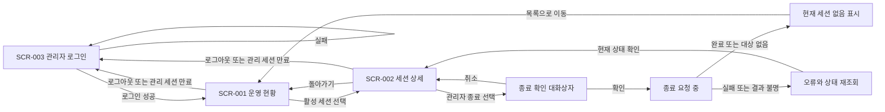

# 운영 대시보드 화면 스펙

관리자가 로그인한 뒤 대기·활성 상태를 확인하고 특정 세션을 종료하는 화면 동작을 정의한다. 실제 화면 구현은 아니다. 시각 구성은 HTML 시안이 보여 주며, 시안은 동작·상태·검증의 기준이 아니다.

| 항목 | 값 |
| --- | --- |
| 상태 | Draft |
| 관련 요구사항 | [PRD](../requirements/PRD.md) FR-06, AC-09·AC-10·AC-36 |
| 관련 시스템 스펙 | [관리 조회와 세션 종료](management.md) |
| 용어 | [VNC Relay 용어집](../../GLOSSARY.md) |
| 관련 계약 | [관리 API v1](../contracts/management-api-v1.md). Active(2026-10-16 채택)이며 경로·응답 본문·화면 URL은 이 계약이 기준이다. 관리 API는 JSON over HTTP이며 경로 접두사는 `/api/v1/`이다(사용자 확정). |
| 관련 아키텍처 문서·ADR | 없음. 정적 HTML·JS 대시보드 선택은 별도 ADR 없이 [PRD 확정 기준](../requirements/PRD.md#확정-기준)으로 관리한다. 대시보드는 별도 빌드 단계 없는 정적 HTML·JS이며 실행파일에 넣어 관리 리스너가 제공한다. 프런트엔드 코드는 아직 없다. |
| 디자인 원본·공통 시각 기준 | [운영 대시보드 디자인 기준](../design/DESIGN.md). Accepted(2026-10-20 사용자 채택). 색·간격·폰트·토큰·배치 기준은 디자인 기준이 정한다. |
| HTML 시안 | [../design/mockups/dashboard.html](../design/mockups/dashboard.html). 채택된 디자인 기준의 토큰으로 만든 시안이며 사용자가 2026-10-20에 채택했다. 4절의 모든 화면 ID와 상태를 보여 준다. 영어 화면은 대표 화면 두 개(SCR-001 정상, SCR-003 입력)만 보여 준다. 시안과 이 문서의 문장이 다르면 문장을 따른다. |
| 관련 컴포넌트 예시 | 없음. 실제 컴포넌트와 미리보기 환경이 없다. |

선택 기준·시나리오 소유·와이어프레임 판정은 [스펙 작성 규칙](AGENTS.md)을, HTML 시안 판정은 [디자인 문서 작성 규칙](../design/AGENTS.md#html-시안)을 따른다. 색·간격·글꼴 값은 디자인 기준을 연결한다. 시안 작성 순서는 [frontend-workflow 참고 문서](../../.agents/skills/frontend-workflow/references/frontend-workflow.md#화면별-html-시안-4단계)를 따른다.

## 1. 범위와 사용자

- 로그인한 관리자가 요약·대기 목록·활성 목록·세션 상세·최근 종료 목록을 보고 현재 세션을 확인한 뒤 종료한다.
- 내장 관리자 로그인과 조회·관리자 종료는 사용자 확정 범위다. 권한은 서버가 검증하며 중계 IP 허용 정책과 분리한다.
- 로그인·운영 현황·상세 화면과 조건별 이동을 별도 화면 스펙으로 관리한다.
- 화면 배치와 세션의 구체적 표현은 Draft다. 폴링 주기 P는 설정 가능하며 기본값 2초로 확정이다([4.1절](#41-폴링)). 내장 로그인 선택 자체는 미확정으로 되돌리지 않는다.
- 원격 화면 표시·키보드 입력 전송·noVNC·설정 편집·장기 이력 검색을 제공하지 않는다.
- 대시보드는 별도 빌드 단계 없는 정적 HTML·JS로 만들고 실행파일에 넣어 관리 리스너가 제공한다. Node 빌드 체인과 JS 프레임워크 의존성을 추가하지 않는다.
- 지원 화면 폭은 데스크톱과 모바일 폭이고, 지원 브라우저는 최신 Chrome·Edge·Firefox·Safari다. 두 폭 모두에서 필수 정보와 상세 이동·종료·취소·로그아웃 행동을 쓸 수 있어야 한다([6절](#6-화면-크기와-접근성)).
- 화면 문구는 한국어와 영어 두 가지다. 브라우저 언어로 자동 선택하고 사용자가 바꿀 수 있다([화면 언어](#화면-언어)).

## 2. 화면 흐름



| 화면 ID | 화면 | 진입 | 이탈 |
| --- | --- | --- | --- |
| SCR-001 | 운영 현황 | 로그인 성공, 유효한 관리 세션으로 진입, 상세에서 돌아가기 | 활성 세션 선택 시 상세, 로그아웃·관리 세션 만료 시 로그인 |
| SCR-002 | 세션 상세 | 선택한 세션 식별자 | 목록으로 돌아가기, 종료 확인 열기 |
| SCR-003 | 관리자 로그인 | 인증되지 않은 진입, 로그아웃, 관리 세션 만료 | 로그인 성공 시 운영 현황 |

화면 URL과 라우터 구현은 정하지 않는다. 종료 확인은 SCR-002의 대화상자 상태다. 보호된 화면의 직접 진입에도 유효한 관리 세션이 필요하다.

## 3. 화면 구성과 와이어프레임

밑그림은 정보 묶음과 행동만 표현한다. 기준은 아래 문장과 수용 테스트다. 화면마다 구성요소 표를 둔다.

### SCR-001 운영 현황

```text
+--------------------------------------------------------------------------------------+
| VNC Relay  운영 현황              [언어] [로그아웃]                              |
| 운영 현황  마지막 성공 갱신: [시각]                         [새로고침]          |
| 실행 상태 [값]  가동 시간 [값]  대기 [수]  활성 [수]                             |
| 초기 교환 중 [수]  Mode I 대상 연결 중 [수]                                      |
| 중계 연결 [현재/상한]  관리 연결 [현재/상한]                                      |
+--------------------------------------------------------------------------------------+
| 대기 연결                                                                        |
| 역할 | 중계 ID | 접속 시각 | 대기 시간                                           |
+--------------------------------------------------------------------------------------+
| 활성 세션                                                                        |
| 세션 | 모드 | 전송 경로 | 시작 | Viewer->대상 / 대상->Viewer | 상대 주소 | 상세  |
+--------------------------------------------------------------------------------------+
| 최근 종료 목록                                                                   |
| 세션 | 종료 원인 | 종료 시각 | Viewer->대상 / 대상->Viewer                       |
+--------------------------------------------------------------------------------------+
| 목록별 조회 상태 또는 오류                                                       |
+--------------------------------------------------------------------------------------+
```

| 구성요소 | 표시 내용·입력 규칙 | 사용자 행동 | 결과 | 관련 시나리오 |
| --- | --- | --- | --- | --- |
| 마지막 성공 갱신·새로고침 | 성공한 응답을 반영한 시각(현지 시각과 시간대) | 새로고침 | 같은 조회가 진행 중이 아니면 재조회, 성공했을 때만 시각 갱신 | DASH-003·DASH-004·DASH-005 |
| 서버 요약 | 실행 상태, 가동 시간, 대기 수, 활성 수 | 읽기 | 관리 스펙 값과 일치, 확인하지 못한 값은 0으로 표시하지 않음 | DASH-001·DASH-016 |
| 연결 수·사용량 | 서버 요약의 초기 교환 중 연결 수, Mode I 대상 연결 중 연결 수, 중계 연결(L)·관리 연결(Lm)의 현재 사용량과 상한. 화면에는 기호 L·Lm 대신 "중계 연결"·"관리 연결" 이름과 무엇을 세는지 한 줄 설명을 쓴다. 의미는 [관리 스펙 2절](management.md#2-조회-대상과-상태)을 따른다 | 읽기 | 관리 스펙 값과 일치, 확인하지 못한 값은 0으로 표시하지 않음 | DASH-021 |
| 대기 연결 목록 | 역할, 중계 ID, 접속 시각, 대기 시간. 빈 목록은 "대기 없음" | 읽기 | 대기 연결에는 상세·종료 행동 없음 | DASH-001·DASH-002 |
| 활성 세션 목록 | 세션 식별자, 모드, 전송 경로, 시작 시각, 방향별 바이트, 상대 주소. 빈 목록은 "활성 없음" | 상세 열기 | 선택한 식별자의 SCR-002로 이동 | DASH-001·DASH-002·DASH-006 |
| 최근 종료 목록 | 세션 식별자, 종료 원인, 종료 시각, 방향별 바이트([관리 스펙 2.3절](management.md#23-최근-종료-목록)). 빈 목록은 "최근 종료 없음" | 읽기 | 종료·상세 행동 없음 | DASH-020 |
| 방향별 바이트 | 관리 스펙 2.1절의 누적 바이트(정수)를 KiB/MiB로 표시. 표는 방향을 Viewer->대상, 대상->Viewer로 줄여 쓴다 | 읽기 | 전송량 의미를 바꾸지 않음 | DASH-001·DASH-020 |
| 목록별 조회 상태 | 조회 중·실패·오래된 성공 데이터 구분 | 재조회 | 실패를 빈 목록으로 표시하지 않음 | DASH-003·DASH-004 |
| 언어 선택 | 현재 화면 언어 이름("한국어" 또는 "English") | 언어 선택 | 화면 문구를 즉시 바꾸고 선택을 브라우저에 저장 | DASH-024·DASH-025 |
| 로그아웃 | 현재 관리 세션 | 로그아웃 | 서버 무효화 확인 뒤 데이터 제거·SCR-003 이동 | DASH-019 |

### SCR-002 세션 상세

```text
+--------------------------------------------------------------+
| [목록으로] 세션 [식별자]         마지막 성공 갱신: [시각]       |
| 모드 [값]   Viewer 전송 경로 [값]   시작 시각 [값]             |
| Viewer 주소 [값]             Server/대상 주소 [값]            |
| Viewer -> Server/대상 [바이트]                                |
| Server/대상 -> Viewer [바이트]                [세션 종료]      |
+--------------------------------------------------------------+
| 확인 시: 종료할 세션 [식별자] [취소] [종료 확인]               |
+--------------------------------------------------------------+
```

| 구성요소 | 표시 내용·입력 규칙 | 사용자 행동 | 결과 | 관련 시나리오 |
| --- | --- | --- | --- | --- |
| 목록으로 | 없음 | 선택 | SCR-001로 이동 | DASH-007 |
| 마지막 성공 갱신 | 성공한 응답을 반영한 시각(현지 시각과 시간대) | 읽기 | 성공했을 때만 시각 갱신 | DASH-004·DASH-005 |
| 세션 정보 | 세션 식별자, 모드, Viewer 전송 경로, 시작 시각(현지 시각과 시간대) | 읽기 | 선택한 식별자의 값만 표시 | DASH-006 |
| 상대 주소 | Viewer 주소, Server/대상 주소. 실제 소켓 상대 주소 | 읽기 | 전달 헤더로 상대 주소를 대체하지 않음 | DASH-006 |
| 방향별 바이트 | 관리 스펙 2.1절의 누적 바이트(정수)를 KiB/MiB로 표시 | 읽기 | 전송량 의미를 바꾸지 않음 | DASH-006 |
| 세션 종료 버튼 | 유효한 관리 세션이 있고 대상이 있을 때만 활성 | 선택 | 종료 확인 대화상자 열기, 요청은 보내지 않음 | DASH-009·DASH-014 |
| 종료 확인 대화상자 | 종료할 세션 식별자와 연결이 끊긴다는 영향 | 취소·닫기 또는 종료 확인 | 취소·닫기는 요청 없음과 포커스 복귀, 확인은 현재 식별자로 요청 | DASH-009~013 |
| 언어 선택 | SCR-001과 같다 | 언어 선택 | SCR-001과 같다 | DASH-024·DASH-025 |
| 로그아웃 | 현재 관리 세션 | 로그아웃 | 서버 무효화 확인 뒤 데이터 제거·SCR-003 이동 | DASH-019 |

### SCR-003 관리자 로그인

```text
+------------------------------------------+
|                                  [언어]  |
| VNC Relay 관리자 로그인                  |
| 계정명   [____________________]           |
| 비밀번호 [********************]           |
| [로그인]                                 |
| 로그인 중 또는 공통 인증 실패 안내        |
+------------------------------------------+
```

계정명·비밀번호는 필수다. 빈 입력은 전송하지 않는다. 실패 시 계정명은 유지하고 비밀번호는 지운다. 비밀번호를 URL·로그·화면 오류에 표시하지 않는다. 로그인 진행 중 중복 전송을 막는다. 로그인 실패 제한 중에도 실패와 같은 공통 안내를 표시하며 계정 존재 여부를 드러내지 않는다. 계정 등록·비밀번호 변경 화면은 추가하지 않는다.

| 구성요소 | 표시 내용·입력 규칙 | 사용자 행동 | 결과 | 관련 시나리오 |
| --- | --- | --- | --- | --- |
| 계정명 | 필수. 실패 뒤에도 입력값 유지 | 입력 | 빈 값이면 전송하지 않음 | DASH-018 |
| 비밀번호 | 필수. 가려서 표시, URL·로그·화면 오류에 표시하지 않음 | 입력 | 빈 값이면 전송하지 않음, 실패 뒤 지움 | DASH-018 |
| 로그인 버튼 | 로그인 진행 중에는 비활성 | 로그인 | 성공 시 SCR-001, 실패·실패 기준 초과 시 같은 공통 안내 | DASH-017·DASH-018 |
| 안내 영역 | 로그인 중 또는 공통 인증 실패 안내. 계정 존재 여부를 드러내지 않음 | 읽기 | 보호 데이터 없음 | DASH-018 |
| 언어 선택 | 현재 화면 언어 이름 | 언어 선택 | 화면 문구를 즉시 바꾸고 선택을 브라우저에 저장. 입력한 계정명은 유지 | DASH-024·DASH-025 |

### 시각·전송량 표시 형식

관리 API 값의 형식은 [관리 스펙 2.1절](management.md#21-전송량의-의미)이 정한다. 화면은 그 값을 다음처럼 표시한다.

- 시각: API의 UTC ISO 8601 값을 브라우저 현지 시각으로 바꿔 표시하고 시간대를 함께 보여준다. 마지막 성공 갱신, 접속 시각, 시작·종료 시각이 대상이다.
- 전송량: API의 바이트 정수를 KiB/MiB(이진 단위, 1 KiB = 1024 바이트)로 바꿔 표시한다.
- 표시용 변환은 API 값을 바꾸지 않는다. 확인하지 못한 값은 변환하지 않고 0으로도 표시하지 않는다.
- 소수 자릿수와 KiB·MiB 전환 경계는 [디자인 기준의 표시 형식](../design/DESIGN.md#표시-형식)을 따른다.
- 화면 언어를 바꿔도 시각·전송량 형식은 같다. 시간 길이의 일 단위 글씨처럼 단위를 나타내는 글씨만 언어에 따라 바뀐다.

### 화면 언어

화면 문구는 한국어와 영어 두 가지다(사용자 확정, 2026-10-20).

- 자동 선택: 저장된 선택이 없으면 브라우저의 선호 언어 목록을 앞에서부터 확인한다. 처음 만나는 한국어(`ko`, `ko-KR` 등) 또는 영어(`en`, `en-US` 등)를 쓴다. 둘 다 없으면 영어를 쓴다.
- 직접 선택: SCR-001·SCR-002의 상단 막대와 SCR-003에서 언어를 고를 수 있다. 고르면 다시 불러오지 않고 화면 문구를 바로 바꾼다. 입력값·조회 데이터·화면 상태는 유지한다.
- 저장: 직접 고른 언어는 브라우저 저장소에 남긴다. 같은 브라우저에서 다시 열거나 로그인·로그아웃해도 유지한다. 저장된 선택은 자동 선택보다 우선한다. 서버 설정·관리 API·관리 세션에는 언어를 보내거나 저장하지 않는다.
- 번역 범위: 화면 문구·버튼·레이블·상태 안내·오류 안내를 번역한다. 세션 식별자·중계 ID·주소 같은 데이터 값, 모드·전송 경로 이름(Mode I, TCP 등), 목록에 없는 알 수 없는 값은 받은 그대로 보여 주고 번역하지 않는다.
- 문구 확정: 두 언어의 문구는 [9절](#9-화면-문구)이 정한다. 사용자 결정 2026-10-22(Q49)로 승인했다.

## 4. 화면 상태와 갱신

| 화면 ID | 상태 | 진입 조건 | 보이는 내용 | 가능한 행동 |
| --- | --- | --- | --- | --- |
| SCR-001·SCR-002 | 최초 로딩 | 화면에 들어온 뒤 첫 조회 응답 전 | 조회 중, 아직 모르는 값을 0으로 표시하지 않음 | 목록 이동 또는 조회 완료 대기 |
| SCR-001 | 정상·빈 목록 | 조회 성공 | 실제 값 또는 명시적 대기 없음·활성 없음·최근 종료 없음 | 새로고침, 존재하는 상세 열기 |
| SCR-002 | 정상 | 선택한 세션의 상세 조회 성공 | 세션 정보·상대 주소·방향별 바이트, 세션 종료 버튼 | 목록 이동, 종료 확인 열기 |
| SCR-002 | 종료 확인 | 정상 상태에서 세션 종료 버튼 선택 | 종료할 세션 식별자와 연결이 끊긴다는 영향, 취소·종료 확인 | 취소·닫기, 종료 확인 |
| SCR-001·SCR-002 | 갱신 중 | 성공 데이터가 있는 상태에서 폴링 또는 새로고침 조회 시작 | 이전 성공 데이터가 있으면 유지, 갱신 중 구분 | 화면 이동, 중복 갱신 방지 |
| SCR-001·SCR-002 | 조회 실패 | 조회 오류 응답 또는 조회 제한 시간 초과 | 실패 표시, 이전 데이터는 마지막 성공 시각과 함께 표시 | 명시적 재조회 |
| SCR-001·SCR-002 | 권한 없음·관리 세션 만료 | 인증 거절 응답, 또는 관리 세션의 유휴·최대 수명 경과 | 보호된 데이터 제거, 로그인 화면으로 이동 | 관리자 로그인 |
| SCR-002 | 대상 없음 | 상세 조회가 대상 없음 응답, 또는 종료 완료 | 현재 세션을 찾을 수 없음, 종료 비활성 | 목록으로 이동 |
| SCR-002 | 잘못된 세션 식별자 | 상세 화면 URL의 세션 식별자 형식이 틀림. 요청을 보내지 않음 | 잘못된 세션 식별자 안내(CPY-067), 종료 행동 없음 | 목록으로 이동 |
| SCR-002 | 종료 요청 중 | 종료 확인 선택 뒤 응답 전 | 요청 중 상태, 중복 종료 비활성 | 결과 대기, 다른 화면으로 이동 |
| SCR-002 | 종료 실패·확인 불가 | 종료 실패 응답, 요청 거절(403) 응답, 또는 응답 유실 | 실패 또는 결과를 확인할 수 없음 구분(CPY-065·CPY-066), 요청 거절 안내(CPY-068) | 상태 재조회, 현재 세션 확인 후 재시도 |
| SCR-003 | 입력·로그인 중·실패 | 인증되지 않은 진입·로그아웃·관리 세션 만료, 로그인 전송 뒤 응답 전, 로그인 실패 응답 | 비밀값 없는 입력 오류, 인증 필요 안내(CPY-075), 로그인 확인 중 안내(CPY-073), 공통 인증 실패(CPY-074), 중복 전송 비활성 | 입력 수정·명시적 로그인 |
| SCR-003 | 로그인 요청 실패 | 로그인 요청 뒤 서버 오류 응답 또는 응답 없음 | 로그인 요청 실패 안내(CPY-077), 중복 전송 비활성. 인증 실패(CPY-074)와 구분 | 입력 수정·명시적 재시도 |
| SCR-003 | 로그아웃 결과 확인 필요 | 로그아웃 요청 뒤 응답을 확인하지 못함 | 완료로 표시하지 않음, 관리 데이터 숨김, 로그아웃 결과 불명 안내(CPY-076) | 관리자 로그인 |

### 4.1 폴링

- 폴링 주기 P는 설정 가능하며 기본값은 2초다(확정). 재시작이 필요한 설정이다. 화면은 서버 설정의 P를 따른다. P와 조회 제한 시간의 기본값·유효 범위는 사용자 승인으로 [설정 계약](../contracts/config-v1.md)이 정한다([운영 스펙](operations.md#2-상태와-검증-매개변수)).
- 같은 조회가 진행 중이면 새 주기 요청을 겹쳐 보내지 않는다. 완료 후 다음 주기에 조회한다. 조회 시간 제한은 [설정 계약](../contracts/config-v1.md)이 정하고 요청 전달 방식은 [관리 API 계약](../contracts/management-api-v1.md)이 정한다.
- 마지막 성공 갱신 시각은 성공한 응답을 화면에 반영한 때만 바꾼다. 요청 시작·실패만으로 성공 시각을 갱신하지 않는다.
- 화면·세션 식별자가 바뀐 뒤 도착한 이전 요청 결과는 새 화면을 덮어쓰지 않는다.
- 실패 응답을 빈 성공 목록으로 표시하지 않는다. 권한 거절 이후에는 이전 성공 데이터를 계속 노출하지 않는다.
- 변경 직후 시작하는 다음 정상 폴링이 상태를 포함하면 P와 그 요청의 처리 시간을 더한 범위에서 표시된다. 통신 장애·장시간 요청 중에도 이 지연을 보장한다는 뜻은 아니다.
- 자동 폴링 요청은 관리 세션의 유휴 만료 시각을 연장하지 않는다. 사용자 행동 요청만 연장한다([관리 스펙 3.0절](management.md#30-관리자-로그인과-세션)). 자동·사용자 요청을 구분하는 방식은 [관리 API 계약](../contracts/management-api-v1.md)이 정한다.

## 5. 입력 검증과 종료 오류

- 종료 확인에는 선택한 세션 식별자와 연결이 끊긴다는 영향을 보여야 한다.
- 취소·대화상자 닫기는 종료 요청을 보내지 않는다.
- 확인 뒤에도 서버의 관리 세션 검증을 생략하지 않는다. 유효한 관리 세션이 없으면 종료 행동을 제공하지 않는다.
- 확인 중 대상이 종료됐으면 대상 없음으로 전환한다. 같은 중계 ID의 다른 세션으로 확인 대상을 바꾸지 않는다.
- 종료 응답이 유실되면 성공·실패를 추정하지 않는다. 먼저 해당 식별자의 상태를 다시 조회한다. 종료 요청을 자동 재전송하지 않는다.
- 세션 식별자의 외부 형식과 화면 URL은 [관리 API 계약](../contracts/management-api-v1.md)이 정한다. URL에 임의로 입력한 형식이 잘못되면 잘못된 대상과 대상 소멸을 그 계약에 따라 구분한다.
- 로그인·로그아웃은 관리 스펙의 전송 방식(HTTPS 원칙, 루프백 평문 예외)과 세션·CSRF 규칙을 따른다. 교환 형식과 URL은 [관리 API 계약](../contracts/management-api-v1.md)이 정한다. 로그아웃 완료 뒤 보호된 데이터·갱신 요청을 유지하지 않는다.
- 로그아웃 응답을 확인하지 못하면 서버 세션 무효화 완료로 표시하지 않는다. 관리 데이터는 숨기고 결과 확인이 필요함을 알린다. 이 안내는 SCR-003에 CPY-076으로 표시한다(사용자 결정 2026-10-22(Q47)).

## 6. 화면 크기와 접근성

- 지원 화면 폭은 데스크톱과 모바일 폭이고, 지원 브라우저는 최신 Chrome·Edge·Firefox·Safari다. 모바일 폭의 구체 배치(중단점·큰 표의 표시 방식)는 [디자인 기준](../design/DESIGN.md#중단점과-모바일-배치)을 따른다.
- 두 폭 모두에서 필수 정보와 상세 이동·종료 확인·취소·로그인·로그아웃 행동이 가려지지 않아야 한다.
- 목록·상세 이동·종료 확인·취소는 키보드로 수행할 수 있어야 한다.
- 대화상자를 열면 확인 영역으로 포커스를 이동한다. 닫으면 호출 버튼으로 돌린다. 대상 소멸로 버튼이 사라지면 목록 이동 행동으로 돌린다.
- 오류·조회 중·종료 중 상태는 색만으로 구분하지 않는다. 버튼과 값에는 역할을 알 수 있는 이름을 제공한다.
- 화면 언어를 바꾸면 문서 언어 정보도 같은 언어로 바꾼다. 보조 기술이 맞는 발음으로 읽게 하기 위해서다. 언어 선택은 키보드로 쓸 수 있어야 하고, 두 언어 중 어느 쪽이 선택되어 있어도 찾을 수 있는 이름을 가진다.

## 7. 수용 테스트

화면 테스트는 실제 컴포넌트·서버 계약을 연결한 환경에서 실행한다. 테스트 코드는 `specs/`를 기준으로 한 이 문서의 상대 경로와 시나리오 ID를 메타 정보에 기록한다(예: `dashboard.md:DASH-001`). 연결 방식은 [검증 기록](../AGENTS.md#검증-기록)을 따른다. 테스트 위치와 결과는 이 문서에 적지 않는다.

| 시나리오 ID | 요구사항 ID | 화면 ID | 조건과 사용자 행동 | 기대 결과 |
| --- | --- | --- | --- | --- |
| DASH-001 | FR-06 | SCR-001 | 알려진 요약·대기·활성 데이터로 첫 조회 | 역할·시각·모드·경로·방향별 바이트 표시, 시각은 현지 시각과 시간대, 바이트는 KiB/MiB로 표시, 미확인 값은 0 아님 |
| DASH-002 | FR-06 | SCR-001 | 정상 조회 결과가 두 빈 목록 | 대기 없음·활성 없음, 오류 표시 없음 |
| DASH-003 | FR-06 | SCR-001·SCR-002 | 최초 또는 갱신 조회 실패 | 오류와 빈 결과 구분, 이전 값은 오래된 성공 데이터임을 표시 |
| DASH-004 | FR-06 | SCR-001·SCR-002 | 실패 뒤 명시적 재조회 성공 | 현재 값 복구, 성공 시각은 성공 반영 시에만 갱신 |
| DASH-005 | FR-06 | SCR-001·SCR-002 | P보다 긴 응답, 세션 변경, 늦은 이전 응답 | 동일 조회 중첩 없음, 이전 응답이 현재 화면을 덮지 않음 |
| DASH-006 | FR-06 | SCR-002 | 목록의 활성 세션을 선택 | 선택한 세션 상세와 주소 의미·방향별 전송량 일치, 시작 시각은 현지 시각과 시간대, 전송량은 KiB/MiB로 표시 |
| DASH-007 | FR-06 | SCR-002 | 상세 조회 전·갱신 중 대상 소멸 | 대상 없음 표시, 종료 비활성, 목록 이동 가능 |
| DASH-008 | FR-06 | SCR-001·SCR-002 | 권한 없음 응답, 또는 표시 중 관리 세션 만료(Si 또는 Sa 경과 포함) | 보호된 이전 데이터·갱신 제거, 로그인 화면으로 이동 |
| DASH-009 | FR-06 | SCR-002 | 종료 확인을 열고 취소·닫기 | 세션 유지, 종료 요청 없음, 포커스 복귀 |
| DASH-010 | FR-06 | SCR-002 | 관리자 확인 후 종료 완료 응답 | 요청 중 중복 동작 차단, 완료 뒤 대상 없음·목록 갱신 |
| DASH-011 | FR-06 | SCR-002 | 종료 확인 전후 자연 종료 | 다른 식별자로 종료하지 않음, 대상 소멸 안내 |
| DASH-012 | FR-06 | SCR-002 | 종료 처리 실패 | 완료로 표시하지 않음, 오류와 상태 재조회 제공 |
| DASH-013 | FR-06 | SCR-002 | 종료 요청 이후 응답 유실 | 결과 불명 표시, 자동 재전송 없이 먼저 상태 조회 |
| DASH-014 | FR-06 | SCR-002 | 관리 세션 없이 상세 직접 진입 | 운영 데이터·종료 행동 없음, 직접 API 거절은 MGT-008로 검증 |
| DASH-015 | FR-06 | SCR-001·SCR-002 | 키보드로 이동·확인·취소, 데스크톱·모바일 폭에서 긴 값 표시 | 행동 접근 가능, 포커스 유지, 필수 정보와 오류 이름 확인 가능 |
| DASH-016 | FR-06 | SCR-001·SCR-002 | 중계 상태 변경 후 다음 정상 폴링 완료 | 해당 상태와 성공 시각 반영, 원격 화면·설정 편집 행동 없음 |
| DASH-017 | FR-06 | SCR-003 | 올바른 계정명·비밀번호로 로그인 | 인증 성공 뒤 SCR-001, 관리 조회 가능 |
| DASH-018 | FR-06 | SCR-003 | 빈 입력, 틀린 자격 증명, 또는 실패 기준 초과 뒤 로그인 | 빈 입력 전송 없음, 실패는 공통 안내·비밀번호 제거, 보호 데이터 없음, 실패 기준 초과 시에도 같은 공통 안내 |
| DASH-019 | FR-06 | SCR-001·SCR-002 | 로그아웃 성공 또는 응답 유실 후 이전 화면 접근 | 성공 시 데이터 제거·로그인 이동, 유실 시 완료 오표시 없음과 SCR-003의 결과 확인 필요 안내(CPY-076), 중계 세션은 유지 |
| DASH-020 | FR-06 | SCR-001 | 최근 종료 목록 조회: 정상 EOF·연결 오류·관리자 종료로 끝난 세션, 빈 목록 | 원인·종료 시각·방향별 바이트 표시, 종료 시각은 현지 시각과 시간대, 바이트는 KiB/MiB로 표시, 빈 목록은 "최근 종료 없음", 종료 항목에 종료 행동 없음 |
| DASH-021 | FR-06 | SCR-001 | 초기 교환 중 연결·Mode I 대상 연결 중 연결을 만들고 L·Lm 사용량이 알려진 상태에서 서버 요약 표시, 값을 확인하지 못한 경우 | 연결 수와 L·Lm 사용량이 관리 스펙(MGT-026) 값과 일치, 확인하지 못한 값은 0으로 표시하지 않음 |
| DASH-022 | FR-06 | SCR-001·SCR-002 | P를 기본값과 다른 값으로 설정한 서버와 P를 설정하지 않은 서버에서 각각 폴링 관찰 | 설정한 서버는 설정한 P 주기, 설정하지 않은 서버는 2초 주기로 조회, 같은 조회 중첩 없음 |
| DASH-023 | FR-06 | SCR-001·SCR-002·SCR-003 | 데스크톱 폭과 모바일 폭에서 최신 Chrome·Edge·Firefox·Safari로 각 화면을 사용 | 필수 정보와 상세 이동·종료 확인·취소·로그인·로그아웃 행동이 가려지지 않고 동작 |
| DASH-024 | FR-06 | SCR-001·SCR-002·SCR-003 | 저장된 선택이 없는 브라우저에서 선호 언어를 `ko-KR`, `en-US`, `ja-JP`만, `ja-JP` 다음 `ko`로 각각 설정하고 화면 열기 | 차례로 한국어, 영어, 영어, 한국어 문구. 문서 언어 정보도 차례로 `ko`, `en`, `en`, `ko`. 시각·전송량 형식은 모두 같음 |
| DASH-025 | FR-06 | SCR-001·SCR-002·SCR-003 | 로그인 화면에서 계정명을 입력한 뒤 다른 언어를 고르고, 로그인·다시 불러오기·로그아웃 | 계정명 유지, 고른 언어가 즉시 적용되고 다시 불러오기·로그인·로그아웃 뒤에도 유지, 문서 언어 정보가 고른 언어와 같음, 브라우저 선호 언어보다 우선, 데이터 값과 알 수 없는 값은 번역하지 않음, 관리 API 요청에 언어 값 없음 |
| DASH-026 | FR-06 | SCR-002 | 상세 화면 URL의 세션 식별자 형식이 틀려 진입([4절 잘못된 세션 식별자 행](#4-화면-상태와-갱신)) | 요청을 보내지 않고 잘못된 세션 식별자 안내(CPY-067) 표시, 종료 행동 없음, 대상 없음 안내와 구분
| DASH-027 | FR-06 | SCR-003 | 로그인 요청 뒤 서버 오류 응답 또는 응답 없음([4절 로그인 요청 실패 행](#4-화면-상태와-갱신)) | 로그인 요청 실패 안내(CPY-077) 표시, 인증 실패 안내(CPY-074)와 다른 문구, 중복 전송 비활성

## 8. 미결정 사항

시각 기준과 모바일 폭 배치는 [디자인 기준](../design/DESIGN.md)(Accepted)이 정한다. 토큰·스타일·컴포넌트는 이 문서에서 만들지 않는다.

DASH-TBD-003(로그인·세션 오류의 화면 메시지 문구)은 사용자 결정 2026-10-22(Q49)로 해소했으며 재사용하지 않는다. 이 절에 남은 DASH-TBD 항목은 없다.

DASH-TBD-001은 결정되어 4.1절과 설정 계약에 반영했으며 재사용하지 않는다. DASH-TBD-002는 [관리 API v1](../contracts/management-api-v1.md) 채택(2026-10-16)으로 결정되어 계약 1.8·1.11절에 반영했으며 재사용하지 않는다. DASH-TBD-004(시각 기준·모바일 배치·표시 자릿수)는 [디자인 기준](../design/DESIGN.md) 채택(2026-10-20)으로 결정했으며 재사용하지 않는다.

## 9. 화면 문구

- 상태: 승인(사용자 결정 2026-10-22(Q49)). 작성일 2026-10-21.
- 승인: 사용자 결정 2026-10-22(Q49)로 9절 문구 전체를 승인했다. 2026-10-21 사용자 결정에 따라 승인용 초안으로 먼저 작성했다.

### 9.1 상태와 읽는 법

- 이 절의 문구는 사용자 결정 2026-10-22(Q49)로 승인했다. 이 절의 문구가 화면 문구 기준이다.
- 이 절은 DASH-TBD-003을 해소했다(사용자 결정 2026-10-22(Q49)).
- 화면 동작(상태, 요청, 폴링, 확인 대화상자)은 1~7절이 정한다. 이 절은 동작을 바꾸지 않는다.
- 시안(`../design/mockups/dashboard.html`)의 문구는 예시다. 화면 스펙 머리말에 따라 문장이 다르면 스펙을 따른다.
- "근거" 열의 "스펙"은 이 문서의 1~7절을, "계약"은 관리 API 계약을, "관리 스펙"은 관리 스펙을 가리킨다.
- 문구 ID `CPY-`는 이 문서 안에서만 쓴다. 한 번 쓴 ID는 다시 쓰지 않는다. 시나리오 ID가 아니다.

### 9.2 공통 규칙

- 한국어와 English 문구는 같은 ID 아래 짝을 이룬다. 한쪽에만 있는 문구는 없다.
- 세션 식별자, 중계 ID, 주소, Mode I·Mode II, TCP·WS·WSS 같은 값과 이름은 번역하지 않는다(스펙 §3).
- 목록에 없는 값은 받은 그대로 보여 준다(스펙 §3, 계약 server.state).
- 오류 문구는 입력값을 되풀이하지 않는다(계약, 오류 본문 규칙).
- 로그인 실패 문구는 계정 존재 여부를 드러내지 않는다. 실패 제한 중에도 같은 문구를 쓴다(스펙 §3, 관리 스펙 §3.0).
- 언어 이름은 각 언어로 쓴다: "한국어", "English"(디자인 기준).
- 두 언어의 길이가 다르다. 라벨과 버튼에 고정 폭을 두지 않는다(디자인 기준).
- 한국어 안내는 설명에 "~습니다", 행동 요청에 "~하십시오"를 쓴다.

### 9.3 문구 목록

#### 9.3.1 공통

| ID | 위치 | 한국어 | English | 근거 |
| --- | --- | --- | --- | --- |
| CPY-001 | 언어 선택 이름 | 언어 (Language) | 언어 (Language) | 디자인 기준 접근성 표(두 언어 이름) |
| CPY-002 | 언어 선택 항목 | 한국어 | English | 디자인 기준 언어 선택, 언어 이름 규칙 |
| CPY-003 | 제품 이름 | VNC Relay | VNC Relay | 스펙 SCR-003 제목 |
| CPY-004 | SCR-001 화면 이름 | 운영 현황 | Operations overview | 스펙 SCR-001 이름 |
| CPY-005 | SCR-002 화면 이름 | 세션 상세 | Session details | 스펙 SCR-002 이름 |
| CPY-006 | SCR-003 화면 제목 | VNC Relay 관리자 로그인 | VNC Relay administrator sign in | 스펙 SCR-003 제목 |
| CPY-007 | 상단 막대 로그아웃 | 로그아웃 | Sign out | 디자인 기준 버튼 목록 |
| CPY-008 | 새로고침 버튼 | 새로고침 | Refresh | 스펙 §3, 디자인 기준 버튼 |
| CPY-009 | 상세 열기 버튼 | 상세 | Details | 디자인 기준 버튼 |
| CPY-010 | 목록으로 버튼 | 목록으로 | Back to list | 스펙 SCR-002, 디자인 기준 버튼 |
| CPY-011 | 취소·닫기 버튼 | 취소 | Cancel | 스펙 §3 대화상자, 디자인 기준 버튼 |
| CPY-012 | 로그인 버튼 | 로그인 | Sign in | 디자인 기준 버튼 |
| CPY-013 | 로그인 버튼, 요청 중 | 로그인 중… | Signing in… | 스펙 SCR-003 요청 중 비활성 |
| CPY-014 | 상태 재조회 버튼 | 상태 재조회 | Check status again | 스펙 §4, 디자인 기준 버튼 |

#### 9.3.2 SCR-001 운영 현황

| ID | 위치 | 한국어 | English | 근거 |
| --- | --- | --- | --- | --- |
| CPY-015 | 마지막 성공 갱신 | 마지막 성공 갱신: {시각} | Last successful update: {time} | 스펙 §3 |
| CPY-016 | 목록 상태 배지 | 조회 중 | Loading | 스펙 §4 상태 이름 |
| CPY-017 | 목록 상태 배지 | 갱신 중 | Updating | 스펙 §4 상태 이름 |
| CPY-018 | 목록 상태 배지 | 조회 실패 | Failed to load | 스펙 §4 상태 이름 |
| CPY-019 | 목록 상태 배지 | 오래된 데이터 | Stale data | 스펙 §3 "오래된 성공 데이터" |
| CPY-020 | 조회 실패, 이전 데이터 있음 | 조회에 실패했습니다. 아래 값은 마지막 성공 시각 {시각}의 이전 데이터입니다. | Loading failed. The values below are from the last successful update at {time}. | 스펙 §4 (이전 데이터와 마지막 성공 시각) |
| CPY-021 | 조회 실패, 이전 데이터 없음 | 조회에 실패했습니다. 새로고침으로 다시 시도하십시오. | Loading failed. Use Refresh to try again. | 스펙 §4 (명시적 재조회) |
| CPY-022 | 서버 요약 제목 | 서버 요약 | Server summary | 스펙 §3 |
| CPY-023 | 실행 상태 라벨 | 실행 상태 | Server state | 스펙 §3, 계약 server.state |
| CPY-024 | 실행 상태 값 `ready` | 준비됨 | Ready | 계약 server.state 설명 |
| CPY-025 | 실행 상태 값 `shutdown_grace` | 종료 유예 중 | Shutting down (grace period) | 계약 server.state 설명 |
| CPY-026 | 가동 시간 라벨 | 가동 시간 | Uptime | 스펙 §3 |
| CPY-027 | 대기 연결 수 라벨 | 대기 연결 수 | Waiting connections | 계약 counts.waiting |
| CPY-028 | 활성 세션 수 라벨 | 활성 세션 수 | Active sessions | 계약 counts.active |
| CPY-029 | 초기 교환 중 연결 수 | 초기 교환 중 | Initial exchange | 스펙 §3 연결 수 |
| CPY-030 | Mode I 대상 연결 중 연결 수 | Mode I 대상 연결 중 | Connecting to Mode I target | 스펙 §3 연결 수 |
| CPY-031 | 중계 연결 사용량 이름 | 중계 연결 | Relay connections | 스펙 §3 (기호 L 대신 이름) |
| CPY-032 | 중계 연결 설명 | 중계 측 연결 소켓의 현재 수와 상한입니다. | Current count and limit of relay-side connection sockets. | 관리 스펙 §2 (L) |
| CPY-033 | 관리 연결 사용량 이름 | 관리 연결 | Management connections | 스펙 §3 (기호 Lm 대신 이름) |
| CPY-034 | 관리 연결 설명 | 관리·상태 리스너의 연결 소켓 현재 수와 상한입니다. | Current count and limit of management and status listener sockets. | 관리 스펙 §2 (Lm) |
| CPY-035 | 값을 읽지 못함 | 확인 불가 | Unavailable | 관리 스펙 §2 (확인 불가, 0으로 표시하지 않음) |
| CPY-036 | 대기 연결 목록 제목 | 대기 연결 | Waiting connections | 스펙 SCR-001 |
| CPY-037 | 대기 연결 표 머리글 | 역할, 중계 ID, 접속 시각, 대기 시간 | Role, Relay ID, Connected at, Waiting time | 스펙 §3 표 |
| CPY-038 | 대기 연결 빈 목록 | 대기 없음 | No waiting connections | 스펙 §3, §4 |
| CPY-039 | 활성 세션 목록 제목 | 활성 세션 | Active sessions | 스펙 SCR-001 |
| CPY-040 | 활성 세션 표 머리글 | 세션, 모드, 전송 경로, 시작, Viewer->대상 / 대상->Viewer, 상대 주소, 상세 | Session, Mode, Transport, Started, Viewer->target / target->Viewer, Peer address, Details | 스펙 §3 표 |
| CPY-041 | 활성 세션 빈 목록 | 활성 없음 | No active sessions | 스펙 §3, §4 |
| CPY-042 | 최근 종료 목록 제목 | 최근 종료 목록 | Recently closed sessions | 스펙 SCR-001, 용어집 |
| CPY-043 | 최근 종료 표 머리글 | 세션, 종료 원인, 종료 시각, Viewer->대상 / 대상->Viewer | Session, Close reason, Closed at, Viewer->target / target->Viewer | 스펙 §3 표 |
| CPY-044 | 최근 종료 빈 목록 | 최근 종료 없음 | No recently closed sessions | 스펙 §3, §4 |
| CPY-045 | 종료 원인 `peer_eof` | 정상 EOF | Normal EOF | 관리 스펙 §2.3, 용어집 |
| CPY-046 | 종료 원인 `connection_error` | 연결 오류 | Connection error | 관리 스펙 §2.3 |
| CPY-047 | 종료 원인 `admin_terminated` | 관리자 종료 | Terminated by administrator | 관리 스펙 §2.3, 용어집 |
| CPY-048 | 종료 원인 `dead_connection` | 끊긴 연결 감지 | Dead connection detected | 관리 스펙 §2.3 |
| CPY-049 | 종료 원인 `close_timeout` | 정리 제한 시간 초과 | Cleanup time limit exceeded | 관리 스펙 §2.3 |
| CPY-050 | 종료 원인 `server_shutdown` | 서버 종료 | Server shutdown | 관리 스펙 §2.3, 용어집 |

#### 9.3.3 SCR-002 세션 상세

| ID | 위치 | 한국어 | English | 근거 |
| --- | --- | --- | --- | --- |
| CPY-051 | 화면 제목 | 세션 {식별자} | Session {session_id} | 스펙 SCR-002 |
| CPY-052 | 마지막 성공 갱신 | 마지막 성공 갱신: {시각} | Last successful update: {time} | 스펙 SCR-002 |
| CPY-053 | 모드 라벨 | 모드 | Mode | 스펙 SCR-002 |
| CPY-054 | Viewer 전송 경로 라벨 | Viewer 전송 경로 | Viewer transport | 스펙 SCR-002 |
| CPY-055 | 시작 시각 라벨 | 시작 시각 | Started at | 스펙 SCR-002 |
| CPY-056 | Viewer 주소 라벨 | Viewer 주소 | Viewer address | 스펙 SCR-002 |
| CPY-057 | Server·대상 주소 라벨 | Server/대상 주소 | Server/target address | 스펙 SCR-002 |
| CPY-058 | 주소 설명 | 실제 소켓 상대 주소입니다. | Actual socket peer address. | 스펙 SCR-002 |
| CPY-059 | 대상 없음 안내 | 현재 세션을 찾을 수 없음 | The current session was not found | 스펙 §4 (문구 그대로) |
| CPY-060 | 세션 종료 버튼 | 세션 종료 | Terminate session | 디자인 기준 버튼 |
| CPY-061 | 종료 확인 대화상자 제목 | 세션 종료 확인 | Confirm session termination | 스펙 SCR-002 대화상자 |
| CPY-062 | 종료 확인 대화상자 본문 | 세션 {식별자}의 연결을 끊습니다. Viewer와 Server 또는 Mode I 대상 사이의 중계가 멈춥니다. 끊긴 세션은 다시 이어지지 않습니다. | The connection for session {session_id} will close. The relay between the Viewer and the Server or Mode I target will stop. A closed session does not resume. | 스펙 §3 (끊김 영향), 관리 스펙 §4 (종료된 세션을 복원하지 않음) |
| CPY-063 | 종료 확인 버튼 | 종료 확인 | Confirm termination | 디자인 기준 버튼 |
| CPY-064 | 종료 요청 중 버튼 | 종료 요청 중… | Terminating… | 스펙 §4 요청 중 |
| CPY-065 | 종료 처리 실패 안내 | 세션 종료에 실패했습니다. 상태를 다시 확인하십시오. | Session termination failed. Check the status again. | 스펙 §4, DASH-012 (완료로 표시하지 않음) |
| CPY-066 | 결과 확인 불가 안내 | 종료 결과를 확인할 수 없습니다. 세션이 끝났을 수 있습니다. 요청을 자동으로 다시 보내지 않습니다. 상태를 다시 확인하십시오. | The termination result cannot be confirmed. The session may have ended. The request is not sent again automatically. Check the status again. | 스펙 §4·§5, DASH-013 |
| CPY-067 | 잘못된 세션 식별자 | 잘못된 세션 식별자 | Invalid session ID | 계약 화면 URL 규칙(형식이 틀리면 요청 없이 표시), 스펙 4절 SCR-002 '잘못된 세션 식별자' 행 |
| CPY-068 | 종료 요청 거절 (403) | 요청을 처리하지 못했습니다. 화면을 다시 확인한 뒤 종료를 다시 요청하십시오. | The request was not processed. Check the screen, then request termination again. | 계약 403 csrf_invalid 처리, 관리 스펙 §4, 스펙 4절 종료 실패·확인 불가 행 |

#### 9.3.4 SCR-003 관리자 로그인

| ID | 위치 | 한국어 | English | 근거 |
| --- | --- | --- | --- | --- |
| CPY-069 | 계정명 라벨 | 계정명 | Account name | 스펙 SCR-003 (필수) |
| CPY-070 | 비밀번호 라벨 | 비밀번호 | Password | 스펙 SCR-003 (필수, 가림) |
| CPY-071 | 계정명 빈 입력 | 계정명을 입력하십시오. | Enter an account name. | 스펙 §4 (빈 입력은 보내지 않음) |
| CPY-072 | 비밀번호 빈 입력 | 비밀번호를 입력하십시오. | Enter a password. | 스펙 §4 (빈 입력은 보내지 않음) |
| CPY-073 | 로그인 확인 중 안내 | 로그인을 확인하는 중입니다. | Checking sign-in. | 스펙 SCR-003 안내 영역 "로그인 중" |
| CPY-074 | 공통 인증 실패 안내 | 로그인할 수 없습니다. 계정명과 비밀번호를 확인한 뒤 다시 시도하십시오. | Sign-in failed. Check the account name and password, then try again. | 스펙 §3·§4 (공통 안내, 계정 존재 여부 비노출), 계약 login_failed |
| CPY-075 | 인증 필요 안내 | 로그인이 필요합니다. 다시 로그인하십시오. | Sign-in is required. Sign in again. | 계약 unauthenticated (세션 없음·만료·로그아웃·재시작을 구분하지 않음) |
| CPY-076 | 로그아웃 결과 불명 안내 | 로그아웃이 끝났는지 확인하지 못했습니다. 이 화면의 관리 데이터는 숨겼습니다. | Could not confirm that sign-out finished. Management data is hidden in this screen. | 스펙 §5 (완료로 표시하지 않음, 데이터 숨김, 확인 필요 알림) |
| CPY-077 | 로그인 요청 실패(서버 오류·응답 없음) | 로그인 요청을 처리하지 못했습니다. 잠시 뒤 다시 시도하십시오. | The sign-in request could not be processed. Try again later. | 스펙 4절(로그인 요청 실패 행), 계약 2.2절(응답 없음은 실패로 표시). 인증 실패(CPY-074)와 구분 |

### 9.4 근거 문서

- 화면 문구의 상태·안내: 이 문서 3·4·5절, DASH-009~013, DASH-018~019.
- 오류 코드와 화면 처리: [관리 API v1](../contracts/management-api-v1.md) 오류 코드와 소비자 처리 표, 화면 URL 규칙, server.state, counts 필드.
- 종료 원인과 세션 복원: [관리 스펙](management.md) §2.3, §3.0, §4, §5.
- 버튼 이름과 언어 이름: [디자인 기준](../design/DESIGN.md)의 버튼 목록, 언어 선택 규칙, 접근성 표.
- 용어: [VNC Relay 용어집](../../GLOSSARY.md).

### 9.5 결정 기록

1. 종료 완료 안내. 화면 스펙 DASH-010은 종료 완료 뒤 대상 없음과 목록 갱신만 정한다. 사용자 결정 2026-10-22(Q44): (a)를 골랐다. CPY-059만 쓰고 완료 안내 문구와 상태는 따로 두지 않는다.
2. 공통 인증 실패 문구(CPY-074). 제한 중에도 같은 문구를 쓴다는 점은 스펙이 정했다. 사용자 결정 2026-10-22(Q45): 문구를 승인했다.
3. 인증 필요 문구(CPY-075). 계약은 세션 없음·만료·로그아웃·재시작을 구분하지 않는다. 사용자 결정 2026-10-22(Q45): (a) 한 문구로 쓴다. 원인별 문구는 쓰지 않으므로 계약을 바꾸지 않는다.
4. 종료 요청 거절(CPY-068)과 잘못된 세션 식별자(CPY-067). 사용자 결정 2026-10-22(Q46): CPY-067은 별도 상태 행으로 추가했다(4절, SCR-002 '잘못된 세션 식별자'). CPY-068(403)은 종료 처리 실패·확인 불가 상태에 넣었다.
5. 로그아웃 결과 불명 안내(CPY-076). 사용자 결정 2026-10-22(Q47): (a) SCR-003에 표시한다.
6. 로그인 요청 결과 불명·서버 오류(CPY-077). 사용자 결정 2026-10-22(Q48): 4절에 SCR-003 '로그인 요청 실패(서버 오류·응답 없음)' 행을 추가하고 CPY-077을 쓴다. 인증 실패(CPY-074)와 구분한다.
7. English 용어. 사용자 결정 2026-10-22(Q49): Sign in, Sign out, Terminate session, Details, Peer address, Mode I target을 승인했다.
8. 한국어 존댓말. 사용자 결정 2026-10-22(Q49): "~하십시오" 형식(9.2절)을 승인했다. CPY-001~077 전체와 9절 문구를 승인했고 DASH-TBD-003을 해소했다.

구현 판단(사용자 결정 없음): 4절에 SCR-003 '로그아웃 결과 확인 필요' 행을 따로 둔 것과, 4절 신규 행 세 개(SCR-002 잘못된 세션 식별자, SCR-003 로그아웃 결과 확인 필요, SCR-003 로그인 요청 실패)의 진입 조건과 보이는 내용 문장은 이 문서가 정했다.
