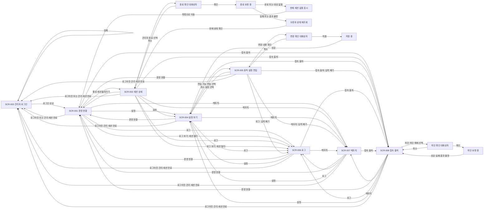

# 운영 대시보드 화면 스펙

관리자가 로그인한 뒤 대기·활성 상태를 확인하고 특정 세션을 종료하는 화면 동작을 정의한다. 설정 보기·동적 설정 편집, 최근 로그 조회, 메트릭 화면, 접속 출처 화면도 포함한다. 시각 구성은 HTML 시안이 보여 주며, 시안은 동작·상태·검증의 기준이 아니다.

| 항목 | 값 |
| --- | --- |
| 상태 | Active |
| 관련 요구사항 | [PRD](../requirements/PRD.md) FR-06·FR-09, AC-09·AC-10·AC-36·AC-54·AC-56·AC-62·AC-65·AC-67·AC-68 |
| 관련 시스템 스펙 | [관리 조회와 세션 종료](management.md). 메트릭 값의 뜻은 [관리 스펙 2.5절](management.md#25-메트릭)이 정한다. 접속 출처에서 무엇을 어느 주소로 세는지는 [운영 스펙 3.9절](operations.md#39-접속-출처-통계)과 [관리 스펙 2.6절](management.md#26-접속-출처)이 정한다. 주소 차단·해제는 설정 편집으로 하며, 규칙은 [운영 스펙 3.10절](operations.md#310-출발지-ip-차단-목록)과 [관리 스펙 3.3절](management.md#33-설정-보기와-동적-설정-편집)이 정하고 결정 근거는 [ADR-0013](../decisions/ADR-0013-relay-source-deny-list.md)이다. |
| 용어 | [VNC Relay 용어집](../../GLOSSARY.md) |
| 관련 계약 | [관리 API v1](../contracts/management-api-v1.md). Active이며 경로·응답 본문·화면 URL은 이 계약이 기준이다. 관리 API는 JSON over HTTP이며 경로 접두사는 `/api/v1/`이다. 메트릭의 이름·단위·속성과 추이 형식은 [메트릭 v1](../contracts/metrics-v1.md)이 정한다. 접속 출처 응답 형식은 [관리 API v1 1.17절](../contracts/management-api-v1.md#117-접속-출처-get-apiv1sources)이 정한다. 차단·해제는 [1.13절](../contracts/management-api-v1.md#113-설정-보기-get-apiv1config)·[1.14절](../contracts/management-api-v1.md#114-동적-설정-편집-patch-apiv1config)의 설정 보기·편집을 쓴다. |
| 관련 아키텍처 문서·ADR | [코드 지도](../architectures/code-map.md), [대시보드 구성 요소 설계](../architectures/dashboard-components.md), [대시보드 운영 화면 설계](../architectures/dashboard-operations-overview.md), [관리 리스너 모듈 설계](../architectures/management-listener.md), [메트릭 모듈 설계](../architectures/metrics.md), [접속 출처 모듈 설계](../architectures/source-stats.md), [ADR-0011](../decisions/ADR-0011-pull-metrics-on-status-listener.md), [ADR-0012](../decisions/ADR-0012-local-ip-info-databases.md). 정적 HTML·JS 대시보드 선택은 별도 ADR 없이 [PRD 확정 기준](../requirements/PRD.md#확정-기준)으로 관리한다. 대시보드는 별도 빌드 단계 없는 정적 HTML·JS이며 실행파일에 넣어 관리 리스너가 제공한다. 프런트엔드 코드는 `web/dashboard/`에 있다. |
| 디자인 원본·공통 시각 기준 | [운영 대시보드 디자인 기준](../design/DESIGN.md). Accepted. 색·간격·폰트·토큰·배치 기준은 디자인 기준이 정한다. |
| HTML 시안 | [대시보드 시안](../design/mockups/dashboard.html). SCR-001~008의 모든 상태와 한국어·English 화면을 포함한다. SCR-006은 16개 상태를 제공한다. SCR-007은 4절의 상태 가운데 관리 세션 만료를 뺀 모든 상태를 제공한다. SCR-007 프레임은 추이 기간으로 최근 1시간을 고른 화면이며, 최근 24시간에서 바뀌는 문구는 9.3.7절의 CPY-251~254를 따른다. SCR-008도 4절의 상태 가운데 관리 세션 만료를 뺀 모든 상태를 제공하며, 프레임은 집계 기간으로 최근 1시간을 고른 화면이다. 시안과 이 문서의 문장이 다르면 문장을 따른다. |
| 관련 컴포넌트 예시 | 구성 요소는 `web/dashboard/app/components/`에 있다([대시보드 구성 요소 설계](../architectures/dashboard-components.md)). 미리보기 `web/dashboard/preview/`는 `cargo xtask dashboard-serve`로 연다(로컬 전용). 로그인 화면(SCR-003)은 `web/dashboard/login/`에 있다. `login/`과 `app/`은 파일을 공유하지 않으므로 구성 요소를 가져오지 않는다([프런트엔드 컨벤션 1.1절](../conventions/frontend.md)). |

선택 기준·시나리오 소유·와이어프레임 판정은 [스펙 작성 규칙](AGENTS.md)을, HTML 시안 판정은 [디자인 문서 작성 규칙](../design/AGENTS.md#html-시안)을 따른다. 색·간격·글꼴 값은 디자인 기준을 연결한다. 시안 작성 순서는 `frontend-workflow` 스킬의 참고 문서 「화면별 HTML 시안 (4단계)」를 따른다.

## 1. 범위와 사용자

- 로그인한 관리자가 요약·대기 목록·활성 목록·세션 상세·최근 종료 목록을 보고 현재 세션을 확인한 뒤 종료한다.
- 내장 관리자 로그인과 조회·관리자 종료를 제공한다. 권한은 서버가 검증하며 중계 IP 허용 정책과 분리한다.
- 로그인·운영 현황·상세·설정 보기·동적 설정 편집·로그·메트릭·접속 출처 화면과 조건별 이동을 별도 화면 스펙으로 관리한다.
- 폴링 주기 P는 설정 가능하며 기본값은 2초다([4.1절](#41-폴링)).
- 원격 화면 표시·키보드 입력 전송·noVNC·장기 이력 검색을 제공하지 않는다. 설정 보기는 항상 제공한다. 동적 설정 편집은 `management.config_edit = true`로 시작한 서버에서 로그인한 모든 관리자가 쓴다. 수동 재로드 행동은 추가하지 않는다.
- 최근 로그는 메모리에 보관한 마지막 N개 운영 로그다. N은 `recent_logs.max_entries`이며 기본값 1000, 범위 0~10000이다. 0이면 보관하지 않고 재시작하면 목록이 비워진다. 값 변경에는 재시작이 필요하다. 장기 이력 검색으로 해석하지 않는다.
- 로그 화면은 수준·사건 이름 필터, 값 검색, P 주기 자동 갱신과 일시정지, 세션별 진입, 현재 필터 결과 전체의 JSON Lines 다운로드를 제공해야 한다.
- 메트릭 화면은 메트릭의 현재 값과 서버가 보관한 추이를 보여 준다. 추이 기간은 최근 1시간과 최근 24시간 가운데 고른다. 다른 기간 지정·장기 저장·임계값 경보·외부 수집 설정은 제공하지 않는다. 외부 수집 도구는 상태 리스너의 `/metrics`를 읽는다([운영 스펙 3.8절](operations.md#38-메트릭)).
- 접속 출처 화면은 최근 1시간 또는 최근 24시간에 중계 리스너로 들어온 연결을 클라이언트 주소·국가·ASN별로 센 수와 IP 정보 DB 상태를 보여 준다. 국가·ASN은 운영자가 설정한 IP 정보 DB에서 서버가 찾는다. 화면과 서버는 IP 정보를 찾으려고 외부에 요청하지 않는다. 주소와 ASN의 ipinfo.io 조회 링크는 관리자가 고를 때만 새 탭에서 열린다. 장기 이력·다른 기간 지정·화면의 정렬 변경은 제공하지 않는다([운영 스펙 3.9절](operations.md#39-접속-출처-통계)).
- 접속 출처 화면의 주소별 표에서 주소를 차단하고, 단일 주소 항목으로 차단한 주소의 차단을 해제할 수 있다. 차단 목록은 설정 편집으로 바꾸므로 `management.config_edit = true`로 시작한 서버에서만 쓴다. 차단하면 그 주소의 열린 세션과 대기 연결이 바로 끊긴다([운영 스펙 3.10절](operations.md#310-출발지-ip-차단-목록)).
- 대시보드는 별도 빌드 단계 없는 정적 HTML·JS로 만들고 실행파일에 넣어 관리 리스너가 제공한다. Node 빌드 체인과 JS 프레임워크 의존성을 추가하지 않는다.
- 지원 화면 폭은 데스크톱과 모바일 폭이고, 지원 브라우저는 최신 Chrome·Edge·Firefox·Safari다. 두 폭 모두에서 필수 정보와 상세 이동·종료·취소·로그아웃 행동을 쓸 수 있어야 한다([6절](#6-화면-크기와-접근성)).
- 화면 문구는 한국어와 영어 두 가지다. 브라우저 언어로 자동 선택하고 사용자가 바꿀 수 있다([화면 언어](#화면-언어)).

## 2. 화면 흐름



| 화면 ID | 화면 | 진입 | 이탈 |
| --- | --- | --- | --- |
| SCR-001 | 운영 현황 | 로그인 성공, 유효한 관리 세션으로 진입, 상세에서 돌아가기 | 활성 세션 선택 시 상세, 최근 종료 항목의 로그 보기 시 세션 필터 로그, 메트릭·접속 출처·로그·설정 선택 시 해당 화면, 로그아웃·관리 세션 만료 시 로그인 |
| SCR-002 | 세션 상세 | 선택한 세션 식별자 | 목록으로 돌아가기, 종료 확인 열기, 메트릭·접속 출처·로그·설정, 로그 보기로 세션 필터 로그 진입 |
| SCR-003 | 관리자 로그인 | 인증되지 않은 진입, 로그아웃, 관리 세션 만료 | 로그인 성공 시 운영 현황 |
| SCR-004 | 설정 보기 | `/#/settings`, 상단 막대 설정, 저장 성공 | 운영 현황·메트릭·접속 출처·로그, 편집 가능하면 SCR-005, 로그아웃·관리 세션 만료 시 로그인 |
| SCR-005 | 동적 설정 편집 | `/#/settings/edit`, SCR-004의 편집 | 취소·설정 선택·저장 성공 시 SCR-004, 운영 현황·메트릭·접속 출처·로그, 로그아웃·관리 세션 만료 시 로그인 |
| SCR-006 | 로그 | `/#/logs`, 상단 막대 로그, SCR-002의 로그 보기(세션 필터), SCR-001 최근 종료 항목의 로그 보기(세션 필터) | 운영 현황·메트릭·접속 출처·설정, 로그아웃·관리 세션 만료 시 로그인 |
| SCR-007 | 메트릭 | `/#/metrics`, 상단 막대 메트릭 | 운영 현황·접속 출처·로그·설정, 로그아웃·관리 세션 만료 시 로그인 |
| SCR-008 | 접속 출처 | `/#/sources`, 상단 막대 접속 출처 | 운영 현황·메트릭·로그·설정, 로그아웃·관리 세션 만료 시 로그인 |

화면 URL은 [관리 API 계약](../contracts/management-api-v1.md)이 정한다. 종료 확인은 SCR-002, 변경 확인은 SCR-005의 대화상자 상태다. 보호된 화면의 직접 진입에도 유효한 관리 세션이 필요하다. 상단 막대는 다섯 항목을 제공해야 한다. "운영 현황"은 SCR-001·002에서, "메트릭"은 SCR-007에서, "접속 출처"는 SCR-008에서, "로그"는 SCR-006에서, "설정"은 SCR-004·005에서 활성이다. 순서는 운영 현황 · 메트릭 · 접속 출처 · 로그 · 설정이다. 상단 막대의 운영 현황 항목 이름은 CPY-294다. 화면 제목 CPY-004와 영어 문구가 다르다(영어 1024px 상단 막대 폭, 사용자 결정 2026-11-20). 다섯 항목은 모든 지원 폭에서 사용할 수 있어야 한다. 화면을 떠나면 늦게 도착한 조회·저장 결과로 새 화면을 덮어서는 안 된다. SCR-005에서 메트릭·접속 출처·로그로 이동해도 저장하지 않은 입력을 버리고 PATCH를 보내지 않는다. 세션 필터 URL은 `/#/logs?session_id={session_id}`다.

SCR-001·002·004·005·006·007·008의 상단 막대 도구 맨 앞과 SCR-003의 언어 선택 앞에는 도움말 링크(CPY-195)를 둔다. 링크는 현재 화면 언어의 [도움말 사이트](help-site.md) 첫 페이지를 새 탭에서 연다. 대시보드는 도움말 사이트에 요청을 보내지 않는다. 링크를 골라도 현재 화면·입력·관리 세션은 그대로다.

## 3. 화면 구성과 와이어프레임

밑그림은 정보 묶음과 행동만 표현한다. 기준은 아래 문장과 수용 테스트다. 화면마다 구성요소 표를 둔다.

### SCR-001 운영 현황

```text
+--------------------------------------------------------------------------------------+
| VNC Relay  [운영 현황: 활성] [메트릭] [접속 출처] [로그] [설정]   [도움말] [언어] [로그아웃] |
| 운영 현황  마지막 성공 갱신: [시각]                         [새로고침]          |
| 실행 상태 [값]  가동 시간 [값]  대기 [수]  활성 [수]                             |
| 초기 교환 중 [수]  Mode I 대상 연결 중 [수]                                      |
| 중계 연결 [현재/상한]  관리 연결 [현재/상한]                                      |
+--------------------------------------------------------------------------------------+
| 대기 연결 [개수]                                                                 |
| 역할 | 중계 ID | 전송 경로 | 상대 주소 | 접속 시각 | 대기 시간                     |
+--------------------------------------------------------------------------------------+
| 활성 세션 [개수]                                                                 |
| 세션 | 모드 | 전송 경로(Viewer → 대상) | 시작 | 방향별 바이트 | 상대 주소 | 상세 |
+--------------------------------------------------------------------------------------+
| 최근 종료 목록 [개수]                                                            |
| 세션 | 종료 원인 | 모드 | 전송 경로(Viewer → 대상) | 시각 | 방향별 바이트 | 상대 주소 | 로그 |
+--------------------------------------------------------------------------------------+
| 목록별 조회 상태 또는 오류                                                       |
+--------------------------------------------------------------------------------------+
```

| 구성요소 | 표시 내용·입력 규칙 | 사용자 행동 | 결과 | 관련 시나리오 |
| --- | --- | --- | --- | --- |
| 상단 막대 내비게이션 | 운영 현황·메트릭·접속 출처·로그·설정, 현재 화면의 활성 표시. 순서는 운영 현황 · 메트릭 · 접속 출처 · 로그 · 설정 | 항목 선택 | SCR-001·SCR-007·SCR-008·SCR-006·SCR-004로 이동 | DASH-028 |
| 마지막 성공 갱신·새로고침 | 성공한 응답을 반영한 시각(현지 시각과 시간대) | 새로고침 | 같은 조회가 진행 중이 아니면 재조회, 성공했을 때만 시각 갱신 | DASH-003·DASH-004·DASH-005 |
| 서버 요약 | 실행 상태, 가동 시간, 대기 수, 활성 수 | 읽기 | 관리 스펙 값과 일치, 확인하지 못한 값은 0으로 표시하지 않음 | DASH-001·DASH-016 |
| 연결 수·사용량 | 서버 요약의 초기 교환 중 연결 수, Mode I 대상 연결 중 연결 수, 중계 연결(L)·관리 연결(Lm)의 현재 사용량과 상한. 화면에는 기호 L·Lm 대신 "중계 연결"·"관리 연결" 이름과 무엇을 세는지 한 줄 설명을 쓴다. 의미는 [관리 스펙 2절](management.md#2-조회-대상과-상태)을 따른다 | 읽기 | 관리 스펙 값과 일치, 확인하지 못한 값은 0으로 표시하지 않음 | DASH-021 |
| 대기 연결 목록 | 역할, 중계 ID, 전송 경로(`transport`), 상대 주소(`address`), 접속 시각, 대기 시간. 신뢰 프록시를 거친 연결은 상대 주소 칸에 전달 주소를 CPY-199 줄로 따로 표시하고, `forwarded_ip`가 `null`이면 그 줄을 숨긴다. 머리글은 CPY-197. 빈 목록은 "대기 없음" | 읽기 | 대기 연결에는 상세·종료 행동 없음. 소켓 주소를 전달 주소로 대체하지 않음 | DASH-001·DASH-002·DASH-065 |
| 활성 세션 목록 | 세션 식별자, 모드, 양쪽 전송 경로(`viewer_transport → target_transport`), 시작 시각, 방향별 바이트, 상대 주소. 전송 경로는 TCP·WS·WSS이며 Mode I 대상은 TCP다. 빈 목록은 "활성 없음" | 상세 열기 | 선택한 식별자의 SCR-002로 이동. CPY-187 적용 | DASH-001·DASH-002·DASH-006·DASH-062 |
| 최근 종료 목록 | 세션 식별자, 종료 원인, 모드, 양쪽 전송 경로(`viewer_transport → target_transport`), 시각, 방향별 바이트, 상대 주소, 로그 보기([관리 스펙 2.3절](management.md#23-최근-종료-목록)). 머리글은 CPY-198. 시각 칸은 시작 시각(CPY-055)·종료 시각(CPY-200)·지속 시간(CPY-201) 세 줄이다. 지속 시간은 API의 `duration_ms`를 쓰며 시작·종료 시각의 차이로 계산하지 않는다. 상대 주소 칸은 활성 세션 목록처럼 Viewer 주소(CPY-056)와 Server/대상 주소(CPY-057)를 쓰고, 전달 주소가 있으면 각 소켓 주소 다음 줄에 CPY-180·181로 따로 표시한다. 빈 목록은 "최근 종료 없음". 종료 원인 `session_expired`는 CPY-190과 중립 배지로 표시한다. 종료 원인 `ip_denied`는 CPY-323으로 표시한다 | 로그 보기(CPY-182) | SCR-006을 그 세션의 세션 필터(`/#/logs?session_id={session_id}`)로 연다. 종료·상세 행동 없음 | DASH-020·DASH-066 |
| 목록 개수 배지 | 대기 연결·활성 세션·최근 종료 목록의 제목 옆에 해당 목록의 표시 중인 응답 항목 수를 쓴다. 문구는 CPY-084·085다. 성공한 빈 목록은 0건이다. 첫 성공 전에는 배지를 숨긴다. 갱신 실패로 이전 목록을 유지하면 그 목록의 개수도 유지한다. 서버 요약의 수를 대신 쓰지 않는다. | 읽기 | 목록별 개수와 보이는 데이터가 같은 응답을 따른다. 언어 변경 때 개수 문구도 즉시 바뀐다. | DASH-001~004·DASH-020·DASH-025 |
| 방향별 바이트 | 관리 스펙 2.1절의 누적 바이트(정수)를 KiB/MiB로 표시. 표는 방향을 Viewer->대상, 대상->Viewer로 줄여 쓴다 | 읽기 | 전송량 의미를 바꾸지 않음 | DASH-001·DASH-020 |
| 목록별 조회 상태 | 조회 중·실패·오래된 성공 데이터 구분 | 재조회 | 실패를 빈 목록으로 표시하지 않음 | DASH-003·DASH-004 |
| 언어 선택 | 현재 화면 언어 이름("한국어" 또는 "English") | 언어 선택 | 화면 문구를 즉시 바꾸고 선택을 브라우저에 저장 | DASH-024·DASH-025 |
| 도움말 링크 | CPY-195와 새 탭 아이콘. 접근 가능한 이름은 CPY-195 뒤에 괄호로 CPY-196을 붙인다 | 선택 | 새 탭에서 현재 화면 언어의 도움말 첫 페이지를 연다. 현재 화면·입력·관리 세션은 그대로다 | DASH-064 |
| 로그아웃 | 현재 관리 세션 | 로그아웃 | 서버 무효화 확인 뒤 데이터 제거·SCR-003 이동 | DASH-019 |

### SCR-002 세션 상세

```text
+--------------------------------------------------------------+
| VNC Relay [운영 현황: 활성] [메트릭] [접속 출처] [로그] [설정] [도움말] [언어] [로그아웃] |
| [목록으로] 세션 [식별자]         마지막 성공 갱신: [시각]       |
| 모드 [값] Viewer 전송 경로 [값] Server/대상 전송 경로 [값]     |
| 시작 시각 [값] Viewer 주소 [값] Server/대상 주소 [값]          |
| Viewer 전달 주소 [있을 때] Server/대상 전달 주소 [있을 때]     |
| 방향별 바이트 [값]                    [로그 보기] [세션 종료] |
+--------------------------------------------------------------+
| 확인 시: 종료할 세션 [식별자] [취소] [종료 확인]               |
+--------------------------------------------------------------+
```

| 구성요소 | 표시 내용·입력 규칙 | 사용자 행동 | 결과 | 관련 시나리오 |
| --- | --- | --- | --- | --- |
| 상단 막대 내비게이션 | SCR-001과 같다. 운영 현황 활성 | 항목 선택 | SCR-001·SCR-007·SCR-008·SCR-006·SCR-004로 이동 | DASH-028 |
| 목록으로 | 없음 | 선택 | SCR-001로 이동 | DASH-007 |
| 마지막 성공 갱신 | 성공한 응답을 반영한 시각(현지 시각과 시간대) | 읽기 | 성공했을 때만 시각 갱신 | DASH-004·DASH-005 |
| 세션 정보 | 세션 식별자, 모드, Viewer 전송 경로, Server/대상 전송 경로(`target_transport`), 시작 시각(현지 시각과 시간대) | 읽기 | 선택한 식별자의 값만 표시. Mode I 대상은 TCP, Mode II Server는 TCP·WS·WSS | DASH-006·DASH-062 |
| 상대 주소·전달 주소 | `viewer_address`·`target_address`는 소켓 상대 주소다. `viewer_forwarded_ip`·`target_forwarded_ip`가 있으면 별도 행에 전달 주소를 표시한다. null인 전달 주소 행은 숨긴다 | 읽기 | 소켓 주소를 전달 주소로 대체하지 않음. 주소 설명은 CPY-188 적용 | DASH-006·DASH-062 |
| 로그 보기 | 현재 `session_id` | 선택 | SCR-006에 세션 필터로 진입. URL은 `/#/logs?session_id={session_id}` | DASH-059 |
| 방향별 바이트 | 관리 스펙 2.1절의 누적 바이트(정수)를 KiB/MiB로 표시 | 읽기 | 전송량 의미를 바꾸지 않음 | DASH-006 |
| 세션 종료 버튼 | 유효한 관리 세션이 있고 대상이 있을 때만 활성 | 선택 | 종료 확인 대화상자 열기, 요청은 보내지 않음 | DASH-009·DASH-014 |
| 종료 확인 대화상자 | 종료할 세션 식별자와 연결이 끊긴다는 영향 | 취소·닫기 또는 종료 확인 | 취소·닫기는 요청 없음과 포커스 복귀, 확인은 현재 식별자로 요청 | DASH-009~013 |
| 언어 선택 | SCR-001과 같다 | 언어 선택 | SCR-001과 같다 | DASH-024·DASH-025 |
| 도움말 링크 | SCR-001과 같다 | 선택 | SCR-001과 같다 | DASH-064 |
| 로그아웃 | 현재 관리 세션 | 로그아웃 | 서버 무효화 확인 뒤 데이터 제거·SCR-003 이동 | DASH-019 |

### SCR-003 관리자 로그인

```text
+------------------------------------------+
|                         [도움말] [언어]  |
| [표식] VNC Relay 로그인                  |
| 계정명   [____________________]           |
| 비밀번호 [********************]           |
| [로그인]                                 |
| 로그인 중 또는 공통 인증 실패 안내        |
+------------------------------------------+
```

계정명·비밀번호는 필수다. 빈 입력은 전송하지 않는다. 실패 시 계정명은 유지하고 비밀번호는 지운다. 비밀번호를 URL·로그·화면 오류에 표시하지 않는다. 로그인 진행 중 중복 전송을 막는다. 로그인 실패 제한 중에도 실패와 같은 공통 안내를 표시하며 계정 존재 여부를 드러내지 않는다. 계정 등록·비밀번호 변경 화면은 추가하지 않는다. 새로고침 후 계정명은 복원하지 않는다. 로그인 요청 제한 시간은 10초다. 인증 실패·요청 실패 안내에는 짧은 제목을 따로 두지 않고 CPY-074·CPY-077 한 문장을 쓴다. 빈 입력에는 CPY-071·CPY-072를 쓴다.

| 구성요소 | 표시 내용·입력 규칙 | 사용자 행동 | 결과 | 관련 시나리오 |
| --- | --- | --- | --- | --- |
| 계정명 | 필수. 실패 뒤에도 입력값 유지 | 입력 | 빈 값이면 전송하지 않음 | DASH-018 |
| 비밀번호 | 필수. 가려서 표시, URL·로그·화면 오류에 표시하지 않음 | 입력 | 빈 값이면 전송하지 않음, 실패 뒤 지움 | DASH-018 |
| 로그인 버튼 | 로그인 진행 중에는 비활성 | 로그인 | 성공 시 SCR-001, 실패·실패 기준 초과 시 같은 공통 안내 | DASH-017·DASH-018 |
| 안내 영역 | 로그인 중 또는 공통 인증 실패 안내. 계정 존재 여부를 드러내지 않음 | 읽기 | 보호 데이터 없음 | DASH-018 |
| 언어 선택 | 현재 화면 언어 이름 | 언어 선택 | 화면 문구를 즉시 바꾸고 선택을 브라우저에 저장. 입력한 계정명은 유지 | DASH-024·DASH-025 |
| 도움말 링크 | SCR-001과 같다. 언어 선택 앞에 둔다 | 선택 | 새 탭에서 현재 화면 언어의 도움말 첫 페이지를 연다. 입력한 계정명은 그대로다 | DASH-064 |

### SCR-004 설정 보기

```text
+-----------------------------------------------------------------------+
| VNC Relay [운영 현황] [메트릭] [접속 출처] [로그] [설정: 활성] [도움말] [언어] [로그아웃] |
| 설정 보기                                      [새로고침] [편집]      |
| 조회 시각 [as_of]                                                      |
| [설정 파일 상태 안내 / 편집 꺼짐·막힘 / 저장 성공 안내]                 |
| 마지막 재로드: [시각·결과·계기·바뀐 키] 또는 [이력 없음]                |
| [설정 구역 이름]                                                      |
| 키                         값                  적용 구분 / 파일 차이   |
| relay.tcp_viewer.allow      203.0.113.0/24       재시작 없이 적용        |
| management.config_edit     true                 재시작 필요             |
| (설정 계약의 모든 구역·키, 기본값과 생략된 값 포함)                     |
+-----------------------------------------------------------------------+
```

| 구성요소 | 표시 내용·입력 규칙 | 사용자 행동 | 결과 | 관련 시나리오 |
| --- | --- | --- | --- | --- |
| 상단 막대 | 운영 현황·메트릭·접속 출처·로그·설정(활성), 도움말, 언어, 로그아웃 | 이동·도움말 열기·언어 선택·로그아웃 | 공통 행동 유지 | DASH-028·050·051·064 |
| 조회 시각·새로고침 | `as_of`를 현지 시각·시간대와 함께 표시 | 새로고침 | `GET /api/v1/config`. 진입·명시적 새로고침에만 조회하고 자동 폴링하지 않음. 중첩 조회 없음 | DASH-029·048·049 |
| 파일 상태 안내 | `file.state` 5종, `file.config_keys`, `file.diagnostics` | 읽기 | 실행 값과 파일의 차이를 구분. 진단은 5.1절의 `code`별 한영 문구와 `key`를 표시. 목록에 없는 코드만 서버 `message`와 `code`를 표시 | DASH-030~032 |
| 마지막 재로드 | `last_reload.at`·`result`·`trigger`·`config_keys`. `null`이면 이력 없음 | 읽기 | 현재 파일 상태와 별도로 표시. 결과는 적용·거절·재시작 필요, 계기는 파일 변경 감지·설정 편집으로 번역. 시각은 조회 시각과 같은 현지 시각·시간대 형식. 키는 데이터 그대로 | DASH-029·033 |
| 구역별 키·값 | `items`의 모든 키를 설정 계약 1.2절 순서와 테이블별로 묶음. `value`는 실행 중 유효 값이며 기본값 포함. 불리언은 `true`·`false`, 정수는 정확한 십진 값, 문자열은 그대로, 배열은 항목별 줄, `[]`는 빈 목록, `null`은 값 없음으로 표시 | 읽기 | 파일에만 있는 미적용 값을 실행 값처럼 표시하지 않음. 파일 차이는 `file.config_keys`에 든 키에 글씨로 표시 | DASH-029~032 |
| 적용 구분 | `items.reload = dynamic`은 재시작 없이 적용, `restart`는 재시작 필요. v4의 재로드 대상은 44개다(접속 ticket 키 10개와 차단 목록 키 1개 포함) | 읽기 | 인증서·개인키 경로 4개와 접속 ticket 공개 키 파일 경로 2개는 경로만 보이며 파일 내용과 편집 입력은 없음. `recent_logs.max_entries`는 재시작 필요이며 `recent_closed.max_entries` 옆에 표시 | DASH-029·035 |
| 편집 | `edit_enabled = true`이며 `file.state`가 `in_effect`·`pending`일 때 활성 | 편집 | SCR-005 이동. 꺼짐이면 `management.config_edit = true`와 재시작 안내. 막힘이면 파일 수정·재시작 등 이유 안내 | DASH-031·032·034 |
| 저장 성공 안내 | PATCH `applied`의 길이. 빈 배열은 0개 | 읽기 | SCR-004에서 현재 실행 값을 다시 조회하고 성공 안내. 조회 실패가 저장 성공 사실을 취소하지 않음 | DASH-039·052 |

### SCR-005 동적 설정 편집

```text
+-----------------------------------------------------------------------+
| VNC Relay [운영 현황] [메트릭] [접속 출처] [로그] [설정: 활성] [도움말] [언어] [로그아웃] |
| 동적 설정 편집                                                        |
| [키별 다음 검사·요청부터 적용. 끝난 검사·타이머·소켓 옵션 유지 안내]     |
| 출발지 IP 허용 목록: relay.tcp_viewer.allow                             |
| [203.0.113.0/24                  ]  한 줄에 항목 하나                  |
| [198.51.100.7                    ]  [입력 도움말 / 줄별 오류]          |
| 접근 정책 / 연결 상한 / 시간 제한 / 연결 유지                         |
| 접근 정책: 차단 목록 relay.deny.sources                                 |
| [203.0.113.9                      ]  [입력 도움말 / 줄별 오류]          |
| limits.relay_connections [2000]  min ~ max                             |
| timeouts.handshake_secs  [10  ] 초                                     |
| [취소]                                      [변경 내용 확인]           |
+-----------------------------------------------------------------------+
| 변경 확인: 바뀐 키·이전 → 새 값 / 목록의 추가·삭제 / 빈 목록 경고       |
| 차단 목록에 새 항목·바꾼 항목이 있으면: 열린 연결을 끊는다는 경고         |
| 기존 연결 유지 안내                              [취소] [적용]        |
+-----------------------------------------------------------------------+
```

| 구성요소 | 표시 내용·입력 규칙 | 사용자 행동 | 결과 | 관련 시나리오 |
| --- | --- | --- | --- | --- |
| 상단 막대 | SCR-004와 같다 | 이동·도움말 열기·언어 선택·로그아웃 | 이동하면 저장하지 않은 입력은 버림. 이탈 확인 없음. 도움말은 새 탭에서 열리므로 입력을 버리지 않음 | DASH-028·050·051·053·064 |
| 준비 조회 | 진입 때 `GET /api/v1/config`. 그 응답의 `revision`과 실행 값 보관 | 조회 완료 대기·명시적 재조회 | 폴링 없음. `revision = null`이면 편집하지 않음 | DASH-032·035·048·049 |
| 입력 구역 | 출발지 IP 허용 목록 / 접근 정책 / 연결 상한 / 시간 제한 / 연결 유지 / 접속 ticket(CPY-191). 전체 편집 대상 38개 중 `items.editable = true`인 키만 입력란으로 제공. 차단 목록 `relay.deny.sources`는 접근 정책 구역에 있으며 중계 진입점이 꺼져 있어도 입력란이 있다. 꺼진 역할·리스너·Mode I 키, TLS 경로 4개, 접속 ticket 공개 키 파일 경로 2개는 입력란 없음 | 입력 | `management.config_edit`와 재시작 필요 키도 편집하지 않음. 여섯 구역의 순서는 출발지 IP 허용 목록 / 접근 정책 / 연결 상한 / 시간 제한 / 연결 유지 / 접속 ticket이다. 구역 안 순서는 설정 계약 1.2절의 키 순서다. 따라서 Viewer 키 다음 Server 키이며 키마다 `enabled`, `issuer`, `relay_host`, `max_lifetime_secs` 순서다 | DASH-035 |
| 여러 줄 목록 | 한 줄에 항목 하나, 빈 줄 무시, 항목 안·앞뒤 공백 금지. 원래 줄 번호와 전송 배열 첨자의 연결을 유지 | 입력 수정 | 서버 진단의 `key[i]`를 해당 입력란과 원래 줄에 연결. 진단 문구는 5.1절의 코드별 한영 대응을 사용 | DASH-036·040 |
| 정수 | 서버의 `min`·`max` 표시. 초·바이트 단위, 연결·대기·probe 개수는 개수 단위 | 입력 수정 | 정수·범위·Lw ≤ L 화면 검사 | DASH-036 |
| 불리언 | `relay.ticket.viewer.enabled`·`relay.ticket.server.enabled`. SCR-006 수준 체크 그룹과 같은 체크박스이며 label은 키 이름 | 선택·해제 | 바뀐 값만 `true`·`false`로 전송 | DASH-035·036 |
| 문자열 | `issuer`·`relay_host`. 한 줄 입력이며 앞뒤 공백을 자르지 않음. UTF-8 1~256바이트 | 입력 수정 | 범위를 벗어나면 CPY-193. 실행 값이 `null`이고 입력이 비어 있으면 바꾸지 않은 값으로 보고 전송하지 않음 | DASH-036 |
| 변경 내용 확인 | 화면 검사 통과 후에만 열기 | 선택 | 바뀐 키별 이전·새 값. 목록은 추가·삭제 항목. 빈 목록은 키별 의미를 경고(CPY-105·183·192). ticket `enabled`를 `false`에서 `true`로 바꾸면 그 키의 변경 항목 안에 CPY-194 경고. 바뀐 값이 없어도 0개를 확인할 수 있음 | DASH-037·052 |
| 차단 목록 | 접근 정책 구역의 목록 입력. label은 CPY-319와 키 이름 `relay.deny.sources`. 도움말은 CPY-119와 CPY-320 | 입력 수정 | 한 줄에 항목 하나이고 문법은 서버가 검사한다. 빈 목록은 아무것도 차단하지 않으므로 CPY-105를 쓰지 않는다. 변경 확인에서 추가한 항목이 하나 이상이면 그 키의 변경 항목 안에 CPY-321 경고를 보인다. 이 키는 CPY-189의 "기존 중계 세션은 계속 동작합니다"에 해당하지 않는 예외이며 CPY-321로 알린다. 서버 진단 `relay.deny.sources[i]`는 해당 줄에 연결하고, 신뢰 프록시와의 겹침은 CPY-322로 번역한다 | DASH-091 |
| 확인 대화상자 | 키별 다음 검사·요청부터 적용되며 이미 끝난 검사·시작한 타이머·소켓 옵션은 유지한다는 안내(CPY-189). 정확한 적용 시점은 [설정 계약 1.8절](../contracts/config-v4.md#18-재로드-구분) | 취소·닫기 또는 적용 | 취소·닫기는 요청 없음·입력 유지·호출 버튼 초점 복귀. 적용은 보관한 `revision`과 바뀐 키만 `changes`로 PATCH. 변경이 없으면 PATCH 없이 보기로 이동 | DASH-037~039·052 |
| 오류 안내 | 5.1절의 코드별 안내, 입력란 진단 또는 화면 상단 안내. SCR-004 `file.diagnostics`와 `config_file_invalid`도 같은 진단 번역 사용 | 수정·다시 불러오기·명시적 재시도·설정 보기 | 실패·결과 불명·저장 성공을 구분. 자동 재전송 없음 | DASH-040~049 |
| 취소 | 저장하지 않음 | 선택 | SCR-004로 이동, 이탈 확인 없음 | DASH-053 |

SCR-004는 [설정 v4 계약 1.2절](../contracts/config-v4.md#12-키-표)의 리스너·역할 테이블을 그대로 구분해야 한다. `relay.ws_viewer.*`·`relay.wss_viewer.*`는 표시하거나 전송하지 않는다. SCR-005는 `settings-model.js`의 `fieldGroup` 분류를 재사용한다. 접속 ticket 키 8개는 마지막 접속 ticket 구역에 둔다.

| v4 키 | SCR-004 표시 위치·적용 구분 | SCR-005 구역 |
| --- | --- | --- |
| `relay.ws.viewer.allow`·`relay.ws.server.allow`·`relay.wss.viewer.allow`·`relay.wss.server.allow` | 각 역할 테이블, 재로드 가능 | 출발지 IP 허용 목록(`sourceAllowLists`) |
| `relay.ws.viewer.allowed_origins`·`relay.ws.server.allowed_origins`·`relay.wss.viewer.allowed_origins`·`relay.wss.server.allowed_origins` | 각 역할 테이블, 재로드 가능 | 접근 정책(`accessPolicies`) |
| `relay.ws.trusted_proxies`·`relay.wss.trusted_proxies` | 각 리스너 테이블, 재로드 가능 | 접근 정책(`accessPolicies`) |
| `relay.deny.sources` | `[relay.deny]` 테이블, 재로드 가능 | 접근 정책(`accessPolicies`). 중계 진입점이 꺼져 있어도 `editable = true` |
| `relay.ws.viewer.enabled`·`relay.ws.server.enabled`·`relay.wss.viewer.enabled`·`relay.wss.server.enabled` | 각 역할 테이블, 재시작 필요 | 입력 없음 |
| `relay.ws.listen`·`relay.wss.listen` | 각 리스너 테이블, 재시작 필요 | 입력 없음 |
| `relay.wss.cert_file`·`relay.wss.key_file` | WSS 리스너 테이블, 재로드 가능 | 입력 없음. `management.cert_file`·`management.key_file`도 동일 |
| `relay.ticket.viewer.enabled`·`issuer`·`relay_host`·`max_lifetime_secs`, `relay.ticket.server`의 같은 키 | `[relay.ticket.viewer]`·`[relay.ticket.server]` 테이블, 재로드 가능 | 접속 ticket(`accessTickets`). 그 역할이 WS 또는 WSS에서 켜져 있을 때만 `editable = true` |
| `relay.ticket.viewer.public_keys_file`·`relay.ticket.server.public_keys_file` | 각 ticket 테이블, 재로드 가능. 경로만 표시 | 입력 없음 |
| `recent_logs.max_entries` | `recent_closed.max_entries` 옆, 재시작 필요 | 입력 없음 |

`trusted_proxies = []`는 전달 헤더를 신뢰하지 않는다는 뜻이다. 역할의 `allow = []`처럼 모든 새 접속을 거절하는 목록이 아니다. 확인 대화상자는 이 키에 CPY-105를 쓰지 않고 CPY-183을 써야 한다. 역할의 `allowed_origins = []`는 Origin이 있는 요청을 거절한다. Origin이 없는 요청은 Origin 비교를 생략하고 IP 검사를 한다. 그 역할에 접속 ticket 확인을 켰으면 ticket 확인도 한다([WebSocket 계약](../contracts/websocket-relay-v2.md)). 이 키에도 CPY-105 대신 CPY-192를 써야 한다.
`trusted_proxies`에는 프록시 주소만 넣어야 하며 클라이언트 범위를 넣어서는 안 된다. 모든 전달 주소가 신뢰 프록시에 속하면 요청을 거절한다. 이 입력 도움말은 CPY-185로 표시한다. IP·CIDR·범위의 문법과 진단은 기존 출발지 IP 목록과 같다.
`trusted_proxies` 변경은 다음 수락 검사 또는 업그레이드 검사에 적용한다. 역할 `allow` 변경은 다음 수락 시의 합집합 검사와 업그레이드 시의 역할 검사에 적용한다. `allowed_origins` 변경은 다음 업그레이드 요청에 적용한다. 이미 끝난 검사의 결과는 유지한다. 수락됐지만 아직 업그레이드하지 않은 연결도 새 값으로 업그레이드 검사를 할 수 있다. 적용 시점 안내는 CPY-189를 쓴다.
차단 목록 변경은 다음 수락·업그레이드·등록 검사에 적용하고, 교체 직후 열린 활성 세션과 대기 연결에도 적용한다. 이 키의 새 값에 이전 값에 없던 항목 글자가 하나라도 있으면 CPY-321 경고를 보인다. 항목을 더한 경우와 기존 항목을 더 넓은 범위로 바꾼 경우가 모두 여기에 든다. 항목 수만으로 판단하지 않는다. 목록이 그대로이거나 항목을 지우기만 하면 경고가 없다.

### SCR-006 로그

다음 그림은 로그 화면의 정보 묶음과 행동을 보여 준다.

```text
+----------------------------------------------------------------------------+
| VNC Relay [운영 현황] [메트릭] [접속 출처] [로그: 활성] [설정] [도움말] [언어] [로그아웃] |
| 로그                                    [자동 갱신: 켜짐] [새로고침]     |
| 보관 [수] / 최대 [수]                    마지막 성공 갱신: [시각·시간대] |
| 수준 [info] [warn] [error]  사건 이름 [모든 사건 v]                        |
| 값 검색 [____________________________] [검색]                            |
| 세션 [session_id] [필터 해제] (URL에 세션 필터가 있을 때)                  |
| [조회 중 / 빈 목록 / 보관 꺼짐 / 실패·오래된 시각 / 누락 안내]            |
+----------------------------------------------------------------------------+
| 최근 로그                                             [JSON Lines 다운로드] |
| 시각·시간대 | 수준 | 사건 | 주요 필드 요약 | [자세히]                    |
| [펼친 행: 모든 필드와 값]                                                |
| [이전 로그 더 보기]                                                      |
+----------------------------------------------------------------------------+
```

| 구성요소 | 보이는 내용 | 행동 | 결과 | 시나리오 |
| --- | --- | --- | --- | --- |
| 상단 막대·제목 | 운영 현황·메트릭·접속 출처·로그(활성)·설정, 도움말, 로그 제목 | 이동·도움말 열기·언어 선택·로그아웃 | 공통 활성·관리 세션 규칙 유지 | DASH-028·063·064 |
| 보관 상태·갱신 시각 | 전체 보관 수, `max_entries`, 마지막 성공 갱신의 현지 시각·시간대. 전체 보관 수는 두 seq가 null이면 0, 아니면 `latest_seq - oldest_seq + 1`이다. 현재 필터 결과 수와 구분 | 읽기 | 성공 응답 기준의 보관 상태 표시. 실패 때 시각 유지 | DASH-054·061 |
| 수준 필터 | info·warn·error 체크박스, 초기값은 모두 선택 | 선택 변경 | 선택한 수준으로 재조회 | DASH-055 |
| 사건 이름 필터 | 모든 사건 + [ops-info 2.0.0](../contracts/ops-info-v2.md)의 사건 이름 | 선택 | 정확히 같은 사건만 재조회. 값은 번역하지 않음 | DASH-055 |
| 값 검색 | 입력값·도움말·검색 버튼 | Enter 또는 검색 선택 | 검증 통과한 값으로 재조회. 빈 값이면 검색 해제 | DASH-056 |
| 세션 필터 칩 | URL의 유효한 `session_id`, 필터 해제 | 필터 해제 | 세션 필터만 제거하고 재조회 | DASH-059 |
| 자동 갱신·새로고침 | 기본 켜짐, 일시정지 상태, 갱신 중 상태 | 켜기·끄기·명시적 새로고침 | P 주기 폴링 또는 수동 조회. 요청 중첩 없음 | DASH-057·061 |
| 로그 목록·상세 | 최신 순. 현지 시각·시간대, 수준 배지, 사건 이름, 주요 필드 요약. 요약은 존재하는 `session_id`·`conn_id`·`listener`·`role`·`reason`·`detail`을 필드 이름과 값으로 표시 | 자세히 펼치기·접기 | 모든 필드와 중첩 값을 빠짐없이 표시. `entry` 값은 번역·변경하지 않음 | DASH-054·063 |
| 이전 로그 더 보기 | 이전 방향 `has_more = true`일 때 제공 | 선택 | `before=<가장 오래된 표시 seq>`로 조회해 목록 아래에 추가. 같은 seq 중복 표시 없음 | DASH-058 |
| 다운로드 | 현재 필터 결과 전체, JSON Lines | 선택 | 화면에 로드하지 않은 결과도 5.2절대로 수집해 파일 저장 | DASH-060 |
| 상태 안내 | 로딩·빈 결과·보관 꺼짐·조회 실패·누락 | 읽기·가능한 복구 행동 | 빈 결과와 실패 구분. 미조회 로그가 제거되면 누락 안내 | DASH-057·061 |

### SCR-007 메트릭

다음 그림은 메트릭 화면의 정보 묶음과 행동을 보여 준다. 화면은 `GET /api/v1/metrics` 응답 하나로 모든 구역을 그린다. 메트릭의 이름·단위·속성은 [메트릭 계약](../contracts/metrics-v1.md)이, 값의 뜻은 [관리 스펙 2.5절](management.md#25-메트릭)이 정한다.

```text
+------------------------------------------------------------------------------------+
| VNC Relay [운영 현황] [메트릭: 활성] [접속 출처] [로그] [설정] [도움말] [언어] [로그아웃] |
| 메트릭  [상태 배지]  마지막 성공 갱신: [시각·시간대]  추이 기간 [최근 1시간 ▾] [새로고침] |
| 추이: [보이는 기간], [간격] · 점 [n]/[최대 개수]개                                 |
| 외부 수집 도구는 상태 리스너의 /metrics를 읽는다는 안내                            |
| [조회 중 / 실패·오래된 데이터 / 요청 거절 안내]                                    |
+------------------------------------------------------------------------------------+
| 핵심 지표                                                                          |
| [활성 세션 수] [대기 연결 수] [중계 연결: 게이지] [관리 연결: 게이지]               |
| [처리량: 방향별 /초] [거절한 연결: 누적] [CPU 사용률] [메모리 사용량]               |
+------------------------------------------------------------------------------------+
| 추이([보이는 기간])                                                                |
| [활성 세션·대기 연결 차트]            [연결(분당) 차트]                            |
| [처리량(초당) 차트]                   [CPU 사용률 차트]                            |
| [메모리 사용량 차트]                                                               |
| 차트마다 범례: 계열 이름 · 선 모양 견본 · 현재 [값] · 최대 [값]                    |
+------------------------------------------------------------------------------------+
| 시간 분포                                                                          |
| 항목 | 속성 | 개수 | 평균 | p95 상한 | 분포 막대                                   |
+------------------------------------------------------------------------------------+
| 원인별 수(시작 뒤 누적)                                                            |
| [연결 거절] [연결 중단] [세션 종료] [관리 활동] [설정 변경] [WebSocket] 표 6개      |
| 표마다 속성 칸과 수 칸. 수 칸은 숫자와 수 막대                                     |
+------------------------------------------------------------------------------------+
| 프로세스                                                                           |
| 가동 시간 | CPU 시간(사용자 / 시스템) | 메모리 사용량 | 가상 메모리 | 스레드 수 |   |
| 열린 핸들 수 또는 열린 파일 기술자 수 | 버전                                       |
+------------------------------------------------------------------------------------+
```

| 구성요소 | 표시 내용·입력 규칙 | 사용자 행동 | 결과 | 관련 시나리오 |
| --- | --- | --- | --- | --- |
| 상단 막대 | 운영 현황·메트릭(활성)·접속 출처·로그·설정, 도움말, 언어, 로그아웃 | 이동·도움말 열기·언어 선택·로그아웃 | 공통 행동 유지. 떠나면 메트릭 자동 조회를 멈춤 | DASH-028·064·068 |
| 제목·상태·새로고침 | 제목 CPY-202, 상태 배지(CPY-016~019), 마지막 성공 갱신(CPY-015) | 새로고침 | 추이 전체를 다시 조회([4.1절](#41-폴링)). 성공했을 때만 시각 갱신 | DASH-073·074·077 |
| 추이 기간 | 보이는 label CPY-248과 선택지 CPY-249(최근 1시간)·CPY-250(최근 24시간). 화면에 들어오면 CPY-249 | 고르기 | 고른 기간의 추이 전체를 바로 다시 조회([4.1절](#41-폴링)). 성공하면 값·추이·추이 범위·시각을 바꿈. 실패하면 이전 기간을 계속 보임 | DASH-080 |
| 추이 범위 | 보이는 기간이 최근 1시간이면 CPY-203, 최근 24시간이면 CPY-251. 점 수는 화면이 보관한 추이 점의 수 | 읽기 | 보관한 점이나 보이는 기간이 바뀌면 함께 바뀜 | DASH-070·080·081 |
| 외부 수집 안내 | CPY-244. `[metrics] enabled` 값은 조회하지 않고 늘 같은 안내를 보임 | 읽기 | 요청 없음 | DASH-069 |
| 핵심 지표 | 구역 제목 CPY-204, 카드 8개. 아래 핵심 지표 표 | 읽기 | 확인하지 못한 값은 0으로 표시하지 않음 | DASH-069·072 |
| 추이 차트 | 구역 제목 CPY-213(최근 1시간)·CPY-252(최근 24시간), 차트 5개. 아래 추이 차트 표와 규칙 | 읽기. 차트에는 행동이 없음 | 보관한 점이 차트별 최소 수보다 적으면 그 차트 자리에 CPY-220(최근 1시간)·CPY-253(최근 24시간) | DASH-070·072·081 |
| 시간 분포 표 | 제목 CPY-221, 머리글 CPY-222, 설명 CPY-225. 행마다 분포 막대(CPY-247). 아래 시간 분포 규칙 | 읽기 | 기록이 없는 항목은 CPY-236 | DASH-071 |
| 원인별 수 표 | 구역 제목 CPY-226, 표 6개(CPY-227). 수 칸은 숫자와 수 막대. 아래 원인별 수 표 | 읽기 | 행이 없는 표는 CPY-236 | DASH-071 |
| 프로세스 | 제목 CPY-237. 가동 시간(CPY-026), CPU 시간(CPY-238), 메모리 사용량(CPY-210), 가상 메모리(CPY-239), 스레드 수(CPY-240), 열린 핸들 수(CPY-241)와 열린 파일 기술자 수(CPY-242) 가운데 응답에 있는 것, 버전(CPY-243, `resource`의 `service.version`) | 읽기 | `available = false`인 값은 CPY-035 | DASH-071·072 |
| 언어 선택·도움말·로그아웃 | SCR-001과 같다 | SCR-001과 같다 | SCR-001과 같다 | DASH-064·079 |

핵심 지표 카드는 다음 순서로 둔다. "모든 점의 합"은 그 메트릭의 `points[].value`를 모두 더한 값이다. "이웃한 두 점"은 화면이 보관한 추이에서 `seq`가 1 차이 나는 두 점이다. 두 점의 간격은 최근 1시간 추이에서 10초, 최근 24시간 추이에서 1분이다. "보이는 기간"은 화면이 보관한 추이의 기간이다. 첫 성공 전에는 고른 기간이고, 기간을 바꾼 조회가 성공하기 전에는 이전 기간이다.

| 카드 | 이름·설명 | 값 | 값을 정할 수 없을 때 |
| --- | --- | --- | --- |
| 활성 세션 | CPY-028 | `vnc_relay.session.count`의 모든 점의 합 | 메트릭이 없거나 `available = false`이면 CPY-035 |
| 대기 연결 | CPY-027 | `vnc_relay.waiting.count`의 모든 점의 합 | 위와 같음 |
| 중계 연결 | CPY-031·032, Gauge | `vnc_relay.relay_connection.usage`와 `vnc_relay.relay_connection.limit`(CPY-079) | 사용량은 CPY-035, 상한은 CPY-080 |
| 관리 연결 | CPY-033·034, Gauge | `vnc_relay.admin_connection.usage`와 `vnc_relay.admin_connection.limit`(CPY-079) | 위와 같음 |
| 처리량 | CPY-205. 방향마다 한 줄이며 방향 이름은 CPY-218 | 가장 최근 이웃한 두 점의 `session_io_viewer_to_target`·`session_io_target_to_viewer` 차이를 두 점의 `at` 차이(초)로 나눈 값. 형식은 CPY-206 | 이웃한 두 점이 없으면 CPY-212. 두 값 가운데 하나라도 `null`이면 CPY-035 |
| 거절한 연결 | CPY-207 | `vnc_relay.connection.rejected`의 모든 점의 합. 점이 없으면 0 | 메트릭이 없거나 `available = false`이면 CPY-035 |
| CPU 사용률 | CPY-208. 설명은 보이는 기간이 최근 1시간이면 CPY-209, 최근 24시간이면 CPY-254 | 가장 최근 이웃한 두 점의 `process_cpu_time` 차이를 `at` 차이(초)로 나눈 값의 백분율 | 처리량과 같음 |
| 메모리 사용량 | CPY-210·211 | `process.memory.usage` | `available = false`이면 CPY-035 |

추이 차트는 다음 순서로 둔다. 계열 값은 [메트릭 계약 1.8절](../contracts/metrics-v1.md#18-추이)의 계열 키에서 얻는다.

| 차트 | 제목 | 계열(범례 이름) | 그리는 값 |
| --- | --- | --- | --- |
| 1 | CPY-214 | 활성 세션 수(CPY-028), 대기 연결 수(CPY-027) | `session_count`, `waiting_count` 그대로 |
| 2 | CPY-215 | 수락·거절·중단(CPY-216) | `connection_accepted`·`connection_rejected`·`connection_aborted`의 1분당 증가량. 아래 연결 차트 규칙 |
| 3 | CPY-217 | Viewer->대상·대상->Viewer(CPY-218) | `session_io_viewer_to_target`·`session_io_target_to_viewer`의 이웃한 두 점 차이 ÷ `at` 차이(초) |
| 4 | CPY-208 | 계열 하나. 범례 이름은 차트 제목과 같음 | `process_cpu_time`의 이웃한 두 점 차이 ÷ `at` 차이(초)의 백분율 |
| 5 | CPY-210 | 계열 하나. 범례 이름은 차트 제목과 같음 | `process_memory_usage` 그대로 |

- x축은 보관한 가장 최근 점의 `at`에서 보이는 기간(1시간 또는 24시간) 전부터 그 시각까지다. 눈금은 이 범위를 4등분한 다섯 시각이다. 1시간은 15분, 24시간은 6시간 간격이다. 눈금 글씨는 현지 시각이다.
- y축은 0에서 시작한다. 위 끝은 보이는 값의 최댓값 이상이다. 눈금 글씨는 아래 표시 형식을 따른다.
- 차이로 그리는 계열의 값은 뒤 점의 시각에 그린다. 두 점 가운데 하나의 값이 `null`이거나 두 점의 `seq`가 이어지지 않으면 그 자리에는 값이 없다.
- 값이 없는 자리에서는 선을 끊는다. 0으로 그리거나 양옆 점을 잇지 않는다.
- 범례는 계열마다 이름, 선 모양 견본, CPY-219(현재 값과 보이는 범위의 최댓값)를 보인다. 현재 값이 없으면 그 자리에 CPY-035를 쓴다. 보이는 범위에 값이 하나도 없으면 최댓값 자리에도 CPY-035를 쓴다.
- 한 차트의 계열은 색과 선 모양(실선·파선·점선)으로 함께 구분한다.
- 차트마다 최소 점 수가 있다. 차트 1·5는 2개, 차트 3·4는 3개다. 차트 2는 묶음 두 개를 이을 수 있는 수로, 최근 1시간에서 13개, 최근 24시간에서 3개다. 값 두 개를 이어 선 하나를 그을 수 있는 가장 적은 수다. 보관한 점이 이 수보다 적으면 그 차트 자리에 CPY-220(최근 24시간은 CPY-253)을 보인다. 그래서 보관한 점이 2개 미만이면 다섯 차트 모두 이 자리다.
- 보관한 점이 최소 수 이상이면 값이 없는 자리가 있어도 CPY-220·253을 보이지 않는다. 축과 범례를 보이고 그을 수 있는 선만 긋는다. 예를 들어 모든 점의 `process_memory_usage`가 `null`이면 메모리 차트에는 선이 없고 범례의 현재 값은 CPY-035다.
- 연결 차트는 1분 묶음마다 값 하나를 그린다. 묶음은 `seq`가 이어지며 1분을 덮는 점이다. 최근 1시간 추이에서는 점 7개(이웃한 두 점 6쌍), 최근 24시간 추이에서는 점 2개(이웃한 두 점 1쌍)다. 보관한 가장 최근 점의 `seq`부터 쌍의 수(6 또는 1)씩 거꾸로 나눈다. 예를 들어 최근 1시간에서 가장 최근 `seq`가 100이면 묶음은 94~100, 88~94, 82~88 순서다. 이웃한 묶음은 경계의 점 하나를 함께 쓴다.
- 묶음의 값은 1분당 증가량이다. 마지막 점과 첫 점의 값 차이를 두 점의 `at` 차이(초)로 나누고 60을 곱한다. 이 값을 묶음의 마지막 점 시각에 그린다. 서버가 제때 기록하면 `at` 차이는 60초이고 값은 그 1분 동안 늘어난 수다. 기록이 늦어 간격이 더 길어도 값은 1분당 비율이다.
- 묶음의 `seq` 가운데 보관하지 않은 `seq`가 있거나, 그 계열 값이 `null`인 점이 있으면 그 묶음은 값이 없다. 점을 모두 채우지 못한 가장 오래된 묶음은 그리지 않는다. 범례의 현재 값은 가장 최근 묶음의 값이다.

시간 분포 표는 메트릭 계약 1.3절 순서의 히스토그램 4종을 행으로 보인다. 항목 이름은 CPY-223이다.

- 항목마다 응답의 `points` 순서대로 속성 조합 하나가 한 행이다. 속성 칸은 `이름=값`을 쉼표로 이어 번역하지 않고 쓴다.
- 개수는 `count`, 평균은 `sum ÷ count`다.
- p95 상한은 `bucket_counts`를 앞에서부터 더한 값이 처음으로 `count × 0.95` 이상이 되는 구간의 위 경계다. CPY-224의 "≤" 형식으로 쓴다. 그 구간이 마지막 경계보다 큰 값의 구간이면 마지막 경계를 CPY-224의 ">" 형식으로 쓴다.
- `points`가 빈 항목은 항목 이름과 CPY-236 한 행으로 보인다.
- 분포 막대는 그 행의 `bucket_counts`를 구간 순서대로 같은 폭의 막대로 그린다. 막대 높이는 그 행에서 가장 큰 구간 개수에 비례한다. 개수가 0인 구간은 막대를 그리지 않는다. 개수가 0이 아닌 구간은 비례 높이가 디자인 기준의 최소 높이보다 작아도 최소 높이로 그린다. 마지막 구간(마지막 경계보다 큰 값)도 막대 하나다. 축·눈금 글씨는 없다. 접근 가능한 이름은 CPY-247이다.

원인별 수 표는 다음 6개다. 모든 수는 프로세스가 시작한 뒤의 누적 값이다.

| 표(CPY-227) | 메트릭 | 머리글 | 칸의 값 |
| --- | --- | --- | --- |
| 연결 거절 | `vnc_relay.connection.rejected` | CPY-228 | `listener`, `stage`, `reason`, 수 |
| 연결 중단 | `vnc_relay.connection.aborted` | CPY-228 | `listener`, `stage`, `reason`, 수 |
| 세션 종료 | `vnc_relay.session.closed` | CPY-229 | `mode`, `close_cause`, 수 |
| 관리 활동 | `vnc_relay.admin.logins`, `vnc_relay.admin.lockouts`, `vnc_relay.admin.terminations` | CPY-230 | 항목(CPY-231), `result` 또는 `scope`, 수 |
| 설정 변경 | `vnc_relay.config.reloads`, `vnc_relay.config.edits` | CPY-232 | 항목(CPY-233), `result`, `trigger` 또는 `reason`, 수 |
| WebSocket | `vnc_relay.websocket.ping_timeouts`, `vnc_relay.ticket.accepted` | CPY-234 | 항목(CPY-235), `listener`, `role`, 수 |

- 행은 수가 큰 순서다. 수가 같으면 응답의 순서를 따른다.
- 속성 값은 번역하지 않고 받은 그대로 쓴다. 단 `close_cause`는 SCR-001과 같은 CPY-045~050·083·190·323으로 번역한다. 그 목록에 없는 값은 받은 그대로 쓴다.
- 그 속성이 없는 메트릭의 칸은 비운다. 예를 들어 ping 시간 초과 행의 `role` 칸은 빈 칸이다.
- 표에 넣을 점이 하나도 없으면 머리글 아래에 CPY-236 한 행을 보인다.
- 수 칸은 숫자 옆에 수 막대를 그린다. 막대 길이는 그 표에서 가장 큰 수에 비례한다. 수가 0이 아니면 비례 길이가 디자인 기준의 최소 길이보다 작아도 최소 길이로 그린다. 수 막대는 장식이며 접근 가능한 이름이 없다. 값은 숫자 글씨가 전한다.

화면은 메트릭 계약의 모든 값을 보이지 않는다. `vnc_relay.connection.accepted`·`vnc_relay.connection.in_progress`·`vnc_relay.session.started`·`vnc_relay.admin_session.count`와 속성별 활성·대기 수는 외부 수집 도구로 읽는다. 초기 교환 중·Mode I 대상 연결 중 연결 수는 SCR-001에도 있다.

### SCR-008 접속 출처

다음 그림은 접속 출처 화면의 정보 묶음과 행동을 보여 준다. 화면은 `GET /api/v1/sources` 응답 하나로 모든 구역을 그린다. 차단·해제 행동만 설정 편집 요청을 쓴다(아래 "주소 차단과 해제"). 무엇을 어느 주소로 세는지는 [운영 스펙 3.9절](operations.md#39-접속-출처-통계)이, 응답 형식은 [관리 API 계약 1.17절](../contracts/management-api-v1.md#117-접속-출처-get-apiv1sources)이 정한다. 화면은 받은 순서와 값을 그대로 보이며 다시 정렬하거나 합산하지 않는다.

```text
+------------------------------------------------------------------------------------+
| VNC Relay [운영 현황] [메트릭] [접속 출처: 활성] [로그] [설정] [도움말] [언어] [로그아웃] |
| 접속 출처  [상태 배지]  마지막 성공 갱신: [시각·시간대]  집계 기간 [최근 1시간 ▾] [새로고침] |
| 집계: [시작 시각] ~ [끝 시각] · 보관 사건 [n]/[상한]개                            |
| [보관 상한 안내: 이 기간의 앞부분 사건을 버렸음]                                   |
| [조회 중 / 실패·오래된 데이터 / 요청 거절 안내]                                    |
| [차단·차단 해제 결과 알림]                                                         |
+------------------------------------------------------------------------------------+
| 요약                                                                               |
| [연결 시도] [거절] [중단] [시작한 세션] [주소] [국가] [ASN]                         |
+------------------------------------------------------------------------------------+
| IP 정보 DB                                                                         |
| 국가 DB [상태 배지] [DB 종류] · 빌드 시각 [시각] · 읽은 시각 [시각] / [안내·원인]  |
| ASN DB  [상태 배지] [DB 종류] · 빌드 시각 [시각] · 읽은 시각 [시각] / [안내·원인]  |
| [쓰는 DB 제공자의 출처 표시]                                                       |
+------------------------------------------------------------------------------------+
| 주소별 [개수]                                                                      |
| [편집 꺼짐 안내: 차단하려면 설정 파일의 management.config_edit]                    |
| 주소 | 국가 | ASN | 연결 시도 | 거절 | 중단 | 세션 | 마지막 사건 | 차단 상태             |
| 로컬이 아닌 주소와 ASN은 ipinfo.io 조회 링크(새 탭). 로컬 주소는 [로컬] 배지       |
| 차단 상태: [차단] / [차단됨] [차단 해제] / [차단됨]+범위 항목 안내                 |
+------------------------------------------------------------------------------------+
| 국가별 [개수]                          | ASN별 [개수]                              |
| 국가 | 주소 | 연결 시도 | 거절 | 중단 | 세션 | ASN | 이름 | 주소 | 연결 시도 | ... |
+------------------------------------------------------------------------------------+
```

| 구성요소 | 표시 내용·입력 규칙 | 사용자 행동 | 결과 | 관련 시나리오 |
| --- | --- | --- | --- | --- |
| 상단 막대 | 운영 현황·메트릭·접속 출처(활성)·로그·설정, 도움말, 언어, 로그아웃 | 이동·도움말 열기·언어 선택·로그아웃 | 공통 행동 유지. 떠나면 접속 출처 자동 조회를 멈춤 | DASH-028·064·082 |
| 제목·상태·새로고침 | 제목 CPY-255, 상태 배지(CPY-016~019), 마지막 성공 갱신(CPY-015) | 새로고침 | 고른 기간을 다시 조회([4.1절](#41-폴링)). 성공했을 때만 시각 갱신 | DASH-086 |
| 집계 기간 | 보이는 label CPY-256과 선택지 CPY-249(최근 1시간)·CPY-250(최근 24시간). 화면에 들어오면 CPY-249 | 고르기 | 고른 기간을 바로 다시 조회([4.1절](#41-폴링)). 성공하면 모든 구역을 바꿈. 실패하면 이전 기간의 값을 계속 보임 | DASH-087 |
| 집계 범위 | CPY-257. 시작·끝 시각은 `window_start`·`as_of`, 보관 사건은 `stored`·`capacity` | 읽기 | 응답마다 바뀜 | DASH-083 |
| 보관 상한 안내 | `dropped_before`가 `null`이 아니고 `window_start` 이상이면 CPY-258. 시각 자리는 `dropped_before`다. 그 밖에는 보이지 않음 | 읽기 | 표의 수가 기간 전체의 수가 아님을 알림. 오류로 표시하지 않음 | DASH-083 |
| 요약 | 구역 제목 CPY-259, 카드 7개(CPY-260)와 설명 CPY-261. 값은 차례로 `totals.attempts`·`rejected`·`aborted`·`sessions`, `addresses.total`, `countries.total`, `asns.total` | 읽기 | 응답 값 그대로. 사건이 없으면 0 | DASH-083·086 |
| IP 정보 DB | 구역 제목 CPY-262. 국가 DB·ASN DB 행(CPY-263). 아래 IP 정보 DB 규칙 | 출처 링크 선택 | 출처 링크는 새 탭에서 제공자 사이트를 연다 | DASH-085 |
| 주소별 표 | 제목·caption CPY-279, 머리글 CPY-280과 차단 상태 열 CPY-295, 설명 CPY-281·283·292. 아래 표 규칙 | 조회 링크 선택 | ipinfo.io를 새 탭에서 연다. 현재 화면·관리 세션은 그대로 | DASH-083·084 |
| 차단 상태 칸 | 아래 "주소 차단과 해제"의 규칙. [차단] CPY-296, [차단 해제] CPY-298, 배지 CPY-300, 범위 항목 안내 CPY-301 | [차단]·[차단 해제] 선택 | 확인 대화상자를 엶. 요청 없음 | DASH-089·090 |
| 편집 꺼짐 안내 | `deny_editable = false`이면 주소별 표 위에 CPY-302 | 읽기 | 버튼 없음 | DASH-090 |
| 차단 확인 대화상자 | 제목 CPY-303, label CPY-304과 주소, 본문 CPY-305, [차단](CPY-296)·[취소](CPY-011) | 취소·닫기 또는 차단 | 취소·닫기는 요청 없음. 차단은 아래 흐름으로 요청 | DASH-089 |
| 차단 해제 확인 대화상자 | 제목 CPY-307, label CPY-308과 주소, 본문 CPY-309, [차단 해제](CPY-298)·[취소](CPY-011) | 취소·닫기 또는 차단 해제 | 취소·닫기는 요청 없음. 해제는 아래 흐름으로 요청 | DASH-090 |
| 차단 결과 알림 | 성공은 CPY-311·312. 실패는 5.5절의 문구. 카드 위 알림 영역 | 읽기 | 다음 차단·해제를 시작하거나 화면을 떠나면 지움 | DASH-089·090 |
| 국가별 표 | 제목·caption CPY-284, 머리글 CPY-285. 아래 표 규칙 | 읽기 | 응답 순서 그대로 | DASH-083·087 |
| ASN별 표 | 제목·caption CPY-286, 머리글 CPY-287. 아래 표 규칙 | 조회 링크 선택 | ipinfo.io를 새 탭에서 연다 | DASH-083·084 |
| 언어 선택·도움말·로그아웃 | SCR-001과 같다 | SCR-001과 같다 | SCR-001과 같다. 언어를 바꾸면 국가 이름도 바뀜 | DASH-064·087 |

IP 정보 DB 행은 `databases.country`와 `databases.asn`을 이 순서로 보인다.

| `state` | 상태 배지 | 함께 보이는 값 | 안내 |
| --- | --- | --- | --- |
| `not_configured` | CPY-264, 중립 | 없음 | CPY-269. `{key}`는 국가 DB가 `ip_info.country_db`, ASN DB가 `ip_info.asn_db` |
| `loaded` | CPY-265, 성공 | `database_type`, 빌드 시각(`build_time`), 읽은 시각(`loaded_at`). 라벨은 CPY-268 | 없음 |
| `stale` | CPY-266, 경고 | `loaded`와 같음. 계속 쓰는 이전 DB의 값이다 | CPY-270. `{reason}`은 `error`의 원인 문구 |
| `unavailable` | CPY-267, 오류 | 없음 | CPY-271. `{reason}`은 `error`의 원인 문구 |
| 모르는 값 | 받은 값 그대로, 중립 | 응답에 있는 값만 | 없음 |

- 원인 문구는 `error`가 `file_unreadable`이면 CPY-272, `file_too_large`이면 CPY-273, `invalid_format`이면 CPY-274, `unsupported_data`이면 CPY-275다. 모르는 값은 받은 그대로 쓴다. `error`가 `null`이면 원인 문장을 뺀다.
- DB 상태는 조회 상태와 다르다. 어느 DB가 `loaded`가 아니어도 화면 상태 배지(CPY-016~019)는 바꾸지 않는다. 국가·ASN 칸은 응답 값을 따른다. `stale`이면 이전 DB에서 찾은 값이 그대로 보인다. `not_configured`·`unavailable`인 DB가 찾는 값은 응답에서 `null`이므로 그 칸은 CPY-288이다. 다른 값은 그대로 보인다.
- 출처 표시는 `provider`가 `null`이 아닌 DB 행마다 정한다. `dbip`는 CPY-276, `ipinfo`는 CPY-277, `maxmind_geolite`는 CPY-278이다. 두 행의 제공자가 같으면 한 번만 보인다. `maxmind`·`unknown`·모르는 값은 출처 표시가 없다. 출처 링크도 아래 조회 링크와 같은 새 탭 규칙을 따른다.

세 표는 다음 규칙을 따른다.

- 행은 응답의 `items` 순서 그대로다. 화면에서 정렬을 바꾸는 행동은 없다.
- 제목 옆 개수는 `total`이 `items` 수보다 크면 CPY-289, 같으면 CPY-084·085의 `{n}`에 `total`을 넣는다.
- 기간 안 사건이 없어 `items`가 비면 머리글 아래에 CPY-290 한 행을 보인다. 요약 카드는 0이다.
- 주소 칸은 `ip`를 받은 그대로 쓴다. `local`이 `false`이면 이 글씨가 `https://ipinfo.io/<ip>` 조회 링크다. `true`이면 링크 없이 CPY-282 배지를 옆에 둔다.
- 국가 칸은 `{이름} ({코드})`다. 이름은 화면 언어로 된 브라우저의 지역 이름이다. 브라우저가 그 코드의 이름을 주지 않으면 코드만 쓴다. `null`이면 CPY-288이다.
- ASN 칸은 `AS{asn}` 글씨이며 `https://ipinfo.io/AS{asn}` 조회 링크다. 주소별 표는 `as_name`이 있으면 다음 줄에 쓴다. ASN별 표는 이름 칸에 `as_name`을 쓰고 `null`이면 빈 칸이다. `asn`이 `null`이면 링크 없이 CPY-288이다.
- 수 칸은 정수, 마지막 사건 칸은 `last_seen_at`의 현지 시각과 시간대다. 주소·ASN 이름·DB 종류는 번역하지 않는다.
- 조회 링크와 출처 링크는 `target="_blank"`·`rel="noopener noreferrer"`로 연다. 대시보드는 이 주소에 요청을 보내지 않으며, 관리자가 링크를 고를 때만 브라우저가 새 탭을 연다. 링크 주소의 IP와 ASN은 응답 값을 그대로 넣는다.

#### 주소 차단과 해제

차단·해제는 전용 요청 없이 설정 편집으로 한다. 화면은 `GET /api/v1/config`로 `revision`과 `relay.deny.sources`의 현재 값을 읽고, `PATCH /api/v1/config`로 그 키의 전체 값을 보낸다. 형식은 [관리 API 계약 1.13절](../contracts/management-api-v1.md#113-설정-보기-get-apiv1config)·[1.14절](../contracts/management-api-v1.md#114-동적-설정-편집-patch-apiv1config)이 정한다. 버튼을 숨겨도 서버가 인증·CSRF·편집 허용을 검사한다.

차단 상태 칸은 응답의 `deny_editable`과 행의 `local`·`deny_entries`로 정한다. `deny_entries`의 항목 글자에 `/`와 `-`가 없으면 단일 주소 항목이고, 하나라도 있으면 범위 항목이다.

| 조건 | 차단 상태 칸 |
| --- | --- |
| `deny_editable = true`, 로컬이 아닌 주소, `deny_entries`가 빈 배열 | [차단] 버튼(CPY-296). 접근 가능한 이름은 CPY-297 |
| `deny_editable = true`, 로컬이 아닌 주소, 모든 항목이 단일 주소 항목 | 차단됨 배지(CPY-300)와 [차단 해제] 버튼(CPY-298). 접근 가능한 이름은 CPY-299 |
| `deny_editable = true`, 로컬이 아닌 주소, 범위 항목이 하나라도 있음 | 차단됨 배지와 범위 항목 안내(CPY-301). 버튼 없음 |
| `deny_editable = true`, 로컬 주소 | `deny_entries`가 비어 있지 않으면 차단됨 배지만 보인다. 비어 있으면 빈 칸이다. 버튼 없음 |
| `deny_editable = false` | 버튼과 범위 항목 안내 없음. `deny_entries`가 비어 있지 않으면 차단됨 배지만 보인다. 주소별 표 위에 CPY-302 한 줄 |

- [차단]을 고르면 차단 확인 대화상자를 연다. 열면 초점은 [취소]에 둔다. 이 단계는 요청을 보내지 않는다.
- 차단을 확인하면 먼저 `GET /api/v1/config`로 `revision`과 `relay.deny.sources`의 현재 값을 읽는다. 이어 현재 값의 끝에 행의 `ip` 글자를 더한 전체 목록을 `changes`에 넣고, 보관한 `revision`과 `X-CSRF-Token`으로 PATCH한다. 현재 값에 같은 글자가 이미 있으면 PATCH를 보내지 않고 성공으로 본다.
- [차단 해제]를 고르면 차단 해제 확인 대화상자를 연다. 열면 초점은 [취소]에 둔다. 이 단계는 요청을 보내지 않는다.
- 해제를 확인하면 먼저 `GET /api/v1/config`로 읽는다. 이어 현재 값에서 행의 `deny_entries` 글자를 모두 뺀 전체 목록으로 PATCH한다. 행의 `deny_entries`는 지난 조회의 값이라 그사이 목록이 바뀌었을 수 있다. 뺄 글자가 현재 값에 하나도 없으면 PATCH를 보내지 않고 성공으로 보지 않는다. 이때 CPY-324를 보이고 `X-Relay-Poll` 없이 한 번 다시 조회한다. 성공 알림(CPY-312)은 지운 항목만 알린다. 다시 조회한 행이 여전히 차단됨이면 다른 항목이 이 주소를 덮고 있는 것이며, 행은 그 상태를 그대로 보인다.
- 요청 중에는 모든 행의 [차단]·[차단 해제]와 대화상자의 확인·취소를 비활성으로 둔다. 확인 버튼 글씨는 차단이 CPY-306, 해제가 CPY-310이다. 같은 요청을 다시 보내지 않는다.
- 대화상자는 요청이 끝나면 어느 결과든 닫는다. 결과는 카드 위 알림 영역에 보인다. 성공은 차단이 CPY-311, 해제가 CPY-312다. 실패는 5.5절을 따른다.
- 성공하면 접속 출처를 `X-Relay-Poll` 없이 현재 `window`로 다시 조회한다. 앞선 접속 출처 요청이 끝나기 전에는 보내지 않는다([4.1절](#41-폴링)). 다시 조회가 실패해도 차단·해제 성공을 취소하지 않고, 조회 실패는 4절의 조회 실패 상태로 따로 보인다.
- 대화상자를 닫으면 초점을 호출한 행의 버튼으로 돌린다. 다시 조회로 그 버튼이 사라졌으면 결과 알림 영역으로 돌린다.
- 차단하면 그 주소의 열린 세션과 대기 연결이 바로 끊긴다. 해제해도 끊은 연결은 되살아나지 않는다. 두 내용은 대화상자 본문(CPY-305·309)으로 알린다.

### 시각·전송량 표시 형식

관리 API 값의 형식은 [관리 스펙 2.1절](management.md#21-전송량의-의미)이 정한다. 화면은 그 값을 다음처럼 표시한다.

- 시각: API의 UTC ISO 8601 값을 브라우저 현지 시각으로 바꿔 표시하고 시간대를 함께 보여준다. 마지막 성공 갱신, 접속 시각, 시작·종료 시각이 대상이다. SCR-008의 집계 범위·버린 사건 시각·DB 빌드 시각·읽은 시각·마지막 사건 시각도 같다.
- 전송량: API의 바이트 정수를 KiB/MiB(이진 단위, 1 KiB = 1024 바이트)로 바꿔 표시한다.
- 시간 길이: 가동 시간·대기 시간·최근 종료 항목의 지속 시간은 API의 밀리초 값을 [디자인 기준의 표시 형식](../design/DESIGN.md#표시-형식)에 따라 `D일 HH:MM:SS`로 표시한다. SCR-007의 가동 시간은 `process.uptime`의 초 값을 같은 형식으로 표시한다.
- 짧은 시간 길이: SCR-007의 시간 분포 평균·p95 상한과 CPU 시간은 초 값을 밀리초, 초(CPY-246), `D일 HH:MM:SS` 가운데 하나로 표시한다.
- 초당 전송량: SCR-007의 처리량은 초당 바이트를 전송량 형식으로 바꾸고 CPY-206을 붙여 표시한다.
- 비율과 개수: CPU 사용률은 백분율로, 개수는 정수로 표시한다. 연결 차트의 1분당 증가량은 비율이므로 소수로 표시한다.
- 표시용 변환은 API 값을 바꾸지 않는다. 확인하지 못한 값은 변환하지 않고 0으로도 표시하지 않는다.
- 소수 자릿수, KiB·MiB 전환 경계, 짧은 시간 길이의 전환 경계는 [디자인 기준의 표시 형식](../design/DESIGN.md#표시-형식)을 따른다.
- 화면 언어를 바꿔도 시각·전송량 형식은 같다. 시간 길이의 일 단위 글씨와 초 단위 글씨처럼 단위를 나타내는 글씨만 언어에 따라 바뀐다.

### 화면 언어

화면 문구는 한국어와 영어 두 가지다.

- 자동 선택: 저장된 선택이 없으면 브라우저의 선호 언어 목록을 앞에서부터 확인한다. 처음 만나는 한국어(`ko`, `ko-KR` 등) 또는 영어(`en`, `en-US` 등)를 쓴다. 둘 다 없으면 영어를 쓴다.
- 직접 선택: SCR-001·SCR-002·SCR-004·SCR-005·SCR-006·SCR-007·SCR-008의 상단 막대와 SCR-003에서 언어를 고를 수 있다. 고르면 다시 불러오지 않고 화면 문구를 바로 바꾼다. 입력값·조회 데이터·화면 상태·필터·펼친 로그 상세는 유지한다.
- 저장: 직접 고른 언어는 브라우저 저장소에 남긴다. 같은 브라우저에서 다시 열거나 로그인·로그아웃해도 유지한다. 저장된 선택은 자동 선택보다 우선한다. 서버 설정·관리 API·관리 세션에는 언어를 보내거나 저장하지 않는다.
- 도움말 링크: 현재 화면 언어의 도움말 첫 페이지(`https://kayden-kim.github.io/vnc-relay/ko/` 또는 `https://kayden-kim.github.io/vnc-relay/en/`)를 가리킨다. 언어를 바꾸면 링크 주소와 문구도 바로 바뀐다.
- 번역 범위: 화면 문구·버튼·레이블·상태 안내·오류 안내를 번역한다. 세션 식별자·중계 ID·주소 같은 데이터 값, 모드·전송 경로 이름(Mode I, TCP 등), 목록에 없는 알 수 없는 값은 받은 그대로 보여 주고 번역하지 않는다.
- 문구 확정: 두 언어의 문구는 [9절](#9-화면-문구)이 정한다.

## 4. 화면 상태와 갱신

| 화면 ID | 상태 | 진입 조건 | 보이는 내용 | 가능한 행동 |
| --- | --- | --- | --- | --- |
| SCR-001·SCR-002 | 최초 로딩 | 화면에 들어온 뒤 첫 조회 응답 전 | 조회 중, 아직 모르는 값을 0으로 표시하지 않음 | 목록 이동 또는 조회 완료 대기 |
| SCR-001 | 정상·빈 목록 | 조회 성공 | 실제 값 또는 명시적 대기 없음·활성 없음·최근 종료 없음 | 새로고침, 존재하는 상세 열기 |
| SCR-002 | 정상 | 선택한 세션의 상세 조회 성공 | 세션 정보·상대 주소·방향별 바이트, 세션 종료 버튼 | 목록 이동, 종료 확인 열기 |
| SCR-002 | 종료 확인 | 정상 상태에서 세션 종료 버튼 선택 | 종료할 세션 식별자와 연결이 끊긴다는 영향, 취소·종료 확인 | 취소·닫기, 종료 확인 |
| SCR-001·SCR-002 | 갱신 중 | 성공 데이터가 있는 상태에서 사용자가 새로고침·재조회를 고름. 또는 자동 폴링 조회가 시작 뒤 1초 안에 끝나지 않음([4.1절](#41-폴링)) | 이전 성공 데이터가 있으면 유지, 갱신 중 구분 | 화면 이동, 중복 갱신 방지 |
| SCR-001·SCR-002 | 조회 실패 | 조회 오류 응답 또는 조회 제한 시간 초과 | 실패 표시, 이전 데이터는 마지막 성공 시각과 함께 표시 | 명시적 재조회 |
| SCR-001·SCR-002 | 권한 없음·관리 세션 만료 | 인증 거절 응답, 또는 관리 세션의 유휴·최대 수명 경과 | 보호된 데이터 제거, 로그인 화면으로 이동 | 관리자 로그인 |
| SCR-002 | 대상 없음 | 상세 조회가 대상 없음 응답, 또는 종료 완료 | 현재 세션을 찾을 수 없음, 종료 비활성 | 목록으로 이동 |
| SCR-002 | 잘못된 세션 식별자 | 상세 화면 URL의 세션 식별자 형식이 틀림. 요청을 보내지 않음 | 잘못된 세션 식별자 안내(CPY-067), 종료 행동 없음 | 목록으로 이동 |
| SCR-002 | 종료 요청 중 | 종료 확인 선택 뒤 응답 전 | 요청 중 상태, 중복 종료 비활성 | 결과 대기, 다른 화면으로 이동 |
| SCR-002 | 종료 실패·확인 불가 | 종료 실패 응답, 요청 거절(403) 응답, 또는 응답 유실 | 실패 또는 결과를 확인할 수 없음 구분(CPY-065·CPY-066), 요청 거절 안내(CPY-068) | 상태 재조회, 현재 세션 확인 후 재시도 |
| SCR-003 | 입력·로그인 중·실패 | 인증되지 않은 진입·로그아웃·관리 세션 만료, 로그인 전송 뒤 응답 전, 로그인 실패 응답 | 비밀값 없는 입력 오류, 인증 필요 안내(CPY-075), 로그인 확인 중 안내(CPY-073), 공통 인증 실패(CPY-074), 중복 전송 비활성 | 입력 수정·명시적 로그인 |
| SCR-003 | 로그인 요청 실패 | 로그인 요청 뒤 서버 오류 응답 또는 응답 없음 | 로그인 요청 실패 안내(CPY-077), 중복 전송 비활성. 인증 실패(CPY-074)와 구분 | 입력 수정·명시적 재시도 |
| SCR-003 | 로그아웃 결과 확인 필요 | 로그아웃 요청 뒤 응답을 확인하지 못함, 또는 로그아웃 요청 거절(403) 응답 | 완료로 표시하지 않음, 관리 데이터 숨김, 로그아웃 결과 불명 안내(CPY-076) | 관리자 로그인 |
| SCR-004·SCR-005 | 로딩 | 첫 GET 응답 전 | 기존 CPY-016 정보 배지. 값·입력을 아직 표시하지 않음 | 화면 이동, 완료 대기 |
| SCR-004·SCR-005 | 조회 실패 | GET 오류·시간 초과 | CPY-020·021 패턴. 이전 조회 값이 있으면 오래된 값·시각과 구분. 편집·적용은 비활성 | 명시적 새로고침 |
| SCR-004·SCR-005 | 관리 세션 만료 | 인증 거절·관리 세션 유휴·최대 수명 경과 | 보호 데이터·입력·진행 요청 제거, SCR-003 CPY-075 | 로그인 |
| SCR-004 | 정상·in_effect | GET 성공, `file.state = in_effect` | 실행 값·적용 구분, 파일과 실행 값 같음(CPY-092) | 새로고침, 조건 충족 시 편집 |
| SCR-004 | pending | `file.state = pending` | 재로드 대상 차이(CPY-093), `config_keys` 표식, 표시 값은 실행 값 | 새로고침, 조건 충족 시 편집 |
| SCR-004 | restart_required | `file.state = restart_required` | 재시작 필요 차이(CPY-094)와 키, 편집 비활성 | 파일 수정·재시작 후 새로고침 |
| SCR-004 | invalid | `file.state = invalid` | 파일 검증 실패(CPY-095)와 진단, 실행 값 유지, 편집 비활성 | 파일 수정 후 새로고침 |
| SCR-004 | unreadable | `file.state = unreadable` | 파일 읽기 실패(CPY-096), 실행 값 유지, 편집 비활성 | 파일 접근 복구 후 새로고침 |
| SCR-004 | last_reload 없음 | `last_reload = null` | 이 프로세스의 재로드 이력 없음(CPY-098). 실패나 시각 0으로 표시하지 않음 | 새로고침 |
| SCR-004 | 편집 꺼짐 | `edit_enabled = false` | 보기 유지, 편집 비활성, 설정 키와 재시작 안내(CPY-097) | 새로고침 |
| SCR-004 | 편집 막힘 | 편집 기능은 켜짐, `restart_required`·`invalid`·`unreadable` | 해당 파일 상태 안내와 키·진단. 편집 비활성 | 원인 복구 후 새로고침 |
| SCR-004 | 저장 성공 안내 | PATCH 200 뒤 이동 | 적용 키 수(CPY-099), 현재 설정 GET. `applied = []`이면 0개 | 새로고침, 편집 |
| SCR-005 | 편집 가능 | GET 성공, 편집 켜짐, 파일 `in_effect`·`pending` | editable 키 입력과 적용 시점 안내(CPY-189) | 입력, 취소, 변경 내용 확인 |
| SCR-005 | 편집 꺼짐 | 직접 URL 진입의 GET 또는 PATCH `config_edit_disabled` | CPY-097. 입력·적용 행동 제거 | 설정 보기 |
| SCR-005 | 편집 막힘 | GET의 파일 상태가 막힘, 또는 PATCH `config_restart_pending`·`config_file_invalid` | 파일 상태·키·진단. 입력·적용 행동 제거 | 설정 보기, 원인 복구 뒤 다시 불러오기 |
| SCR-005 | 화면 검사 오류 | 정수·범위·관계·공백 검사 실패 | 입력란 오류(CPY-112~115), 첫 오류로 초점 이동. 요청 없음 | 입력 수정 |
| SCR-005 | 확인 대화상자 | 변경 내용 확인 선택·검사 통과 | 이전·새 값·목록 추가·삭제, 키별 적용 시점·기존 중계 세션 유지, 키별 빈 목록 경고(CPY-101~106·183·189·192), 차단 목록의 새 항목·바꾼 항목 경고(CPY-321) | 취소·닫기, 적용 |
| SCR-005 | 저장 중 | 적용 선택 뒤 응답 전 | CPY-107. 중복 적용·확인과 입력 변경 비활성 | 결과 대기, 화면 이동 |
| SCR-005 | 서버 검증 오류 | `config_invalid` | 입력 유지. 진단을 해당 입력란·줄에 표시(CPY-116·117) | 입력 수정, 다시 확인 |
| SCR-005 | 충돌 | `config_conflict` | 입력 유지. 파일 변경·입력 폐기 안내(CPY-108). 즉시 재전송 금지 | 다시 불러오기, 취소 |
| SCR-005 | 쓰기 실패 | `config_write_failed` | CPY-109. 파일·실행 값 이전 그대로, 입력 유지 | 변경 내용 확인 후 명시적 재시도 |
| SCR-005 | 결과 불명 | PATCH 응답 없음·시간 초과 | CPY-110. 성공·실패 추정 없음. 다시 적용 비활성, 자동 재전송 없음 | 설정 보기에서 다시 조회 |
| SCR-006 | 최초 로딩 | 유효한 URL로 진입한 뒤 첫 로그 응답 전 | 조회 중(CPY-016), 아직 모르는 보관 수를 0으로 표시하지 않음. 보관 상태(CPY-150) 자리는 CPY-016 배지로 대신하고, 마지막 성공 갱신(CPY-015)의 시각 자리는 CPY-035로 채운다. SCR-001·002 구현의 첫 성공 전 표시와 같다. 새 문구는 쓰지 않는다 | 이동, 조회 완료 대기 |
| SCR-006 | 정상 | `max_entries > 0`, 필터에 맞는 항목이 있음 | 보관 상태·성공 시각, 최신 순 로그, 필터·갱신·다운로드 | 필터, 상세 펼치기, 이전 로그, 다운로드 |
| SCR-006 | 빈 결과 | `max_entries > 0`, `items = []` | 필터와 일치하는 최근 로그 없음(CPY-166). 실패와 구분 | 필터 변경·해제, 새로고침 |
| SCR-006 | 보관 꺼짐 | `max_entries = 0` | 보관하지 않음과 `recent_logs.max_entries`·재시작 안내(CPY-167). 이전 로그·다운로드 비활성 | 설정 보기, 새로고침 |
| SCR-006 | 조회 실패·오래된 데이터 | 오류·응답 없음·시간 초과 | 이전 로그와 마지막 성공 시각 유지(CPY-020). 첫 성공 전이면 CPY-021이며, 보관 상태 자리는 CPY-035 배지, 마지막 성공 갱신의 시각 자리는 CPY-035다. 다운로드 실패는 CPY-175로 별도 표시 | 새로고침, 입력 수정 |
| SCR-006 | 관리 세션 만료 | `401 unauthenticated` 또는 유휴·최대 수명 경과 | 로그·상세·다운로드 버퍼·요청 제거, SCR-003 CPY-075로 이동 | 로그인 |
| SCR-006 | 잘못된 세션 식별자 | URL의 `session_id`가 5.2절 형식에 맞지 않음 | CPY-067. 로그 API 요청·폴링·다운로드 없음 | 필터 해제, 화면 이동 |
| SCR-006 | 누락 안내 | 증분 조회에서 `oldest_seq > 마지막으로 확인한 seq + 1` | 일부 로그가 조회 전에 제거됨(CPY-168). 현재 확보한 로그는 유지하며 완전한 이력으로 표시하지 않음 | 새로고침, 필터 변경 |
| SCR-006 | 갱신 중 | 이전 로그가 있고, 사용자가 시작한 조회가 진행 중이거나 자동 조회가 시작 뒤 1초 안에 끝나지 않음([4.1절](#41-폴링)) | 목록·성공 시각 유지, CPY-017. 같은 로그 요청 중복 방지 | 화면 이동, 자동 갱신 끄기 |
| SCR-006 | 자동 갱신 일시정지 | 자동 갱신 끄기 | CPY-169, 기존 로그·시각 유지 | 켜기, 명시적 새로고침·필터·이전 로그·다운로드 |
| SCR-007 | 최초 로딩 | 화면에 들어온 뒤 첫 메트릭 응답 전 | CPY-016 배지. 마지막 성공 갱신(CPY-015)의 시각 자리는 CPY-035. 카드·차트·표·프로세스 값을 그리지 않으며 0으로 표시하지 않음 | 이동, 조회 완료 대기 |
| SCR-007 | 정상 | 조회 성공, 보관한 추이 점이 2개 이상 | 핵심 지표·추이·시간 분포·원인별 수·프로세스. 보관한 점이 차트별 최소 수보다 적은 차트 자리는 CPY-220(최근 24시간은 CPY-253). 기록이 없는 항목과 표는 CPY-236 | 새로고침, 추이 기간 변경, 이동 |
| SCR-007 | 추이 수집 중 | 조회 성공, 보관한 추이 점이 2개 미만 | 처리량·CPU 사용률 카드는 CPY-212, 다섯 차트 자리는 CPY-220(최근 24시간은 CPY-253). 다른 카드·표·프로세스는 값 표시. 오류로 표시하지 않음 | 새로고침, 추이 기간 변경, 다음 자동 조회 대기 |
| SCR-007 | 일부 값 확인 불가 | 조회 성공, `available = false`인 메트릭이나 `null`인 추이 값이 있음 | 해당 카드·프로세스 행은 CPY-035, 차트는 그 자리의 선을 끊음. 다른 값은 그대로. 오류로 표시하지 않음 | 새로고침 |
| SCR-007 | 갱신 중 | 이전 값이 있고, 사용자가 시작한 조회(새로고침·추이 기간 변경)가 진행 중이거나 자동 조회가 시작 뒤 1초 안에 끝나지 않음([4.1절](#41-폴링)) | 값·추이·추이 범위·성공 시각 유지, CPY-017 | 화면 이동, 추이 기간 변경 |
| SCR-007 | 조회 실패·오래된 데이터 | `500 internal`, 응답 없음, 시간 초과, 해석할 수 없는 응답 | 이전 값이 있으면 CPY-019 배지와 CPY-020, 값·추이·성공 시각 유지. 없으면 CPY-018 배지와 CPY-021. 실패를 빈 표·빈 차트·0으로 표시하지 않음 | 새로고침. 다음 P 자동 조회 계속 |
| SCR-007 | 요청 거절 | `400 invalid_request` 또는 `405 invalid_request` | CPY-018 배지와 CPY-245. 이전 값과 성공 시각 유지. 자동 조회 중지 | 새로고침 |
| SCR-007 | 관리 세션 만료 | `401 unauthenticated` 또는 유휴·최대 수명 경과 | 값·추이·진행 요청 제거, SCR-003 CPY-075로 이동 | 로그인 |
| SCR-008 | 최초 로딩 | 화면에 들어온 뒤 첫 접속 출처 응답 전 | CPY-016 배지. 마지막 성공 갱신(CPY-015)의 시각 자리는 CPY-035. 집계 범위를 그리지 않음. 요약·IP 정보 DB·표의 값을 그리지 않으며 0으로 표시하지 않음 | 이동, 집계 기간 변경, 조회 완료 대기 |
| SCR-008 | 정상 | 조회 성공, 기간 안 사건이 있음 | 집계 범위·요약·IP 정보 DB·세 표 | 새로고침, 집계 기간 변경, 조회·출처 링크, 이동 |
| SCR-008 | 사건 없음 | 조회 성공, 세 `items`가 빈 배열 | 요약 카드는 0, 세 표 자리는 CPY-290. IP 정보 DB 행은 그대로. 오류로 표시하지 않음 | 새로고침, 집계 기간 변경 |
| SCR-008 | IP 정보 DB 없음·읽기 실패 | 조회 성공, `databases.<종류>.state`가 `loaded`가 아님 | 그 DB 행에 상태 배지(CPY-264·266·267)와 안내(CPY-269~271). `not_configured`·`unavailable`이면 그 DB에서 찾는 칸은 응답 값이 `null`이므로 CPY-288. `stale`이면 이전 DB의 값이 그대로 보임. 다른 값은 그대로. 조회 실패로 표시하지 않음 | 새로고침. 운영자는 설정이나 DB 파일을 고침 |
| SCR-008 | 보관 상한 초과 | 조회 성공, `dropped_before`가 `window_start` 이상 | CPY-258과 나머지 값. 오류로 표시하지 않음 | 새로고침, 집계 기간 변경 |
| SCR-008 | 갱신 중 | 이전 값이 있고, 사용자가 시작한 조회(새로고침·집계 기간 변경)가 진행 중이거나 자동 조회가 시작 뒤 1초 안에 끝나지 않음([4.1절](#41-폴링)) | 값·집계 범위·성공 시각 유지, CPY-017 | 화면 이동, 집계 기간 변경 |
| SCR-008 | 조회 실패·오래된 데이터 | `500 internal`, 응답 없음, 시간 초과, 해석할 수 없는 응답 | 이전 값이 있으면 CPY-019 배지와 CPY-020, 값·성공 시각 유지. 없으면 CPY-018 배지와 CPY-021. 실패를 빈 표나 0으로 표시하지 않음 | 새로고침. 다음 P 자동 조회 계속 |
| SCR-008 | 요청 거절 | `400 invalid_request` 또는 `405 invalid_request` | CPY-018 배지와 CPY-293. 이전 값과 성공 시각 유지. 자동 조회 중지 | 새로고침 |
| SCR-008 | 관리 세션 만료 | `401 unauthenticated` 또는 유휴·최대 수명 경과 | 값·진행 요청 제거, SCR-003 CPY-075로 이동 | 로그인 |
| SCR-008 | 차단 가능 | 조회 성공, `deny_editable = true` | 로컬이 아닌 주소 행에 [차단] 또는 [차단 해제], 차단된 주소에 차단됨 배지. 범위 항목으로 차단된 주소는 배지와 CPY-301 | 차단·해제 대화상자 열기 |
| SCR-008 | 편집 꺼짐 | 조회 성공, `deny_editable = false` | 버튼 없음. 차단된 주소에는 배지만. 주소별 표 위에 CPY-302 | 새로고침 |
| SCR-008 | 차단·해제 확인 | [차단] 또는 [차단 해제] 선택 | 확인 대화상자. 초점은 [취소]. 요청 없음 | 취소·닫기, 확인 |
| SCR-008 | 차단·해제 요청 중 | 확인 선택 뒤 응답 전 | 확인 버튼 글씨 CPY-306·310. 모든 행의 [차단]·[차단 해제]와 대화상자의 확인·취소 비활성. 요청 겹침 없음 | 결과 대기, 화면 이동 |
| SCR-008 | 차단·해제 성공 | 설정 편집 200, 또는 이미 같은 상태라 PATCH 없이 끝남 | 대화상자 닫힘. CPY-311·312. 접속 출처를 다시 조회해 행을 갱신 | 새로고침, 화면 이동 |
| SCR-008 | 차단·해제 실패·결과 불명 | 5.5절의 오류 | 대화상자 닫힘. 5.5절의 알림(CPY-097·313~318). 성공으로 표시하지 않음. 결과 불명이면 다시 조회 | 명시적 재시도, 새로고침 |

### 4.1 폴링

- 폴링 주기 P는 설정 가능하며 기본값은 2초다(확정). 재시작이 필요한 설정이다. 화면은 서버 설정의 P를 따른다. P와 조회 제한 시간의 기본값·유효 범위는 [설정 계약](../contracts/config-v4.md)이 정한다([운영 스펙](operations.md#2-상태와-검증-매개변수)).
- 같은 조회가 진행 중이면 새 주기 요청을 겹쳐 보내지 않는다. 완료 후 다음 주기에 조회한다. 조회 시간 제한은 [설정 계약](../contracts/config-v4.md)이 정하고 요청 전달 방식은 [관리 API 계약](../contracts/management-api-v1.md)이 정한다.
- 마지막 성공 갱신 시각은 성공한 응답을 화면에 반영한 때만 바꾼다. 요청 시작·실패만으로 성공 시각을 갱신하지 않는다.
- 자동 폴링 조회가 시작 뒤 1초 안에 끝나면 상태 배지와 새로고침 버튼 문구를 바꾸지 않는다. 그동안 화면은 직전 상태(정상·오래된 데이터·실패)를 그대로 보인다. 1초가 지나도 끝나지 않으면 그때부터 갱신 중(CPY-017)을 보인다. 이전 성공 데이터가 없으면 조회 중(CPY-016)을 보인다. 사용자가 고른 새로고침·재조회는 바로 표시한다. 자동 조회가 진행 중일 때 사용자가 새로고침을 고르면 진행 중인 조회를 바로 갱신 중으로 표시한다. 요청을 겹치지 않는 규칙과 버튼의 켜짐·꺼짐 규칙을 따른다.
- 화면·세션 식별자가 바뀐 뒤 도착한 이전 요청 결과는 새 화면을 덮어쓰지 않는다.
- 실패 응답을 빈 성공 목록으로 표시하지 않는다. 권한 거절 이후에는 이전 성공 데이터를 계속 노출하지 않는다.
- 변경 직후 시작하는 다음 정상 폴링이 상태를 포함하면 P와 그 요청의 처리 시간을 더한 범위에서 표시된다. 통신 장애·장시간 요청 중에도 이 지연을 보장한다는 뜻은 아니다.
- 자동 폴링 요청은 관리 세션의 유휴 만료 시각을 연장하지 않는다. 사용자 행동 요청만 연장한다([관리 스펙 3.0절](management.md#30-관리자-로그인과-세션)). 자동·사용자 요청을 구분하는 방식은 [관리 API 계약](../contracts/management-api-v1.md)이 정한다.
- SCR-004·SCR-005의 설정 GET은 이 폴링에 포함하지 않는다. 설정 조회·편집은 사용자 행동 요청이며 관리 세션 유휴 만료를 연장한다. PATCH에는 `X-Relay-Poll`을 붙이지 않는다. PATCH 응답 제한 시간은 세션 정보의 `dashboard.query_timeout_secs`를 쓴다. 시간 초과는 결과 불명이다.
- SCR-006은 첫 조회 뒤 자동 갱신을 기본으로 켠다. P마다 현재 필터와 `after=<최신 표시 seq>`를 붙여 `GET /api/v1/logs`를 요청한다. 자동 조회와 이어지는 증분 페이지에는 `X-Relay-Poll: 1`을 붙인다. 첫 조회·수동 새로고침·필터 변경·이전 로그·다운로드에는 붙이지 않는다. 이 GET에는 CSRF 토큰이 필요 없다.
- 증분 응답의 `has_more = true`이면 마지막으로 받은 seq를 `after`로 삼아 다음 페이지를 차례로 조회한다. 앞선 요청이 끝나기 전에 다른 로그 요청을 겹치지 않는다. 페이지의 항목은 seq로 중복을 제거하고 최신 순으로 맨 위에 추가한다. 자동 갱신을 끄면 다음 자동 요청을 시작하지 않으며 진행 중인 응답은 현재 필터와 같을 때만 반영한다.
- 필터에 맞는 로그가 아직 없으면 첫 성공 응답의 `latest_seq`를 증분 기준으로 쓴다. 버퍼도 비었으면 0을 쓴다. 증분 페이지를 모두 읽었으면 응답의 `latest_seq`까지 확인한 것으로 기록한다. 그래야 필터에 맞지 않는 사건 때문에 같은 빈 구간을 계속 읽거나 잘못된 누락 안내를 띄우지 않는다. 보관 범위가 마지막 확인 seq보다 앞서면 누락을 알린다.
- 수동 새로고침·필터 변경은 커서 없이 최신 결과부터 다시 조회하고 이전 페이지 상태를 초기화한다. 필터 변경 전 응답은 새 목록을 덮지 않는다. 자동 갱신의 켜짐·꺼짐 선택은 유지한다. 서버 재시작으로 seq가 초기화돼 이전 확인 seq보다 작아지면 기존 목록·커서를 버리고 최신 결과를 다시 읽는다. 로그를 영구 이력처럼 이어 붙이지 않는다.
- SCR-007은 진입·새로고침·추이 기간 변경 때 `history_after` 없이 `GET /api/v1/metrics`를 요청한다. 고른 기간이 최근 24시간이면 `history_window=24h`를 붙이고, 최근 1시간이면 `history_window`를 붙이지 않는다. 이 요청은 사용자 행동이므로 `X-Relay-Poll`을 붙이지 않는다. 성공하면 보관한 추이를 응답의 점으로 바꾼다.
- SCR-007은 그 뒤 P마다 `X-Relay-Poll: 1`을 붙여 고른 기간을 자동 조회한다. 보관한 점이 고른 기간의 것이면 `history_after=<보관한 가장 큰 seq>`를 붙인다. 보관한 점이 없거나 다른 기간의 것이면 붙이지 않고, 성공하면 보관한 추이를 응답의 점으로 바꾼다. 앞선 메트릭 요청이 끝나기 전에 다음 요청을 보내지 않는다. 이 GET에는 CSRF 토큰이 필요 없다.
- 응답의 `metrics`로 카드·표·프로세스 값을 모두 바꾼다. 응답의 `history.points`는 보관한 점 뒤에 붙이며 같은 seq를 두 번 넣지 않는다. 가장 큰 seq보다 기간의 최대 개수(최근 1시간 360, 최근 24시간 1440) 이상 작은 seq의 점은 버린다. 그래서 화면은 점을 최대 360개 또는 1440개 보관한다.
- 서버는 최근 1시간 추이 점을 10초마다, 최근 24시간 추이 점을 1분마다 찍는다. P가 그 간격보다 짧으면 여러 자동 조회가 빈 `history.points`를 받는다. 이것은 정상이며 차트를 바꾸지 않는다.
- 추이 기간을 바꾸면 CPY-017을 바로 보이고 고른 기간을 조회한다. 메트릭 요청이 진행 중이면 그 요청이 끝난 뒤 바로 조회한다. 바꾸기 전 기간의 응답은 반영하지 않는다. 고른 기간의 조회가 성공하기 전까지 보이는 기간의 값·추이·추이 범위·성공 시각을 유지한다. 조회가 실패하면 보이는 기간을 그대로 두고 조회 실패 안내를 보인다. 선택에는 고른 기간이 그대로 남는다.
- SCR-007을 떠나면 자동 조회를 멈추고 보관한 추이와 고른 기간을 버린다. 떠난 뒤 도착한 응답은 반영하지 않는다. 다시 들어오면 최근 1시간으로 처음부터 조회한다. 언어를 바꾸면 고른 기간과 보관한 추이를 유지한다.
- `400`·`405`를 받으면 자동 조회를 멈춘다. 새로고침이나 추이 기간 변경을 고르면 `history_after` 없이 다시 조회하고, 성공하면 자동 조회를 다시 시작한다([5.3절](#53-메트릭-조회-오류)).
- SCR-008은 진입·새로고침·집계 기간 변경 때 `GET /api/v1/sources?window=1h` 또는 `window=24h`를 `X-Relay-Poll` 없이 요청한다. 고른 기간의 값을 늘 `window`에 넣는다. 그 뒤 P마다 같은 `window`와 `X-Relay-Poll: 1`로 자동 조회한다. 앞선 접속 출처 요청이 끝나기 전에 다음 요청을 보내지 않는다. 이 GET에는 CSRF 토큰이 필요 없다.
- SCR-008의 응답은 증분이 아니다. 성공할 때마다 집계 범위·요약·IP 정보 DB·세 표를 응답 값으로 모두 바꾼다.
- 집계 기간을 바꾸면 CPY-017을 바로 보이고 고른 기간을 조회한다. 접속 출처 요청이 진행 중이면 그 요청이 끝난 뒤 바로 조회한다. 바꾸기 전 기간의 응답은 반영하지 않는다. 고른 기간의 조회가 성공하기 전까지 이전 기간의 값·집계 범위·성공 시각을 유지한다. 실패하면 이전 기간의 값과 조회 실패 안내를 보이고, 다음 자동 조회는 고른 기간을 요청한다. 선택에는 고른 기간이 그대로 남는다.
- SCR-008을 떠나면 자동 조회를 멈추고 값과 고른 기간을 버린다. 떠난 뒤 도착한 응답은 반영하지 않는다. 다시 들어오면 최근 1시간으로 처음부터 조회한다. 언어를 바꾸면 다시 조회하지 않고 고른 기간과 값을 유지한다.
- SCR-008이 `400`·`405`를 받으면 자동 조회를 멈춘다. 새로고침이나 집계 기간 변경을 고르면 다시 조회하고, 성공하면 자동 조회를 다시 시작한다([5.4절](#54-접속-출처-조회-오류)).
- 차단·해제가 성공하면 SCR-008은 `X-Relay-Poll` 없이 현재 `window`로 접속 출처를 다시 조회한다. 앞선 접속 출처 요청이 끝난 뒤 보내며 요청을 겹치지 않는다. 설정 편집 요청 자체는 자동으로 반복하지 않는다.

## 5. 입력 검증과 종료 오류

- 종료 확인에는 선택한 세션 식별자와 연결이 끊긴다는 영향을 보여야 한다.
- 취소·대화상자 닫기는 종료 요청을 보내지 않는다.
- 확인 뒤에도 서버의 관리 세션 검증을 생략하지 않는다. 유효한 관리 세션이 없으면 종료 행동을 제공하지 않는다.
- 확인 중 대상이 종료됐으면 대상 없음으로 전환한다. 같은 중계 ID의 다른 세션으로 확인 대상을 바꾸지 않는다. 종료 완료 안내와 상태는 따로 두지 않고 대상 없음 안내(CPY-059)를 쓴다.
- 종료 응답이 유실되면 성공·실패를 추정하지 않는다. 먼저 해당 식별자의 상태를 다시 조회한다. 종료 요청을 자동 재전송하지 않는다.
- 세션 식별자의 외부 형식과 화면 URL은 [관리 API 계약](../contracts/management-api-v1.md)이 정한다. URL에 임의로 입력한 형식이 잘못되면 잘못된 대상과 대상 소멸을 그 계약에 따라 구분한다.
- 로그인·로그아웃은 관리 스펙의 전송 방식(HTTPS 원칙, 루프백 평문 예외)과 세션·CSRF 규칙을 따른다. 교환 형식과 URL은 [관리 API 계약](../contracts/management-api-v1.md)이 정한다. 로그아웃 완료 뒤 보호된 데이터·갱신 요청을 유지하지 않는다.
- 로그아웃 응답을 확인하지 못하면 서버 세션 무효화 완료로 표시하지 않는다. 관리 데이터는 숨기고 결과 확인이 필요함을 알린다. 이 안내는 SCR-003에 CPY-076으로 표시한다.

### 5.1 설정 입력과 편집 오류

- 목록은 줄바꿈으로 나눈다. 길이 0인 빈 줄만 무시한다. 공백만 있는 줄과 항목 앞뒤·안의 공백은 오류다. 공백을 잘라 고치거나 목록을 정렬하지 않는다. IP·CIDR·범위, Origin, Mode I 대상 항목의 최종 문법 검사는 서버가 맡는다.
- 정수는 소수·지수 표기 없이 십진 정수로 입력한다. 빈 값·정수가 아닌 값은 보내지 않는다. 각 정수는 GET 항목의 `min` 이상 `max` 이하다. `limits.waiting ≤ limits.relay_connections`를 함께 검사한다. 범위는 [설정 계약 1.2·1.6절](../contracts/config-v4.md)을 바꾸지 않는다.
- 화면 검사는 서버 검증을 대신하지 않는다. 오류 목록의 순서는 화면 입력 순서다. 목록 전송 전에 빈 줄을 제외한 배열 인덱스와 화면의 1부터 세는 원래 줄 번호를 연결한다. 예를 들어 원래 1·3·4줄을 전송했을 때 `relay.tcp_viewer.allow[2]`는 그 입력란의 4줄 오류다. 첨자는 0부터 센다. 진단 첨자가 없으면 입력란 전체 오류다. 입력란으로 연결할 수 없는 진단은 화면 상단에 키와 같은 번역 규칙의 문구로 표시한다.
- 화면 검사 실패와 서버 `config_invalid` 응답은 오류 요약을 알리고 첫 오류 입력란으로 초점을 옮긴다. 목록 줄 오류에는 해당 줄 범위도 선택한다. 진단은 안정된 `code`로 판정한다. 아래 표에 있는 코드는 서버 `message`를 보여 주지 않고 현재 화면 언어의 CPY 문구를 쓴다. 목록 줄에는 CPY-117의 `{diagnostic}` 자리에 그 문구를 넣는다. 입력값을 오류 안내에 따로 반복하지 않는다.
- 아래 표는 편집 대상 38개 키의 필수 여부·자료형·범위·관계·목록 문법에서 생길 수 있는 진단 코드를 포함한다([설정 계약 2.1절](../contracts/config-v4.md#21-설정-오류와-준비-실패)). 화면 검사로 막는 오류도 서버가 보낼 수 있으므로 번역한다. `GET file.diagnostics`, `400 config_invalid`, `409 config_file_invalid`에 모두 같은 대응을 쓴다. 파일 자체·편집 범위 밖 오류 등 표에 없는 코드만 서버 `message`를 받은 그대로 표시하고 `code`를 함께 보인다. 공개 키 파일을 읽은 결과인 `ticket_keys_invalid`도 표에 없는 코드로 처리한다. 알 수 없는 문구가 현재 화면 언어와 다를 수 있음을 허용한다.

| 진단 `code` | 화면 문구 | 적용 대상 |
| --- | --- | --- |
| `config_missing_key` | CPY-140 | 필수 allow·Mode I 대상 목록 누락 |
| `config_type_mismatch` | CPY-141 | 배열·문자열 항목·정수 자료형 |
| `config_value_out_of_range` | CPY-142 | 정수 범위, L을 넘는 waiting |
| `config_relation_violated` | CPY-143 | 키 사이 관계 |
| `config_ip_item_invalid` | CPY-144 | IP·CIDR·범위 항목 문법 |
| `config_ip_range_reversed` | CPY-145 | IP 범위 시작·끝 순서 |
| `config_ip_range_family_mixed` | CPY-146 | IP 범위 주소 체계 |
| `config_origin_invalid` | CPY-147 | Origin 항목 문법 |
| `config_target_item_invalid` | CPY-148 | Mode I 대상 항목 문법 |
| `config_deny_overlaps_proxy` | CPY-322 | 차단 목록 항목과 신뢰 프록시 항목의 겹침 |

- PATCH는 `X-CSRF-Token`과 준비 GET의 `revision`을 보낸다. `changes`에는 실제로 바뀐 editable 키만 넣는다. 변경이 없으면 PATCH를 보내지 않고 SCR-004에 0개 안내로 돌아간다. PATCH 200의 `applied = []`도 같은 0개 안내로 처리한다.
- 적용은 파일에 기록되고 재시작 뒤에도 남는다. 바꾸지 않은 키·주석·공백·키 순서는 유지된다. 화면은 파일 저장과 실행 값 적용을 별개 성공으로 표시하지 않는다. 파일에 기록한 뒤 같은 요청 안에서 실행 값을 직접 교체하고 200을 반환한다. 파일 변경 감지가 같은 후보를 읽으면 다시 적용하지 않는다.

| 오류 | 화면 처리 | 복구 |
| --- | --- | --- |
| `400 invalid_request` | 입력 유지, 요청을 처리하지 못함(CPY-118). 자동 재전송 없음 | 화면 다시 불러오기 |
| `400 config_invalid` | 진단 코드를 CPY-140~148·322로 번역해 입력란·줄에 연결, 입력 유지. 목록에 없는 코드만 원문·코드 표시 | 수정 후 다시 확인 |
| `401 unauthenticated` | 공통 관리 세션 만료 처리, 보호 데이터·입력 제거 | 로그인 |
| `403 csrf_invalid` | 입력 유지, CPY-118. 설정 기능 꺼짐과 구분 | 화면 다시 불러오기 |
| `403 config_edit_disabled` | 편집 꺼짐으로 전환 | 설정 키·재시작 안내, 설정 보기 |
| `409 config_conflict` | 충돌 표시. 입력을 버린다는 안내를 다시 불러오기 행동 옆에 표시 | 명시적 GET으로 revision·실행 값·입력을 함께 교체 |
| `409 config_restart_pending` | 편집 막힘, `config_keys` 표시 | 파일의 재시작 필요 차이를 해소한 뒤 GET |
| `409 config_file_invalid` | 편집 막힘, `diagnostics`에 같은 코드별 한영 문구 표시. 목록에 없는 코드만 원문·코드 표시. 빈 진단이면 읽기 실패와 구분하려고 GET 결과의 상태를 확인 | 파일 수정·접근 복구 뒤 GET |
| `500 config_write_failed` | 입력 유지, 파일·실행 값 이전 그대로 안내 | 다시 확인 후 명시적 재시도 |
| 응답 없음·시간 초과 | 결과 불명. 자동 재전송 금지 | SCR-004 GET으로 실제 실행 값·파일 상태·마지막 재로드 확인 |
| 그 밖의 코드 | 기존 계약의 HTTP 범주별 처리. 알 수 없는 코드를 성공으로 간주하지 않음 | 조회는 재조회, PATCH의 확인 못 한 서버 실패는 결과 불명으로 설정 보기 |

### 5.2 로그 필터·다운로드와 조회 오류

입출력의 정확한 형식은 [관리 API 계약 1.15절](../contracts/management-api-v1.md#115-최근-로그-get-apiv1logs)을 따른다. 필터는 AND로 결합한다.

| 입력·행동 | 검증·요청 | 화면 결과 |
| --- | --- | --- |
| 값 검색 | 비어 있지 않은 값은 유니코드 스칼라 값 1~256개(UTF-16 코드 단위나 UTF-8 바이트 수가 아님). Enter 또는 검색 버튼으로 적용하며 입력할 때마다 보내지 않음. 257개 이상은 요청 없이 CPY-165와 입력 오류 표시. 빈 값을 적용하면 `q`를 생략해 검색 해제 | ASCII 대소문자를 구분하지 않는 부분 일치. 필드 이름이 아니라 모든 필드 값(문자열, 십진 숫자, 불리언·`null`, 배열 요소, 중첩 객체의 값)이 대상이며 변환 규칙은 [관리 API 계약 1.15절](../contracts/management-api-v1.md#115-최근-로그-get-apiv1logs)을 따름. 입력을 자동으로 잘라내거나 번역하지 않음 |
| 세션 필터 | URL을 해석한 뒤 `^[A-Za-z0-9_-]{1,64}$`를 검사. 빈 값·잘못된 인코딩도 오류. 형식 오류면 로그 API 요청·폴링·다운로드를 보내지 않음 | CPY-067과 필터 해제 제공. 유효하면 해당 세션의 `session_id` 사건과 보관된 `session_started`의 Viewer·Server 연결 사건을 표시. 시작 사건이 제거됐으면 연결 사건까지 찾는다고 보장하지 않음(CPY-186) |
| 필터 해제 | `session_id`만 URL·요청에서 제거 | 수준·사건·적용한 검색어 유지, 최신 결과 재조회 |
| 수준 | info·warn·error만 선택 가능. 하나 이상일 때 선택 값을 쉼표로 연결한 `level`. 전부 선택이면 생략 가능. 전부 해제하면 로그 요청·폴링·다운로드를 시작하지 않고 CPY-173 표시 | 잘못된 수준을 서버로 보내지 않음. 하나 이상 다시 선택하면 최신 결과부터 재조회 |
| 사건 이름 | 모든 사건은 `event` 생략. 나머지는 `[a-z0-9_]{1,64}`의 사건 이름 하나, 정확히 일치 | 목록에 없는 이름도 API에서는 오류가 아니라 빈 결과다. 화면의 사건 이름·로그 값은 번역하지 않음 |
| 이전 로그 | `before`는 현재 가장 오래된 seq(1 이상), `after`는 함께 보내지 않음 | 서버 오름차순 결과를 최신 순으로 바꿔 아래에 추가. `has_more = false`이면 더 보기 없음 |
| 다운로드 | 시작할 때 적용된 수준·사건·값·세션 필터를 고정. 커서 없이 `limit=1000`으로 첫 페이지, 이후 가장 오래된 수집 seq를 `before`로 삼아 `has_more = false`까지 순차 조회 | 화면에 보이는 일부만 저장해서는 안 됨. 수집 중 중복 다운로드를 막고 CPY-174 표시. 다른 로그 요청과 겹치지 않게 자동 폴링을 잠시 보류한 뒤 원래 선택으로 복귀 |

다운로드는 브라우저에서 만든다. 페이지마다 `items[].entry` 객체 전체를 JSON 한 줄로 쓰며 `seq` 래퍼는 쓰지 않는다. UTF-8과 LF를 쓰고 seq 오름차순으로 이어야 한다. 파일 이름은 `vnc-relay-logs-<UTC yyyymmddThhmmssZ>.jsonl`이다. 시각은 다운로드를 시작한 UTC 시각이다. 첫 페이지 뒤 새로 생긴 로그는 이 파일에 섞지 않는다. 오류·화면 이탈·관리 세션 만료 때 부분 파일을 완료 파일로 저장해서는 안 된다. 수집 중 오래된 사건이 제거될 수 있으므로 서버가 내려준 보관 범위와 누락 안내를 확인해야 한다. 이 API는 과거 스냅숏이나 장기 이력의 보존을 보장하지 않는다.

| 오류 | 화면 처리 | 복구 |
| --- | --- | --- |
| `400 invalid_request` | CPY-176. 입력·이전 성공 데이터 유지, 오류 응답을 빈 성공으로 표시하지 않음 | 필터를 확인한 뒤 명시적 재조회. 같은 잘못된 요청 자동 반복 금지 |
| `401 unauthenticated` | 로그·펼친 상세·커서·다운로드 버퍼와 진행 요청 제거. SCR-003 CPY-075 | 로그인 |
| `405 invalid_request` (`Allow: GET`) | CPY-177. 같은 코드의 400과는 HTTP 상태로 구분. 성공으로 표시하지 않고 자동 조회 중단 | 화면을 다시 불러온 뒤 명시적 재조회 |
| `500 internal` | CPY-020 또는 CPY-021. 마지막 성공 데이터·시각 유지 | 새로고침. 자동 갱신이 켜져 있으면 다음 P에 재조회 |
| 응답 없음·시간 초과·해석할 수 없는 응답 | 조회 실패로 표시. 이전 데이터·시각 유지. 다운로드면 CPY-175, 부분 파일 저장 없음 | 명시적 재조회·다운로드. 일반 조회의 다음 P 폴링은 켜짐 상태에서만 실행 |
| 그 밖의 코드 | [관리 API 계약](../contracts/management-api-v1.md)의 HTTP 범주별 처리. 알 수 없는 코드를 성공으로 간주하지 않음 | 조회 실패로 구분하고 명시적 재조회 |

### 5.3 메트릭 조회 오류

응답 형식은 [관리 API 계약 1.16절](../contracts/management-api-v1.md#116-메트릭-get-apiv1metrics)을 따른다. 화면은 `history_window`에 `24h`만 넣고(최근 1시간은 생략), `history_after`에 보관한 seq만 넣는다. 그래서 정상 동작에서는 `400`이 생기지 않는다.

| 오류 | 화면 처리 | 복구 |
| --- | --- | --- |
| `400 invalid_request` | CPY-018 배지와 CPY-245. 이전 값·추이·성공 시각 유지. 자동 조회를 멈추고 같은 요청을 자동으로 다시 보내지 않음 | 새로고침(`history_after` 없이 조회) |
| `401 unauthenticated` | 값·추이·진행 요청 제거. SCR-003 CPY-075 | 로그인 |
| `405 invalid_request` (`Allow: GET`) | `400`과 같음. 같은 코드의 400과는 HTTP 상태로 구분하지만 화면 처리는 같음 | 새로고침 |
| `500 internal` | 이전 값이 있으면 CPY-020, 없으면 CPY-021. 값·추이·성공 시각 유지 | 새로고침. 다음 P 자동 조회 |
| 응답 없음·시간 초과·해석할 수 없는 응답 | `500`과 같음 | `500`과 같음 |
| 그 밖의 코드 | [관리 API 계약](../contracts/management-api-v1.md)의 HTTP 범주별 처리. 알 수 없는 코드를 성공으로 간주하지 않음 | 새로고침 |

### 5.4 접속 출처 조회 오류

응답 형식은 [관리 API 계약 1.17절](../contracts/management-api-v1.md#117-접속-출처-get-apiv1sources)을 따른다. 화면은 `window`에 `1h`·`24h`만 넣는다. 그래서 정상 동작에서는 `400`이 생기지 않는다. IP 정보 DB가 없거나 읽지 못한 상태는 오류 응답이 아니다. `200`의 `databases`로 받아 3절의 IP 정보 DB 규칙대로 보인다.

| 오류 | 화면 처리 | 복구 |
| --- | --- | --- |
| `400 invalid_request` | CPY-018 배지와 CPY-293. 이전 값·성공 시각 유지. 자동 조회를 멈추고 같은 요청을 자동으로 다시 보내지 않음 | 새로고침 |
| `401 unauthenticated` | 값·진행 요청 제거. SCR-003 CPY-075 | 로그인 |
| `405 invalid_request` (`Allow: GET`) | `400`과 같음. 같은 코드의 400과는 HTTP 상태로 구분하지만 화면 처리는 같음 | 새로고침 |
| `500 internal` | 이전 값이 있으면 CPY-020, 없으면 CPY-021. 값·성공 시각 유지 | 새로고침. 다음 P 자동 조회 |
| 응답 없음·시간 초과·해석할 수 없는 응답 | `500`과 같음 | `500`과 같음 |
| 그 밖의 코드 | [관리 API 계약](../contracts/management-api-v1.md)의 HTTP 범주별 처리. 알 수 없는 코드를 성공으로 간주하지 않음 | 새로고침 |

### 5.5 주소 차단·해제 오류

차단·해제는 설정 보기·편집 요청을 쓰므로 오류 코드는 5.1절과 같다. SCR-008은 결과를 카드 위 알림 영역에 보인다. 어떤 실패도 성공으로 표시하지 않고 자동으로 다시 보내지 않는다.

| 오류 | 화면 처리 | 복구 |
| --- | --- | --- |
| `GET /api/v1/config`의 응답 없음·시간 초과·`500 internal`·해석할 수 없는 응답 | CPY-318. PATCH를 보내지 않음. 대화상자를 닫음 | 명시적으로 다시 시도 |
| `GET`의 `edit_enabled = false` 또는 PATCH `403 config_edit_disabled` | CPY-097. 접속 출처를 다시 조회해 `deny_editable`이 `false`이면 버튼을 제거 | 설정 파일의 `management.config_edit`를 고치고 재시작 |
| `GET`의 `file.state`가 `in_effect`·`pending`이 아님, `relay.deny.sources`의 `editable = false`, PATCH `409 config_restart_pending`·`409 config_file_invalid` | CPY-314 | 설정 보기에서 원인을 확인 |
| PATCH `409 config_conflict` | CPY-313 | 새로고침으로 다시 조회한 뒤 다시 시도 |
| PATCH `400 config_invalid` | CPY-315의 `{diagnostic}`에 5.1절의 코드별 문구를 넣음. 신뢰 프록시와의 겹침은 CPY-322. 목록에 없는 코드만 서버 원문과 코드 | 설정 화면에서 항목을 확인 |
| PATCH `400 invalid_request`·`403 csrf_invalid` | CPY-316 | 화면 다시 불러오기 |
| 어느 요청이든 `401 unauthenticated` | 공통 관리 세션 만료 처리. 보호 데이터·진행 요청 제거. SCR-003 CPY-075 | 로그인 |
| PATCH 응답 없음·시간 초과·확인하지 못한 서버 실패 | CPY-317. 자동 재전송 없음. 접속 출처를 한 번 다시 조회 | 다시 조회한 값으로 확인 |
| 그 밖의 코드 | [관리 API 계약](../contracts/management-api-v1.md)의 HTTP 범주별 처리. 알 수 없는 코드를 성공으로 간주하지 않음. 확인하지 못한 서버 실패는 결과 불명과 같음 | 새로고침 |


## 6. 화면 크기와 접근성

- 지원 화면 폭은 데스크톱과 모바일 폭이고, 지원 브라우저는 최신 Chrome·Edge·Firefox·Safari다. 모바일 폭의 구체 배치(중단점·큰 표의 표시 방식)는 [디자인 기준](../design/DESIGN.md#중단점과-모바일-배치)을 따른다.
- 두 폭 모두에서 필수 정보와 상세 이동·종료 확인·취소·로그인·로그아웃 행동이 가려지지 않아야 한다.
- 목록·상세 이동·종료 확인·취소는 키보드로 수행할 수 있어야 한다.
- SCR-001 대기 연결 표와 최근 종료 표의 열은 두 폭에서 숨기거나 말줄임하지 않는다. 최근 종료 항목의 로그 보기는 키보드로 쓸 수 있어야 하며 보이는 이름 CPY-182를 접근 가능한 이름으로 쓴다.
- 대화상자를 열면 확인 영역으로 포커스를 이동한다. 닫으면 호출 버튼으로 돌린다. 대상 소멸로 버튼이 사라지면 목록 이동 행동으로 돌린다.
- 오류·조회 중·종료 중 상태는 색만으로 구분하지 않는다. 버튼과 값에는 역할을 알 수 있는 이름을 제공한다.
- 화면 언어를 바꾸면 문서 언어 정보도 같은 언어로 바꾼다. 보조 기술이 맞는 발음으로 읽게 하기 위해서다. 언어 선택은 키보드로 쓸 수 있어야 하고, 두 언어 중 어느 쪽이 선택되어 있어도 찾을 수 있는 이름을 가진다.
- 도움말 링크는 보이는 글씨 CPY-195와 새 탭 안내 CPY-196을 함께 접근 가능한 이름으로 제공한다. 새 탭 아이콘은 장식이다. 링크는 `target="_blank"`와 `rel="noopener noreferrer"`로 연다. 도움말 사이트가 대시보드 창에 접근하지 못하고, 대시보드 주소를 전달받지 않게 하기 위해서다.
- 설정 내비게이션·새로고침·편집·변경 내용 확인·적용·취소도 두 폭에서 가려지지 않아야 한다. 모바일에서는 다섯 내비게이션 항목을 숨기지 않고 상단 막대의 다음 줄에 둔다. 키·값 목록과 입력 구역은 한 열로 쌓고 긴 키·경로는 줄바꿈한다. 다섯 항목의 순서는 운영 현황 · 메트릭 · 접속 출처 · 로그 · 설정이다.
- 모든 설정 입력에는 키가 들어간 보이는 `label`을 둔다. 단위와 범위를 도움말로 연결한다. 오류 때 `aria-invalid`를 설정하고 도움말·오류를 `aria-describedby`로 함께 연결한다. 오류 요약은 보조 기술에 알린다. 줄 오류는 줄 번호를 읽을 수 있어야 한다.
- 변경 확인 대화상자는 제목·설명을 연결한다. 열면 취소 버튼에 초점을 둔다. Tab·Shift+Tab은 대화상자 안에서 순환하고 Escape·취소로 닫으면 변경 내용 확인 버튼에 돌린다. 적용 뒤 이동하면 SCR-004 제목으로 옮긴다. 저장 중 안내는 상태 영역으로 알린다.
- SCR-006의 수준 체크박스는 보이는 그룹 이름과 각 수준 이름을 가져야 한다. 사건 이름·값 검색·자동 갱신은 보이는 `label`을 가져야 한다. 검색 도움말과 오류는 입력의 `aria-describedby`로 연결하며 형식 오류에는 `aria-invalid`를 설정한다.
- 로그를 표로 보여 주면 CPY-178의 `caption`과 열 머리글(CPY-162)을 제공해야 한다. 모바일에서 목록으로 바꾸면 각 사건에 제목을 두고 시각·수준·사건·요약의 이름을 유지해야 한다. 긴 필드 값은 내용이 잘리지 않도록 줄바꿈한다.
- 자세히 버튼은 현재 펼침 상태를 `aria-expanded`로 알리고 `aria-controls`로 해당 상세 영역을 연결해야 한다. 접을 때 버튼의 초점을 유지한다. 새 항목 추가가 기존 초점이나 펼친 상세를 지워서는 안 된다.
- 자동 갱신으로 들어온 모든 로그를 live region에서 읽어서는 안 된다. 목록 본문은 live region으로 만들지 않는다. 조회 실패·누락·일시정지 같은 상태 변화만 상태 영역으로 알린다. 검색·필터·자동 갱신·새로고침·상세·더 보기·다운로드·세션 필터 해제는 두 폭과 두 언어에서 키보드로 사용할 수 있어야 한다.
- SCR-007의 차트는 `role="img"`를 가진 그림이어야 한다. 접근 가능한 이름은 차트 제목과 계열마다 이름·CPY-219 값을 이은 글이다. 범례 글씨도 화면에 보인다. 차트는 키보드 초점을 받지 않고 툴팁이 없다.
- SCR-007 차트의 계열은 색만으로 구분해서는 안 된다. 선 모양(실선·파선·점선)과 범례 글씨로 함께 구분한다.
- SCR-007의 시간 분포·원인별 수 표는 표 제목을 `caption`으로, 열 머리글을 `th`로 둔다. 모바일 폭에서 카드 목록으로 바꾸면 항목마다 열 이름을 유지한다. 긴 속성 값은 줄바꿈하며 자르지 않는다.
- SCR-007은 자동 갱신으로 바뀐 값을 live region에서 읽어서는 안 된다. 조회 실패·복구·요청 거절 같은 상태 변화만 상태 영역으로 알린다.
- SCR-007은 320px 폭까지 가로 스크롤이 없어야 한다. 카드는 폭에 따라 한 줄의 개수를 줄이고 차트는 컨테이너 폭에 맞춰 다시 그린다.
- SCR-007의 추이 기간 선택은 보이는 label(CPY-248)을 가진 네이티브 select다. 두 폭과 두 언어에서 키보드로 고를 수 있어야 한다. 조회가 진행 중이어도 비활성으로 두지 않는다. 고른 뒤에도 초점은 선택에 남는다.
- SCR-008의 세 표는 표 제목을 `caption`으로, 열 머리글을 `th`로 둔다. 수 칸은 오른쪽 정렬이다. 모바일 폭에서 카드 목록으로 바꾸면 항목마다 열 이름을 유지한다. 긴 IPv6 주소와 AS 이름은 줄바꿈하며 자르지 않는다. 320px 폭까지 가로 스크롤이 없어야 한다.
- SCR-008의 조회 링크는 보이는 글씨가 주소 또는 `AS{asn}`이다. 접근 가능한 이름은 CPY-291 뒤에 괄호로 CPY-196을 붙인 글이다. 출처 링크의 접근 가능한 이름은 보이는 출처 표시 뒤에 괄호로 CPY-196을 붙인 글이다. 새 탭 아이콘은 장식이다. `target="_blank"`와 `rel="noopener noreferrer"`로 연다. ipinfo.io와 DB 제공자 사이트가 대시보드 창에 접근하지 못하고 대시보드 주소를 전달받지 않게 하기 위해서다.
- SCR-008의 DB 상태와 로컬 주소 배지는 색만으로 구분하지 않고 글씨로도 구분한다.
- SCR-008은 자동 갱신으로 바뀐 값을 live region에서 읽어서는 안 된다. 조회 실패·복구·요청 거절 같은 상태 변화만 상태 영역으로 알린다.
- SCR-008의 집계 기간 선택은 보이는 label(CPY-256)을 가진 네이티브 select다. 두 폭과 두 언어에서 키보드로 고를 수 있어야 한다. 조회가 진행 중이어도 비활성으로 두지 않는다. 고른 뒤에도 초점은 선택에 남는다.
- SCR-008의 [차단]·[차단 해제] 버튼은 보이는 글씨가 CPY-296·298이고 접근 가능한 이름은 CPY-297·299다. 이름에 주소가 들어 있어 표에서 버튼을 구분할 수 있다.
- SCR-008의 차단됨 배지와 범위 항목 안내는 색만으로 구분하지 않고 글씨로도 구분한다.
- SCR-008의 차단·해제 확인 대화상자는 제목과 본문을 연결하고, 열면 [취소]에 초점을 둔다. Tab·Shift+Tab은 대화상자 안에서 순환한다. Escape와 [취소]는 대화상자를 닫고 초점을 호출한 버튼으로 돌린다.
- SCR-008의 차단·해제 결과와 요청 중 상태는 상태 영역으로 알린다. 자동 갱신으로 바뀐 값은 live region에서 읽어서는 안 된다.
- SCR-008의 차단 상태 칸은 모바일 폭에서 카드 목록으로 바꿔도 항목 이름을 유지하며, 320px 폭까지 가로 스크롤이 없어야 한다.

## 7. 수용 테스트

화면 테스트는 실제 컴포넌트·서버 계약을 연결한 환경에서 실행한다. 테스트 코드는 `specs/`를 기준으로 한 이 문서의 상대 경로와 시나리오 ID를 메타 정보에 기록한다(예: `dashboard.md:DASH-001`). 연결 방식은 [검증 기록](../AGENTS.md#검증-기록)을 따른다. 테스트 위치와 결과는 이 문서에 적지 않는다.

시험 도구·장애 주입·시간 관찰 방식은 [프런트엔드 컨벤션](../conventions/frontend.md)의 검증 기준을 따른다. 실제 구현과 실행 증거는 [대시보드 검증 how-to](../how-to/verify-dashboard-frontend.md)에 기록한다.

| 시나리오 ID | 요구사항 ID | 화면 ID | 조건과 사용자 행동 | 기대 결과 |
| --- | --- | --- | --- | --- |
| DASH-001 | FR-06 | SCR-001 | 알려진 요약·대기·활성 데이터로 첫 조회 | 역할·시각·모드·경로·방향별 바이트 표시, 시각은 현지 시각과 시간대, 바이트는 KiB/MiB로 표시, 미확인 값은 0 아님. 목록 제목의 개수는 각 응답 항목 수와 일치하고 CPY-084·085의 단수·복수 문구를 따른다. |
| DASH-002 | FR-06 | SCR-001 | 정상 조회 결과가 두 빈 목록 | 대기 없음·활성 없음, 두 개수 배지는 0건/0 items, 오류 표시 없음 |
| DASH-003 | FR-06 | SCR-001·SCR-002 | 최초 또는 갱신 조회 실패 | 오류와 빈 결과 구분, 이전 값은 오래된 성공 데이터임을 표시. 첫 성공 전 목록 개수 배지는 없고, 이전 목록을 유지하면 그 개수도 유지한다. |
| DASH-004 | FR-06 | SCR-001·SCR-002 | 실패 뒤 명시적 재조회 성공 | 현재 값 복구, 성공 시각은 성공 반영 시에만 갱신 |
| DASH-005 | FR-06 | SCR-001·SCR-002 | P보다 긴 응답, 세션 변경, 늦은 이전 응답 | 동일 조회 중첩 없음, 이전 응답이 현재 화면을 덮지 않음 |
| DASH-006 | FR-06 | SCR-002 | 목록의 활성 세션을 선택 | 선택한 세션 상세와 주소 의미·방향별 전송량 일치, 시작 시각은 현지 시각과 시간대, 전송량은 KiB/MiB로 표시 |
| DASH-007 | FR-06 | SCR-002 | 상세 조회 전·갱신 중 대상 소멸 | 대상 없음 표시, 종료 비활성, 목록 이동 가능 |
| DASH-008 | FR-06 | SCR-001·SCR-002 | 권한 없음 응답, 또는 표시 중 관리 세션 만료(Si 또는 Sa 경과 포함) | 보호된 이전 데이터·갱신 제거, 로그인 화면으로 이동 |
| DASH-009 | FR-06 | SCR-002 | 종료 확인을 열고 취소·닫기 | 세션 유지, 종료 요청 없음, 포커스 복귀 |
| DASH-010 | FR-06 | SCR-002 | 관리자 확인 후 종료 완료 응답 | 요청 중 중복 동작 차단, 완료 뒤 대상 없음·목록 갱신 |
| DASH-011 | FR-06 | SCR-002 | 종료 확인 전후 자연 종료 | 다른 식별자로 종료하지 않음, 대상 소멸 안내 |
| DASH-012 | FR-06 | SCR-002 | 종료 처리 실패 | 완료로 표시하지 않음, 오류와 상태 재조회 제공 |
| DASH-013 | FR-06 | SCR-002 | 종료 요청 이후 응답 유실 | 결과 불명 표시, 자동 재전송 없이 먼저 상태 조회 |
| DASH-014 | FR-06 | SCR-002 | 관리 세션 없이 상세 직접 진입 | 운영 데이터·종료 행동 없음, 직접 API 거절은 MGT-008로 검증 |
| DASH-015 | FR-06 | SCR-001·SCR-002 | 키보드로 이동·확인·취소, 데스크톱·모바일 폭에서 긴 값 표시 | 행동 접근 가능, 포커스 유지, 필수 정보와 오류 이름 확인 가능 |
| DASH-016 | FR-06 | SCR-001·SCR-002 | 중계 상태 변경 후 다음 정상 폴링 완료 | 해당 상태와 성공 시각 반영. 원격 화면·설정 입력란 없음. 설정은 상단 내비게이션으로 별도 화면에 진입 |
| DASH-017 | FR-06 | SCR-003 | 올바른 계정명·비밀번호로 로그인 | 인증 성공 뒤 SCR-001, 관리 조회 가능 |
| DASH-018 | FR-06 | SCR-003 | 빈 입력, 틀린 자격 증명, 또는 실패 기준 초과 뒤 로그인 | 빈 입력 전송 없음, 실패는 공통 안내·비밀번호 제거, 보호 데이터 없음, 실패 기준 초과 시에도 같은 공통 안내 |
| DASH-019 | FR-06 | SCR-001·SCR-002 | 로그아웃 성공 또는 응답 유실 후 이전 화면 접근 | 성공 시 데이터 제거·로그인 이동, 유실 시 완료 오표시 없음과 SCR-003의 결과 확인 필요 안내(CPY-076), 중계 세션은 유지 |
| DASH-020 | FR-06 | SCR-001 | 최근 종료 목록 조회: 정상 EOF·연결 오류·관리자 종료·접속 ticket 세션 만료(`session_expired`)·차단 목록 종료(`ip_denied`)로 끝난 세션, 빈 목록 | 원인·종료 시각·방향별 바이트 표시, `session_expired`는 CPY-190과 중립 배지, `ip_denied`는 CPY-323, 종료 시각은 현지 시각과 시간대, 바이트는 KiB/MiB로 표시, 빈 목록은 "최근 종료 없음", 개수 배지는 응답 항목 수(빈 목록은 0건/0 items), 종료 항목에 종료 행동 없음 |
| DASH-021 | FR-06 | SCR-001 | 초기 교환 중 연결·Mode I 대상 연결 중 연결을 만들고 L·Lm 사용량이 알려진 상태에서 서버 요약 표시, 값을 확인하지 못한 경우 | 연결 수와 L·Lm 사용량이 관리 스펙(MGT-026) 값과 일치, 확인하지 못한 값은 0으로 표시하지 않음 |
| DASH-022 | FR-06 | SCR-001·SCR-002 | P를 기본값과 다른 값으로 설정한 서버와 P를 설정하지 않은 서버에서 각각 폴링 관찰 | 설정한 서버는 설정한 P 주기, 설정하지 않은 서버는 2초 주기로 조회, 같은 조회 중첩 없음 |
| DASH-023 | FR-06 | SCR-001·SCR-002·SCR-003·SCR-006 | 데스크톱 폭과 모바일 폭에서 최신 Chrome·Edge·Firefox·Safari로 각 화면을 사용 | 필수 정보와 상세 이동·종료 확인·취소·로그인·로그아웃·로그 필터·상세·더 보기·다운로드 행동이 가려지지 않고 동작 |
| DASH-024 | FR-06 | SCR-001·SCR-002·SCR-003 | 저장된 선택이 없는 브라우저에서 선호 언어를 `ko-KR`, `en-US`, `ja-JP`만, `ja-JP` 다음 `ko`로 각각 설정하고 화면 열기 | 차례로 한국어, 영어, 영어, 한국어 문구. 문서 언어 정보도 차례로 `ko`, `en`, `en`, `ko`. 시각·전송량 형식은 모두 같음 |
| DASH-025 | FR-06 | SCR-001·SCR-002·SCR-003 | 로그인 화면에서 계정명을 입력한 뒤 다른 언어를 고르고, 로그인·다시 불러오기·로그아웃 | 계정명 유지, 고른 언어가 즉시 적용되고 다시 불러오기·로그인·로그아웃 뒤에도 유지, 문서 언어 정보가 고른 언어와 같음, 브라우저 선호 언어보다 우선, 데이터 값과 알 수 없는 값은 번역하지 않음, 관리 API 요청에 언어 값 없음 |
| DASH-026 | FR-06 | SCR-002 | 상세 화면 URL의 세션 식별자 형식이 틀려 진입([4절 잘못된 세션 식별자 행](#4-화면-상태와-갱신)) | 요청을 보내지 않고 잘못된 세션 식별자 안내(CPY-067) 표시, 종료 행동 없음, 대상 없음 안내와 구분. |
| DASH-027 | FR-06 | SCR-003 | 로그인 요청 뒤 서버 오류 응답 또는 응답 없음([4절 로그인 요청 실패 행](#4-화면-상태와-갱신)) | 로그인 요청 실패 안내(CPY-077) 표시, 인증 실패 안내(CPY-074)와 다른 문구, 중복 전송 비활성. |
| DASH-028 | FR-06 | SCR-001·002·004·005·006·007·008 | 다섯 내비게이션 선택, 보호된 설정·로그·메트릭·접속 출처 URL 직접 진입 | 운영 현황·메트릭·접속 출처·로그·설정 이동과 활성 항목 일치. 상세에서는 운영 현황, 편집에서는 설정 활성. 관리 세션 없으면 로그인, 보호 데이터 없음. 다섯 항목의 순서는 운영 현황 · 메트릭 · 접속 출처 · 로그 · 설정 |
| DASH-029 | FR-06 | SCR-004 | v4의 기본값·null·빈 배열·긴 경로·재로드 44개가 있는 설정 조회 | 모든 키가 계약 순서로 리스너·역할 구역별 표시. 실행 값·파일 차이 구분. 재시작 없이 적용·재시작 필요, TLS 경로 4개와 ticket 공개 키 파일 경로 2개는 경로만 표시하고 파일 내용 없음. ticket 키 10개는 `[relay.ticket.viewer]`·`[relay.ticket.server]` 구역에 재시작 없이 적용으로 표시. `relay.deny.sources`는 재시작 없이 적용으로 표시. recent_logs.max_entries는 recent_closed.max_entries 옆에 재시작 필요로 표시 |
| DASH-030 | FR-06 | SCR-004 | 파일 상태가 in_effect 또는 pending | 각 안내·차이 키 표시. 기능 켜짐이면 편집 가능. 진입·새로고침 GET만 있고 자동 폴링 없음 |
| DASH-031 | FR-06 | SCR-004 | 재시작 필요 차이가 남은 파일 | restart_required와 해당 키, 실행 값 표시. 편집 불가 |
| DASH-032 | FR-06 | SCR-004·005 | 검증 실패 또는 읽지 못한 파일. 두 언어에서 file.diagnostics 표시 | invalid 진단·unreadable 안내 구분. 알려진 진단 코드는 CPY-140~148·322, 모르는 코드만 원문·코드 표시. 실행 값 유지, 편집·적용 불가 |
| DASH-033 | FR-06 | SCR-004 | last_reload가 null | 이 프로세스 재로드 이력 없음. 실패·0 시각으로 표시하지 않음 |
| DASH-034 | FR-06 | SCR-004·005 | 편집 꺼짐 서버에서 보기·편집 직접 URL 진입 | 보기는 제공. 입력·적용 없음. management.config_edit와 재시작 안내 |
| DASH-035 | FR-06 | SCR-005 | 일부 역할·리스너·Mode I가 꺼지고 한 역할만 WS·WSS에서 켜진 v4 서버에서 편집 진입. 신뢰 프록시·각 역할 목록·켜진 역할의 ticket 키 수정 | 편집 대상 38개 중 editable 키만 여섯 구역 입력. 역할 allow는 출발지 IP 허용 목록, 역할 allowed_origins와 리스너 trusted_proxies, 차단 목록 `relay.deny.sources`는 접근 정책, 켜진 역할의 ticket 키 4개는 마지막 접속 ticket 구역. 꺼진 역할의 ticket 키·ticket 공개 키 파일 경로 2개·TLS 경로 4개·enabled·listen·recent_logs.max_entries 등 재시작 필요 키 입력 없음 |
| DASH-036 | FR-06 | SCR-005 | 목록 빈 줄·공백, 빈 수·소수·범위 밖·Lw > L, 빈 issuer·257바이트 relay_host 입력 후 확인. ticket enabled 체크박스 선택 | 빈 줄만 제외, 공백은 오류. 문자열 길이 오류는 CPY-193. 나머지 오류도 필드 연결, 첫 오류 초점, PATCH 없음. 체크박스 변경은 불리언 값으로 확인 대화상자에 표시 |
| DASH-037 | FR-06 | SCR-005 | 유효한 목록·숫자·ticket 값을 바꾸고 확인. allow·allowed_origins·trusted_proxies를 각각 빈 목록으로 바꿈. ticket enabled를 false에서 true로 바꿈 | 바뀐 키·이전→새 값·추가/삭제 항목. 키별 빈 목록 경고(CPY-105·183·192)를 구분하고 trusted_proxies를 접속 전부 거절로 표시하지 않음. enabled 변경 항목 안에 CPY-194 경고. 기존 연결·타이머·소켓 옵션 유지 안내 |
| DASH-038 | FR-06 | SCR-005 | 확인 대화상자 취소·Escape | PATCH 없음, 입력 유지, 호출 버튼 초점 복귀 |
| DASH-039 | FR-06 | SCR-005·004 | 확인 뒤 적용·200 응답 | revision·변경 키와 CSRF 전송, 중복 저장 없음. 보기 이동·GET·실제 applied 키 수 안내 |
| DASH-040 | FR-06 | SCR-005 | 두 언어에서 서버 config_invalid. 5.1절 진단 코드 10종과 모르는 코드를 각각 반환하고, 빈 줄을 끼운 목록에는 key[2] 진단 | 입력 유지, 전송 첨자를 원래 줄 번호로 바꿔 표시·선택. 알려진 코드는 현재 언어의 CPY-140~148·322를 CPY-117에 넣고 서버 원문은 표시하지 않음. 모르는 코드만 원문과 코드 표시. 첫 오류 초점. 파일 변경 성공으로 표시하지 않음 |
| DASH-041 | FR-06 | SCR-005 | 다른 관리자가 파일을 바꾼 뒤 적용하여 config_conflict | 충돌·입력 폐기 안내. 입력 유지, 자동 재전송 없음 |
| DASH-042 | FR-06 | SCR-005 | 충돌 뒤 다시 불러오기 선택 | 입력 폐기, 새 GET의 실행 값·revision으로 복구. 이전 응답은 덮어쓰지 않음 |
| DASH-043 | FR-06 | SCR-005 | PATCH가 config_edit_disabled·config_restart_pending·config_file_invalid. 두 언어에서 진단 표시 | 각각 편집 꺼짐·막힘 전환. 키·진단·원인 안내, 입력·적용 행동 제거. 진단은 5.1절의 같은 코드별 한영 대응과 모르는 코드 처리 적용 |
| DASH-044 | FR-06 | SCR-005 | config_write_failed | 입력 유지. 파일·실행 값 이전 그대로 안내, 성공 오표시 없음 |
| DASH-045 | FR-06 | SCR-005·004 | 쓰기 실패 원인 해소 뒤 다시 확인·적용 성공 | 명시적 요청 한 번으로 저장, 보기·키 수 안내로 복구 |
| DASH-046 | FR-06 | SCR-005 | PATCH 응답 없음·query_timeout_secs 초과 | 결과 불명. 성공·실패 추정·자동 재전송 없음, 다시 적용 비활성, 설정 보기 제공 |
| DASH-047 | FR-06 | SCR-004 | 결과 불명 뒤 설정 보기 선택 | GET의 현재 실행 값·파일 상태·마지막 재로드로 확인. PATCH를 재전송하지 않음 |
| DASH-048 | FR-06 | SCR-004·005 | 첫 GET 또는 새로고침 실패 | 로딩·조회 실패·빈 값 구분, 이전 값이면 오래된 시각 표시. 편집·적용 불가 |
| DASH-049 | FR-06 | SCR-004·005 | 조회 실패·파일 복구 뒤 명시적 GET 성공 | 새 실행 값·revision·가능 행동으로 복구. 성공 때만 시각 갱신 |
| DASH-050 | FR-06 | SCR-004·005 | 두 폭·ko/en에서 긴 키·긴 목록·진단·확인 대화상자를 키보드로 사용, 입력 뒤 언어 변경 | 가로 넘침·겹침·정보 생략 없음. 입력·상태 유지, 라벨·도움말·오류 연결, 첫 오류·대화상자 초점, 문서 언어 일치 |
| DASH-051 | FR-06 | SCR-004·005 | 설정 표시·편집 중 관리 세션 만료 또는 로그아웃 | 보호 값·입력·진행 요청 제거. 기존 로그인·로그아웃 결과 규칙 유지. 중계 연결 유지 |
| DASH-052 | FR-06 | SCR-005·004 | 변경 없는 입력으로 확인·적용, 또는 PATCH 200 applied=[] | 변경 없는 화면은 PATCH 없이 복귀. 빈 changes 전송 없음. 빈 applied 응답도 0개 안내, 불필요한 재전송 없음 |
| DASH-053 | FR-06 | SCR-005 | 입력을 바꾼 뒤 취소·운영 현황·설정으로 이탈 | 이탈 확인 없이 이동·입력 폐기, PATCH 없음 |
| DASH-054 | FR-06 | SCR-006 | 첫 조회를 지연한 뒤 여러 수준·사건·중첩 필드가 있는 로그 응답, 자세히 펼치기·접기 | 첫 성공 전 조회 중·미확인 수 구분. 보관 수·최대·성공 시각, 최신 순의 현지 시각·시간대·수준·사건·주요 필드 요약 표시. 상세는 entry의 모든 필드와 값을 보존 |
| DASH-055 | FR-06 | SCR-006 | 수준 하나·여러 개·전부·전부 해제, 모든 사건·개별 사건 선택과 조합 | 수준은 info/warn/error만, 사건은 정확히 일치. 필터 AND 결합. 전부 해제는 요청 없이 안내. 필터 변경은 최신부터 재조회하고 늦은 이전 응답 무시. 데이터 이름은 번역하지 않음 |
| DASH-056 | FR-06 | SCR-006 | 1자·256자·257자·빈 검색어를 Enter와 버튼으로 적용. ASCII 대소문자·숫자·배열·중첩 값·필드 이름 검색 | 1~256자는 적용, 257자는 오류·요청 없음, 빈 값은 q 생략해 해제. 입력 중 요청 없음. ASCII 대소문자 무시 부분 일치, 값만 검색하며 필드 이름은 대상 아님 |
| DASH-057 | FR-06 | SCR-006 | P마다 새 로그, P보다 긴 요청, after 한 페이지를 넘는 로그, 필터 불일치 구간, 자동 갱신 끄기·켜기, 미조회 항목 제거 | X-Relay-Poll: 1과 after 사용. has_more 페이지 순차 수집·중첩 없음. 새 항목 맨 위·seq 중복 없음. 일시정지는 다음 자동 요청 없음, 수동 요청 가능. oldest_seq > 마지막 확인 seq + 1이면 누락 안내. 필터 불일치만으로 누락 오표시 없음 |
| DASH-058 | FR-06 | SCR-006 | 최신 페이지 뒤 이전 로그 더 보기 반복, 이전 결과가 없음 | before=가장 오래된 표시 seq, after 동시 사용 없음. 최신 순 유지하며 아래 추가·중복 없음. 이전 방향 has_more=false이면 더 보기 없음 |
| DASH-059 | FR-06 | SCR-002·SCR-006 | 상세의 로그 보기, 유효·잘못된 session_id URL, 필터 해제 | 해당 세션 필터 칩·세션/연결 사건 표시. 잘못된 값은 CPY-067·로그 API 요청 없음. 시작 사건 제거의 제한 안내. 해제하면 세션 필터만 제거하고 나머지 필터 유지. `/#/logs?session_id={session_id}` 형식 적용 |
| DASH-060 | FR-06 | SCR-006 | 1000건을 넘는 현재 필터 결과에서 다운로드, 수집 중 새 사건·오류·화면 이탈 | limit=1000과 before로 has_more=false까지 모든 일치 결과 수집. entry 하나당 JSON 한 줄, seq 래퍼 없음, UTF-8·LF·seq 오름차순. 파일명은 vnc-relay-logs-<UTC yyyymmddThhmmssZ>.jsonl. 첫 페이지 뒤 새 사건 제외. 오류·이탈 시 부분 파일 완료 저장 없음 |
| DASH-061 | FR-06 | SCR-006 | max_entries=0, 비어 있는 버퍼·필터 결과, 첫 조회·갱신 실패, 400·401·405·500·시간 초과, 실패 뒤 새로고침 | 꺼짐은 키·재시작 안내, 빈 결과와 실패 구분. 실패 시 이전 로그·성공 시각 유지. 오류 코드는 5.2절대로 처리. 성공 후 복구. 401은 로그·다운로드 버퍼·폴링 제거 뒤 로그인. 자동 조회로 유휴 만료 연장 없음 |
| DASH-062 | FR-06 | SCR-001·SCR-002 | Mode I와 Mode II의 TCP·WS·WSS 조합, 양쪽 전달 주소 유무 | 활성 목록에 Viewer → 대상 양쪽 전송 경로. 상세에 Server/대상 전송 경로. Mode I 대상 TCP. 소켓 주소 유지, 있는 전달 주소만 별도 표시. CPY-187·188 적용 |
| DASH-063 | FR-06 | SCR-006 | 데스크톱·모바일, ko/en에서 긴 로그·중첩 값·모든 상태를 키보드로 사용하고 언어 변경 | 필수 정보·필터·갱신·더 보기·다운로드·해제 접근 가능. 라벨·caption 또는 목록 제목·aria-expanded 연결. 새 로그마다 live region 알림 없음. 초점·입력·필터·펼친 상세 유지, 문서 언어 일치 |
| DASH-064 | FR-09 | SCR-001~SCR-008 | 각 화면을 1280px·390px 폭과 ko/en으로 열어 도움말 링크를 확인한다. 언어를 바꾼 뒤 다시 확인한다 | SCR-001·002·004·005·006·007·008은 상단 막대 도구에, SCR-003은 언어 선택 앞에 CPY-195가 보인다. 접근 가능한 이름에 CPY-196이 들어 있다. 주소는 현재 화면 언어의 도움말 첫 페이지이고 `target="_blank"`·`rel="noopener noreferrer"`다. 언어를 바꾸면 주소와 문구가 바로 바뀐다. 대시보드가 도움말 주소로 요청을 보내지 않는다 |
| DASH-065 | FR-06 | SCR-001 | TCP·WS·WSS 대기 연결, 전달 주소가 있는 연결과 없는 연결, 긴 IPv6 주소, 알 수 없는 전송 경로 값을 1280px·390px 폭과 ko/en으로 조회 | 머리글은 CPY-197. 대기 표에 전송 경로 배지와 소켓 상대 주소를 표시. 전달 주소가 있으면 CPY-199 줄로 따로 표시하고 `null`이면 줄이 없음. 알 수 없는 값은 받은 그대로 표시. 긴 주소는 줄바꿈하며 320px 폭에서도 가로 스크롤이 없음 |
| DASH-066 | FR-06 | SCR-001·SCR-006 | Mode I·II, 양쪽 전송 경로, 전달 주소 유무, 하루를 넘는 지속 시간의 최근 종료 항목을 1280px·390px 폭과 ko/en으로 조회하고, 한 항목의 로그 보기를 키보드로 선택 | 머리글은 CPY-198. 모드 배지, Viewer → 대상 전송 경로, 시작·종료 시각(현지 시각과 시간대), `duration_ms`의 지속 시간(`D일 HH:MM:SS`), 양 끝 소켓 주소와 있는 전달 주소만 표시. 로그 보기는 이름이 CPY-182이며 SCR-006을 그 세션의 세션 필터로 연다. 320px 폭에서도 가로 스크롤이 없음 |
| DASH-067 | FR-06 | SCR-001·SCR-002·SCR-006 | 자동 폴링 응답이 1초 안에 옴. 자동 폴링 응답이 1초 넘게 걸림. 오래된 데이터 상태에서 자동 폴링이 1초 안에 다시 실패함. 자동 폴링 중 사용자가 새로고침을 고름 | 1초 안에 끝난 자동 폴링 동안 갱신 중·조회 중 배지와 새로고침 버튼 문구가 나타나지 않고 직전 상태(오래된 데이터 배지·경고 포함)가 그대로 보임. 1초가 지나도 끝나지 않으면 갱신 중을 보임. 사용자가 고른 새로고침은 바로 갱신 중을 보임. 같은 조회는 겹치지 않음 |
| DASH-068 | FR-06 | SCR-007 | 관리 세션이 있는 상태에서 상단 막대의 메트릭을 고른 뒤 다른 화면으로 이동하고 다시 돌아옴. SCR-005에서 입력을 바꾼 뒤 메트릭을 고름 | `/#/metrics`로 이동하고 메트릭 항목이 활성(`aria-current="page"`)이다. 진입 때 `history_after`와 `X-Relay-Poll` 없이 한 번 조회한다. 떠나면 메트릭 자동 조회가 멈추고 늦은 응답이 새 화면을 덮지 않는다. 돌아오면 추이를 처음부터 다시 조회한다. SCR-005 입력은 이탈 확인 없이 버리고 PATCH를 보내지 않는다 |
| DASH-069 | FR-06 | SCR-007 | 알려진 값의 메트릭 응답과 이웃한 추이 점 두 개 이상. 활성·대기 세션, L·Lm 사용량과 상한, 거절 누적, 방향별 바이트, CPU 시간, 메모리 값이 있음 | 핵심 지표 카드 8개가 응답 값과 같다. 활성·대기·거절은 모든 점의 합이다. 처리량은 가장 최근 이웃한 두 점의 방향별 차이를 시각 차이(초)로 나눈 값이며 CPY-206 형식이다. CPU 사용률은 같은 두 점의 CPU 시간 차이 비율을 백분율로 보인다. L·Lm은 Gauge와 CPY-079로 보인다. 외부 수집 안내 CPY-244가 보인다 |
| DASH-070 | FR-06 | SCR-007 | 추이 점 360개로 첫 조회. 다음 자동 조회에서 새 점 1개를 받음. 중간에 `null` 값과 빠진 seq가 있음. `at` 간격이 10초보다 긴 연결 묶음이 있음 | 차트 5개를 최근 1시간 x축으로 그린다. 처리량·CPU 차트는 이웃한 두 점의 초당 비율을 그린다. 연결 차트는 가장 최근 `seq`부터 6씩 나눈 묶음마다 (마지막 점 값 − 첫 점 값) ÷ `at` 차이(초) × 60을 묶음의 마지막 점 시각에 그린다. 간격이 긴 묶음도 1분당 값이다. `null`과 빠진 seq 자리는 선이 끊기며(연결 차트는 그 자리가 든 묶음 전체) 0으로 그리지 않는다. 범례는 계열 이름·선 모양 견본·CPY-219다. 자동 조회는 `X-Relay-Poll: 1`과 `history_after=<보관한 가장 큰 seq>`를 보낸다. 새 점을 seq 중복 없이 붙이고 가장 오래된 점을 버려 360개를 넘지 않는다. CPY-203의 점 수가 보관한 점의 수와 같다 |
| DASH-071 | FR-06 | SCR-007 | 히스토그램 4종(기록이 없는 항목, 마지막 경계보다 큰 값 포함), 원인별 메트릭 6표(여러 행, 알 수 없는 종료 원인, 빈 표), Linux 형식과 Windows 형식의 프로세스 메트릭 | 시간 분포 표는 항목·속성(`이름=값`, 번역 없음)·개수·평균·p95 상한(CPY-224)·분포 막대와 설명 CPY-225를 보인다. 마지막 구간의 p95 상한은 "> 마지막 경계"다. 분포 막대는 `bucket_counts` 순서의 막대이며 높이가 그 행의 가장 큰 구간 개수에 비례하고, 개수가 0인 구간은 막대가 없다. 기록이 없는 항목과 빈 표는 CPY-236이다. 원인별 표는 수가 큰 순서이고 속성 값을 번역하지 않는다. 수 막대 길이는 그 표의 가장 큰 수에 비례한다. 종료 원인만 CPY-045~050·083·190·323으로 번역하고 모르는 값은 원문이다. 프로세스 구역은 응답에 있는 열린 핸들 수 또는 열린 파일 기술자 수만 보이고, 버전은 `service.version`이다 |
| DASH-072 | FR-06 | SCR-007 | 추이 점이 0개·1개·2개·12개·13개인 응답. `available = false`인 프로세스 메트릭과 `null` 추이 값이 섞인 응답. 모든 점의 `process_memory_usage`가 `null`인 응답 | 점이 2개 미만이면 처리량·CPU 사용률 카드는 CPY-212, 다섯 차트 자리는 CPY-220이며 0을 그리지 않는다. 점이 2개이면 차트 1·5만 선을 긋고 차트 2·3·4 자리는 CPY-220이다. 12개이면 연결 차트 자리만 CPY-220이고, 13개이면 연결 차트가 묶음 두 개를 잇는다. 확인하지 못한 카드·프로세스 값은 CPY-035이고 다른 값은 그대로 보인다. 메모리 값이 모두 `null`이면 메모리 차트는 CPY-220 없이 선이 없고 범례의 현재 값이 CPY-035다. 오류 배지·경고를 띄우지 않는다 |
| DASH-073 | FR-06 | SCR-007 | 첫 조회 응답을 늦춘 뒤 `500`·응답 없음·조회 제한 시간 초과로 실패시킴. 성공한 뒤 자동 조회를 같은 방법으로 실패시킴 | 첫 성공 전에는 CPY-016과 시각 자리 CPY-035만 보이고 0·빈 차트를 보이지 않는다. 첫 조회 실패는 CPY-018 배지와 CPY-021이다. 성공 뒤 실패는 CPY-019 배지와 CPY-020이며 이전 값·추이·마지막 성공 시각을 유지한다. 실패를 빈 표나 0으로 보이지 않는다 |
| DASH-074 | FR-06 | SCR-007 | 조회 실패 뒤 새로고침을 고름. 조회 실패 뒤 다음 P 자동 조회가 성공함 | 새로고침은 `history_after`와 `X-Relay-Poll` 없이 추이 전체를 다시 조회한다. 실패 뒤에도 자동 조회는 P마다 계속된다. 어느 쪽이든 성공하면 값·추이·마지막 성공 시각을 갱신하고 실패 안내를 지운다 |
| DASH-075 | FR-06 | SCR-007 | 메트릭 조회가 `400 invalid_request` 또는 `405 invalid_request`를 받은 뒤 새로고침을 고름 | CPY-018 배지와 CPY-245를 보이고 이전 값과 마지막 성공 시각을 유지한다. 자동 조회를 멈추고 같은 요청을 다시 보내지 않는다. 새로고침은 `history_after` 없이 조회하며, 성공하면 자동 조회를 다시 시작한다 |
| DASH-076 | FR-06 | SCR-007 | 메트릭 화면 표시 중 `401 unauthenticated`를 받음. 자동 조회만 계속된 채 관리 세션의 유휴 시간이 지남 | 값·추이·진행 중 요청을 지우고 SCR-003에 CPY-075를 보인다. 자동 조회(`X-Relay-Poll: 1`)는 관리 세션의 유휴 만료를 연장하지 않는다 |
| DASH-077 | FR-06 | SCR-007 | 자동 조회가 1초 안에 끝남. 1초를 넘김. 오래된 데이터 상태에서 1초 안에 다시 실패함. 자동 조회 중 새로고침을 고름. P보다 긴 응답 | 1초 안에 끝난 자동 조회 동안 배지와 새로고침 버튼 문구가 바뀌지 않고 직전 상태가 그대로 보인다. 1초를 넘기면 CPY-017을 보인다. 사용자가 고른 새로고침은 바로 CPY-017을 보인다. 메트릭 요청은 겹치지 않는다 |
| DASH-078 | FR-06 | SCR-007 | 1280px·390px·320px 폭과 ko/en에서 정상·수집 중·실패 상태를 키보드로 사용 | 가로 스크롤·겹침·정보 생략이 없다. 카드는 폭에 따라 줄을 바꾸고 차트는 컨테이너 폭에 맞춰 다시 그린다. 각 차트는 `role="img"`와 제목·범례 글씨를 담은 접근 가능한 이름을 가진다. 분포 막대는 `role="img"`와 CPY-247 이름을 가지고, 수 막대는 보조 기술에 드러나지 않는다. 계열은 색과 선 모양으로 함께 구분한다. 표는 `caption`과 열 머리글(모바일은 항목별 열 이름)을 가진다. 추이 기간 선택은 보이는 label(CPY-248)을 가진다. 상단 막대·추이 기간·새로고침·도움말·언어·로그아웃을 키보드로 쓸 수 있다. 자동 갱신 값은 live region으로 읽지 않는다 |
| DASH-079 | FR-06 | SCR-007 | 값이 있는 메트릭 화면에서 언어를 바꿈 | 다시 조회하지 않고 화면 문구·단위 글씨(CPY-206·246, 일 단위)·문서 언어 정보가 바로 바뀐다. 속성 값은 번역하지 않는다. 시각·수 형식은 같다. 추이·값·화면 상태와 고른 추이 기간은 유지한다 |
| DASH-080 | FR-06 | SCR-007 | 추이 점이 있는 화면에서 추이 기간을 최근 24시간으로 바꾼 뒤 다시 최근 1시간으로 바꿈. 자동 조회가 진행 중일 때 기간을 바꿈. 바꾼 조회가 실패한 뒤 다음 P 자동 조회가 성공함. 최근 24시간을 고른 채 다른 화면으로 갔다가 돌아옴 | 추이 기간 선택은 보이는 label(CPY-248)과 CPY-249·250 선택지를 가지며 처음 값은 최근 1시간이다. 기간을 바꾸면 CPY-017을 바로 보이고 `history_after`와 `X-Relay-Poll` 없이 고른 기간을 조회한다. 최근 24시간은 `history_window=24h`를 붙이고 최근 1시간은 붙이지 않는다. 진행 중인 요청이 있으면 그 요청이 끝난 뒤 조회하며 메트릭 요청은 겹치지 않는다. 바꾸기 전 기간의 응답은 반영하지 않는다. 성공하기 전까지 이전 기간의 값·추이·추이 범위·성공 시각을 유지하고, 성공하면 보관한 점을 응답의 점으로 바꾼다. 바꾼 조회가 실패하면 이전 기간의 추이와 CPY-019·CPY-020을 보이고, 다음 자동 조회는 고른 기간을 `history_after` 없이 조회한다. 다른 화면에 갔다가 돌아오면 최근 1시간으로 처음부터 조회한다 |
| DASH-081 | FR-06 | SCR-007 | 최근 24시간을 고르고 1분 간격 추이 점 1440개로 조회. 다음 자동 조회에서 새 점 1개를 받음. 점이 1개·2개·3개인 응답. 빠진 seq와 `at` 간격이 1분보다 긴 이웃 점이 있음 | 추이 범위는 CPY-251, 구역 제목은 CPY-252, CPU 사용률 설명은 CPY-254다. 차트 5개를 최근 24시간 x축으로 그리며 눈금은 6시간 간격의 현지 시각 다섯 개다. 자동 조회는 `history_window=24h`, `history_after=<보관한 가장 큰 seq>`, `X-Relay-Poll: 1`을 보내고, 새 점을 seq 중복 없이 붙여 1440개를 넘지 않는다. 처리량·CPU 사용률 카드와 차트는 이웃한 두 점(1분 간격)의 초당 비율이다. 연결 차트는 이웃한 두 점마다 (뒤 점 값 − 앞 점 값) ÷ `at` 차이(초) × 60을 뒤 점 시각에 그린다. 점이 2개 미만이면 다섯 차트 자리가 CPY-253이고, 2개이면 차트 2·3·4 자리만 CPY-253이며, 3개이면 다섯 차트 모두 선을 긋는다. 빠진 seq 자리는 선이 끊기고 0으로 그리지 않는다 |
| DASH-082 | FR-06 | SCR-008 | 관리 세션이 있는 상태에서 상단 막대의 접속 출처를 고른 뒤 다른 화면으로 이동하고 다시 돌아옴. SCR-005에서 입력을 바꾼 뒤 접속 출처를 고름. 관리 세션 없이 `/#/sources`로 직접 들어옴 | `/#/sources`로 이동하고 접속 출처 항목이 활성(`aria-current="page"`)이다. 상단 막대 순서는 운영 현황 · 메트릭 · 접속 출처 · 로그 · 설정이다. 진입 때 `window=1h`를 붙여 `X-Relay-Poll` 없이 한 번 조회한다. 떠나면 자동 조회가 멈추고 늦은 응답이 새 화면을 덮지 않는다. 돌아오면 최근 1시간으로 처음부터 조회한다. SCR-005 입력은 이탈 확인 없이 버리고 PATCH를 보내지 않는다. 관리 세션이 없으면 SCR-003으로 가고 접속 출처 값이 보이지 않는다 |
| DASH-083 | FR-06 | SCR-008 | 서로 다른 주소 150개·국가 여러 개·ASN 120개가 있는 응답(`items`는 주소 100개·ASN 100개). 국가·ASN이 `null`인 항목. `dropped_before`가 `null`인 응답, `window_start`보다 이른 응답, `window_start` 이상인 응답. P마다 자동 조회 | 요약 카드 7개가 `totals` 네 값과 세 `total` 값이다. 세 표는 응답 순서대로 모든 `items`를 보인다. 주소·ASN 표 제목은 CPY-289(전체 150개 중 상위 100개, 전체 120개 중 상위 100개), 국가 표 제목은 CPY-084·085다. `null` 국가·ASN은 CPY-288이다. 집계 범위는 CPY-257이며 시각은 현지 시각과 시간대다. CPY-258은 `dropped_before`가 `window_start` 이상일 때만 보인다. 자동 조회는 `X-Relay-Poll: 1`과 같은 `window`를 보내고, 요청이 겹치지 않으며, 응답마다 모든 값을 바꾼다 |
| DASH-084 | FR-06 | SCR-008 | 로컬이 아닌 IPv4·IPv6 주소(`local = false`), 로컬 주소(`local = true`), ASN이 있는 항목과 `null`인 항목을 ko/en으로 표시하고 링크를 키보드로 고름 | `local = false`인 주소는 `https://ipinfo.io/<ip>` 링크다. ASN은 `AS<n>` 글씨이며 `https://ipinfo.io/AS<n>` 링크다. 링크는 `target="_blank"`·`rel="noopener noreferrer"`이고 접근 가능한 이름은 CPY-291과 CPY-196이다. 로컬 주소는 링크 없이 CPY-282 배지를 보인다. `null` ASN에는 링크가 없다. 대시보드는 ipinfo.io로 요청을 보내지 않는다 |
| DASH-085 | FR-06 | SCR-008 | 국가·ASN DB의 `state`가 `not_configured`·`loaded`·`stale`·`unavailable`·모르는 값인 응답. `error`가 원인 코드 4종과 모르는 값. `provider`가 `dbip`·`ipinfo`·`maxmind_geolite`·`maxmind`·`unknown`·모르는 값이고, 두 DB의 제공자가 같거나 다름 | 상태는 CPY-264~267 배지 글씨로 보이고 모르는 상태는 받은 그대로다. `loaded`·`stale`은 `database_type`·빌드 시각·읽은 시각(CPY-268)을 보인다. `not_configured`는 키 이름이 든 CPY-269, `stale`은 CPY-270, `unavailable`은 CPY-271이다. 원인은 CPY-272~275이고 모르는 원인은 받은 그대로다. 출처 표시는 쓰는 DB의 제공자마다 한 번씩 CPY-276(`dbip`)·CPY-277(`ipinfo`)·CPY-278(`maxmind_geolite`)이며 새 탭 링크다. `maxmind`·`unknown`·모르는 제공자와 `provider = null`인 행은 출처 표시가 없다. DB 상태 때문에 화면 상태 배지가 바뀌지 않는다 |
| DASH-086 | FR-06 | SCR-008 | 첫 조회를 늦춘 뒤 성공·`500`·응답 없음·시간 초과로 끝냄. 기간 안 사건이 없는 응답. 성공 뒤 자동 조회 실패, 그 뒤 새로고침 또는 다음 P 자동 조회 성공. `400`·`405` 뒤 새로고침. `401`. 1초 안에 끝나는 자동 조회와 1초를 넘기는 자동 조회 | 첫 성공 전에는 CPY-016과 시각 자리 CPY-035만 보이고 0을 보이지 않는다. 첫 조회 실패는 CPY-018·CPY-021이다. 사건 없음은 요약 0과 세 표의 CPY-290이며 오류가 아니다. 성공 뒤 실패는 CPY-019·CPY-020이며 이전 값과 성공 시각을 유지하고, 자동 조회는 계속된다. 성공하면 값·시각을 갱신하고 실패 안내를 지운다. `400`·`405`는 CPY-018·CPY-293이며 자동 조회를 멈추고, 새로고침이 성공하면 다시 시작한다. `401`은 값과 진행 요청을 지우고 SCR-003에 CPY-075를 보인다. 자동 조회는 관리 세션의 유휴 만료를 연장하지 않는다. 1초 안에 끝난 자동 조회는 배지와 새로고침 버튼 문구를 바꾸지 않고, 1초를 넘기면 CPY-017을 보인다 |
| DASH-087 | FR-06 | SCR-008 | 값이 있는 화면에서 집계 기간을 최근 24시간으로 바꾸고 다시 최근 1시간으로 바꿈. 자동 조회 중에 기간을 바꿈. 바꾼 조회가 실패함. 국가 코드 `KR`·`US`와 브라우저가 이름을 모르는 코드가 있는 화면에서 언어를 바꿈 | 기간 선택은 보이는 label CPY-256과 CPY-249·250 선택지를 가지며 처음 값은 최근 1시간이다. 바꾸면 CPY-017을 바로 보이고 고른 `window`로 `X-Relay-Poll` 없이 조회한다. 진행 중 요청이 끝난 뒤 조회하며, 요청은 겹치지 않고, 바꾸기 전 기간의 응답은 반영하지 않는다. 성공 전까지 이전 기간의 값을 유지한다. 실패하면 이전 값과 CPY-019·CPY-020을 보이며 다음 자동 조회는 고른 기간이다. 언어를 바꾸면 다시 조회하지 않고 문구와 국가 이름이 바로 바뀐다. 국가는 `{이름} ({코드})`이며 이름을 모르는 코드는 코드만 보인다. 주소·AS 이름·DB 종류·출처 표시는 번역하지 않는다. 고른 기간과 값은 유지한다 |
| DASH-088 | FR-06 | SCR-008 | 1280px·390px·320px 폭과 ko/en에서 긴 IPv6 주소·긴 AS 이름과 4절의 모든 상태를 키보드로 사용 | 가로 스크롤·겹침·정보 생략이 없다. 세 표는 `caption`과 열 머리글(모바일은 항목별 열 이름)을 가진다. 긴 값은 줄바꿈한다. 상단 막대·집계 기간·새로고침·조회 링크·출처 링크·도움말·언어·로그아웃을 키보드로 쓸 수 있다. 상태 배지와 로컬 배지는 글씨로도 구분한다. 자동 갱신 값은 live region으로 읽지 않고 상태 변화만 알린다 |
| DASH-089 | FR-06·AC-68 | SCR-008 | `management.config_edit = true`인 서버에서 로컬이 아닌 주소(203.0.113.9)의 [차단] 선택. 대화상자를 취소·Escape로 닫음. 다시 열어 확인. 성공 응답. 현재 목록에 같은 글자가 이미 있는 경우. 요청 중 다른 행의 버튼과 확인 버튼을 연타. 두 언어 | 대화상자는 제목 CPY-303·label CPY-304과 주소·본문 CPY-305를 보이고 초점은 [취소]다. 취소·Escape는 요청 없이 닫고 초점을 호출한 버튼으로 돌린다. 확인은 먼저 `GET /api/v1/config`, 이어 `revision`·CSRF와 함께 `relay.deny.sources`의 현재 값에 그 주소 글자를 더한 전체 목록을 PATCH한다. 같은 글자가 이미 있으면 PATCH가 없다. 요청 중 모든 행의 버튼과 대화상자의 확인·취소는 비활성이고 확인 글씨는 CPY-306이며 같은 요청을 다시 보내지 않는다. 성공하면 대화상자가 닫히고 CPY-311이 보이며 `X-Relay-Poll` 없이 현재 `window`로 다시 조회한다. 그 주소 행은 차단됨 배지와 [차단 해제]를 보인다. 호출 버튼이 사라지면 초점은 알림 영역으로 간다 |
| DASH-090 | FR-06·AC-68 | SCR-008 | (a) 단일 주소 항목으로 차단된 주소의 [차단 해제] 선택·확인. 지난 조회 뒤 다른 관리자가 그 항목을 지운 경우와, 그 항목을 지우고 이 주소를 덮는 CIDR을 넣은 경우. (b) 범위 항목(198.51.100.0/24, 2001:db8::1-2001:db8::ff)으로 차단된 주소와 단일·범위 항목이 함께 있는 주소. (c) 차단된 로컬 주소. (d) `deny_editable = false`. (e) 오류: `GET /api/v1/config` 실패, `403 config_edit_disabled`, `409 config_conflict`·`config_file_invalid`·`config_restart_pending`, `400 config_invalid`(신뢰 프록시 겹침 포함), `400 invalid_request`·`403 csrf_invalid`, `401`, PATCH 응답 없음. 두 언어 | (a) 대화상자는 CPY-307·308·309를 보인다. 확인은 현재 값에서 행의 `deny_entries` 글자를 모두 뺀 목록으로 PATCH한다. 성공은 CPY-312와 다시 조회다. 뺄 글자가 현재 값에 없으면 PATCH 없이 CPY-324를 보이고 한 번 다시 조회하며 CPY-312는 없다. 다시 조회한 행은 CIDR이 덮으면 차단됨 배지와 CPY-301을 보인다. (b) 범위 항목이 하나라도 있으면 [차단 해제] 없이 차단됨 배지와 CPY-301만 보인다. (c) 배지만 보이고 버튼은 없다. (d) 버튼 없이 배지만 보이고 주소별 표 위에 CPY-302 한 줄이 보인다. (e) 5.5절의 문구와 복구를 따른다. GET 실패는 PATCH 없이 CPY-318, 결과 불명은 CPY-317이며 자동 재전송 없이 한 번 다시 조회한다. 실패와 결과 불명을 성공으로 표시하지 않는다. `401`은 값과 진행 요청을 지우고 SCR-003에 CPY-075를 보인다 |
| DASH-091 | FR-06·AC-67 | SCR-004·005 | 중계 진입점이 모두 꺼진 서버에서 설정 보기·편집 진입. `relay.deny.sources`에 항목 추가·삭제·빈 목록, 기존 항목을 더 넓은 CIDR로 바꾸기. 신뢰 프록시와 겹치는 항목, 문법 오류 항목을 넣고 확인. 두 언어 | SCR-004에 `[relay.deny]` 표의 키가 재시작 없이 적용으로 나오고 재로드 대상은 44개다. SCR-005 접근 정책 구역에 입력란(label CPY-319, 도움말 CPY-119·320)이 진입점이 꺼져 있어도 있고 편집 대상은 38개다. 빈 목록은 CPY-105 없이 CPY-320으로 안내한다. 항목을 더하거나 바꾸면(항목 수가 같아도) 확인 대화상자의 그 키 변경 항목 안에 CPY-321 경고가 있고, 지우기만 하면 경고가 없다. 겹침 진단은 해당 줄에 CPY-322, 문법 오류는 CPY-144~146이다 |

## 8. 미결정 사항

없다.

## 9. 화면 문구

- 상태: 확정. 각 표의 한국어·English 쌍이 화면 문구 기준이다.
- 사용하지 않는 ID는 다시 쓰지 않는다. CPY-037·040·043·058·100·184 대신 각각 CPY-197·187·198·188·189·192를 쓴다.

### 9.1 상태와 읽는 법

- 이 절은 각 문구의 사용 위치와 상태를 정한다.
- 화면 동작(상태, 요청, 폴링, 확인 대화상자)은 1~7절이 정한다. 이 절은 동작을 바꾸지 않는다.
- 시안(`../design/mockups/dashboard.html`)의 문구는 예시다. 화면 스펙 머리말에 따라 문장이 다르면 스펙을 따른다.
- "근거" 열의 "스펙"은 이 문서의 1~7절을, "계약"은 관리 API 계약을, "관리 스펙"은 관리 스펙을 가리킨다.
- 문구 ID `CPY-`는 이 문서 안에서만 쓴다. 한 번 쓴 ID는 다시 쓰지 않는다. 시나리오 ID가 아니다.

### 9.2 공통 규칙

- 한국어와 English 문구는 같은 ID 아래 짝을 이룬다. 한쪽에만 있는 문구는 없다.
- 세션 식별자, 중계 ID, 주소, Mode I·Mode II, TCP·WS·WSS 같은 값과 이름은 번역하지 않는다(스펙 §3).
- 목록에 없는 값은 받은 그대로 보여 준다(스펙 §3, 계약 server.state).
- 오류 문구는 입력값을 되풀이하지 않는다(계약, 오류 본문 규칙).
- 로그인 실패 문구는 계정 존재 여부를 드러내지 않는다. 실패 제한 중에도 같은 문구를 쓴다(스펙 §3, 관리 스펙 §3.0).
- 언어 이름은 각 언어로 쓴다: "한국어", "English"(디자인 기준).
- 두 언어의 길이가 다르다. 라벨과 버튼에 고정 폭을 두지 않는다(디자인 기준).
- 한국어 안내는 설명에 "~습니다", 행동 요청에 "~하십시오"를 쓴다.

### 9.3 문구 목록

#### 9.3.1 공통

| ID | 위치 | 한국어 | English | 근거 |
| --- | --- | --- | --- | --- |
| CPY-001 | 언어 선택 이름 | 언어 (Language) | 언어 (Language) | 디자인 기준 접근성 표(두 언어 이름) |
| CPY-002 | 언어 선택 항목 | 한국어 | English | 디자인 기준 언어 선택, 언어 이름 규칙 |
| CPY-003 | 제품 이름 | VNC Relay | VNC Relay | 스펙 SCR-003 제목 |
| CPY-004 | SCR-001 화면 이름 | 운영 현황 | Operations overview | 스펙 SCR-001 이름 |
| CPY-294 | 상단 막대의 SCR-001 항목 이름 | 운영 현황 | Overview | 2절 상단 막대. 영어 1024px 폭(사용자 결정 2026-11-20) |
| CPY-005 | SCR-002 화면 이름 | 세션 상세 | Session details | 스펙 SCR-002 이름 |
| CPY-006 | SCR-003 화면 제목 | VNC Relay 로그인 | VNC Relay sign in | 스펙 SCR-003 제목. "관리자"를 넣지 않는다(사용자 결정 2026-11-21) |
| CPY-007 | 상단 막대 로그아웃 | 로그아웃 | Sign out | 디자인 기준 버튼 목록 |
| CPY-008 | 새로고침 버튼 | 새로고침 | Refresh | 스펙 §3, 디자인 기준 버튼 |
| CPY-009 | 상세 열기 버튼 | 상세 | Details | 디자인 기준 버튼 |
| CPY-010 | 목록으로 버튼 | 목록으로 | Back to list | 스펙 SCR-002, 디자인 기준 버튼 |
| CPY-011 | 취소·닫기 버튼 | 취소 | Cancel | 스펙 §3 대화상자, 디자인 기준 버튼 |
| CPY-012 | 로그인 버튼 | 로그인 | Sign in | 디자인 기준 버튼 |
| CPY-013 | 로그인 버튼, 요청 중 | 로그인 중… | Signing in… | 스펙 SCR-003 요청 중 비활성 |
| CPY-014 | 상태 재조회 버튼 | 상태 재조회 | Check status again | 스펙 §4, 디자인 기준 버튼 |
| CPY-078 | 상단 막대(nav 랜드마크) 이름 | 주 메뉴 | Main menu | 디자인 기준 접근성 표(랜드마크 이름 "주 메뉴") |
| CPY-195 | 상단 막대·로그인 화면의 도움말 링크 | 도움말 | Help | 스펙 SCR-001·DASH-064 |
| CPY-196 | 도움말 링크의 새 탭 안내. 보이지 않고 접근 가능한 이름에만 붙인다 | 새 탭에서 열림 | opens in a new tab | 스펙 6절 |

#### 9.3.2 SCR-001 운영 현황

| ID | 위치 | 한국어 | English | 근거 |
| --- | --- | --- | --- | --- |
| CPY-015 | 마지막 성공 갱신 | 마지막 성공 갱신: {시각} | Last successful update: {time} | 스펙 §3 |
| CPY-016 | 목록 상태 배지 | 조회 중 | Loading | 스펙 §4 상태 이름 |
| CPY-017 | 목록 상태 배지 | 갱신 중 | Updating | 스펙 §4 상태 이름 |
| CPY-018 | 목록 상태 배지 | 조회 실패 | Failed to load | 스펙 §4 상태 이름 |
| CPY-019 | 목록 상태 배지 | 오래된 데이터 | Stale data | 스펙 §3 "오래된 성공 데이터" |
| CPY-020 | 조회 실패, 이전 데이터 있음 | 조회에 실패했습니다. 아래 값은 마지막 성공 시각 {시각}의 이전 데이터입니다. | Loading failed. The values below are from the last successful update at {time}. | 스펙 §4 (이전 데이터와 마지막 성공 시각) |
| CPY-021 | 조회 실패, 이전 데이터 없음 | 조회에 실패했습니다. 새로고침으로 다시 시도하십시오. | Loading failed. Use Refresh to try again. | 스펙 §4 (명시적 재조회) |
| CPY-022 | 서버 요약 제목 | 서버 요약 | Server summary | 스펙 §3 |
| CPY-023 | 실행 상태 라벨 | 실행 상태 | Server state | 스펙 §3, 계약 server.state |
| CPY-024 | 실행 상태 값 `ready` | 준비됨 | Ready | 계약 server.state 설명 |
| CPY-025 | 실행 상태 값 `shutdown_grace` | 종료 유예 중 | Shutting down (grace period) | 계약 server.state 설명 |
| CPY-026 | 가동 시간 라벨 | 가동 시간 | Uptime | 스펙 §3 |
| CPY-027 | 대기 연결 수 라벨 | 대기 연결 수 | Waiting connections | 계약 counts.waiting |
| CPY-028 | 활성 세션 수 라벨 | 활성 세션 수 | Active sessions | 계약 counts.active |
| CPY-029 | 초기 교환 중 연결 수 | 초기 교환 중 | Initial exchange | 스펙 §3 연결 수 |
| CPY-030 | Mode I 대상 연결 중 연결 수 | Mode I 대상 연결 중 | Connecting to Mode I target | 스펙 §3 연결 수 |
| CPY-031 | 중계 연결 사용량 이름 | 중계 연결 | Relay connections | 스펙 §3 (기호 L 대신 이름) |
| CPY-032 | 중계 연결 설명 | 중계 측 연결 소켓의 현재 수와 상한입니다. | Current count and limit of relay-side connection sockets. | 관리 스펙 §2 (L) |
| CPY-033 | 관리 연결 사용량 이름 | 관리 연결 | Management connections | 스펙 §3 (기호 Lm 대신 이름) |
| CPY-034 | 관리 연결 설명 | 관리·상태 리스너의 연결 소켓 현재 수와 상한입니다. | Current count and limit of management and status listener sockets. | 관리 스펙 §2 (Lm) |
| CPY-035 | 값을 읽지 못함 | 확인 불가 | Unavailable | 관리 스펙 §2 (확인 불가, 0으로 표시하지 않음) |
| CPY-036 | 대기 연결 목록 제목 | 대기 연결 | Waiting connections | 스펙 SCR-001 |
| CPY-037 | 사용하지 않음(CPY-197 사용) | 역할, 중계 ID, 접속 시각, 대기 시간 | Role, Relay ID, Connected at, Waiting time | 스펙 §3 표 |
| CPY-197 | 대기 연결 표 머리글 | 역할, 중계 ID, 전송 경로, 상대 주소, 접속 시각, 대기 시간 | Role, Relay ID, Transport, Peer address, Connected at, Waiting time | 스펙 SCR-001·DASH-065 |
| CPY-199 | 대기 연결 상대 주소 칸의 전달 주소 줄 라벨 | 전달 주소 | Forwarded address | 스펙 SCR-001·DASH-065 |
| CPY-038 | 대기 연결 빈 목록 | 대기 없음 | No waiting connections | 스펙 §3, §4 |
| CPY-039 | 활성 세션 목록 제목 | 활성 세션 | Active sessions | 스펙 SCR-001 |
| CPY-040 | 사용하지 않음(CPY-187 사용) | 세션, 모드, 전송 경로, 시작, Viewer->대상 / 대상->Viewer, 상대 주소, 상세 | Session, Mode, Transport, Started, Viewer->target / target->Viewer, Peer address, Details | 스펙 §3 표 |
| CPY-041 | 활성 세션 빈 목록 | 활성 없음 | No active sessions | 스펙 §3, §4 |
| CPY-042 | 최근 종료 목록 제목 | 최근 종료 목록 | Recently closed sessions | 스펙 SCR-001, 용어집 |
| CPY-043 | 사용하지 않음(CPY-198 사용) | 세션, 종료 원인, 종료 시각, Viewer->대상 / 대상->Viewer | Session, Close reason, Closed at, Viewer->target / target->Viewer | 스펙 §3 표 |
| CPY-198 | 최근 종료 표 머리글 | 세션, 종료 원인, 모드, 전송 경로(Viewer → 대상), 시각, Viewer->대상 / 대상->Viewer, 상대 주소, 로그 | Session, Close reason, Mode, Transport (Viewer → target), Time, Viewer->target / target->Viewer, Peer address, Logs | 스펙 SCR-001·DASH-066 |
| CPY-200 | 최근 종료 시각 칸의 종료 시각 줄 라벨. 시작 줄은 CPY-055를 쓴다 | 종료 시각 | Closed at | 스펙 SCR-001·DASH-066 |
| CPY-201 | 최근 종료 시각 칸의 지속 시간 줄 라벨 | 지속 시간 | Duration | 스펙 SCR-001·DASH-066 |
| CPY-044 | 최근 종료 빈 목록 | 최근 종료 없음 | No recently closed sessions | 스펙 §3, §4 |
| CPY-045 | 종료 원인 `peer_eof` | 정상 EOF | Normal EOF | 관리 스펙 §2.3, 용어집 |
| CPY-046 | 종료 원인 `connection_error` | 연결 오류 | Connection error | 관리 스펙 §2.3 |
| CPY-047 | 종료 원인 `admin_terminated` | 관리자 종료 | Terminated by administrator | 관리 스펙 §2.3, 용어집 |
| CPY-048 | 종료 원인 `dead_connection` | 끊긴 연결 감지 | Dead connection detected | 관리 스펙 §2.3 |
| CPY-049 | 종료 원인 `close_timeout` | 정리 제한 시간 초과 | Cleanup time limit exceeded | 관리 스펙 §2.3 |
| CPY-050 | 종료 원인 `server_shutdown` | 서버 종료 | Server shutdown | 관리 스펙 §2.3, 용어집 |
| CPY-083 | 종료 원인 `internal_error` | 내부 오류 | Internal error | 관리 스펙 §2.3 |
| CPY-190 | 종료 원인 `session_expired`(중립 배지) | 세션 만료 | Session expired | 관리 스펙 MGT-052 |
| CPY-323 | 종료 원인 `ip_denied` | 차단 목록으로 끊음 | Closed by deny list | 관리 스펙 §2.3, 운영 스펙 3.10절 |
| CPY-079 | 연결 사용량 상한 | 상한 {n} | Limit {n} | 디자인 기준 Gauge("상한 n") |
| CPY-080 | 연결 사용량 상한을 읽지 못함 | 상한 확인 불가 | Limit unavailable | 관리 스펙 §2 (확인 불가, 0으로 표시하지 않음) |
| CPY-084 | 세 목록 제목의 개수, n=0 또는 n≥2 | {n}건 | {n} items | DESIGN 개수 배지 |
| CPY-085 | 세 목록 제목의 개수, n=1 | 1건 | 1 item | 영어 단수형 |
| CPY-187 | 활성 세션 표 머리글 | 세션, 모드, 전송 경로(Viewer → 대상), 시작, Viewer->대상 / 대상->Viewer, 상대 주소, 상세 | Session, Mode, Transport (Viewer → target), Started, Viewer->target / target->Viewer, Peer address, Details | 스펙 SCR-001·DASH-062 |

#### 9.3.3 SCR-002 세션 상세

| ID | 위치 | 한국어 | English | 근거 |
| --- | --- | --- | --- | --- |
| CPY-051 | 화면 제목 | 세션 {식별자} | Session {session_id} | 스펙 SCR-002 |
| CPY-052 | 마지막 성공 갱신 | 마지막 성공 갱신: {시각} | Last successful update: {time} | 스펙 SCR-002 |
| CPY-053 | 모드 라벨 | 모드 | Mode | 스펙 SCR-002 |
| CPY-054 | Viewer 전송 경로 라벨 | Viewer 전송 경로 | Viewer transport | 스펙 SCR-002 |
| CPY-055 | 시작 시각 라벨 | 시작 시각 | Started at | 스펙 SCR-002 |
| CPY-056 | Viewer 주소 라벨 | Viewer 주소 | Viewer address | 스펙 SCR-002 |
| CPY-057 | Server·대상 주소 라벨 | Server/대상 주소 | Server/target address | 스펙 SCR-002 |
| CPY-058 | 사용하지 않음(CPY-188 사용) | 실제 소켓 상대 주소입니다. | Actual socket peer address. | 스펙 SCR-002 |
| CPY-059 | 대상 없음 안내 | 현재 세션을 찾을 수 없음 | The current session was not found | 스펙 §4 (문구 그대로) |
| CPY-060 | 세션 종료 버튼 | 세션 종료 | Terminate session | 디자인 기준 버튼 |
| CPY-061 | 종료 확인 대화상자 제목 | 세션 종료 확인 | Confirm session termination | 스펙 SCR-002 대화상자 |
| CPY-062 | 종료 확인 대화상자 본문 | 세션 {식별자}의 연결을 끊습니다. Viewer와 Server 또는 Mode I 대상 사이의 중계가 멈춥니다. 끊긴 세션은 다시 이어지지 않습니다. | The connection for session {session_id} will close. The relay between the Viewer and the Server or Mode I target will stop. A closed session does not resume. | 스펙 §3 (끊김 영향), 관리 스펙 §4 (종료된 세션을 복원하지 않음) |
| CPY-063 | 종료 확인 버튼 | 종료 확인 | Confirm termination | 디자인 기준 버튼 |
| CPY-064 | 종료 요청 중 버튼 | 종료 요청 중… | Terminating… | 스펙 §4 요청 중 |
| CPY-065 | 종료 처리 실패 안내 | 세션 종료에 실패했습니다. 상태를 다시 확인하십시오. | Session termination failed. Check the status again. | 스펙 §4, DASH-012 (완료로 표시하지 않음) |
| CPY-066 | 결과 확인 불가 안내 | 종료 결과를 확인할 수 없습니다. 세션이 끝났을 수 있습니다. 요청을 자동으로 다시 보내지 않습니다. 상태를 다시 확인하십시오. | The termination result cannot be confirmed. The session may have ended. The request is not sent again automatically. Check the status again. | 스펙 §4·§5, DASH-013 |
| CPY-067 | 잘못된 세션 식별자 | 잘못된 세션 식별자 | Invalid session ID | 계약 화면 URL 규칙(형식이 틀리면 요청 없이 표시), 스펙 4절 SCR-002 '잘못된 세션 식별자' 행 |
| CPY-068 | 종료 요청 거절 (403) | 요청을 처리하지 못했습니다. 화면을 다시 확인한 뒤 종료를 다시 요청하십시오. | The request was not processed. Check the screen, then request termination again. | 계약 403 csrf_invalid 처리, 관리 스펙 §4, 스펙 4절 종료 실패·확인 불가 행 |
| CPY-081 | 세션 정보 카드 제목 | 세션 정보 | Session information | 디자인 기준 SCR-002 배치(세션 정보 카드) |
| CPY-082 | 전송량 카드 제목 | 전송량 | Transfer | 디자인 기준 카드 제목 목록(전송량) |
| CPY-179 | SCR-002 대상 전송 경로 라벨 | Server/대상 전송 경로 | Server/target transport | 확정 |
| CPY-180 | SCR-002 Viewer 전달 주소 라벨 | Viewer 전달 주소 | Viewer forwarded address | 확정 |
| CPY-181 | SCR-002 대상 전달 주소 라벨 | Server/대상 전달 주소 | Server/target forwarded address | 확정 |
| CPY-182 | SCR-001·SCR-002 세션 필터 로그 이동 | 로그 보기 | View logs | 확정 |
| CPY-188 | SCR-002 주소 설명 | 주소는 소켓 상대 주소입니다. 신뢰 프록시를 거쳤으면 전달 주소를 따로 표시합니다. | Addresses are socket peer addresses. Forwarded addresses are shown separately when a trusted proxy is used. | 스펙 SCR-002·DASH-062 |

#### 9.3.4 SCR-003 관리자 로그인

| ID | 위치 | 한국어 | English | 근거 |
| --- | --- | --- | --- | --- |
| CPY-069 | 계정명 라벨 | 계정명 | Account name | 스펙 SCR-003 (필수) |
| CPY-070 | 비밀번호 라벨 | 비밀번호 | Password | 스펙 SCR-003 (필수, 가림) |
| CPY-071 | 계정명 빈 입력 | 계정명을 입력하십시오. | Enter an account name. | 스펙 §4 (빈 입력은 보내지 않음) |
| CPY-072 | 비밀번호 빈 입력 | 비밀번호를 입력하십시오. | Enter a password. | 스펙 §4 (빈 입력은 보내지 않음) |
| CPY-073 | 로그인 확인 중 안내 | 로그인을 확인하는 중입니다. | Checking sign-in. | 스펙 SCR-003 안내 영역 "로그인 중" |
| CPY-074 | 공통 인증 실패 안내 | 로그인할 수 없습니다. 계정명과 비밀번호를 확인한 뒤 다시 시도하십시오. | Sign-in failed. Check the account name and password, then try again. | 스펙 §3·§4 (공통 안내, 계정 존재 여부 비노출), 계약 login_failed |
| CPY-075 | 인증 필요 안내 | 로그인이 필요합니다. 다시 로그인하십시오. | Sign-in is required. Sign in again. | 계약 unauthenticated (세션 없음·만료·로그아웃·재시작을 구분하지 않음) |
| CPY-076 | 로그아웃 결과 불명 안내 | 로그아웃이 끝났는지 확인하지 못했습니다. 이 화면의 관리 데이터는 숨겼습니다. | Could not confirm that sign-out finished. Management data is hidden in this screen. | 스펙 §5 (완료로 표시하지 않음, 데이터 숨김, 확인 필요 알림) |
| CPY-077 | 로그인 요청 실패(서버 오류·응답 없음) | 로그인 요청을 처리하지 못했습니다. 잠시 뒤 다시 시도하십시오. | The sign-in request could not be processed. Try again later. | 스펙 4절(로그인 요청 실패 행), 계약 2.2절(응답 없음은 실패로 표시). 인증 실패(CPY-074)와 구분 |

#### 9.3.5 SCR-004·SCR-005 설정 보기·편집

설정 키·배열 항목·경로는 번역하지 않는다. 진단은 5.1절에 따른 코드별 한영 문구를 쓴다. 목록에 없는 코드의 진단 원문만 번역하지 않는다. 설정 구역 이름은 설정 테이블 이름을 그대로 쓴다. 적용 키 수는 PATCH의 `applied.length`다.

| ID | 위치 | 한국어 | English | 근거 |
| --- | --- | --- | --- | --- |
| CPY-086 | 내비게이션 | 설정 | Settings | 확정 |
| CPY-087 | SCR-004 제목 | 설정 보기 | View settings | 확정 |
| CPY-088 | SCR-005 제목 | 동적 설정 편집 | Edit dynamic settings | 확정 |
| CPY-089 | 편집 행동 | 편집 | Edit | 확정 |
| CPY-090 | 확인 행동 | 변경 내용 확인 | Review changes | 확정 |
| CPY-091 | 적용 행동 | 적용 | Apply | 확정 |
| CPY-092 | in_effect | 설정 파일과 실행 중인 설정이 같습니다. | The configuration file matches the settings in effect. | 확정 |
| CPY-093 | pending | 설정 파일에 재시작 없이 적용할 차이가 있습니다. 표시 값은 실행 중인 설정입니다. | The configuration file has changes that can be applied without a restart. The values shown are in effect now. | 확정 |
| CPY-094 | restart_required | 설정 파일에 재시작이 필요한 차이가 있어 편집할 수 없습니다. 파일을 수정하거나 서버를 재시작한 뒤 다시 불러오십시오. | The configuration file has changes that require a restart. Editing is blocked. Update the file or restart the server, then reload. | 확정 |
| CPY-095 | invalid | 설정 파일의 검증에 실패해 편집할 수 없습니다. 진단을 확인하고 파일을 수정한 뒤 다시 불러오십시오. | The configuration file failed validation. Editing is blocked. Check the diagnostics, update the file, then reload. | 확정 |
| CPY-096 | unreadable | 설정 파일을 읽지 못해 편집할 수 없습니다. 파일 접근을 복구한 뒤 다시 불러오십시오. | The configuration file could not be read. Editing is blocked. Restore file access, then reload. | 확정 |
| CPY-097 | 편집 꺼짐 | 편집 기능이 꺼져 있습니다. 설정 파일에서 management.config_edit = true로 바꾸고 서버를 재시작하십시오. | Editing is disabled. Set management.config_edit = true in the configuration file and restart the server. | 확정 |
| CPY-098 | 재로드 없음 | 이 프로세스의 재로드 이력이 없습니다. | This process has no reload history. | 확정 |
| CPY-099 | 저장 성공 | 설정 {n}개를 적용했습니다. | Applied {n} settings. | 확정 |
| CPY-100 | 사용하지 않음(CPY-189 사용) | 새 연결부터 적용됩니다. 기존 연결·이미 시작한 타이머·이미 설정한 소켓 옵션은 이전 값을 유지합니다. | Changes apply from new connections. Existing connections, started timers, and configured socket options keep their previous values. | 확정 |
| CPY-101 | 확인 제목 | 설정 변경 확인 | Confirm settings changes | 확정 |
| CPY-102 | 비교 라벨 | 이전 값 / 새 값 | Previous value / New value | 확정 |
| CPY-103 | 목록 추가 | 추가한 항목 | Added items | 확정 |
| CPY-104 | 목록 삭제 | 뺀 항목 | Removed items | 확정 |
| CPY-105 | 빈 목록 경고 | 빈 허용 목록은 해당 키가 검사하는 모든 새 접속·요청을 거절합니다. | An empty allow list rejects all new connections or requests checked by this key. | 확정 |
| CPY-106 | 변경 없음 | 바뀐 설정이 없습니다. | No settings have changed. | 확정 |
| CPY-107 | 저장 중 | 설정을 저장하고 적용하는 중입니다. | Saving and applying settings. | 확정 |
| CPY-108 | 충돌 | 그사이 설정 파일이 바뀌었습니다. 다시 불러오면 입력 내용을 버리고 현재 설정으로 바꿉니다. | The configuration file has changed. Reloading discards your input and loads the current settings. | 확정 |
| CPY-109 | 쓰기 실패 | 설정 파일을 쓰지 못했습니다. 파일과 실행 값은 바뀌지 않았습니다. 입력을 확인한 뒤 다시 시도하십시오. | The configuration file could not be written. The file and settings in effect are unchanged. Review your input and try again. | 확정 |
| CPY-110 | 결과 불명 | 적용 결과를 확인할 수 없습니다. 요청을 자동으로 다시 보내지 않습니다. 설정 보기에서 현재 값을 확인하십시오. | The apply result cannot be confirmed. The request is not sent again automatically. Check the current values in View settings. | 확정 |
| CPY-111 | 다시 불러오기 행동 | 다시 불러오기 | Reload settings | 확정 |
| CPY-112 | 정수 오류 | 정수를 입력하십시오. | Enter an integer. | 확정 |
| CPY-113 | 범위 오류 | {min} 이상 {max} 이하로 입력하십시오. | Enter a value from {min} to {max}. | 확정 |
| CPY-114 | 관계 오류 | limits.waiting은 limits.relay_connections 이하여야 합니다. | limits.waiting must not exceed limits.relay_connections. | 확정 |
| CPY-115 | 공백 오류 | {line}줄: 항목에 공백을 넣지 마십시오. | Line {line}: do not include whitespace in an item. | 확정 |
| CPY-116 | 서버 검증 안내 | 입력한 설정의 검증에 실패했습니다. 표시한 입력란을 확인하십시오. | The entered settings failed validation. Check the marked fields. | 확정 |
| CPY-117 | 줄 진단. diagnostic은 코드별 번역 문구, 모르는 코드이면 원문과 코드 | {line}줄: {diagnostic} | Line {line}: {diagnostic} | 확정 |
| CPY-118 | 요청 거절 | 요청을 처리하지 못했습니다. 화면을 다시 불러오십시오. 입력 내용은 버립니다. | The request could not be processed. Reload this screen. Your input will be discarded. | 확정 |
| CPY-119 | 목록 도움말 | 한 줄에 항목 하나를 입력하십시오. 빈 줄은 무시합니다. 공백은 넣지 마십시오. | Enter one item per line. Empty lines are ignored. Do not include whitespace. | 확정 |
| CPY-120 | 적용 구분 | 재시작 없이 적용 | Applies without restart | 확정 |
| CPY-121 | 적용 구분 | 재시작 필요 | Restart required | 확정 |
| CPY-122 | 파일 차이 표식 | 파일과 다름 | Differs from file | 확정 |
| CPY-123 | 최근 재로드 제목 | 마지막 재로드 | Last reload | 확정 |
| CPY-124 | 재로드 결과 | 적용 / 거절 / 재시작 필요 | Applied / Rejected / Restart required | 확정 |
| CPY-125 | 재로드 계기 | 파일 변경 감지 / 설정 편집 | File watch / Configuration edit | 확정 |
| CPY-126 | 목록 빈 값 | 빈 목록 | Empty list | 확정 |
| CPY-127 | null 값 | 값 없음 | No value | 확정 |
| CPY-128 | 조회 시각 | 조회 시각: {time} | Retrieved at: {time} | 확정 |
| CPY-129 | 키·값 목록 라벨 | 키 / 값 / 적용 구분 | Key / Value / Application | 확정 |
| CPY-130 | 입력 구역 | 출발지 IP 허용 목록 | Source IP allow lists | 확정 |
| CPY-131 | 입력 구역 | 접근 정책 | Access policies | 확정 |
| CPY-132 | 입력 구역 | 연결 상한 | Connection limits | 확정 |
| CPY-133 | 입력 구역 | 시간 제한 | Timeouts | 확정 |
| CPY-134 | 입력 구역 | 연결 유지 | Keepalive | 확정 |
| CPY-135 | 단위 | 초 / 바이트 / 개 | seconds / bytes / count | 확정 |
| CPY-136 | 정수 도움말 | 범위: {min}~{max} | Range: {min}–{max} | 확정 |
| CPY-137 | 오류 요약 | 입력 오류가 {n}개 있습니다. 첫 오류로 이동합니다. | There are {n} input errors. Focus moves to the first error. | 확정 |
| CPY-138 | 재로드 정보 라벨 | 시각 / 결과 / 계기 / 바뀐 키 | Time / Result / Trigger / Changed keys | 확정 |
| CPY-139 | 파일 상태 제목 | 설정 파일 상태 | Configuration file status | 확정 |
| CPY-140 | `config_missing_key` | 필수 설정 값이 없습니다. | A required setting value is missing. | 확정 |
| CPY-141 | `config_type_mismatch` | 설정 값의 자료형이 맞지 않습니다. | The setting value has an invalid type. | 확정 |
| CPY-142 | `config_value_out_of_range` | 설정 값이 허용 범위를 벗어났습니다. | The setting value is outside its allowed range. | 확정 |
| CPY-143 | `config_relation_violated` | 설정 키 사이의 관계를 만족하지 않습니다. | The relationship between setting keys is not valid. | 확정 |
| CPY-144 | `config_ip_item_invalid` | IP·CIDR·범위 항목의 형식이 올바르지 않습니다. | The IP, CIDR, or range item has an invalid format. | 확정 |
| CPY-145 | `config_ip_range_reversed` | IP 범위의 시작 주소는 끝 주소 이하여야 합니다. | The start address of an IP range must not exceed its end address. | 확정 |
| CPY-146 | `config_ip_range_family_mixed` | IP 범위의 두 주소는 모두 IPv4이거나 모두 IPv6여야 합니다. | Both addresses in an IP range must be IPv4 or both must be IPv6. | 확정 |
| CPY-147 | `config_origin_invalid` | Origin 항목의 형식이 올바르지 않습니다. | The Origin item has an invalid format. | 확정 |
| CPY-148 | `config_target_item_invalid` | Mode I 대상 항목의 형식이 올바르지 않습니다. | The Mode I target item has an invalid format. | 확정 |
| CPY-183 | SCR-005 빈 신뢰 프록시 목록 경고 | 빈 trusted_proxies 목록은 전달 헤더를 신뢰하지 않습니다. 소켓 상대 IP로 클라이언트 주소를 검사합니다. | An empty trusted_proxies list does not trust forwarded headers. The socket peer IP is used as the client address. | 스펙 SCR-005 |
| CPY-184 | 사용하지 않음(CPY-192 사용) | 빈 allowed_origins 목록은 Origin이 있는 요청을 거절합니다. Origin이 없는 요청은 IP 검사만 합니다. | An empty allowed_origins list rejects requests with Origin. Requests without Origin use only the IP check. | WebSocket 계약 |
| CPY-185 | SCR-005 신뢰 프록시 도움말 | trusted_proxies에는 프록시 주소만 입력하십시오. 클라이언트 범위는 넣지 마십시오. 전달 주소가 모두 신뢰 프록시에 속하면 요청을 거절합니다. | Enter only proxy addresses in trusted_proxies. Do not include client ranges. A request is rejected when all forwarded addresses belong to trusted proxies. | WebSocket 계약 1.8절 |
| CPY-189 | SCR-005 적용 시점 안내 | 바뀐 값은 키별 다음 검사·요청부터 적용됩니다. 이미 끝난 검사·시작한 타이머·설정한 소켓 옵션은 이전 결과를 유지합니다. 기존 중계 세션은 계속 동작합니다. | Changed values apply from the next check or request for each key. Completed checks, started timers, and configured socket options keep their previous results. Existing relay sessions continue. | 설정 계약 1.8절 |
| CPY-191 | SCR-005 접속 ticket 구역 제목 | 접속 ticket | Access tickets | 스펙 SCR-005 |
| CPY-192 | SCR-005 빈 Origin 목록 경고 | 빈 allowed_origins 목록은 Origin이 있는 요청을 거절합니다. Origin이 없는 요청은 IP 검사를 하고, 그 역할에 접속 ticket 확인을 켰으면 ticket도 확인합니다. | An empty allowed_origins list rejects requests with Origin. Requests without Origin use the IP check, and also the ticket check when access tickets are on for the role. | WebSocket 계약 1.9절 |
| CPY-193 | SCR-005 문자열 길이 오류(`issuer`·`relay_host`) | 1바이트 이상 256바이트 이하로 입력하십시오. | Enter 1 to 256 bytes. | 설정 계약 1.2절 |
| CPY-194 | SCR-005 확인 대화상자의 ticket `enabled` false→true 경고 | 접속 ticket 확인을 켜면 이 역할의 WS·WSS 업그레이드 요청 가운데 유효한 ticket이 없는 요청을 거절합니다. 기존 중계 세션은 계속 동작합니다. | Turning on access ticket checks rejects this role's WS and WSS upgrade requests that have no valid ticket. Existing relay sessions continue. | WebSocket 계약 1.9.6절 |
| CPY-319 | SCR-005 차단 목록 항목 이름 | 차단 목록 | Deny list | 스펙 SCR-005 |
| CPY-320 | SCR-005 차단 목록 도움말 | 허용 목록보다 우선합니다. 저장하면 이 목록에 해당하는 주소의 열린 세션과 대기 연결을 바로 끊습니다. 빈 목록은 아무것도 차단하지 않습니다. | The deny list takes precedence over allow lists. Saving closes open sessions and waiting connections from matching addresses immediately. An empty list blocks nothing. | 운영 스펙 3.10절 |
| CPY-321 | SCR-005 확인 대화상자의 차단 목록 새 항목·바꾼 항목 경고 | 예외: 차단 목록에 새로 넣거나 바꾼 항목에 해당하는 주소의 열린 세션과 대기 연결은 저장 직후 끊깁니다. | Exception: Open sessions and waiting connections from addresses covered by new or changed deny list entries are closed immediately after saving. | 운영 스펙 3.10절 |
| CPY-322 | `config_deny_overlaps_proxy` 진단 | 차단 항목이 신뢰 프록시 주소와 겹칩니다. 프록시 주소는 차단할 수 없습니다. | A deny entry overlaps a trusted proxy address. Proxy addresses cannot be blocked. | 설정 계약 1.6절 |

#### 9.3.6 SCR-006 로그

기본 새로고침(CPY-008), 마지막 성공 갱신(CPY-015), 조회·갱신·실패·오래된 데이터(CPY-016~021), 잘못된 세션 식별자(CPY-067), 인증 필요(CPY-075), 설정 보기(CPY-087)는 공통 문구를 쓴다. 필드 이름·사건 이름·수준 값(info/warn/error)·전송 경로·주소·식별자는 번역하지 않는다. SCR-006의 첫 성공 전 시각 자리에는 4절에 따라 CPY-035를 쓴다.

| ID | 위치 | 한국어 | English | 상태·근거 |
| --- | --- | --- | --- | --- |
| CPY-149 | 상단 막대·SCR-006 제목 | 로그 | Logs | 스펙 SCR-006 |
| CPY-150 | 전체 보관 상태. n과 max는 필터와 무관한 수 | 보관 {n} / 최대 {max} | Retained {n} / Maximum {max} | 스펙 SCR-006 |
| CPY-151 | 수준 필터 그룹 이름 | 수준 | Level | 스펙 5.2절 |
| CPY-152 | 사건 선택 라벨 | 사건 이름 | Event name | 스펙 5.2절 |
| CPY-153 | 사건 선택의 전체 값 | 모든 사건 | All events | 스펙 5.2절 |
| CPY-154 | 검색 입력 라벨 | 값 검색 | Search values | 스펙 5.2절 |
| CPY-155 | 검색 행동 | 검색 | Search | 스펙 5.2절 |
| CPY-156 | 검색 도움말 | 1~256자를 입력한 뒤 Enter를 누르거나 검색을 선택하십시오. 빈 값으로 검색하면 검색 조건을 해제합니다. 필드 값에서 ASCII 대소문자를 구분하지 않고 찾습니다. | Enter 1–256 characters, then press Enter or select Search. Searching with an empty value clears the search. Field values are matched without ASCII case sensitivity. | 스펙 5.2절 |
| CPY-157 | 세션 필터 칩 | 세션 {session_id} | Session {session_id} | 스펙 SCR-006 |
| CPY-158 | 세션 필터 해제 행동 | 필터 해제 | Clear filter | 스펙 5.2절 |
| CPY-159 | 자동 갱신 토글 라벨 | 자동 갱신 | Auto refresh | 스펙 4.1절 |
| CPY-160 | 과거 페이지 행동 | 이전 로그 더 보기 | Load older logs | 스펙 SCR-006 |
| CPY-161 | 파일 저장 행동 | JSON Lines 다운로드 | Download JSON Lines | 스펙 5.2절 |
| CPY-162 | 로그 표 머리글·모바일 항목 이름 | 시각, 수준, 사건, 요약, 자세히 | Time, Level, Event, Summary, Details | 스펙 SCR-006·6절 |
| CPY-163 | 상세 펼치기 행동 | 자세히 | Show details | 스펙 6절 |
| CPY-164 | 상세 접기 행동 | 접기 | Hide details | 스펙 6절 |
| CPY-165 | 검색 길이 오류 | 검색어는 1~256자로 입력하십시오. 검색을 해제하려면 빈 값으로 검색하십시오. | Enter a search value of 1–256 characters. To clear the search, search with an empty value. | 스펙 5.2절 |
| CPY-166 | 정상 빈 결과 | 필터와 일치하는 최근 로그가 없습니다. | No recent logs match the filters. | 스펙 4절 |
| CPY-167 | 보관 꺼짐 | 최근 로그를 보관하지 않습니다. 보관하려면 설정 파일의 recent_logs.max_entries를 1~10000으로 바꾸고 서버를 재시작하십시오. | Recent logs are not retained. To retain them, set recent_logs.max_entries to 1–10000 in the configuration file and restart the server. | 확정 |
| CPY-168 | 미조회 항목 제거 안내 | 조회하기 전에 일부 로그가 보관 목록에서 제거됐습니다. 표시한 목록은 전체 이력이 아닙니다. | Some logs were removed from the retained list before they could be fetched. The displayed list is not a complete history. | 스펙 4절 |
| CPY-169 | 자동 갱신 일시정지 안내 | 자동 갱신을 일시정지했습니다. 새로고침과 필터는 계속 사용할 수 있습니다. | Auto refresh is paused. Refresh and filters are still available. | 스펙 4절 |
| CPY-170 | 자동 갱신 켜짐 상태 | 켜짐 | On | 스펙 SCR-006 |
| CPY-171 | 자동 갱신 꺼짐 상태 | 꺼짐 | Off | 스펙 SCR-006 |
| CPY-172 | 필터 구역 이름 | 로그 필터 | Log filters | 스펙 SCR-006·6절 |
| CPY-173 | 수준 미선택 | 수준을 하나 이상 선택하십시오. | Select at least one level. | 스펙 5.2절 |
| CPY-174 | 다운로드 진행 상태 | 필터와 일치하는 로그 전체를 모으는 중입니다. | Collecting all logs that match the filters. | 스펙 5.2절 |
| CPY-175 | 다운로드 실패 | 로그 다운로드에 실패했습니다. 부분 파일은 저장하지 않았습니다. 다시 시도하십시오. | The log download failed. No partial file was saved. Try again. | 스펙 5.2절 |
| CPY-176 | invalid_request 안내 | 로그 조회 요청을 처리하지 못했습니다. 필터를 확인한 뒤 다시 조회하십시오. | The log query could not be processed. Check the filters and query again. | 스펙 5.2절 |
| CPY-177 | 405 `invalid_request`(조회 방식 오류) 안내 | 로그 조회 방식이 맞지 않습니다. 화면을 다시 불러오십시오. | The log query method is not supported. Reload this screen. | 스펙 5.2절 |
| CPY-178 | 로그 목록 제목·표 caption | 최근 로그 | Recent logs | 스펙 SCR-006·6절 |
| CPY-186 | 세션 필터 보관 범위 안내 | 보관 중인 로그만 검색합니다. 세션 시작 로그가 제거됐으면 연결별 로그 일부는 포함되지 않을 수 있습니다. | Only retained logs are searched. Some connection logs may be excluded if the session start log has been removed. | 관리 API 계약 1.15절 |

#### 9.3.7 SCR-007 메트릭

새로고침(CPY-008), 마지막 성공 갱신(CPY-015), 조회·갱신·실패·오래된 데이터(CPY-016~021), 가동 시간(CPY-026), 대기·활성 수(CPY-027·028), 중계·관리 연결(CPY-031~034·079·080), 확인 불가(CPY-035), 종료 원인(CPY-045~050·083·190·323), 인증 필요(CPY-075)는 공통 문구를 쓴다. 속성 이름·속성 값·메트릭 이름은 번역하지 않는다.

| ID | 위치 | 한국어 | English | 근거 |
| --- | --- | --- | --- | --- |
| CPY-202 | 상단 막대·SCR-007 제목 | 메트릭 | Metrics | 스펙 SCR-007 |
| CPY-203 | 추이 범위 안내(보이는 기간이 최근 1시간). n은 보관한 점 수 | 추이: 최근 1시간, 10초 간격 · 점 {n}/360개 | Trends: last hour, 10-second interval · Points: {n}/360 | 메트릭 계약 1.8절 |
| CPY-204 | 핵심 지표 구역 제목 | 핵심 지표 | Key indicators | 스펙 SCR-007 |
| CPY-205 | 처리량 카드 이름 | 처리량 | Throughput | 스펙 SCR-007 |
| CPY-206 | 초당 전송량 형식 | {value}/초 | {value}/s | 스펙 3절 표시 형식 |
| CPY-207 | 거절 카드 이름 | 거절한 연결(시작 뒤 누적) | Rejected connections (since start) | 메트릭 계약 1.3절 |
| CPY-208 | CPU 사용률 카드·차트 이름 | CPU 사용률 | CPU usage | 스펙 SCR-007 |
| CPY-209 | CPU 사용률 설명(보이는 기간이 최근 1시간) | 직전 10초 동안 쓴 CPU 시간의 비율입니다. 100%는 코어 1개를 모두 쓴 양입니다. | Share of CPU time used in the last 10 seconds. 100% equals one fully used core. | 스펙 SCR-007 |
| CPY-210 | 메모리 사용량 카드·차트·프로세스 이름 | 메모리 사용량 | Memory usage | 메트릭 계약 1.3절 |
| CPY-211 | 메모리 사용량 설명 | 물리 메모리 사용량입니다. Linux는 RSS, Windows는 작업 집합입니다. | Physical memory in use: RSS on Linux, working set on Windows. | 메트릭 계약 1.3절 |
| CPY-212 | 비율을 아직 계산할 수 없는 카드 값 | 수집 중 | Collecting | 스펙 4절 |
| CPY-213 | 추이 구역 제목(보이는 기간이 최근 1시간) | 추이(최근 1시간) | Trends (last hour) | 스펙 SCR-007 |
| CPY-214 | 차트 제목 | 활성 세션·대기 연결 | Active sessions and waiting connections | 스펙 SCR-007 |
| CPY-215 | 차트 제목 | 연결(분당) | Connections (per minute) | 스펙 SCR-007 |
| CPY-216 | 연결 차트 범례 | 수락 / 거절 / 중단 | Accepted / Rejected / Aborted | 메트릭 계약 1.8절 |
| CPY-217 | 차트 제목 | 처리량(초당) | Throughput (per second) | 스펙 SCR-007 |
| CPY-218 | 처리량 방향 이름(카드·범례) | Viewer->대상 / 대상->Viewer | Viewer->target / target->Viewer | 관리 스펙 2.1절 |
| CPY-219 | 범례 값 | 현재 {current} · 최대 {max} | Now {current} · Max {max} | 스펙 SCR-007 |
| CPY-220 | 보관한 점이 차트별 최소 수보다 적은 차트 자리(보이는 기간이 최근 1시간) | 추이를 모으는 중입니다. 10초마다 점이 하나씩 쌓입니다. | Collecting trend data. One point is added every 10 seconds. | 스펙 4절 |
| CPY-221 | 시간 분포 구역 제목 | 시간 분포 | Duration distribution | 스펙 SCR-007 |
| CPY-222 | 시간 분포 표 머리글 | 항목, 속성, 개수, 평균, p95 상한, 분포 | Metric, Attributes, Count, Mean, p95 upper bound, Distribution | 스펙 SCR-007 |
| CPY-223 | 시간 분포 항목 이름 | 초기 교환 / 대기 / 세션 / Mode I 대상 연결 | Initial exchange / Waiting / Session / Mode I target connection | 메트릭 계약 1.3절 |
| CPY-224 | p95 상한 표기 | ≤ {value} / > {value} | ≤ {value} / > {value} | 스펙 SCR-007 |
| CPY-225 | p95 상한 설명 | p95 상한은 기록한 값의 95%가 들어가는 첫 구간의 경계입니다. 정확한 백분위수가 아닙니다. | The p95 upper bound is the edge of the first bucket that holds 95% of recorded values. It is not an exact percentile. | 메트릭 계약 1.5절 |
| CPY-226 | 원인별 수 구역 제목 | 원인별 수(시작 뒤 누적) | Counts by cause (since start) | 스펙 SCR-007 |
| CPY-227 | 원인별 표 제목 | 연결 거절 / 연결 중단 / 세션 종료 / 관리 활동 / 설정 변경 / WebSocket | Rejected connections / Aborted connections / Closed sessions / Administration / Configuration changes / WebSocket | 스펙 SCR-007 |
| CPY-228 | 연결 거절·중단 표 머리글 | 리스너, 단계, 원인, 수 | Listener, Stage, Reason, Count | 메트릭 계약 1.4절 |
| CPY-229 | 세션 종료 표 머리글 | 모드, 종료 원인, 수 | Mode, Close cause, Count | 메트릭 계약 1.4절 |
| CPY-230 | 관리 활동 표 머리글 | 항목, 결과·범위, 수 | Item, Result or scope, Count | 메트릭 계약 1.4절 |
| CPY-231 | 관리 활동 항목 | 로그인 / 로그인 제한 / 관리자 종료 | Sign-in / Sign-in limit / Administrator termination | 메트릭 계약 1.3절 |
| CPY-232 | 설정 변경 표 머리글 | 항목, 결과, 계기·원인, 수 | Item, Result, Trigger or reason, Count | 메트릭 계약 1.4절 |
| CPY-233 | 설정 변경 항목 | 재로드 / 편집 | Reload / Edit | 메트릭 계약 1.3절 |
| CPY-234 | WebSocket 표 머리글 | 항목, 리스너, 역할, 수 | Item, Listener, Role, Count | 메트릭 계약 1.4절 |
| CPY-235 | WebSocket 항목 | ping 시간 초과 / 접속 ticket 수락 | Ping timeout / Access ticket accepted | 메트릭 계약 1.3절 |
| CPY-236 | 기록이 없는 항목·빈 표 | 기록 없음 | No records | 스펙 4절 |
| CPY-237 | 프로세스 구역 제목 | 프로세스 | Process | 스펙 SCR-007 |
| CPY-238 | 프로세스 CPU 시간 라벨 | CPU 시간(사용자 / 시스템) | CPU time (user / system) | 메트릭 계약 1.3절 |
| CPY-239 | 프로세스 가상 메모리 라벨 | 가상 메모리 | Virtual memory | 메트릭 계약 1.3절 |
| CPY-240 | 프로세스 스레드 라벨 | 스레드 수 | Threads | 메트릭 계약 1.3절 |
| CPY-241 | 프로세스 핸들 라벨(Windows) | 열린 핸들 수 | Open handles | 메트릭 계약 1.3절 |
| CPY-242 | 프로세스 파일 기술자 라벨(Linux) | 열린 파일 기술자 수 | Open file descriptors | 메트릭 계약 1.3절 |
| CPY-243 | 프로세스 버전 라벨 | 버전 | Version | 메트릭 계약 1.2절 |
| CPY-244 | 외부 수집 안내 | 외부 수집 도구는 상태 리스너의 /metrics에서 같은 값을 읽습니다. 켜려면 설정 파일에서 [metrics] enabled = true로 바꾸고 서버를 재시작하십시오. | External collectors read the same values from /metrics on the status listener. To turn it on, set [metrics] enabled = true in the configuration file and restart the server. | 운영 스펙 3.8절 |
| CPY-245 | 400·405 안내 | 메트릭 조회 요청을 처리하지 못했습니다. 새로고침으로 다시 조회하십시오. | The metrics request could not be processed. Use Refresh to query again. | 스펙 5.3절 |
| CPY-246 | 초 단위 표기 | {n}초 | {n} s | 스펙 3절 표시 형식 |
| CPY-247 | 분포 막대의 접근 가능한 이름. {items}는 개수가 0이 아닌 구간을 순서대로 쉼표로 잇는다. 구간 하나는 CPY-224 형식의 경계와 개수다(ko `≤ 5 ms 3개`, en `≤ 5 ms: 3`) | 구간별 개수: {items} | Count per bucket: {items} | 스펙 SCR-007 |
| CPY-248 | 추이 기간 선택의 label | 추이 기간 | Trend period | 스펙 SCR-007 |
| CPY-249 | 추이 기간 선택지 | 최근 1시간 | Last hour | 메트릭 계약 1.8절 |
| CPY-250 | 추이 기간 선택지 | 최근 24시간 | Last 24 hours | 메트릭 계약 1.8절 |
| CPY-251 | 추이 범위 안내(보이는 기간이 최근 24시간). n은 보관한 점 수 | 추이: 최근 24시간, 1분 간격 · 점 {n}/1440개 | Trends: last 24 hours, 1-minute interval · Points: {n}/1440 | 메트릭 계약 1.8절 |
| CPY-252 | 추이 구역 제목(보이는 기간이 최근 24시간) | 추이(최근 24시간) | Trends (last 24 hours) | 스펙 SCR-007 |
| CPY-253 | 보관한 점이 차트별 최소 수보다 적은 차트 자리(보이는 기간이 최근 24시간) | 추이를 모으는 중입니다. 1분마다 점이 하나씩 쌓입니다. | Collecting trend data. One point is added every minute. | 스펙 4절 |
| CPY-254 | CPU 사용률 설명(보이는 기간이 최근 24시간) | 직전 1분 동안 쓴 CPU 시간의 비율입니다. 100%는 코어 1개를 모두 쓴 양입니다. | Share of CPU time used in the last minute. 100% equals one fully used core. | 스펙 SCR-007 |

#### 9.3.8 SCR-008 접속 출처

새로고침(CPY-008), 마지막 성공 갱신(CPY-015), 조회·갱신·실패·오래된 데이터(CPY-016~021), 확인 불가(CPY-035), 인증 필요(CPY-075), 목록 개수(CPY-084·085), 새 탭 안내(CPY-196), 기간 선택지(CPY-249·250)는 공통 문구를 쓴다. 주소·국가 코드·AS 번호·AS 이름·DB 종류·모르는 상태와 원인 값은 번역하지 않는다. 국가 이름은 브라우저가 화면 언어로 준다. 출처 표시(CPY-276~278)는 DB 제공자가 정한 라이선스 문구이므로 두 언어에서 같은 영어 원문을 쓴다.

차단·해제 문구는 CPY-295~318이다. 대화상자의 취소는 CPY-011, 편집 꺼짐 안내는 CPY-302, 로그인 필요는 CPY-075를 쓴다. 편집 꺼짐 알림은 CPY-097을 쓴다. 주소는 번역하지 않는다.

| ID | 위치 | 한국어 | English | 근거 |
| --- | --- | --- | --- | --- |
| CPY-255 | 상단 막대·SCR-008 제목 | 접속 출처 | Sources | 스펙 SCR-008 |
| CPY-256 | 집계 기간 선택의 label | 집계 기간 | Period | 스펙 SCR-008 |
| CPY-257 | 집계 범위. 시각은 현지 시각과 시간대 | 집계: {start} ~ {end} · 보관 사건 {stored}/{capacity}개 | Counting {start} – {end} · Stored events: {stored}/{capacity} | 관리 API 계약 1.17절 |
| CPY-258 | 보관 상한 안내. {time}은 `dropped_before` | 보관 상한에 이르러 {time}까지의 사건을 버렸습니다. 이 기간의 앞부분은 수에 들어 있지 않습니다. | The storage limit was reached, so events up to {time} were dropped. The start of this period is not counted. | 운영 스펙 3.9절 |
| CPY-259 | 요약 구역 제목 | 요약 | Summary | 스펙 SCR-008 |
| CPY-260 | 요약 카드 이름 | 연결 시도 / 거절 / 중단 / 시작한 세션 / 주소 / 국가 / ASN | Connection attempts / Rejected / Aborted / Sessions started / Addresses / Countries / ASNs | 관리 API 계약 1.17절 |
| CPY-261 | 요약 설명 | 연결 시도는 중계 리스너가 받아들인 연결과 수락 단계에서 거절한 연결의 수입니다. 거절과 중단은 모든 단계에서 센 수입니다. 시작한 세션은 이 기간에 시작한 중계 세션 수입니다. | Connection attempts are connections that relay listeners accepted or rejected at the accept stage. Rejected and aborted include all stages. Sessions started is the number of relay sessions that started in this period. | 운영 스펙 3.9절 |
| CPY-262 | IP 정보 DB 구역 제목 | IP 정보 DB | IP information databases | 설정 계약 1.12절 |
| CPY-263 | DB 행 이름 | 국가 DB / ASN DB | Country database / ASN database | 설정 계약 1.2절 `[ip_info]` |
| CPY-264 | DB 상태 `not_configured`(중립 배지) | 설정 안 됨 | Not configured | 관리 API 계약 1.17절 |
| CPY-265 | DB 상태 `loaded`(성공 배지) | 사용 중 | In use | 관리 API 계약 1.17절 |
| CPY-266 | DB 상태 `stale`(경고 배지) | 이전 DB 사용 중 | Using previous file | 관리 API 계약 1.17절 |
| CPY-267 | DB 상태 `unavailable`(오류 배지) | 읽기 실패 | Load failed | 관리 API 계약 1.17절 |
| CPY-268 | DB 정보 라벨 | 종류 / 빌드 시각 / 읽은 시각 | Type / Built / Loaded | 관리 API 계약 1.17절 |
| CPY-269 | `not_configured` 안내. {key}는 `ip_info.country_db` 또는 `ip_info.asn_db` | 설정 파일의 {key}에 DB 파일 경로를 넣고 서버를 재시작하면 이 정보를 찾습니다. | Set {key} in the configuration file to a database file path and restart the server to look up this information. | 설정 계약 1.2·1.8절 |
| CPY-270 | `stale` 안내. `error`가 `null`이면 원인 문장을 뺀다 | 파일을 다시 읽지 못해 이전 DB를 계속 씁니다. 원인: {reason}. 파일을 고치면 자동으로 다시 읽습니다. | The file could not be read again, so the previous database is still in use. Cause: {reason}. The file is read again automatically after it is fixed. | 설정 계약 1.12절 |
| CPY-271 | `unavailable` 안내. `error`가 `null`이면 원인 문장을 뺀다 | DB 파일을 읽지 못했습니다. 원인: {reason}. 파일을 고치면 자동으로 다시 읽습니다. | The database file could not be read. Cause: {reason}. The file is read again automatically after it is fixed. | 설정 계약 1.12절 |
| CPY-272 | 원인 `file_unreadable` | 파일이 없거나 읽을 수 없음 | File missing or unreadable | 설정 계약 1.12절 |
| CPY-273 | 원인 `file_too_large` | 파일이 256 MiB보다 큼 | File larger than 256 MiB | 설정 계약 1.12절 |
| CPY-274 | 원인 `invalid_format` | MMDB 파일이 아니거나 검사에 실패함 | Not a valid MMDB file | 설정 계약 1.12절 |
| CPY-275 | 원인 `unsupported_data` | 이 DB에 필요한 국가 또는 ASN 값이 없음 | No country or ASN data for this database | 설정 계약 1.12절 |
| CPY-276 | `dbip` 출처 표시. 전체가 `https://db-ip.com` 링크 | IP Geolocation by DB-IP | IP Geolocation by DB-IP | DB-IP Lite 라이선스(CC BY 4.0) |
| CPY-277 | `ipinfo` 출처 표시. 전체가 `https://ipinfo.io` 링크 | IP address data powered by IPinfo | IP address data powered by IPinfo | IPinfo Lite 라이선스(CC BY-SA 4.0) |
| CPY-278 | `maxmind_geolite` 출처 표시. 주소 부분이 `https://www.maxmind.com` 링크 | This product includes GeoLite Data created by MaxMind, available from https://www.maxmind.com. | This product includes GeoLite Data created by MaxMind, available from https://www.maxmind.com. | GeoLite EULA |
| CPY-279 | 주소별 표 제목·caption | 주소별 | By address | 스펙 SCR-008 |
| CPY-280 | 주소별 표 머리글 | 주소, 국가, ASN, 연결 시도, 거절, 중단, 세션, 마지막 사건 | Address, Country, ASN, Attempts, Rejected, Aborted, Sessions, Last seen | 관리 API 계약 1.17절 |
| CPY-281 | 주소별 설명 | 클라이언트 주소는 신뢰 프록시가 전달한 주소가 있으면 그 주소이고, 없으면 소켓 상대 주소입니다. 세션 열은 그 주소가 Viewer 또는 Mode II Server로 참여한 세션 수입니다. | The client address is the address forwarded by a trusted proxy, or the socket peer address when there is none. The Sessions column counts sessions that the address joined as a Viewer or Mode II Server. | 운영 스펙 3.9절, 관리 API 계약 1.17절 |
| CPY-282 | 로컬 주소 배지(중립) | 로컬 | Local | 관리 API 계약 1.17절 `local` |
| CPY-283 | 로컬 주소 설명 | 로컬 주소(루프백·사설·링크 로컬·공유 주소)는 IP 정보 DB에서 찾지 않고 조회 링크도 없습니다. | Local addresses (loopback, private, link-local, and shared) are not looked up in the IP information databases and have no lookup link. | 관리 API 계약 1.17절 |
| CPY-284 | 국가별 표 제목·caption | 국가별 | By country | 스펙 SCR-008 |
| CPY-285 | 국가별 표 머리글 | 국가, 주소, 연결 시도, 거절, 중단, 세션 | Country, Addresses, Attempts, Rejected, Aborted, Sessions | 관리 API 계약 1.17절 |
| CPY-286 | ASN별 표 제목·caption | ASN별 | By ASN | 스펙 SCR-008 |
| CPY-287 | ASN별 표 머리글 | ASN, 이름, 주소, 연결 시도, 거절, 중단, 세션 | ASN, Name, Addresses, Attempts, Rejected, Aborted, Sessions | 관리 API 계약 1.17절 |
| CPY-288 | 국가·ASN이 `null`인 칸과 행 | 알 수 없음 | Unknown | 관리 API 계약 1.17절 |
| CPY-289 | 일부만 받은 표의 제목 옆 개수 | 전체 {total}개 중 상위 {shown}개 | Top {shown} of {total} | 관리 API 계약 1.17절 |
| CPY-290 | 기간 안 사건이 없는 표 자리 | 이 기간에 기록한 연결이 없습니다. | No connections were recorded in this period. | 스펙 4절 |
| CPY-291 | 조회 링크의 접근 가능한 이름. {value}는 주소 또는 `AS{asn}`. 뒤에 괄호로 CPY-196을 붙인다 | ipinfo.io에서 {value} 조회 | Look up {value} on ipinfo.io | 스펙 6절 |
| CPY-292 | 조회 링크 안내 | 조회 링크는 ipinfo.io를 새 탭에서 엽니다. 링크를 고르면 그 주소나 ASN이 ipinfo.io에 전달됩니다. | Lookup links open ipinfo.io in a new tab. Selecting a link sends that address or ASN to ipinfo.io. | 운영 스펙 3.9절, OPS-R54 |
| CPY-293 | 400·405 안내 | 접속 출처 조회 요청을 처리하지 못했습니다. 새로고침으로 다시 조회하십시오. | The sources request could not be processed. Use Refresh to query again. | 스펙 5.4절 |
| CPY-295 | 주소별 표의 차단 상태 열 머리글 | 차단 상태 | Block status | 스펙 SCR-008 |
| CPY-296 | [차단] 버튼과 차단 확인 대화상자의 확인 버튼 | 차단 | Block | 스펙 SCR-008 |
| CPY-297 | [차단] 버튼의 접근 가능한 이름. {address}는 행의 주소 | {address} 차단 | Block {address} | 스펙 6절 |
| CPY-298 | [차단 해제] 버튼과 차단 해제 확인 대화상자의 확인 버튼 | 차단 해제 | Unblock | 스펙 SCR-008 |
| CPY-299 | [차단 해제] 버튼의 접근 가능한 이름. {address}는 행의 주소 | {address} 차단 해제 | Unblock {address} | 스펙 6절 |
| CPY-300 | 차단됨 배지 | 차단됨 | Blocked | 스펙 SCR-008 |
| CPY-301 | 범위 항목으로 차단된 주소의 안내 | 범위 항목으로 차단되어 있습니다. 설정에서 해제하십시오. | Blocked by a range entry. Remove it in Settings. | 관리 API 계약 1.17절 |
| CPY-302 | `deny_editable = false`일 때 주소별 표 위의 안내 | 차단하려면 설정 파일에서 management.config_edit = true로 바꾸고 서버를 재시작하십시오. | To block addresses, set management.config_edit = true in the configuration file and restart the server. | ADR-0013 |
| CPY-303 | 차단 확인 대화상자 제목 | 주소 차단 확인 | Confirm blocking address | 스펙 SCR-008 |
| CPY-304 | 차단 확인 대화상자의 주소 label | 차단할 주소 | Address to block | 스펙 SCR-008 |
| CPY-305 | 차단 확인 대화상자 본문 | 이 주소의 새 접속을 모든 중계 진입점에서 거절하고, 열린 세션과 대기 연결을 바로 끊습니다. | New connections from this address are rejected at all relay entry points, and its open sessions and waiting connections are closed immediately. | 운영 스펙 3.10절 |
| CPY-306 | 차단 요청 중인 확인 버튼 | 차단 중… | Blocking… | 스펙 SCR-008 |
| CPY-307 | 차단 해제 확인 대화상자 제목 | 차단 해제 확인 | Confirm unblocking address | 스펙 SCR-008 |
| CPY-308 | 차단 해제 확인 대화상자의 주소 label | 차단을 해제할 주소 | Address to unblock | 스펙 SCR-008 |
| CPY-309 | 차단 해제 확인 대화상자 본문 | 이 주소의 새 접속을 다시 허용 목록으로 판정합니다. 끊은 연결은 되살아나지 않습니다. | New connections from this address are checked against the allow lists again. Connections that were closed do not come back. | 운영 스펙 3.10절 |
| CPY-310 | 차단 해제 요청 중인 확인 버튼 | 차단 해제 중… | Unblocking… | 스펙 SCR-008 |
| CPY-311 | 차단 성공 알림. {address}는 주소 | 주소를 차단했습니다: {address} | Blocked address: {address} | 스펙 SCR-008 |
| CPY-312 | 차단 해제 성공 알림. {address}는 주소 | 차단 목록에서 이 주소의 항목을 지웠습니다: {address} | Removed the deny list entries for: {address} | 스펙 SCR-008 |
| CPY-313 | `config_conflict` 알림 | 설정 파일이 바뀌어 차단 목록을 바꾸지 못했습니다. 새로고침으로 다시 조회한 뒤 다시 시도하십시오. | The deny list was not changed because the configuration file changed. Use Refresh and try again. | 스펙 5.5절 |
| CPY-314 | 설정 파일 상태로 편집할 수 없을 때의 알림 | 설정 파일 상태 때문에 차단 목록을 바꾸지 못했습니다. 설정 보기에서 파일 상태를 확인하십시오. | The deny list was not changed because of the state of the configuration file. Check the file state in View settings. | 스펙 5.5절 |
| CPY-315 | `config_invalid` 알림. {diagnostic}은 5.1절의 진단 문구 | 차단 목록을 바꾸지 못했습니다. 원인: {diagnostic} | The deny list was not changed. Cause: {diagnostic} | 스펙 5.5절 |
| CPY-316 | `invalid_request`·`csrf_invalid` 알림 | 요청을 처리하지 못했습니다. 화면을 다시 불러온 뒤 다시 시도하십시오. | The request could not be processed. Reload this screen and try again. | 스펙 5.5절 |
| CPY-317 | 결과를 알 수 없을 때의 알림 | 차단 목록이 바뀌었는지 확인하지 못했습니다. 새로고침으로 다시 조회해 확인하십시오. | Could not confirm whether the deny list changed. Use Refresh to check. | 스펙 5.5절, MGT-R27 |
| CPY-318 | 설정을 읽지 못했을 때의 알림 | 설정을 읽지 못해 차단 목록을 바꾸지 못했습니다. 잠시 뒤 다시 시도하십시오. | The settings could not be read, so the deny list was not changed. Try again later. | 스펙 5.5절 |
| CPY-324 | 해제할 항목이 현재 목록에 없을 때의 알림 | 차단 목록이 이미 바뀌어 지울 항목이 없습니다. 다시 조회한 결과를 확인하십시오. | The deny list has already changed and has no entry to remove. Check the refreshed result. | 스펙 SCR-008 |

### 9.4 근거 문서

- 화면 문구의 상태·안내: 이 문서 3·4·5절, DASH-009~013, DASH-018~019.
- 오류 코드와 화면 처리: [관리 API v1](../contracts/management-api-v1.md) 오류 코드와 소비자 처리 표, 화면 URL 규칙, server.state, counts 필드.
- 종료 원인과 세션 복원: [관리 스펙](management.md) §2.3, §3.0, §4, §5.
- 버튼 이름과 언어 이름: [디자인 기준](../design/DESIGN.md)의 버튼 목록, 언어 선택 규칙, 접근성 표.
- 용어: [VNC Relay 용어집](../../GLOSSARY.md).
- 설정 값·진단·에러 코드: [관리 API v1 1.13절](../contracts/management-api-v1.md#113-설정-보기-get-apiv1config)·[1.14절](../contracts/management-api-v1.md#114-동적-설정-편집-patch-apiv1config), [설정 계약](../contracts/config-v4.md) 1.2·1.6·1.8·2.1절. 설정 화면의 안내는 이 문서 3~7절이다.
- 로그 필터·커서·JSON Lines: [관리 API v1 1.15절](../contracts/management-api-v1.md#115-최근-로그-get-apiv1logs), [운영 정보 계약 2.0.0](../contracts/ops-info-v2.md).
- 메트릭 이름·속성·추이: [메트릭 v1](../contracts/metrics-v1.md), [관리 API v1 1.16절](../contracts/management-api-v1.md#116-메트릭-get-apiv1metrics), [관리 스펙 2.5절](management.md#25-메트릭).
- 접속 출처의 집계·IP 정보 DB 상태: [관리 API v1 1.17절](../contracts/management-api-v1.md#117-접속-출처-get-apiv1sources), [운영 스펙 3.9절](operations.md#39-접속-출처-통계), [설정 계약 1.12절](../contracts/config-v4.md#112-ip-정보-db-파일-형식).
- 주소 차단·해제: [운영 스펙 3.10절](operations.md#310-출발지-ip-차단-목록), [관리 스펙 2.6절](management.md#26-접속-출처)·[3.3절](management.md#33-설정-보기와-동적-설정-편집), [관리 API v1 1.14절](../contracts/management-api-v1.md#114-동적-설정-편집-patch-apiv1config)·[1.17절](../contracts/management-api-v1.md#117-접속-출처-get-apiv1sources), [ADR-0013](../decisions/ADR-0013-relay-source-deny-list.md).

