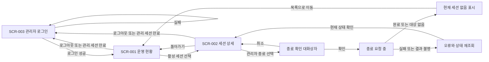

# 운영 대시보드 화면 스펙

관리자가 로그인한 뒤 대기·활성 상태를 확인하고 특정 세션을 종료하는 화면 동작을 정의한다. 실제 화면 구현은 아니다. 시각 구성은 HTML 시안이 보여 주며, 시안은 동작·상태·검증의 기준이 아니다.

| 항목 | 값 |
| --- | --- |
| 상태 | Draft |
| 관련 요구사항 | [PRD](../requirements/PRD.md) FR-06, AC-09·AC-10 |
| 관련 시스템 스펙 | [관리 조회와 세션 종료](management.md) |
| 용어 | [VNC Relay 용어집](../../GLOSSARY.md) |
| 관련 계약 | [관리 API v1](../contracts/management-api-v1.md). Active(2026-10-16 채택)이며 경로·응답 본문·화면 URL은 이 계약이 기준이다. 관리 API는 JSON over HTTP이며 경로 접두사는 `/api/v1/`이다(사용자 확정). |
| 관련 아키텍처 문서·ADR | 없음. 정적 HTML·JS 대시보드 선택은 별도 ADR 없이 [PRD 확정 기준](../requirements/PRD.md#확정-기준)으로 관리한다. 대시보드는 별도 빌드 단계 없는 정적 HTML·JS이며 실행파일에 넣어 관리 리스너가 제공한다. 프런트엔드 코드는 아직 없다. |
| 디자인 원본·공통 시각 기준 | [운영 대시보드 디자인 기준](../design/DESIGN.md). Draft이며 사용자 승인 전 제안이다. 이 문서는 배치와 동작 초안이고 색·간격·폰트·토큰은 디자인 기준이 정한다. |
| HTML 시안 | [../design/mockups/dashboard.html](../design/mockups/dashboard.html). Draft 디자인 시스템의 초안 토큰으로 만든 시안이며 4절의 모든 화면 ID와 상태를 보여 준다. 시안과 이 문서의 문장이 다르면 문장을 따른다. |
| 관련 컴포넌트 예시 | 없음. 실제 컴포넌트와 미리보기 환경이 없다. |

선택 기준·시나리오 소유·와이어프레임 판정은 [스펙 작성 규칙](AGENTS.md)을, HTML 시안 판정은 [디자인 문서 작성 규칙](../design/AGENTS.md#html-시안)을 따른다. 색·간격·글꼴 값은 디자인 기준을 연결한다. 시안 작성 순서는 [frontend-workflow 참고 문서](../../.agents/skills/frontend-workflow/references/frontend-workflow.md#화면별-html-시안-4단계)를 따른다.

## 1. 범위와 사용자

- 로그인한 관리자가 요약·대기 목록·활성 목록·세션 상세·최근 종료 목록을 보고 현재 세션을 확인한 뒤 종료한다.
- 내장 관리자 로그인과 조회·관리자 종료는 사용자 확정 범위다. 권한은 서버가 검증하며 중계 IP 허용 정책과 분리한다.
- 로그인·운영 현황·상세 화면과 조건별 이동을 별도 화면 스펙으로 관리한다.
- 화면 배치와 세션의 구체적 표현은 Draft다. 폴링 주기 P는 설정 가능하며 기본값 2초로 확정이다([4.1절](#41-폴링)). 내장 로그인 선택 자체는 미확정으로 되돌리지 않는다.
- 원격 화면 표시·키보드 입력 전송·noVNC·설정 편집·장기 이력 검색을 제공하지 않는다.
- 대시보드는 별도 빌드 단계 없는 정적 HTML·JS로 만들고 실행파일에 넣어 관리 리스너가 제공한다. Node 빌드 체인과 JS 프레임워크 의존성을 추가하지 않는다.
- 지원 화면 폭은 데스크톱과 모바일 폭이고, 지원 브라우저는 최신 Chrome·Edge·Firefox·Safari다. 두 폭 모두에서 필수 정보와 상세 이동·종료·취소·로그아웃 행동을 쓸 수 있어야 한다([6절](#6-화면-크기와-접근성)).

## 2. 화면 흐름



| 화면 ID | 화면 | 진입 | 이탈 |
| --- | --- | --- | --- |
| SCR-001 | 운영 현황 | 로그인 성공, 유효한 관리 세션으로 진입, 상세에서 돌아가기 | 활성 세션 선택 시 상세, 로그아웃·관리 세션 만료 시 로그인 |
| SCR-002 | 세션 상세 | 선택한 세션 식별자 | 목록으로 돌아가기, 종료 확인 열기 |
| SCR-003 | 관리자 로그인 | 인증되지 않은 진입, 로그아웃, 관리 세션 만료 | 로그인 성공 시 운영 현황 |

화면 URL과 라우터 구현은 정하지 않는다. 종료 확인은 SCR-002의 대화상자 상태다. 보호된 화면의 직접 진입에도 유효한 관리 세션이 필요하다.

## 3. 화면 구성과 와이어프레임

밑그림은 정보 묶음과 행동만 표현한다. 기준은 아래 문장과 수용 테스트다.

### SCR-001 운영 현황

```text
+--------------------------------------------------------------------------------------+
| VNC Relay  [로그아웃]         마지막 성공 갱신: [시각] [새로고침]                |
| 실행 상태 [값]  가동 시간 [값]  대기 [수]  활성 [수]                             |
| 초기 교환 중 [수]  Mode I 대상 연결 중 [수]  L [현재/상한]  Lm [현재/상한]       |
+--------------------------------------------------------------------------------------+
| 대기 연결                                                                        |
| 역할 | 중계 ID | 접속 시각 | 대기 시간                                           |
+--------------------------------------------------------------------------------------+
| 활성 세션                                                                        |
| 세션 | 모드 | 전송 경로 | 시작 | Viewer->대상 / 대상->Viewer | 상대 주소 | 상세  |
+--------------------------------------------------------------------------------------+
| 최근 종료 목록                                                                   |
| 세션 | 종료 원인 | 종료 시각 | Viewer->대상 / 대상->Viewer                       |
+--------------------------------------------------------------------------------------+
| 목록별 조회 상태 또는 오류                                                       |
+--------------------------------------------------------------------------------------+
```

### SCR-002 세션 상세

```text
+--------------------------------------------------------------+
| [목록으로] 세션 [식별자]         마지막 성공 갱신: [시각]       |
| 모드 [값]   Viewer 전송 경로 [값]   시작 시각 [값]             |
| Viewer 주소 [값]             Server/대상 주소 [값]            |
| Viewer -> Server/대상 [바이트]                                |
| Server/대상 -> Viewer [바이트]                [세션 종료]      |
+--------------------------------------------------------------+
| 확인 시: 종료할 세션 [식별자] [취소] [종료 확인]               |
+--------------------------------------------------------------+
```

### SCR-003 관리자 로그인

```text
+------------------------------------------+
| VNC Relay 관리자 로그인                  |
| 계정명   [____________________]           |
| 비밀번호 [********************]           |
| [로그인]                                 |
| 로그인 중 또는 공통 인증 실패 안내        |
+------------------------------------------+
```

계정명·비밀번호는 필수다. 빈 입력은 전송하지 않는다. 실패 시 계정명은 유지하고 비밀번호는 지운다. 비밀번호를 URL·로그·화면 오류에 표시하지 않는다. 로그인 진행 중 중복 전송을 막는다. 로그인 실패 제한 중에도 실패와 같은 공통 안내를 표시하며 계정 존재 여부를 드러내지 않는다. 계정 등록·비밀번호 변경 화면은 추가하지 않는다.

| 구성요소 | 표시·입력 | 사용자 행동 | 결과 | 관련 시나리오 |
| --- | --- | --- | --- | --- |
| 요약·목록 | 관리 스펙이 정한 상태와 집계 | 새로고침 | 성공 데이터·실패 상태 갱신 | DASH-001~005 |
| 연결 수·사용량 | 서버 요약의 초기 교환 중 연결 수, Mode I 대상 연결 중 연결 수, L·Lm의 현재 사용량과 상한. 의미는 [관리 스펙 2절](management.md#2-조회-대상과-상태)을 따른다 | 읽기 | 관리 스펙 값과 일치, 확인하지 못한 값은 0으로 표시하지 않음 | DASH-021 |
| 세션 링크 | 세션 식별자, 모드·경로 | 상세 열기 | 선택한 식별자의 상세 조회 | DASH-006·DASH-007 |
| 최근 종료 항목 | 세션 식별자, 종료 원인, 종료 시각, 방향별 바이트([관리 스펙 2.3절](management.md#23-최근-종료-목록)) | 읽기 | 종료·상세 행동 없음, 빈 목록은 "최근 종료 없음" | DASH-020 |
| 방향별 바이트 | 관리 스펙 2.1절의 누적 바이트(정수)를 KiB/MiB로 표시. 화면 표는 방향을 Viewer->대상, 대상->Viewer로 줄여 쓴다 | 읽기 | 전송량 의미를 바꾸지 않음 | DASH-001·DASH-006·DASH-020 |
| 상대 주소 | 실제 소켓 상대 주소 | 읽기 | 전달 헤더로 상대 주소를 대체하지 않음 | DASH-006 |
| 종료 버튼·확인 | 현재 세션 식별자와 연결 종료 영향 | 취소 또는 확인 | 취소는 요청 없음, 확인은 현재 식별자로 요청 | DASH-009~013 |
| 로그인 | 계정명·비밀번호 | 로그인 | 성공 시 현황, 실패 시 공통 오류 | DASH-017·DASH-018 |
| 로그아웃 | 현재 관리 세션 | 로그아웃 | 서버 무효화 확인 뒤 데이터 제거·로그인 이동 | DASH-019 |

### 시각·전송량 표시 형식

관리 API 값의 형식은 [관리 스펙 2.1절](management.md#21-전송량의-의미)이 정한다. 화면은 그 값을 다음처럼 표시한다.

- 시각: API의 UTC ISO 8601 값을 브라우저 현지 시각으로 바꿔 표시하고 시간대를 함께 보여준다. 마지막 성공 갱신, 접속 시각, 시작·종료 시각이 대상이다.
- 전송량: API의 바이트 정수를 KiB/MiB(이진 단위, 1 KiB = 1024 바이트)로 바꿔 표시한다.
- 표시용 변환은 API 값을 바꾸지 않는다. 확인하지 못한 값은 변환하지 않고 0으로도 표시하지 않는다.
- 소수 자릿수와 KiB·MiB 전환 경계는 시각 기준에서 정한다(DASH-TBD-004).

## 4. 화면 상태와 갱신

| 화면 | 상태 | 보이는 내용 | 가능한 행동 |
| --- | --- | --- | --- |
| SCR-001·SCR-002 | 최초 로딩 | 조회 중, 아직 모르는 값을 0으로 표시하지 않음 | 목록 이동 또는 조회 완료 대기 |
| SCR-001 | 정상·빈 목록 | 실제 값 또는 명시적 대기 없음·활성 없음·최근 종료 없음 | 새로고침, 존재하는 상세 열기 |
| SCR-001·SCR-002 | 갱신 중 | 이전 성공 데이터가 있으면 유지, 갱신 중 구분 | 화면 이동, 중복 갱신 방지 |
| SCR-001·SCR-002 | 조회 실패 | 실패 표시, 이전 데이터는 마지막 성공 시각과 함께 표시 | 명시적 재조회 |
| SCR-001·SCR-002 | 권한 없음·관리 세션 만료 | 보호된 데이터 제거, 로그인 화면으로 이동 | 관리자 로그인 |
| SCR-002 | 대상 없음 | 현재 세션을 찾을 수 없음, 종료 비활성 | 목록으로 이동 |
| SCR-002 | 종료 요청 중 | 요청 중 상태, 중복 종료 비활성 | 결과 대기, 다른 화면으로 이동 |
| SCR-002 | 종료 실패·확인 불가 | 실패 또는 결과를 확인할 수 없음 구분 | 상태 재조회, 현재 세션 확인 후 재시도 |
| SCR-003 | 입력·로그인 중·실패 | 비밀값 없는 입력 오류·공통 인증 실패, 중복 전송 비활성 | 입력 수정·명시적 로그인 |

### 4.1 폴링

- 폴링 주기 P는 설정 가능하며 기본값은 2초다(확정). 재시작이 필요한 설정이다. 화면은 서버 설정의 P를 따른다. P와 조회 제한 시간의 기본값·유효 범위는 사용자 승인으로 [설정 계약](../contracts/config-v1.md)이 정한다([운영 스펙](operations.md#2-상태와-검증-매개변수)).
- 같은 조회가 진행 중이면 새 주기 요청을 겹쳐 보내지 않는다. 완료 후 다음 주기에 조회한다. 조회 시간 제한은 [설정 계약](../contracts/config-v1.md)이 정하고 요청 전달 방식은 [관리 API 계약](../contracts/management-api-v1.md)이 정한다.
- 마지막 성공 갱신 시각은 성공한 응답을 화면에 반영한 때만 바꾼다. 요청 시작·실패만으로 성공 시각을 갱신하지 않는다.
- 화면·세션 식별자가 바뀐 뒤 도착한 이전 요청 결과는 새 화면을 덮어쓰지 않는다.
- 실패 응답을 빈 성공 목록으로 표시하지 않는다. 권한 거절 이후에는 이전 성공 데이터를 계속 노출하지 않는다.
- 변경 직후 시작하는 다음 정상 폴링이 상태를 포함하면 P와 그 요청의 처리 시간을 더한 범위에서 표시된다. 통신 장애·장시간 요청 중에도 이 지연을 보장한다는 뜻은 아니다.
- 자동 폴링 요청은 관리 세션의 유휴 만료 시각을 연장하지 않는다. 사용자 행동 요청만 연장한다([관리 스펙 3.0절](management.md#30-관리자-로그인과-세션)). 자동·사용자 요청을 구분하는 방식은 [관리 API 계약](../contracts/management-api-v1.md)이 정한다.

## 5. 입력 검증과 종료 오류

- 종료 확인에는 선택한 세션 식별자와 연결이 끊긴다는 영향을 보여야 한다.
- 취소·대화상자 닫기는 종료 요청을 보내지 않는다.
- 확인 뒤에도 서버의 관리 세션 검증을 생략하지 않는다. 유효한 관리 세션이 없으면 종료 행동을 제공하지 않는다.
- 확인 중 대상이 종료됐으면 대상 없음으로 전환한다. 같은 중계 ID의 다른 세션으로 확인 대상을 바꾸지 않는다.
- 종료 응답이 유실되면 성공·실패를 추정하지 않는다. 먼저 해당 식별자의 상태를 다시 조회한다. 종료 요청을 자동 재전송하지 않는다.
- 세션 식별자의 외부 형식과 화면 URL은 [관리 API 계약](../contracts/management-api-v1.md)이 정한다. URL에 임의로 입력한 형식이 잘못되면 잘못된 대상과 대상 소멸을 그 계약에 따라 구분한다.
- 로그인·로그아웃은 관리 스펙의 전송 방식(HTTPS 원칙, 루프백 평문 예외)과 세션·CSRF 규칙을 따른다. 교환 형식과 URL은 [관리 API 계약](../contracts/management-api-v1.md)이 정한다. 로그아웃 완료 뒤 보호된 데이터·갱신 요청을 유지하지 않는다.
- 로그아웃 응답을 확인하지 못하면 서버 세션 무효화 완료로 표시하지 않는다. 관리 데이터는 숨기고 결과 확인이 필요함을 알린다.

## 6. 화면 크기와 접근성

- 지원 화면 폭은 데스크톱과 모바일 폭이고, 지원 브라우저는 최신 Chrome·Edge·Firefox·Safari다. 모바일 폭의 구체 배치(중단점·큰 표의 표시 방식)는 시각 기준에서 정한다(DASH-TBD-004).
- 두 폭 모두에서 필수 정보와 상세 이동·종료 확인·취소·로그인·로그아웃 행동이 가려지지 않아야 한다.
- 목록·상세 이동·종료 확인·취소는 키보드로 수행할 수 있어야 한다.
- 대화상자를 열면 확인 영역으로 포커스를 이동한다. 닫으면 호출 버튼으로 돌린다. 대상 소멸로 버튼이 사라지면 목록 이동 행동으로 돌린다.
- 오류·조회 중·종료 중 상태는 색만으로 구분하지 않는다. 버튼과 값에는 역할을 알 수 있는 이름을 제공한다.

## 7. 수용 테스트

화면 테스트는 실제 컴포넌트·서버 계약을 연결한 환경에서 실행한다. 테스트 코드는 `specs/`를 기준으로 한 이 문서의 상대 경로와 시나리오 ID를 메타 정보에 기록한다(예: `dashboard.md:DASH-001`). 연결 방식은 [검증 기록](../AGENTS.md#검증-기록)을 따른다. 테스트 위치와 결과는 이 문서에 적지 않는다.

| 시나리오 ID | 요구사항 ID | 화면 ID | 조건과 사용자 행동 | 기대 결과 |
| --- | --- | --- | --- | --- |
| DASH-001 | FR-06 | SCR-001 | 알려진 요약·대기·활성 데이터로 첫 조회 | 역할·시각·모드·경로·방향별 바이트 표시, 시각은 현지 시각과 시간대, 바이트는 KiB/MiB로 표시, 미확인 값은 0 아님 |
| DASH-002 | FR-06 | SCR-001 | 정상 조회 결과가 두 빈 목록 | 대기 없음·활성 없음, 오류 표시 없음 |
| DASH-003 | FR-06 | SCR-001·SCR-002 | 최초 또는 갱신 조회 실패 | 오류와 빈 결과 구분, 이전 값은 오래된 성공 데이터임을 표시 |
| DASH-004 | FR-06 | SCR-001·SCR-002 | 실패 뒤 명시적 재조회 성공 | 현재 값 복구, 성공 시각은 성공 반영 시에만 갱신 |
| DASH-005 | FR-06 | SCR-001·SCR-002 | P보다 긴 응답, 세션 변경, 늦은 이전 응답 | 동일 조회 중첩 없음, 이전 응답이 현재 화면을 덮지 않음 |
| DASH-006 | FR-06 | SCR-002 | 목록의 활성 세션을 선택 | 선택한 세션 상세와 주소 의미·방향별 전송량 일치, 시작 시각은 현지 시각과 시간대, 전송량은 KiB/MiB로 표시 |
| DASH-007 | FR-06 | SCR-002 | 상세 조회 전·갱신 중 대상 소멸 | 대상 없음 표시, 종료 비활성, 목록 이동 가능 |
| DASH-008 | FR-06 | SCR-001·SCR-002 | 권한 없음 응답, 또는 표시 중 관리 세션 만료(Si 또는 Sa 경과 포함) | 보호된 이전 데이터·갱신 제거, 로그인 화면으로 이동 |
| DASH-009 | FR-06 | SCR-002 | 종료 확인을 열고 취소·닫기 | 세션 유지, 종료 요청 없음, 포커스 복귀 |
| DASH-010 | FR-06 | SCR-002 | 관리자 확인 후 종료 완료 응답 | 요청 중 중복 동작 차단, 완료 뒤 대상 없음·목록 갱신 |
| DASH-011 | FR-06 | SCR-002 | 종료 확인 전후 자연 종료 | 다른 식별자로 종료하지 않음, 대상 소멸 안내 |
| DASH-012 | FR-06 | SCR-002 | 종료 처리 실패 | 완료로 표시하지 않음, 오류와 상태 재조회 제공 |
| DASH-013 | FR-06 | SCR-002 | 종료 요청 이후 응답 유실 | 결과 불명 표시, 자동 재전송 없이 먼저 상태 조회 |
| DASH-014 | FR-06 | SCR-002 | 관리 세션 없이 상세 직접 진입 | 운영 데이터·종료 행동 없음, 직접 API 거절은 MGT-008로 검증 |
| DASH-015 | FR-06 | SCR-001·SCR-002 | 키보드로 이동·확인·취소, 데스크톱·모바일 폭에서 긴 값 표시 | 행동 접근 가능, 포커스 유지, 필수 정보와 오류 이름 확인 가능 |
| DASH-016 | FR-06 | SCR-001·SCR-002 | 중계 상태 변경 후 다음 정상 폴링 완료 | 해당 상태와 성공 시각 반영, 원격 화면·설정 편집 행동 없음 |
| DASH-017 | FR-06 | SCR-003 | 올바른 계정명·비밀번호로 로그인 | 인증 성공 뒤 SCR-001, 관리 조회 가능 |
| DASH-018 | FR-06 | SCR-003 | 빈 입력, 틀린 자격 증명, 또는 실패 기준 초과 뒤 로그인 | 빈 입력 전송 없음, 실패는 공통 안내·비밀번호 제거, 보호 데이터 없음, 실패 기준 초과 시에도 같은 공통 안내 |
| DASH-019 | FR-06 | SCR-001·SCR-002 | 로그아웃 성공 또는 응답 유실 후 이전 화면 접근 | 성공 시 데이터 제거·로그인 이동, 유실 시 완료 오표시 없음, 중계 세션은 유지 |
| DASH-020 | FR-06 | SCR-001 | 최근 종료 목록 조회: 정상 EOF·연결 오류·관리자 종료로 끝난 세션, 빈 목록 | 원인·종료 시각·방향별 바이트 표시, 종료 시각은 현지 시각과 시간대, 바이트는 KiB/MiB로 표시, 빈 목록은 "최근 종료 없음", 종료 항목에 종료 행동 없음 |
| DASH-021 | FR-06 | SCR-001 | 초기 교환 중 연결·Mode I 대상 연결 중 연결을 만들고 L·Lm 사용량이 알려진 상태에서 서버 요약 표시, 값을 확인하지 못한 경우 | 연결 수와 L·Lm 사용량이 관리 스펙(MGT-026) 값과 일치, 확인하지 못한 값은 0으로 표시하지 않음 |
| DASH-022 | FR-06 | SCR-001·SCR-002 | P를 기본값과 다른 값으로 설정한 서버와 P를 설정하지 않은 서버에서 각각 폴링 관찰 | 설정한 서버는 설정한 P 주기, 설정하지 않은 서버는 2초 주기로 조회, 같은 조회 중첩 없음 |
| DASH-023 | FR-06 | SCR-001·SCR-002·SCR-003 | 데스크톱 폭과 모바일 폭에서 최신 Chrome·Edge·Firefox·Safari로 각 화면을 사용 | 필수 정보와 상세 이동·종료 확인·취소·로그인·로그아웃 행동이 가려지지 않고 동작 |

## 8. 미결정 사항

프로젝트 요구사항·디자인 결정 담당자가 시각 기준과 모바일 폭 배치를 정한다. 시각 기준은 [디자인 기준 초안(Draft)](../design/DESIGN.md)이 있으나 승인 전이다. 토큰·스타일·컴포넌트는 이 문서에서 만들지 않는다.

| ID | 항목 | 영향과 제약 | 확정 위치 |
| --- | --- | --- | --- |
| DASH-TBD-003 | 로그인·세션 오류의 화면 메시지 문구 | 내장 관리자 로그인과 로그인 화면은 확정. 로그인·로그아웃 URL과 교환, 세션 오류 코드는 관리 API 계약(채택, 2026-10-16)으로 정해졌다. 남은 것은 화면에 보여줄 메시지 문구이며 시각 기준과 함께 결정 | 이 문서와 프로젝트 디자인 기준(DASH-TBD-004와 함께) |
| DASH-TBD-004 | 시각 기준·모바일 폭 배치(중단점·큰 표 표시 방식), 전송량 표시 자릿수·단위 전환 경계 | 프런트엔드 방식(정적 HTML·JS)·지원 브라우저·화면 폭, 현지 시각(시간대 표시)·KiB/MiB 표시는 확정. 디자인 기준 초안(Draft) 승인 대기. 승인 전에는 시각 기준과 모바일 배치, 표시 자릿수·전환 경계가 확정이 아니다 | [운영 대시보드 디자인 기준](../design/DESIGN.md) (DESIGN-TBD-001~004) |

DASH-TBD-001은 결정되어 4.1절과 설정 계약에 반영했으며 재사용하지 않는다. DASH-TBD-002는 [관리 API v1](../contracts/management-api-v1.md) 채택(2026-10-16)으로 결정되어 계약 1.8·1.11절에 반영했으며 재사용하지 않는다.
