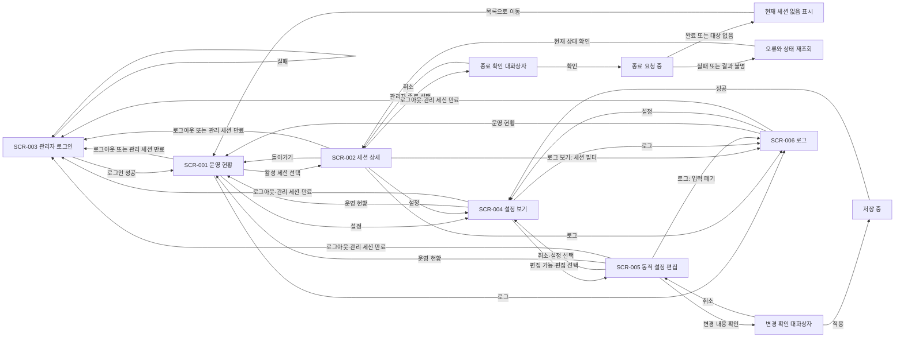

# 운영 대시보드 화면 스펙

관리자가 로그인한 뒤 대기·활성 상태를 확인하고 특정 세션을 종료하는 화면 동작을 정의한다. 설정 보기·동적 설정 편집과 최근 로그 조회도 포함한다. 시각 구성은 HTML 시안이 보여 주며, 시안은 동작·상태·검증의 기준이 아니다.

| 항목 | 값 |
| --- | --- |
| 상태 | Active(2026-11-07 채택, 사용자 결정 2026-11-07(Q150)) |
| 관련 요구사항 | [PRD](../requirements/PRD.md) FR-06·FR-09, AC-09·AC-10·AC-36·AC-54 |
| 관련 시스템 스펙 | [관리 조회와 세션 종료](management.md) |
| 용어 | [VNC Relay 용어집](../../GLOSSARY.md) |
| 관련 계약 | [관리 API v1](../contracts/management-api-v1.md). Active(2026-10-16 채택)이며 경로·응답 본문·화면 URL은 이 계약이 기준이다. 관리 API는 JSON over HTTP이며 경로 접두사는 `/api/v1/`이다(사용자 확정). |
| 관련 아키텍처 문서·ADR | [코드 지도](../architectures/code-map.md), [대시보드 구성 요소 설계](../architectures/dashboard-components.md), [대시보드 운영 화면 설계](../architectures/dashboard-operations-overview.md), [관리 리스너 모듈 설계](../architectures/management-listener.md). 정적 HTML·JS 대시보드 선택은 별도 ADR 없이 [PRD 확정 기준](../requirements/PRD.md#확정-기준)으로 관리한다. 대시보드는 별도 빌드 단계 없는 정적 HTML·JS이며 실행파일에 넣어 관리 리스너가 제공한다. 프런트엔드 코드는 `web/dashboard/`에 있다. |
| 디자인 원본·공통 시각 기준 | [운영 대시보드 디자인 기준](../design/DESIGN.md). Accepted(2026-10-20 사용자 채택). 색·간격·폰트·토큰·배치 기준은 디자인 기준이 정한다. |
| HTML 시안 | [대시보드 시안](../design/mockups/dashboard.html). SCR-001~003의 기존 시안은 2026-10-20 사용자 채택 범위다. 설정 내비게이션 추가와 SCR-004·005의 모든 상태(한국어·English)는 사용자 결정 2026-11-08(Q174)으로 채택했다. 시안과 이 문서의 문장이 다르면 문장을 따른다. |
| 2026-11-08 추가 범위 | 사용자 지시 2026-11-08과 사용자 결정 2026-11-08(Q185·Q186·Q187·Q188)에 따라 SCR-006, 양쪽 전송 경로·전달 주소, 설정 v4 표시를 정의한다. 새 시안·내비게이션 순서는 사용자 결정 2026-11-08(Q189)으로, CPY-149~189는 사용자 결정 2026-11-08(Q190)으로, 최근 로그 API 이름과 세션 필터 URL 형식은 사용자 결정 2026-11-08(Q191)으로 채택했다. 구현은 커밋 `3df0693`이다. 시험은 커밋 `51bd747`의 두 OS 게이트와 [WSS Server·프록시·최근 로그 판정표](../how-to/set-up-and-verify.md#43-wss-server프록시-tls-종료최근-로그-판정표)로 통과로 판정했다. |
| 관련 컴포넌트 예시 | 구성 요소는 `web/dashboard/app/components/`에 있다([대시보드 구성 요소 설계](../architectures/dashboard-components.md)). 미리보기 `web/dashboard/preview/`는 `cargo xtask dashboard-serve`로 연다(로컬 전용). 로그인 화면(SCR-003)은 `web/dashboard/login/`에 있다. `login/`과 `app/`은 파일을 공유하지 않으므로 구성 요소를 가져오지 않는다([프런트엔드 컨벤션 1.1절](../conventions/frontend.md)). |

선택 기준·시나리오 소유·와이어프레임 판정은 [스펙 작성 규칙](AGENTS.md)을, HTML 시안 판정은 [디자인 문서 작성 규칙](../design/AGENTS.md#html-시안)을 따른다. 색·간격·글꼴 값은 디자인 기준을 연결한다. 시안 작성 순서는 [frontend-workflow 참고 문서](../../.agents/skills/frontend-workflow/references/frontend-workflow.md#화면별-html-시안-4단계)를 따른다.

## 1. 범위와 사용자

- 로그인한 관리자가 요약·대기 목록·활성 목록·세션 상세·최근 종료 목록을 보고 현재 세션을 확인한 뒤 종료한다.
- 내장 관리자 로그인과 조회·관리자 종료는 사용자 확정 범위다. 권한은 서버가 검증하며 중계 IP 허용 정책과 분리한다.
- 로그인·운영 현황·상세·설정 보기·동적 설정 편집·로그 화면과 조건별 이동을 별도 화면 스펙으로 관리한다.
- 화면 배치와 세션의 구체적 표현도 채택했다(사용자 결정 2026-11-07(Q150)). 폴링 주기 P는 설정 가능하며 기본값 2초로 확정이다([4.1절](#41-폴링)). 내장 로그인 선택 자체는 미확정으로 되돌리지 않는다.
- 원격 화면 표시·키보드 입력 전송·noVNC·장기 이력 검색을 제공하지 않는다. 설정 보기는 항상 제공한다. 동적 설정 편집은 `management.config_edit = true`로 시작한 서버에서 로그인한 모든 관리자가 쓴다(사용자 지시 2026-11-08, 사용자 결정 2026-11-08(Q169·Q170)). 수동 재로드 행동은 추가하지 않는다.
- 최근 로그는 메모리에 보관한 마지막 N개 운영 로그다. N은 `recent_logs.max_entries`이며 기본값 1000, 범위 0~10000이다. 0이면 보관하지 않고 재시작하면 목록이 비워진다. 값 변경에는 재시작이 필요하다(사용자 결정 2026-11-08(Q185)). 장기 이력 검색으로 해석하지 않는다.
- 로그 화면은 수준·사건 이름 필터, 값 검색, P 주기 자동 갱신과 일시정지, 세션별 진입, 현재 필터 결과 전체의 JSON Lines 다운로드를 제공해야 한다(사용자 결정 2026-11-08(Q186)).
- 대시보드는 별도 빌드 단계 없는 정적 HTML·JS로 만들고 실행파일에 넣어 관리 리스너가 제공한다. Node 빌드 체인과 JS 프레임워크 의존성을 추가하지 않는다.
- 지원 화면 폭은 데스크톱과 모바일 폭이고, 지원 브라우저는 최신 Chrome·Edge·Firefox·Safari다. 두 폭 모두에서 필수 정보와 상세 이동·종료·취소·로그아웃 행동을 쓸 수 있어야 한다([6절](#6-화면-크기와-접근성)).
- 화면 문구는 한국어와 영어 두 가지다. 브라우저 언어로 자동 선택하고 사용자가 바꿀 수 있다([화면 언어](#화면-언어)).

## 2. 화면 흐름



| 화면 ID | 화면 | 진입 | 이탈 |
| --- | --- | --- | --- |
| SCR-001 | 운영 현황 | 로그인 성공, 유효한 관리 세션으로 진입, 상세에서 돌아가기 | 활성 세션 선택 시 상세, 로그·설정 선택 시 해당 화면, 로그아웃·관리 세션 만료 시 로그인 |
| SCR-002 | 세션 상세 | 선택한 세션 식별자 | 목록으로 돌아가기, 종료 확인 열기, 로그·설정, 로그 보기로 세션 필터 로그 진입 |
| SCR-003 | 관리자 로그인 | 인증되지 않은 진입, 로그아웃, 관리 세션 만료 | 로그인 성공 시 운영 현황 |
| SCR-004 | 설정 보기 | `/#/settings`, 상단 막대 설정, 저장 성공 | 운영 현황·로그, 편집 가능하면 SCR-005, 로그아웃·관리 세션 만료 시 로그인 |
| SCR-005 | 동적 설정 편집 | `/#/settings/edit`, SCR-004의 편집 | 취소·설정 선택·저장 성공 시 SCR-004, 운영 현황·로그, 로그아웃·관리 세션 만료 시 로그인 |
| SCR-006 | 로그 | `/#/logs`, 상단 막대 로그, SCR-002의 로그 보기(세션 필터) | 운영 현황·설정, 로그아웃·관리 세션 만료 시 로그인 |

화면 URL은 [관리 API 계약](../contracts/management-api-v1.md)이 정한다. 종료 확인은 SCR-002, 변경 확인은 SCR-005의 대화상자 상태다. 보호된 화면의 직접 진입에도 유효한 관리 세션이 필요하다. 상단 막대는 세 항목을 제공해야 한다. "운영 현황"은 SCR-001·002에서, "로그"는 SCR-006에서, "설정"은 SCR-004·005에서 활성이다. 순서는 운영 현황 · 로그 · 설정이다(사용자 결정 2026-11-08(Q189)). 세 항목은 모든 지원 폭에서 사용할 수 있어야 한다. 화면을 떠나면 늦게 도착한 조회·저장 결과로 새 화면을 덮어서는 안 된다. SCR-005에서 로그로 이동해도 저장하지 않은 입력을 버리고 PATCH를 보내지 않는다. 세션 필터 URL `/#/logs?session_id={session_id}`는 사용자 결정 2026-11-08(Q191)으로 채택했다.

SCR-001·002·004·005·006의 상단 막대 도구와 SCR-003의 언어 선택 앞에는 도움말 링크(CPY-195)를 둔다(사용자 결정 2026-11-11(Q226)). 링크는 현재 화면 언어의 [도움말 사이트](help-site.md) 첫 페이지를 새 탭에서 연다. 대시보드는 도움말 사이트에 요청을 보내지 않는다. 링크를 골라도 현재 화면·입력·관리 세션은 그대로다.

## 3. 화면 구성과 와이어프레임

밑그림은 정보 묶음과 행동만 표현한다. 기준은 아래 문장과 수용 테스트다. 화면마다 구성요소 표를 둔다.

### SCR-001 운영 현황

```text
+--------------------------------------------------------------------------------------+
| VNC Relay  [운영 현황: 활성] [로그] [설정]   [도움말] [언어] [로그아웃]              |
| 운영 현황  마지막 성공 갱신: [시각]                         [새로고침]          |
| 실행 상태 [값]  가동 시간 [값]  대기 [수]  활성 [수]                             |
| 초기 교환 중 [수]  Mode I 대상 연결 중 [수]                                      |
| 중계 연결 [현재/상한]  관리 연결 [현재/상한]                                      |
+--------------------------------------------------------------------------------------+
| 대기 연결 [개수]                                                                 |
| 역할 | 중계 ID | 접속 시각 | 대기 시간                                           |
+--------------------------------------------------------------------------------------+
| 활성 세션 [개수]                                                                 |
| 세션 | 모드 | 전송 경로(Viewer → 대상) | 시작 | 방향별 바이트 | 상대 주소 | 상세 |
+--------------------------------------------------------------------------------------+
| 최근 종료 목록 [개수]                                                            |
| 세션 | 종료 원인 | 종료 시각 | Viewer->대상 / 대상->Viewer                       |
+--------------------------------------------------------------------------------------+
| 목록별 조회 상태 또는 오류                                                       |
+--------------------------------------------------------------------------------------+
```

| 구성요소 | 표시 내용·입력 규칙 | 사용자 행동 | 결과 | 관련 시나리오 |
| --- | --- | --- | --- | --- |
| 상단 막대 내비게이션 | 운영 현황·로그·설정, 현재 화면의 활성 표시. 순서는 사용자 결정 2026-11-08(Q189)으로 채택 | 항목 선택 | SCR-001·SCR-006·SCR-004로 이동 | DASH-028 |
| 마지막 성공 갱신·새로고침 | 성공한 응답을 반영한 시각(현지 시각과 시간대) | 새로고침 | 같은 조회가 진행 중이 아니면 재조회, 성공했을 때만 시각 갱신 | DASH-003·DASH-004·DASH-005 |
| 서버 요약 | 실행 상태, 가동 시간, 대기 수, 활성 수 | 읽기 | 관리 스펙 값과 일치, 확인하지 못한 값은 0으로 표시하지 않음 | DASH-001·DASH-016 |
| 연결 수·사용량 | 서버 요약의 초기 교환 중 연결 수, Mode I 대상 연결 중 연결 수, 중계 연결(L)·관리 연결(Lm)의 현재 사용량과 상한. 화면에는 기호 L·Lm 대신 "중계 연결"·"관리 연결" 이름과 무엇을 세는지 한 줄 설명을 쓴다. 의미는 [관리 스펙 2절](management.md#2-조회-대상과-상태)을 따른다 | 읽기 | 관리 스펙 값과 일치, 확인하지 못한 값은 0으로 표시하지 않음 | DASH-021 |
| 대기 연결 목록 | 역할, 중계 ID, 접속 시각, 대기 시간. 빈 목록은 "대기 없음" | 읽기 | 대기 연결에는 상세·종료 행동 없음 | DASH-001·DASH-002 |
| 활성 세션 목록 | 세션 식별자, 모드, 양쪽 전송 경로(`viewer_transport → target_transport`), 시작 시각, 방향별 바이트, 상대 주소. 전송 경로는 TCP·WS·WSS이며 Mode I 대상은 TCP다. 빈 목록은 "활성 없음" | 상세 열기 | 선택한 식별자의 SCR-002로 이동. 사용자 결정 2026-11-08(Q190)으로 채택한 CPY-187 적용 | DASH-001·DASH-002·DASH-006·DASH-062 |
| 최근 종료 목록 | 세션 식별자, 종료 원인, 종료 시각, 방향별 바이트([관리 스펙 2.3절](management.md#23-최근-종료-목록)). 빈 목록은 "최근 종료 없음". 종료 원인 `session_expired`는 CPY-190과 중립 배지로 표시(사용자 결정 2026-11-11(Q217)) | 읽기 | 종료·상세 행동 없음 | DASH-020 |
| 목록 개수 배지 | 대기 연결·활성 세션·최근 종료 목록의 제목 옆에 해당 목록의 표시 중인 응답 항목 수를 쓴다. 문구는 CPY-084·085다. 성공한 빈 목록은 0건이다. 첫 성공 전에는 배지를 숨긴다. 갱신 실패로 이전 목록을 유지하면 그 목록의 개수도 유지한다. 서버 요약의 수를 대신 쓰지 않는다. | 읽기 | 목록별 개수와 보이는 데이터가 같은 응답을 따른다. 언어 변경 때 개수 문구도 즉시 바뀐다. | DASH-001~004·DASH-020·DASH-025 |
| 방향별 바이트 | 관리 스펙 2.1절의 누적 바이트(정수)를 KiB/MiB로 표시. 표는 방향을 Viewer->대상, 대상->Viewer로 줄여 쓴다 | 읽기 | 전송량 의미를 바꾸지 않음 | DASH-001·DASH-020 |
| 목록별 조회 상태 | 조회 중·실패·오래된 성공 데이터 구분 | 재조회 | 실패를 빈 목록으로 표시하지 않음 | DASH-003·DASH-004 |
| 언어 선택 | 현재 화면 언어 이름("한국어" 또는 "English") | 언어 선택 | 화면 문구를 즉시 바꾸고 선택을 브라우저에 저장 | DASH-024·DASH-025 |
| 도움말 링크 | CPY-195와 새 탭 아이콘. 접근 가능한 이름은 CPY-195 뒤에 괄호로 CPY-196을 붙인다 | 선택 | 새 탭에서 현재 화면 언어의 도움말 첫 페이지를 연다. 현재 화면·입력·관리 세션은 그대로다 | DASH-064 |
| 로그아웃 | 현재 관리 세션 | 로그아웃 | 서버 무효화 확인 뒤 데이터 제거·SCR-003 이동 | DASH-019 |

### SCR-002 세션 상세

```text
+--------------------------------------------------------------+
| VNC Relay [운영 현황: 활성] [로그] [설정] [도움말] [언어] [로그아웃] |
| [목록으로] 세션 [식별자]         마지막 성공 갱신: [시각]       |
| 모드 [값] Viewer 전송 경로 [값] Server/대상 전송 경로 [값]     |
| 시작 시각 [값] Viewer 주소 [값] Server/대상 주소 [값]          |
| Viewer 전달 주소 [있을 때] Server/대상 전달 주소 [있을 때]     |
| 방향별 바이트 [값]                    [로그 보기] [세션 종료] |
+--------------------------------------------------------------+
| 확인 시: 종료할 세션 [식별자] [취소] [종료 확인]               |
+--------------------------------------------------------------+
```

| 구성요소 | 표시 내용·입력 규칙 | 사용자 행동 | 결과 | 관련 시나리오 |
| --- | --- | --- | --- | --- |
| 상단 막대 내비게이션 | SCR-001과 같다. 운영 현황 활성 | 항목 선택 | SCR-001·SCR-006·SCR-004로 이동 | DASH-028 |
| 목록으로 | 없음 | 선택 | SCR-001로 이동 | DASH-007 |
| 마지막 성공 갱신 | 성공한 응답을 반영한 시각(현지 시각과 시간대) | 읽기 | 성공했을 때만 시각 갱신 | DASH-004·DASH-005 |
| 세션 정보 | 세션 식별자, 모드, Viewer 전송 경로, Server/대상 전송 경로(`target_transport`), 시작 시각(현지 시각과 시간대) | 읽기 | 선택한 식별자의 값만 표시. Mode I 대상은 TCP, Mode II Server는 TCP·WS·WSS | DASH-006·DASH-062 |
| 상대 주소·전달 주소 | `viewer_address`·`target_address`는 소켓 상대 주소다. `viewer_forwarded_ip`·`target_forwarded_ip`가 있으면 별도 행에 전달 주소를 표시한다. null인 전달 주소 행은 숨긴다 | 읽기 | 소켓 주소를 전달 주소로 대체하지 않음. 주소 설명은 사용자 결정 2026-11-08(Q190)으로 채택한 CPY-188 적용 | DASH-006·DASH-062 |
| 로그 보기 | 현재 `session_id` | 선택 | SCR-006에 세션 필터로 진입. URL은 사용자 결정 2026-11-08(Q191)으로 채택한 `/#/logs?session_id={session_id}` | DASH-059 |
| 방향별 바이트 | 관리 스펙 2.1절의 누적 바이트(정수)를 KiB/MiB로 표시 | 읽기 | 전송량 의미를 바꾸지 않음 | DASH-006 |
| 세션 종료 버튼 | 유효한 관리 세션이 있고 대상이 있을 때만 활성 | 선택 | 종료 확인 대화상자 열기, 요청은 보내지 않음 | DASH-009·DASH-014 |
| 종료 확인 대화상자 | 종료할 세션 식별자와 연결이 끊긴다는 영향 | 취소·닫기 또는 종료 확인 | 취소·닫기는 요청 없음과 포커스 복귀, 확인은 현재 식별자로 요청 | DASH-009~013 |
| 언어 선택 | SCR-001과 같다 | 언어 선택 | SCR-001과 같다 | DASH-024·DASH-025 |
| 도움말 링크 | SCR-001과 같다 | 선택 | SCR-001과 같다 | DASH-064 |
| 로그아웃 | 현재 관리 세션 | 로그아웃 | 서버 무효화 확인 뒤 데이터 제거·SCR-003 이동 | DASH-019 |

### SCR-003 관리자 로그인

```text
+------------------------------------------+
|                         [도움말] [언어]  |
| VNC Relay 관리자 로그인                  |
| 계정명   [____________________]           |
| 비밀번호 [********************]           |
| [로그인]                                 |
| 로그인 중 또는 공통 인증 실패 안내        |
+------------------------------------------+
```

계정명·비밀번호는 필수다. 빈 입력은 전송하지 않는다. 실패 시 계정명은 유지하고 비밀번호는 지운다. 비밀번호를 URL·로그·화면 오류에 표시하지 않는다. 로그인 진행 중 중복 전송을 막는다. 로그인 실패 제한 중에도 실패와 같은 공통 안내를 표시하며 계정 존재 여부를 드러내지 않는다. 계정 등록·비밀번호 변경 화면은 추가하지 않는다.

| 구성요소 | 표시 내용·입력 규칙 | 사용자 행동 | 결과 | 관련 시나리오 |
| --- | --- | --- | --- | --- |
| 계정명 | 필수. 실패 뒤에도 입력값 유지 | 입력 | 빈 값이면 전송하지 않음 | DASH-018 |
| 비밀번호 | 필수. 가려서 표시, URL·로그·화면 오류에 표시하지 않음 | 입력 | 빈 값이면 전송하지 않음, 실패 뒤 지움 | DASH-018 |
| 로그인 버튼 | 로그인 진행 중에는 비활성 | 로그인 | 성공 시 SCR-001, 실패·실패 기준 초과 시 같은 공통 안내 | DASH-017·DASH-018 |
| 안내 영역 | 로그인 중 또는 공통 인증 실패 안내. 계정 존재 여부를 드러내지 않음 | 읽기 | 보호 데이터 없음 | DASH-018 |
| 언어 선택 | 현재 화면 언어 이름 | 언어 선택 | 화면 문구를 즉시 바꾸고 선택을 브라우저에 저장. 입력한 계정명은 유지 | DASH-024·DASH-025 |
| 도움말 링크 | SCR-001과 같다. 언어 선택 앞에 둔다 | 선택 | 새 탭에서 현재 화면 언어의 도움말 첫 페이지를 연다. 입력한 계정명은 그대로다 | DASH-064 |

### SCR-004 설정 보기

```text
+-----------------------------------------------------------------------+
| VNC Relay [운영 현황] [로그] [설정: 활성]  [도움말] [언어] [로그아웃]   |
| 설정 보기                                      [새로고침] [편집]      |
| 조회 시각 [as_of]                                                      |
| [설정 파일 상태 안내 / 편집 꺼짐·막힘 / 저장 성공 안내]                 |
| 마지막 재로드: [시각·결과·계기·바뀐 키] 또는 [이력 없음]                |
| [설정 구역 이름]                                                      |
| 키                         값                  적용 구분 / 파일 차이   |
| relay.tcp_viewer.allow      203.0.113.0/24       재시작 없이 적용        |
| management.config_edit     true                 재시작 필요             |
| (설정 계약의 모든 구역·키, 기본값과 생략된 값 포함)                     |
+-----------------------------------------------------------------------+
```

| 구성요소 | 표시 내용·입력 규칙 | 사용자 행동 | 결과 | 관련 시나리오 |
| --- | --- | --- | --- | --- |
| 상단 막대 | 운영 현황·로그·설정(활성), 도움말, 언어, 로그아웃 | 이동·도움말 열기·언어 선택·로그아웃 | 공통 행동 유지 | DASH-028·050·051·064 |
| 조회 시각·새로고침 | `as_of`를 현지 시각·시간대와 함께 표시 | 새로고침 | `GET /api/v1/config`. 진입·명시적 새로고침에만 조회하고 자동 폴링하지 않음. 중첩 조회 없음 | DASH-029·048·049 |
| 파일 상태 안내 | `file.state` 5종, `file.config_keys`, `file.diagnostics` | 읽기 | 실행 값과 파일의 차이를 구분. 진단은 5.1절의 `code`별 한영 문구와 `key`를 표시. 목록에 없는 코드만 서버 `message`와 `code`를 표시 | DASH-030~032 |
| 마지막 재로드 | `last_reload.at`·`result`·`trigger`·`config_keys`. `null`이면 이력 없음 | 읽기 | 현재 파일 상태와 별도로 표시. 결과는 적용·거절·재시작 필요, 계기는 파일 변경 감지·설정 편집으로 번역. 시각은 조회 시각과 같은 현지 시각·시간대 형식. 키는 데이터 그대로 | DASH-029·033 |
| 구역별 키·값 | `items`의 모든 키를 설정 계약 1.2절 순서와 테이블별로 묶음. `value`는 실행 중 유효 값이며 기본값 포함. 불리언은 `true`·`false`, 정수는 정확한 십진 값, 문자열은 그대로, 배열은 항목별 줄, `[]`는 빈 목록, `null`은 값 없음으로 표시 | 읽기 | 파일에만 있는 미적용 값을 실행 값처럼 표시하지 않음. 파일 차이는 `file.config_keys`에 든 키에 글씨로 표시 | DASH-029~032 |
| 적용 구분 | `items.reload = dynamic`은 재시작 없이 적용, `restart`는 재시작 필요. v4의 재로드 대상은 43개다(접속 ticket 키 10개 포함) | 읽기 | 인증서·개인키 경로 4개와 접속 ticket 공개 키 파일 경로 2개는 경로만 보이며 파일 내용과 편집 입력은 없음. `recent_logs.max_entries`는 재시작 필요이며 `recent_closed.max_entries` 옆에 표시 | DASH-029·035 |
| 편집 | `edit_enabled = true`이며 `file.state`가 `in_effect`·`pending`일 때 활성 | 편집 | SCR-005 이동. 꺼짐이면 `management.config_edit = true`와 재시작 안내. 막힘이면 파일 수정·재시작 등 이유 안내 | DASH-031·032·034 |
| 저장 성공 안내 | PATCH `applied`의 길이. 빈 배열은 0개 | 읽기 | SCR-004에서 현재 실행 값을 다시 조회하고 성공 안내. 조회 실패가 저장 성공 사실을 취소하지 않음 | DASH-039·052 |

### SCR-005 동적 설정 편집

```text
+-----------------------------------------------------------------------+
| VNC Relay [운영 현황] [로그] [설정: 활성]  [도움말] [언어] [로그아웃]   |
| 동적 설정 편집                                                        |
| [키별 다음 검사·요청부터 적용. 끝난 검사·타이머·소켓 옵션 유지 안내]     |
| 출발지 IP 허용 목록: relay.tcp_viewer.allow                             |
| [203.0.113.0/24                  ]  한 줄에 항목 하나                  |
| [198.51.100.7                    ]  [입력 도움말 / 줄별 오류]          |
| 접근 정책 / 연결 상한 / 시간 제한 / 연결 유지                         |
| limits.relay_connections [2000]  min ~ max                             |
| timeouts.handshake_secs  [10  ] 초                                     |
| [취소]                                      [변경 내용 확인]           |
+-----------------------------------------------------------------------+
| 변경 확인: 바뀐 키·이전 → 새 값 / 목록의 추가·삭제 / 빈 목록 경고       |
| 기존 연결 유지 안내                              [취소] [적용]        |
+-----------------------------------------------------------------------+
```

| 구성요소 | 표시 내용·입력 규칙 | 사용자 행동 | 결과 | 관련 시나리오 |
| --- | --- | --- | --- | --- |
| 상단 막대 | SCR-004와 같다 | 이동·도움말 열기·언어 선택·로그아웃 | 이동하면 저장하지 않은 입력은 버림. 이탈 확인 없음. 도움말은 새 탭에서 열리므로 입력을 버리지 않음 | DASH-028·050·051·053·064 |
| 준비 조회 | 진입 때 `GET /api/v1/config`. 그 응답의 `revision`과 실행 값 보관 | 조회 완료 대기·명시적 재조회 | 폴링 없음. `revision = null`이면 편집하지 않음 | DASH-032·035·048·049 |
| 입력 구역 | 출발지 IP 허용 목록 / 접근 정책 / 연결 상한 / 시간 제한 / 연결 유지 / 접속 ticket(CPY-191). 전체 편집 대상 37개 중 `items.editable = true`인 키만 입력란으로 제공. 꺼진 역할·리스너·Mode I 키, TLS 경로 4개, 접속 ticket 공개 키 파일 경로 2개는 입력란 없음 | 입력 | `management.config_edit`와 재시작 필요 키도 편집하지 않음. 기존 다섯 구역(사용자 결정 2026-11-08(Q170·Q172·Q184·Q188)) 뒤 마지막에 여섯째 구역 "접속 ticket"을 둔다(사용자 결정 2026-11-11(Q215)). 구역 안 순서는 설정 계약 1.2절의 키 순서다. 따라서 Viewer 키 다음 Server 키이며 키마다 `enabled`, `issuer`, `relay_host`, `max_lifetime_secs` 순서다 | DASH-035 |
| 여러 줄 목록 | 한 줄에 항목 하나, 빈 줄 무시, 항목 안·앞뒤 공백 금지. 원래 줄 번호와 전송 배열 첨자의 연결을 유지 | 입력 수정 | 서버 진단의 `key[i]`를 해당 입력란과 원래 줄에 연결. 진단 문구는 5.1절의 코드별 한영 대응을 사용 | DASH-036·040 |
| 정수 | 서버의 `min`·`max` 표시. 초·바이트 단위, 연결·대기·probe 개수는 개수 단위 | 입력 수정 | 정수·범위·Lw ≤ L 화면 검사 | DASH-036 |
| 불리언 | `relay.ticket.viewer.enabled`·`relay.ticket.server.enabled`. SCR-006 수준 체크 그룹과 같은 체크박스이며 label은 키 이름(사용자 결정 2026-11-11(Q216)) | 선택·해제 | 바뀐 값만 `true`·`false`로 전송 | DASH-035·036 |
| 문자열 | `issuer`·`relay_host`. 한 줄 입력이며 앞뒤 공백을 자르지 않음. UTF-8 1~256바이트 | 입력 수정 | 범위를 벗어나면 CPY-193. 실행 값이 `null`이고 입력이 비어 있으면 바꾸지 않은 값으로 보고 전송하지 않음(이 문서의 판단, 사용자 결정 없음) | DASH-036 |
| 변경 내용 확인 | 화면 검사 통과 후에만 열기 | 선택 | 바뀐 키별 이전·새 값. 목록은 추가·삭제 항목. 빈 목록은 키별 의미를 경고(CPY-105·183·192). ticket `enabled`를 `false`에서 `true`로 바꾸면 그 키의 변경 항목 안에 CPY-194 경고(사용자 결정 2026-11-11(Q218)). 바뀐 값이 없어도 0개를 확인할 수 있음 | DASH-037·052 |
| 확인 대화상자 | 키별 다음 검사·요청부터 적용되며 이미 끝난 검사·시작한 타이머·소켓 옵션은 유지한다는 안내(CPY-189, 사용자 결정 2026-11-08(Q190)). 정확한 적용 시점은 [설정 계약 1.8절](../contracts/config-v4.md#18-재로드-구분) | 취소·닫기 또는 적용 | 취소·닫기는 요청 없음·입력 유지·호출 버튼 초점 복귀. 적용은 보관한 `revision`과 바뀐 키만 `changes`로 PATCH. 변경이 없으면 PATCH 없이 보기로 이동 | DASH-037~039·052 |
| 오류 안내 | 5.1절의 코드별 안내, 입력란 진단 또는 화면 상단 안내. SCR-004 `file.diagnostics`와 `config_file_invalid`도 같은 진단 번역 사용 | 수정·다시 불러오기·명시적 재시도·설정 보기 | 실패·결과 불명·저장 성공을 구분. 자동 재전송 없음 | DASH-040~049 |
| 취소 | 저장하지 않음 | 선택 | SCR-004로 이동, 이탈 확인 없음 | DASH-053 |

SCR-004는 [설정 v4 계약 1.2절](../contracts/config-v4.md#12-키-표)의 리스너·역할 테이블을 그대로 구분해야 한다. `relay.ws_viewer.*`·`relay.wss_viewer.*`는 표시하거나 전송하지 않는다. SCR-005는 `settings-model.js`의 `fieldGroup` 분류를 재사용한다. 접속 ticket 키 8개만 새 마지막 구역에 둔다(사용자 결정 2026-11-11(Q215)).

| v4 키 | SCR-004 표시 위치·적용 구분 | SCR-005 구역 |
| --- | --- | --- |
| `relay.ws.viewer.allow`·`relay.ws.server.allow`·`relay.wss.viewer.allow`·`relay.wss.server.allow` | 각 역할 테이블, 재로드 가능 | 출발지 IP 허용 목록(`sourceAllowLists`) |
| `relay.ws.viewer.allowed_origins`·`relay.ws.server.allowed_origins`·`relay.wss.viewer.allowed_origins`·`relay.wss.server.allowed_origins` | 각 역할 테이블, 재로드 가능 | 접근 정책(`accessPolicies`) |
| `relay.ws.trusted_proxies`·`relay.wss.trusted_proxies` | 각 리스너 테이블, 재로드 가능 | 접근 정책(`accessPolicies`) |
| `relay.ws.viewer.enabled`·`relay.ws.server.enabled`·`relay.wss.viewer.enabled`·`relay.wss.server.enabled` | 각 역할 테이블, 재시작 필요 | 입력 없음 |
| `relay.ws.listen`·`relay.wss.listen` | 각 리스너 테이블, 재시작 필요 | 입력 없음 |
| `relay.wss.cert_file`·`relay.wss.key_file` | WSS 리스너 테이블, 재로드 가능 | 입력 없음. `management.cert_file`·`management.key_file`도 동일 |
| `relay.ticket.viewer.enabled`·`issuer`·`relay_host`·`max_lifetime_secs`, `relay.ticket.server`의 같은 키 | `[relay.ticket.viewer]`·`[relay.ticket.server]` 테이블, 재로드 가능 | 접속 ticket(`accessTickets`). 그 역할이 WS 또는 WSS에서 켜져 있을 때만 `editable = true` |
| `relay.ticket.viewer.public_keys_file`·`relay.ticket.server.public_keys_file` | 각 ticket 테이블, 재로드 가능. 경로만 표시 | 입력 없음 |
| `recent_logs.max_entries` | `recent_closed.max_entries` 옆, 재시작 필요 | 입력 없음 |

`trusted_proxies = []`는 전달 헤더를 신뢰하지 않는다는 뜻이다. 역할의 `allow = []`처럼 모든 새 접속을 거절하는 목록이 아니다. 확인 대화상자는 이 키에 CPY-105를 쓰지 않고 CPY-183을 써야 한다. 역할의 `allowed_origins = []`는 Origin이 있는 요청을 거절한다. Origin이 없는 요청은 Origin 비교를 생략하고 IP 검사를 한다. 그 역할에 접속 ticket 확인을 켰으면 ticket 확인도 한다([WebSocket 계약](../contracts/websocket-relay-v2.md), 사용자 결정 2026-11-11(Q196)). 이 키에도 CPY-105 대신 CPY-192를 써야 한다. CPY-192는 CPY-184를 대체한다(사용자 결정 2026-11-11(Q217)).
`trusted_proxies`에는 프록시 주소만 넣어야 하며 클라이언트 범위를 넣어서는 안 된다. 모든 전달 주소가 신뢰 프록시에 속하면 요청을 거절한다. 이 입력 도움말은 CPY-185로 표시한다. IP·CIDR·범위의 문법과 진단은 기존 출발지 IP 목록과 같다.
`trusted_proxies` 변경은 다음 수락 검사 또는 업그레이드 검사에 적용한다. 역할 `allow` 변경은 다음 수락 시의 합집합 검사와 업그레이드 시의 역할 검사에 적용한다. `allowed_origins` 변경은 다음 업그레이드 요청에 적용한다. 이미 끝난 검사의 결과는 유지한다. 수락됐지만 아직 업그레이드하지 않은 연결도 새 값으로 업그레이드 검사를 할 수 있다. CPY-100의 채택 원문은 보존하고 이 차이를 담은 CPY-189를 교체안으로 둔다.

### SCR-006 로그

화면 ID와 기본 URL은 사용자 결정 2026-11-08(Q186·Q187)으로 확정했다. 다음 그림은 동작을 설명하는 텍스트 와이어프레임이다. HTML 시안은 사용자 결정 2026-11-08(Q189)으로, 문구는 사용자 결정 2026-11-08(Q190)으로 채택했다.

```text
+----------------------------------------------------------------------------+
| VNC Relay [운영 현황] [로그: 활성] [설정]       [도움말] [언어] [로그아웃]    |
| 로그                                    [자동 갱신: 켜짐] [새로고침]     |
| 보관 [수] / 최대 [수]                    마지막 성공 갱신: [시각·시간대] |
| 수준 [info] [warn] [error]  사건 이름 [모든 사건 v]                        |
| 값 검색 [____________________________] [검색]                            |
| 세션 [session_id] [필터 해제] (URL에 세션 필터가 있을 때)                  |
| [조회 중 / 빈 목록 / 보관 꺼짐 / 실패·오래된 시각 / 누락 안내]            |
+----------------------------------------------------------------------------+
| 최근 로그                                             [JSON Lines 다운로드] |
| 시각·시간대 | 수준 | 사건 | 주요 필드 요약 | [자세히]                    |
| [펼친 행: 모든 필드와 값]                                                |
| [이전 로그 더 보기]                                                      |
+----------------------------------------------------------------------------+
```

| 구성요소 | 보이는 내용 | 행동 | 결과 | 시나리오 |
| --- | --- | --- | --- | --- |
| 상단 막대·제목 | 운영 현황·로그(활성)·설정, 도움말, 로그 제목 | 이동·도움말 열기·언어 선택·로그아웃 | 공통 활성·관리 세션 규칙 유지 | DASH-028·063·064 |
| 보관 상태·갱신 시각 | 전체 보관 수, `max_entries`, 마지막 성공 갱신의 현지 시각·시간대. 전체 보관 수는 두 seq가 null이면 0, 아니면 `latest_seq - oldest_seq + 1`이다. 현재 필터 결과 수와 구분 | 읽기 | 성공 응답 기준의 보관 상태 표시. 실패 때 시각 유지 | DASH-054·061 |
| 수준 필터 | info·warn·error 체크박스, 처음에는 모두 선택 | 선택 변경 | 선택한 수준으로 재조회 | DASH-055 |
| 사건 이름 필터 | 모든 사건 + [ops-info 2.0.0](../contracts/ops-info-v2.md)의 사건 이름 | 선택 | 정확히 같은 사건만 재조회. 값은 번역하지 않음 | DASH-055 |
| 값 검색 | 입력값·도움말·검색 버튼 | Enter 또는 검색 선택 | 검증 통과한 값으로 재조회. 빈 값이면 검색 해제 | DASH-056 |
| 세션 필터 칩 | URL의 유효한 `session_id`, 필터 해제 | 필터 해제 | 세션 필터만 제거하고 재조회 | DASH-059 |
| 자동 갱신·새로고침 | 기본 켜짐, 일시정지 상태, 갱신 중 상태 | 켜기·끄기·명시적 새로고침 | P 주기 폴링 또는 수동 조회. 요청 중첩 없음 | DASH-057·061 |
| 로그 목록·상세 | 최신 순. 현지 시각·시간대, 수준 배지, 사건 이름, 주요 필드 요약. 요약은 존재하는 `session_id`·`conn_id`·`listener`·`role`·`reason`·`detail`을 필드 이름과 값으로 표시 | 자세히 펼치기·접기 | 모든 필드와 중첩 값을 빠짐없이 표시. `entry` 값은 번역·변경하지 않음 | DASH-054·063 |
| 이전 로그 더 보기 | 이전 방향 `has_more = true`일 때 제공 | 선택 | `before=<가장 오래된 표시 seq>`로 조회해 목록 아래에 추가. 같은 seq 중복 표시 없음 | DASH-058 |
| 다운로드 | 현재 필터 결과 전체, JSON Lines | 선택 | 화면에 로드하지 않은 결과도 5.2절대로 수집해 파일 저장 | DASH-060 |
| 상태 안내 | 로딩·빈 결과·보관 꺼짐·조회 실패·누락 | 읽기·가능한 복구 행동 | 빈 결과와 실패 구분. 미조회 로그가 제거되면 누락 안내 | DASH-057·061 |

### 시각·전송량 표시 형식

관리 API 값의 형식은 [관리 스펙 2.1절](management.md#21-전송량의-의미)이 정한다. 화면은 그 값을 다음처럼 표시한다.

- 시각: API의 UTC ISO 8601 값을 브라우저 현지 시각으로 바꿔 표시하고 시간대를 함께 보여준다. 마지막 성공 갱신, 접속 시각, 시작·종료 시각이 대상이다.
- 전송량: API의 바이트 정수를 KiB/MiB(이진 단위, 1 KiB = 1024 바이트)로 바꿔 표시한다.
- 표시용 변환은 API 값을 바꾸지 않는다. 확인하지 못한 값은 변환하지 않고 0으로도 표시하지 않는다.
- 소수 자릿수와 KiB·MiB 전환 경계는 [디자인 기준의 표시 형식](../design/DESIGN.md#표시-형식)을 따른다.
- 화면 언어를 바꿔도 시각·전송량 형식은 같다. 시간 길이의 일 단위 글씨처럼 단위를 나타내는 글씨만 언어에 따라 바뀐다.

### 화면 언어

화면 문구는 한국어와 영어 두 가지다(사용자 확정, 2026-10-20).

- 자동 선택: 저장된 선택이 없으면 브라우저의 선호 언어 목록을 앞에서부터 확인한다. 처음 만나는 한국어(`ko`, `ko-KR` 등) 또는 영어(`en`, `en-US` 등)를 쓴다. 둘 다 없으면 영어를 쓴다.
- 직접 선택: SCR-001·SCR-002·SCR-004·SCR-005·SCR-006의 상단 막대와 SCR-003에서 언어를 고를 수 있다. 고르면 다시 불러오지 않고 화면 문구를 바로 바꾼다. 입력값·조회 데이터·화면 상태·필터·펼친 로그 상세는 유지한다.
- 저장: 직접 고른 언어는 브라우저 저장소에 남긴다. 같은 브라우저에서 다시 열거나 로그인·로그아웃해도 유지한다. 저장된 선택은 자동 선택보다 우선한다. 서버 설정·관리 API·관리 세션에는 언어를 보내거나 저장하지 않는다.
- 도움말 링크: 현재 화면 언어의 도움말 첫 페이지(`https://kayden-kim.github.io/vnc-relay/ko/` 또는 `https://kayden-kim.github.io/vnc-relay/en/`)를 가리킨다. 언어를 바꾸면 링크 주소와 문구도 바로 바뀐다.
- 번역 범위: 화면 문구·버튼·레이블·상태 안내·오류 안내를 번역한다. 세션 식별자·중계 ID·주소 같은 데이터 값, 모드·전송 경로 이름(Mode I, TCP 등), 목록에 없는 알 수 없는 값은 받은 그대로 보여 주고 번역하지 않는다.
- 문구 확정: 두 언어의 문구는 [9절](#9-화면-문구)이 정한다. 설정 화면의 CPY-086~148은 사용자 결정 2026-11-08(Q175)으로 채택했다.

## 4. 화면 상태와 갱신

| 화면 ID | 상태 | 진입 조건 | 보이는 내용 | 가능한 행동 |
| --- | --- | --- | --- | --- |
| SCR-001·SCR-002 | 최초 로딩 | 화면에 들어온 뒤 첫 조회 응답 전 | 조회 중, 아직 모르는 값을 0으로 표시하지 않음 | 목록 이동 또는 조회 완료 대기 |
| SCR-001 | 정상·빈 목록 | 조회 성공 | 실제 값 또는 명시적 대기 없음·활성 없음·최근 종료 없음 | 새로고침, 존재하는 상세 열기 |
| SCR-002 | 정상 | 선택한 세션의 상세 조회 성공 | 세션 정보·상대 주소·방향별 바이트, 세션 종료 버튼 | 목록 이동, 종료 확인 열기 |
| SCR-002 | 종료 확인 | 정상 상태에서 세션 종료 버튼 선택 | 종료할 세션 식별자와 연결이 끊긴다는 영향, 취소·종료 확인 | 취소·닫기, 종료 확인 |
| SCR-001·SCR-002 | 갱신 중 | 성공 데이터가 있는 상태에서 폴링 또는 새로고침 조회 시작 | 이전 성공 데이터가 있으면 유지, 갱신 중 구분 | 화면 이동, 중복 갱신 방지 |
| SCR-001·SCR-002 | 조회 실패 | 조회 오류 응답 또는 조회 제한 시간 초과 | 실패 표시, 이전 데이터는 마지막 성공 시각과 함께 표시 | 명시적 재조회 |
| SCR-001·SCR-002 | 권한 없음·관리 세션 만료 | 인증 거절 응답, 또는 관리 세션의 유휴·최대 수명 경과 | 보호된 데이터 제거, 로그인 화면으로 이동 | 관리자 로그인 |
| SCR-002 | 대상 없음 | 상세 조회가 대상 없음 응답, 또는 종료 완료 | 현재 세션을 찾을 수 없음, 종료 비활성 | 목록으로 이동 |
| SCR-002 | 잘못된 세션 식별자 | 상세 화면 URL의 세션 식별자 형식이 틀림. 요청을 보내지 않음 | 잘못된 세션 식별자 안내(CPY-067), 종료 행동 없음 | 목록으로 이동 |
| SCR-002 | 종료 요청 중 | 종료 확인 선택 뒤 응답 전 | 요청 중 상태, 중복 종료 비활성 | 결과 대기, 다른 화면으로 이동 |
| SCR-002 | 종료 실패·확인 불가 | 종료 실패 응답, 요청 거절(403) 응답, 또는 응답 유실 | 실패 또는 결과를 확인할 수 없음 구분(CPY-065·CPY-066), 요청 거절 안내(CPY-068) | 상태 재조회, 현재 세션 확인 후 재시도 |
| SCR-003 | 입력·로그인 중·실패 | 인증되지 않은 진입·로그아웃·관리 세션 만료, 로그인 전송 뒤 응답 전, 로그인 실패 응답 | 비밀값 없는 입력 오류, 인증 필요 안내(CPY-075), 로그인 확인 중 안내(CPY-073), 공통 인증 실패(CPY-074), 중복 전송 비활성 | 입력 수정·명시적 로그인 |
| SCR-003 | 로그인 요청 실패 | 로그인 요청 뒤 서버 오류 응답 또는 응답 없음 | 로그인 요청 실패 안내(CPY-077), 중복 전송 비활성. 인증 실패(CPY-074)와 구분 | 입력 수정·명시적 재시도 |
| SCR-003 | 로그아웃 결과 확인 필요 | 로그아웃 요청 뒤 응답을 확인하지 못함, 또는 로그아웃 요청 거절(403) 응답(사용자 결정 2026-10-23(Q54)) | 완료로 표시하지 않음, 관리 데이터 숨김, 로그아웃 결과 불명 안내(CPY-076) | 관리자 로그인 |
| SCR-004·SCR-005 | 로딩 | 첫 GET 응답 전 | 기존 CPY-016 정보 배지. 값·입력을 아직 표시하지 않음 | 화면 이동, 완료 대기 |
| SCR-004·SCR-005 | 조회 실패 | GET 오류·시간 초과 | CPY-020·021 패턴. 이전 조회 값이 있으면 오래된 값·시각과 구분. 편집·적용은 비활성 | 명시적 새로고침 |
| SCR-004·SCR-005 | 관리 세션 만료 | 인증 거절·관리 세션 유휴·최대 수명 경과 | 보호 데이터·입력·진행 요청 제거, SCR-003 CPY-075 | 로그인 |
| SCR-004 | 정상·in_effect | GET 성공, `file.state = in_effect` | 실행 값·적용 구분, 파일과 실행 값 같음(CPY-092) | 새로고침, 조건 충족 시 편집 |
| SCR-004 | pending | `file.state = pending` | 재로드 대상 차이(CPY-093), `config_keys` 표식, 표시 값은 실행 값 | 새로고침, 조건 충족 시 편집 |
| SCR-004 | restart_required | `file.state = restart_required` | 재시작 필요 차이(CPY-094)와 키, 편집 비활성 | 파일 수정·재시작 후 새로고침 |
| SCR-004 | invalid | `file.state = invalid` | 파일 검증 실패(CPY-095)와 진단, 실행 값 유지, 편집 비활성 | 파일 수정 후 새로고침 |
| SCR-004 | unreadable | `file.state = unreadable` | 파일 읽기 실패(CPY-096), 실행 값 유지, 편집 비활성 | 파일 접근 복구 후 새로고침 |
| SCR-004 | last_reload 없음 | `last_reload = null` | 이 프로세스의 재로드 이력 없음(CPY-098). 실패나 시각 0으로 표시하지 않음 | 새로고침 |
| SCR-004 | 편집 꺼짐 | `edit_enabled = false` | 보기 유지, 편집 비활성, 설정 키와 재시작 안내(CPY-097) | 새로고침 |
| SCR-004 | 편집 막힘 | 편집 기능은 켜짐, `restart_required`·`invalid`·`unreadable` | 해당 파일 상태 안내와 키·진단. 편집 비활성 | 원인 복구 후 새로고침 |
| SCR-004 | 저장 성공 안내 | PATCH 200 뒤 이동 | 적용 키 수(CPY-099), 현재 설정 GET. `applied = []`이면 0개 | 새로고침, 편집 |
| SCR-005 | 편집 가능 | GET 성공, 편집 켜짐, 파일 `in_effect`·`pending` | editable 키 입력과 적용 시점 안내(사용자 결정 2026-11-08(Q190)으로 채택한 CPY-189 적용. CPY-100 원문은 이력으로 유지) | 입력, 취소, 변경 내용 확인 |
| SCR-005 | 편집 꺼짐 | 직접 URL 진입의 GET 또는 PATCH `config_edit_disabled` | CPY-097. 입력·적용 행동 제거 | 설정 보기 |
| SCR-005 | 편집 막힘 | GET의 파일 상태가 막힘, 또는 PATCH `config_restart_pending`·`config_file_invalid` | 파일 상태·키·진단. 입력·적용 행동 제거 | 설정 보기, 원인 복구 뒤 다시 불러오기 |
| SCR-005 | 화면 검사 오류 | 정수·범위·관계·공백 검사 실패 | 입력란 오류(CPY-112~115), 첫 오류로 초점 이동. 요청 없음 | 입력 수정 |
| SCR-005 | 확인 대화상자 | 변경 내용 확인 선택·검사 통과 | 이전·새 값·목록 추가·삭제, 키별 적용 시점·기존 중계 세션 유지, 키별 빈 목록 경고(CPY-101~106·183·184·189) | 취소·닫기, 적용 |
| SCR-005 | 저장 중 | 적용 선택 뒤 응답 전 | CPY-107. 중복 적용·확인과 입력 변경 비활성 | 결과 대기, 화면 이동 |
| SCR-005 | 서버 검증 오류 | `config_invalid` | 입력 유지. 진단을 해당 입력란·줄에 표시(CPY-116·117) | 입력 수정, 다시 확인 |
| SCR-005 | 충돌 | `config_conflict` | 입력 유지. 파일 변경·입력 폐기 안내(CPY-108). 즉시 재전송 금지 | 다시 불러오기, 취소 |
| SCR-005 | 쓰기 실패 | `config_write_failed` | CPY-109. 파일·실행 값 이전 그대로, 입력 유지 | 변경 내용 확인 후 명시적 재시도 |
| SCR-005 | 결과 불명 | PATCH 응답 없음·시간 초과 | CPY-110. 성공·실패 추정 없음. 다시 적용 비활성, 자동 재전송 없음 | 설정 보기에서 다시 조회 |
| SCR-006 | 최초 로딩 | 유효한 URL로 진입한 뒤 첫 로그 응답 전 | 조회 중(CPY-016), 아직 모르는 보관 수를 0으로 표시하지 않음. 보관 상태(CPY-150) 자리는 CPY-016 배지로 대신하고, 마지막 성공 갱신(CPY-015)의 시각 자리는 CPY-035로 채운다. SCR-001·002 구현의 첫 성공 전 표시와 같다. 새 문구는 쓰지 않는다 | 이동, 조회 완료 대기 |
| SCR-006 | 정상 | `max_entries > 0`, 필터에 맞는 항목이 있음 | 보관 상태·성공 시각, 최신 순 로그, 필터·갱신·다운로드 | 필터, 상세 펼치기, 이전 로그, 다운로드 |
| SCR-006 | 빈 결과 | `max_entries > 0`, `items = []` | 필터와 일치하는 최근 로그 없음(CPY-166). 실패와 구분 | 필터 변경·해제, 새로고침 |
| SCR-006 | 보관 꺼짐 | `max_entries = 0` | 보관하지 않음과 `recent_logs.max_entries`·재시작 안내(CPY-167). 이전 로그·다운로드 비활성 | 설정 보기, 새로고침 |
| SCR-006 | 조회 실패·오래된 데이터 | 오류·응답 없음·시간 초과 | 이전 로그와 마지막 성공 시각 유지(CPY-020). 첫 성공 전이면 CPY-021이며, 보관 상태 자리는 CPY-035 배지, 마지막 성공 갱신의 시각 자리는 CPY-035다. 다운로드 실패는 CPY-175로 별도 표시 | 새로고침, 입력 수정 |
| SCR-006 | 관리 세션 만료 | `401 unauthenticated` 또는 유휴·최대 수명 경과 | 로그·상세·다운로드 버퍼·요청 제거, SCR-003 CPY-075로 이동 | 로그인 |
| SCR-006 | 잘못된 세션 식별자 | URL의 `session_id`가 5.2절 형식에 맞지 않음 | CPY-067. 로그 API 요청·폴링·다운로드 없음 | 필터 해제, 화면 이동 |
| SCR-006 | 누락 안내 | 증분 조회에서 `oldest_seq > 마지막으로 확인한 seq + 1` | 일부 로그가 조회 전에 제거됨(CPY-168). 현재 확보한 로그는 유지하며 완전한 이력으로 표시하지 않음 | 새로고침, 필터 변경 |
| SCR-006 | 갱신 중 | 이전 로그가 있고 조회 진행 중 | 목록·성공 시각 유지, CPY-017. 같은 로그 요청 중복 방지 | 화면 이동, 자동 갱신 끄기 |
| SCR-006 | 자동 갱신 일시정지 | 자동 갱신 끄기 | CPY-169, 기존 로그·시각 유지 | 켜기, 명시적 새로고침·필터·이전 로그·다운로드 |

### 4.1 폴링

- 폴링 주기 P는 설정 가능하며 기본값은 2초다(확정). 재시작이 필요한 설정이다. 화면은 서버 설정의 P를 따른다. P와 조회 제한 시간의 기본값·유효 범위는 사용자 승인으로 [설정 계약](../contracts/config-v4.md)이 정한다([운영 스펙](operations.md#2-상태와-검증-매개변수)).
- 같은 조회가 진행 중이면 새 주기 요청을 겹쳐 보내지 않는다. 완료 후 다음 주기에 조회한다. 조회 시간 제한은 [설정 계약](../contracts/config-v4.md)이 정하고 요청 전달 방식은 [관리 API 계약](../contracts/management-api-v1.md)이 정한다.
- 마지막 성공 갱신 시각은 성공한 응답을 화면에 반영한 때만 바꾼다. 요청 시작·실패만으로 성공 시각을 갱신하지 않는다.
- 화면·세션 식별자가 바뀐 뒤 도착한 이전 요청 결과는 새 화면을 덮어쓰지 않는다.
- 실패 응답을 빈 성공 목록으로 표시하지 않는다. 권한 거절 이후에는 이전 성공 데이터를 계속 노출하지 않는다.
- 변경 직후 시작하는 다음 정상 폴링이 상태를 포함하면 P와 그 요청의 처리 시간을 더한 범위에서 표시된다. 통신 장애·장시간 요청 중에도 이 지연을 보장한다는 뜻은 아니다.
- 자동 폴링 요청은 관리 세션의 유휴 만료 시각을 연장하지 않는다. 사용자 행동 요청만 연장한다([관리 스펙 3.0절](management.md#30-관리자-로그인과-세션)). 자동·사용자 요청을 구분하는 방식은 [관리 API 계약](../contracts/management-api-v1.md)이 정한다.
- SCR-004·SCR-005의 설정 GET은 이 폴링에 포함하지 않는다. 설정 조회·편집은 사용자 행동 요청이며 관리 세션 유휴 만료를 연장한다. PATCH에는 `X-Relay-Poll`을 붙이지 않는다. PATCH 응답 제한 시간은 세션 정보의 `dashboard.query_timeout_secs`를 쓴다. 시간 초과는 결과 불명이다.
- SCR-006은 첫 조회 뒤 자동 갱신을 기본으로 켠다. P마다 현재 필터와 `after=<최신 표시 seq>`를 붙여 `GET /api/v1/logs`를 요청한다. 자동 조회와 이어지는 증분 페이지에는 `X-Relay-Poll: 1`을 붙인다. 첫 조회·수동 새로고침·필터 변경·이전 로그·다운로드에는 붙이지 않는다. 이 GET에는 CSRF 토큰이 필요 없다.
- 증분 응답의 `has_more = true`이면 마지막으로 받은 seq를 `after`로 삼아 다음 페이지를 차례로 조회한다. 앞선 요청이 끝나기 전에 다른 로그 요청을 겹치지 않는다. 페이지의 항목은 seq로 중복을 제거하고 최신 순으로 맨 위에 추가한다. 자동 갱신을 끄면 다음 자동 요청을 시작하지 않으며 진행 중인 응답은 현재 필터와 같을 때만 반영한다.
- 필터에 맞는 로그가 아직 없으면 첫 성공 응답의 `latest_seq`를 증분 기준으로 쓴다. 버퍼도 비었으면 0을 쓴다. 증분 페이지를 모두 읽었으면 응답의 `latest_seq`까지 확인한 것으로 기록한다. 그래야 필터에 맞지 않는 사건 때문에 같은 빈 구간을 계속 읽거나 잘못된 누락 안내를 띄우지 않는다. 보관 범위가 마지막 확인 seq보다 앞서면 누락을 알린다.
- 수동 새로고침·필터 변경은 커서 없이 최신 결과부터 다시 조회하고 이전 페이지 상태를 초기화한다. 필터 변경 전 응답은 새 목록을 덮지 않는다. 자동 갱신의 켜짐·꺼짐 선택은 유지한다. 서버 재시작으로 seq가 초기화돼 이전 확인 seq보다 작아지면 기존 목록·커서를 버리고 최신 결과를 다시 읽는다. 로그를 영구 이력처럼 이어 붙이지 않는다.

## 5. 입력 검증과 종료 오류

- 종료 확인에는 선택한 세션 식별자와 연결이 끊긴다는 영향을 보여야 한다.
- 취소·대화상자 닫기는 종료 요청을 보내지 않는다.
- 확인 뒤에도 서버의 관리 세션 검증을 생략하지 않는다. 유효한 관리 세션이 없으면 종료 행동을 제공하지 않는다.
- 확인 중 대상이 종료됐으면 대상 없음으로 전환한다. 같은 중계 ID의 다른 세션으로 확인 대상을 바꾸지 않는다.
- 종료 응답이 유실되면 성공·실패를 추정하지 않는다. 먼저 해당 식별자의 상태를 다시 조회한다. 종료 요청을 자동 재전송하지 않는다.
- 세션 식별자의 외부 형식과 화면 URL은 [관리 API 계약](../contracts/management-api-v1.md)이 정한다. URL에 임의로 입력한 형식이 잘못되면 잘못된 대상과 대상 소멸을 그 계약에 따라 구분한다.
- 로그인·로그아웃은 관리 스펙의 전송 방식(HTTPS 원칙, 루프백 평문 예외)과 세션·CSRF 규칙을 따른다. 교환 형식과 URL은 [관리 API 계약](../contracts/management-api-v1.md)이 정한다. 로그아웃 완료 뒤 보호된 데이터·갱신 요청을 유지하지 않는다.
- 로그아웃 응답을 확인하지 못하면 서버 세션 무효화 완료로 표시하지 않는다. 관리 데이터는 숨기고 결과 확인이 필요함을 알린다. 이 안내는 SCR-003에 CPY-076으로 표시한다(사용자 결정 2026-10-22(Q47)).

### 5.1 설정 입력과 편집 오류

- 목록은 줄바꿈으로 나눈다. 길이 0인 빈 줄만 무시한다. 공백만 있는 줄과 항목 앞뒤·안의 공백은 오류다. 공백을 잘라 고치거나 목록을 정렬하지 않는다. IP·CIDR·범위, Origin, Mode I 대상 항목의 최종 문법 검사는 서버가 맡는다.
- 정수는 소수·지수 표기 없이 십진 정수로 입력한다. 빈 값·정수가 아닌 값은 보내지 않는다. 각 정수는 GET 항목의 `min` 이상 `max` 이하다. `limits.waiting ≤ limits.relay_connections`를 함께 검사한다. 범위는 [설정 계약 1.2·1.6절](../contracts/config-v4.md)을 바꾸지 않는다.
- 화면 검사는 서버 검증을 대신하지 않는다. 오류 목록의 순서는 화면 입력 순서다. 목록 전송 전에 빈 줄을 제외한 배열 인덱스와 화면의 1부터 세는 원래 줄 번호를 연결한다. 예를 들어 원래 1·3·4줄을 전송했을 때 `relay.tcp_viewer.allow[2]`는 그 입력란의 4줄 오류다. 첨자는 0부터 센다. 진단 첨자가 없으면 입력란 전체 오류다. 입력란으로 연결할 수 없는 진단은 화면 상단에 키와 같은 번역 규칙의 문구로 표시한다.
- 화면 검사 실패와 서버 `config_invalid` 응답은 오류 요약을 알리고 첫 오류 입력란으로 초점을 옮긴다. 목록 줄 오류에는 해당 줄 범위도 선택한다. 진단은 안정된 `code`로 판정한다. 아래 표에 있는 코드는 서버 `message`를 보여 주지 않고 현재 화면 언어의 CPY 문구를 쓴다. 목록 줄에는 CPY-117의 `{diagnostic}` 자리에 그 문구를 넣는다. 입력값을 오류 안내에 따로 반복하지 않는다.
- 아래 표는 편집 대상 37개 키의 필수 여부·자료형·범위·관계·목록 문법에서 생길 수 있는 진단 코드를 포함한다([설정 계약 2.1절](../contracts/config-v4.md#21-설정-오류와-준비-실패)). 화면 검사로 막는 오류도 서버가 보낼 수 있으므로 번역한다. `GET file.diagnostics`, `400 config_invalid`, `409 config_file_invalid`에 모두 같은 대응을 쓴다. 파일 자체·편집 범위 밖 오류 등 표에 없는 코드만 서버 `message`를 받은 그대로 표시하고 `code`를 함께 보인다. 공개 키 파일을 읽은 결과인 `ticket_keys_invalid`도 표에 없는 코드로 처리한다. 채택한 문구가 없기 때문이다(이 문서의 판단, 사용자 결정 없음). 알 수 없는 문구가 현재 화면 언어와 다를 수 있음을 허용한다.

| 진단 `code` | 화면 문구 | 적용 대상 |
| --- | --- | --- |
| `config_missing_key` | CPY-140 | 필수 allow·Mode I 대상 목록 누락 |
| `config_type_mismatch` | CPY-141 | 배열·문자열 항목·정수 자료형 |
| `config_value_out_of_range` | CPY-142 | 정수 범위, L을 넘는 waiting |
| `config_relation_violated` | CPY-143 | 키 사이 관계 |
| `config_ip_item_invalid` | CPY-144 | IP·CIDR·범위 항목 문법 |
| `config_ip_range_reversed` | CPY-145 | IP 범위 시작·끝 순서 |
| `config_ip_range_family_mixed` | CPY-146 | IP 범위 주소 체계 |
| `config_origin_invalid` | CPY-147 | Origin 항목 문법 |
| `config_target_item_invalid` | CPY-148 | Mode I 대상 항목 문법 |

- PATCH는 `X-CSRF-Token`과 준비 GET의 `revision`을 보낸다. `changes`에는 실제로 바뀐 editable 키만 넣는다. 변경이 없으면 PATCH를 보내지 않고 SCR-004에 0개 안내로 돌아간다. PATCH 200의 `applied = []`도 같은 0개 안내로 처리한다.
- 적용은 파일에 기록되고 재시작 뒤에도 남는다. 바꾸지 않은 키·주석·공백·키 순서는 유지된다(사용자 결정 2026-11-08(Q167)). 화면은 파일 저장과 실행 값 적용을 별개 성공으로 표시하지 않는다.

| 오류 | 화면 처리 | 복구 |
| --- | --- | --- |
| `400 invalid_request` | 입력 유지, 요청을 처리하지 못함(CPY-118). 자동 재전송 없음 | 화면 다시 불러오기 |
| `400 config_invalid` | 진단 코드를 CPY-140~148로 번역해 입력란·줄에 연결, 입력 유지. 목록에 없는 코드만 원문·코드 표시 | 수정 후 다시 확인 |
| `401 unauthenticated` | 공통 관리 세션 만료 처리, 보호 데이터·입력 제거 | 로그인 |
| `403 csrf_invalid` | 입력 유지, CPY-118. 설정 기능 꺼짐과 구분 | 화면 다시 불러오기 |
| `403 config_edit_disabled` | 편집 꺼짐으로 전환 | 설정 키·재시작 안내, 설정 보기 |
| `409 config_conflict` | 충돌 표시. 입력을 버린다는 안내를 다시 불러오기 행동 옆에 표시 | 명시적 GET으로 revision·실행 값·입력을 함께 교체 |
| `409 config_restart_pending` | 편집 막힘, `config_keys` 표시 | 파일의 재시작 필요 차이를 해소한 뒤 GET |
| `409 config_file_invalid` | 편집 막힘, `diagnostics`에 같은 코드별 한영 문구 표시. 목록에 없는 코드만 원문·코드 표시. 빈 진단이면 읽기 실패와 구분하려고 GET 결과의 상태를 확인 | 파일 수정·접근 복구 뒤 GET |
| `500 config_write_failed` | 입력 유지, 파일·실행 값 이전 그대로 안내 | 다시 확인 후 명시적 재시도 |
| 응답 없음·시간 초과 | 결과 불명. 자동 재전송 금지 | SCR-004 GET으로 실제 실행 값·파일 상태·마지막 재로드 확인 |
| 그 밖의 코드 | 기존 계약의 HTTP 범주별 처리. 알 수 없는 코드를 성공으로 간주하지 않음 | 조회는 재조회, PATCH의 확인 못 한 서버 실패는 결과 불명으로 설정 보기 |

### 5.2 로그 필터·다운로드와 조회 오류

입출력의 정확한 형식은 [관리 API 계약 1.15절](../contracts/management-api-v1.md#115-최근-로그-get-apiv1logs)을 따른다. 아래 매개변수·응답 필드 이름은 사용자 결정 2026-11-08(Q191)으로 채택했다. 필터는 AND로 결합한다.

| 입력·행동 | 검증·요청 | 화면 결과 |
| --- | --- | --- |
| 값 검색 | 비어 있지 않은 값은 유니코드 스칼라 값 1~256개(UTF-16 코드 단위나 UTF-8 바이트 수가 아님). Enter 또는 검색 버튼으로 적용하며 입력할 때마다 보내지 않음. 257개 이상은 요청 없이 CPY-165와 입력 오류 표시. 빈 값을 적용하면 `q`를 생략해 검색 해제 | ASCII 대소문자를 구분하지 않는 부분 일치. 필드 이름이 아니라 모든 필드 값(문자열, 십진 숫자, 불리언·`null`, 배열 요소, 중첩 객체의 값)이 대상이며 변환 규칙은 [관리 API 계약 1.15절](../contracts/management-api-v1.md#115-최근-로그-get-apiv1logs)을 따름. 입력을 자동으로 잘라내거나 번역하지 않음 |
| 세션 필터 | URL을 해석한 뒤 `^[A-Za-z0-9_-]{1,64}$`를 검사. 빈 값·잘못된 인코딩도 오류. 형식 오류면 로그 API 요청·폴링·다운로드를 보내지 않음 | CPY-067과 필터 해제 제공. 유효하면 해당 세션의 `session_id` 사건과 보관된 `session_started`의 Viewer·Server 연결 사건을 표시. 시작 사건이 제거됐으면 연결 사건까지 찾는다고 보장하지 않음(CPY-186) |
| 필터 해제 | `session_id`만 URL·요청에서 제거 | 수준·사건·적용한 검색어 유지, 최신 결과 재조회 |
| 수준 | info·warn·error만 선택 가능. 하나 이상일 때 선택 값을 쉼표로 연결한 `level`. 전부 선택이면 생략 가능. 전부 해제하면 로그 요청·폴링·다운로드를 시작하지 않고 CPY-173 표시 | 잘못된 수준을 서버로 보내지 않음. 하나 이상 다시 선택하면 최신 결과부터 재조회 |
| 사건 이름 | 모든 사건은 `event` 생략. 나머지는 `[a-z0-9_]{1,64}`의 사건 이름 하나, 정확히 일치 | 목록에 없는 이름도 API에서는 오류가 아니라 빈 결과다. 화면의 사건 이름·로그 값은 번역하지 않음 |
| 이전 로그 | `before`는 현재 가장 오래된 seq(1 이상), `after`는 함께 보내지 않음 | 서버 오름차순 결과를 최신 순으로 바꿔 아래에 추가. `has_more = false`이면 더 보기 없음 |
| 다운로드 | 시작할 때 적용된 수준·사건·값·세션 필터를 고정. 커서 없이 `limit=1000`으로 첫 페이지, 이후 가장 오래된 수집 seq를 `before`로 삼아 `has_more = false`까지 순차 조회 | 화면에 보이는 일부만 저장해서는 안 됨. 수집 중 중복 다운로드를 막고 CPY-174 표시. 다른 로그 요청과 겹치지 않게 자동 폴링을 잠시 보류한 뒤 원래 선택으로 복귀 |

다운로드는 브라우저에서 만든다. 페이지마다 `items[].entry` 객체 전체를 JSON 한 줄로 쓰며 `seq` 래퍼는 쓰지 않는다. UTF-8과 LF를 쓰고 seq 오름차순으로 이어야 한다. 파일 이름은 `vnc-relay-logs-<UTC yyyymmddThhmmssZ>.jsonl`이다. 시각은 다운로드를 시작한 UTC 시각이다. 첫 페이지 뒤 새로 생긴 로그는 이 파일에 섞지 않는다. 오류·화면 이탈·관리 세션 만료 때 부분 파일을 완료 파일로 저장해서는 안 된다. 수집 중 오래된 사건이 제거될 수 있으므로 서버가 내려준 보관 범위와 누락 안내를 확인해야 한다. 이 API는 과거 스냅숏이나 장기 이력의 보존을 보장하지 않는다.

| 오류 | 화면 처리 | 복구 |
| --- | --- | --- |
| `400 invalid_request` | CPY-176. 입력·이전 성공 데이터 유지, 오류 응답을 빈 성공으로 표시하지 않음 | 필터를 확인한 뒤 명시적 재조회. 같은 잘못된 요청 자동 반복 금지 |
| `401 unauthenticated` | 로그·펼친 상세·커서·다운로드 버퍼와 진행 요청 제거. SCR-003 CPY-075 | 로그인 |
| `405 invalid_request` (`Allow: GET`) | CPY-177. 같은 코드의 400과는 HTTP 상태로 구분. 성공으로 표시하지 않고 자동 조회 중단 | 화면을 다시 불러온 뒤 명시적 재조회 |
| `500 internal` | CPY-020 또는 CPY-021. 마지막 성공 데이터·시각 유지 | 새로고침. 자동 갱신이 켜져 있으면 다음 P에 재조회 |
| 응답 없음·시간 초과·해석할 수 없는 응답 | 조회 실패로 표시. 이전 데이터·시각 유지. 다운로드면 CPY-175, 부분 파일 저장 없음 | 명시적 재조회·다운로드. 일반 조회의 다음 P 폴링은 켜짐 상태에서만 실행 |
| 그 밖의 코드 | [관리 API 계약](../contracts/management-api-v1.md)의 HTTP 범주별 처리. 알 수 없는 코드를 성공으로 간주하지 않음 | 조회 실패로 구분하고 명시적 재조회 |


## 6. 화면 크기와 접근성

- 지원 화면 폭은 데스크톱과 모바일 폭이고, 지원 브라우저는 최신 Chrome·Edge·Firefox·Safari다. 모바일 폭의 구체 배치(중단점·큰 표의 표시 방식)는 [디자인 기준](../design/DESIGN.md#중단점과-모바일-배치)을 따른다.
- 두 폭 모두에서 필수 정보와 상세 이동·종료 확인·취소·로그인·로그아웃 행동이 가려지지 않아야 한다.
- 목록·상세 이동·종료 확인·취소는 키보드로 수행할 수 있어야 한다.
- 대화상자를 열면 확인 영역으로 포커스를 이동한다. 닫으면 호출 버튼으로 돌린다. 대상 소멸로 버튼이 사라지면 목록 이동 행동으로 돌린다.
- 오류·조회 중·종료 중 상태는 색만으로 구분하지 않는다. 버튼과 값에는 역할을 알 수 있는 이름을 제공한다.
- 화면 언어를 바꾸면 문서 언어 정보도 같은 언어로 바꾼다. 보조 기술이 맞는 발음으로 읽게 하기 위해서다. 언어 선택은 키보드로 쓸 수 있어야 하고, 두 언어 중 어느 쪽이 선택되어 있어도 찾을 수 있는 이름을 가진다.
- 도움말 링크는 보이는 글씨 CPY-195와 새 탭 안내 CPY-196을 함께 접근 가능한 이름으로 제공한다. 새 탭 아이콘은 장식이다. 링크는 `target="_blank"`와 `rel="noopener noreferrer"`로 연다. 도움말 사이트가 대시보드 창에 접근하지 못하고, 대시보드 주소를 전달받지 않게 하기 위해서다.
- 설정 내비게이션·새로고침·편집·변경 내용 확인·적용·취소도 두 폭에서 가려지지 않아야 한다. 모바일에서는 세 내비게이션 항목을 숨기지 않고 상단 막대의 다음 줄에 둔다. 키·값 목록과 입력 구역은 한 열로 쌓고 긴 키·경로는 줄바꿈한다. 세 항목의 순서는 운영 현황 · 로그 · 설정이다(사용자 결정 2026-11-08(Q189)).
- 모든 설정 입력에는 키가 들어간 보이는 `label`을 둔다. 단위와 범위를 도움말로 연결한다. 오류 때 `aria-invalid`를 설정하고 도움말·오류를 `aria-describedby`로 함께 연결한다. 오류 요약은 보조 기술에 알린다. 줄 오류는 줄 번호를 읽을 수 있어야 한다.
- 변경 확인 대화상자는 제목·설명을 연결한다. 열면 취소 버튼에 초점을 둔다. Tab·Shift+Tab은 대화상자 안에서 순환하고 Escape·취소로 닫으면 변경 내용 확인 버튼에 돌린다. 적용 뒤 이동하면 SCR-004 제목으로 옮긴다. 저장 중 안내는 상태 영역으로 알린다.
- SCR-006의 수준 체크박스는 보이는 그룹 이름과 각 수준 이름을 가져야 한다. 사건 이름·값 검색·자동 갱신은 보이는 `label`을 가져야 한다. 검색 도움말과 오류는 입력의 `aria-describedby`로 연결하며 형식 오류에는 `aria-invalid`를 설정한다.
- 로그를 표로 보여 주면 CPY-178의 `caption`과 열 머리글(CPY-162)을 제공해야 한다. 모바일에서 목록으로 바꾸면 각 사건에 제목을 두고 시각·수준·사건·요약의 이름을 유지해야 한다. 긴 필드 값은 내용이 잘리지 않도록 줄바꿈한다.
- 자세히 버튼은 현재 펼침 상태를 `aria-expanded`로 알리고 `aria-controls`로 해당 상세 영역을 연결해야 한다. 접을 때 버튼의 초점을 유지한다. 새 항목 추가가 기존 초점이나 펼친 상세를 지워서는 안 된다.
- 자동 갱신으로 들어온 모든 로그를 live region에서 읽어서는 안 된다. 목록 본문은 live region으로 만들지 않는다. 조회 실패·누락·일시정지 같은 상태 변화만 상태 영역으로 알린다. 검색·필터·자동 갱신·새로고침·상세·더 보기·다운로드·세션 필터 해제는 두 폭과 두 언어에서 키보드로 사용할 수 있어야 한다.

## 7. 수용 테스트

화면 테스트는 실제 컴포넌트·서버 계약을 연결한 환경에서 실행한다. 테스트 코드는 `specs/`를 기준으로 한 이 문서의 상대 경로와 시나리오 ID를 메타 정보에 기록한다(예: `dashboard.md:DASH-001`). 연결 방식은 [검증 기록](../AGENTS.md#검증-기록)을 따른다. 테스트 위치와 결과는 이 문서에 적지 않는다.

시험 도구·장애 주입·시간 관찰 방식은 [프런트엔드 컨벤션](../conventions/frontend.md)의 검증 기준을 따른다. 실제 구현과 실행 증거는 [대시보드 검증 how-to](../how-to/verify-dashboard-frontend.md)에 기록한다.

| 시나리오 ID | 요구사항 ID | 화면 ID | 조건과 사용자 행동 | 기대 결과 |
| --- | --- | --- | --- | --- |
| DASH-001 | FR-06 | SCR-001 | 알려진 요약·대기·활성 데이터로 첫 조회 | 역할·시각·모드·경로·방향별 바이트 표시, 시각은 현지 시각과 시간대, 바이트는 KiB/MiB로 표시, 미확인 값은 0 아님. 목록 제목의 개수는 각 응답 항목 수와 일치하고 CPY-084·085의 단수·복수 문구를 따른다. |
| DASH-002 | FR-06 | SCR-001 | 정상 조회 결과가 두 빈 목록 | 대기 없음·활성 없음, 두 개수 배지는 0건/0 items, 오류 표시 없음 |
| DASH-003 | FR-06 | SCR-001·SCR-002 | 최초 또는 갱신 조회 실패 | 오류와 빈 결과 구분, 이전 값은 오래된 성공 데이터임을 표시. 첫 성공 전 목록 개수 배지는 없고, 이전 목록을 유지하면 그 개수도 유지한다. |
| DASH-004 | FR-06 | SCR-001·SCR-002 | 실패 뒤 명시적 재조회 성공 | 현재 값 복구, 성공 시각은 성공 반영 시에만 갱신 |
| DASH-005 | FR-06 | SCR-001·SCR-002 | P보다 긴 응답, 세션 변경, 늦은 이전 응답 | 동일 조회 중첩 없음, 이전 응답이 현재 화면을 덮지 않음 |
| DASH-006 | FR-06 | SCR-002 | 목록의 활성 세션을 선택 | 선택한 세션 상세와 주소 의미·방향별 전송량 일치, 시작 시각은 현지 시각과 시간대, 전송량은 KiB/MiB로 표시 |
| DASH-007 | FR-06 | SCR-002 | 상세 조회 전·갱신 중 대상 소멸 | 대상 없음 표시, 종료 비활성, 목록 이동 가능 |
| DASH-008 | FR-06 | SCR-001·SCR-002 | 권한 없음 응답, 또는 표시 중 관리 세션 만료(Si 또는 Sa 경과 포함) | 보호된 이전 데이터·갱신 제거, 로그인 화면으로 이동 |
| DASH-009 | FR-06 | SCR-002 | 종료 확인을 열고 취소·닫기 | 세션 유지, 종료 요청 없음, 포커스 복귀 |
| DASH-010 | FR-06 | SCR-002 | 관리자 확인 후 종료 완료 응답 | 요청 중 중복 동작 차단, 완료 뒤 대상 없음·목록 갱신 |
| DASH-011 | FR-06 | SCR-002 | 종료 확인 전후 자연 종료 | 다른 식별자로 종료하지 않음, 대상 소멸 안내 |
| DASH-012 | FR-06 | SCR-002 | 종료 처리 실패 | 완료로 표시하지 않음, 오류와 상태 재조회 제공 |
| DASH-013 | FR-06 | SCR-002 | 종료 요청 이후 응답 유실 | 결과 불명 표시, 자동 재전송 없이 먼저 상태 조회 |
| DASH-014 | FR-06 | SCR-002 | 관리 세션 없이 상세 직접 진입 | 운영 데이터·종료 행동 없음, 직접 API 거절은 MGT-008로 검증 |
| DASH-015 | FR-06 | SCR-001·SCR-002 | 키보드로 이동·확인·취소, 데스크톱·모바일 폭에서 긴 값 표시 | 행동 접근 가능, 포커스 유지, 필수 정보와 오류 이름 확인 가능 |
| DASH-016 | FR-06 | SCR-001·SCR-002 | 중계 상태 변경 후 다음 정상 폴링 완료 | 해당 상태와 성공 시각 반영. 원격 화면·설정 입력란 없음. 설정은 상단 내비게이션으로 별도 화면에 진입 |
| DASH-017 | FR-06 | SCR-003 | 올바른 계정명·비밀번호로 로그인 | 인증 성공 뒤 SCR-001, 관리 조회 가능 |
| DASH-018 | FR-06 | SCR-003 | 빈 입력, 틀린 자격 증명, 또는 실패 기준 초과 뒤 로그인 | 빈 입력 전송 없음, 실패는 공통 안내·비밀번호 제거, 보호 데이터 없음, 실패 기준 초과 시에도 같은 공통 안내 |
| DASH-019 | FR-06 | SCR-001·SCR-002 | 로그아웃 성공 또는 응답 유실 후 이전 화면 접근 | 성공 시 데이터 제거·로그인 이동, 유실 시 완료 오표시 없음과 SCR-003의 결과 확인 필요 안내(CPY-076), 중계 세션은 유지 |
| DASH-020 | FR-06 | SCR-001 | 최근 종료 목록 조회: 정상 EOF·연결 오류·관리자 종료·접속 ticket 세션 만료(`session_expired`)로 끝난 세션, 빈 목록 | 원인·종료 시각·방향별 바이트 표시, `session_expired`는 CPY-190과 중립 배지, 종료 시각은 현지 시각과 시간대, 바이트는 KiB/MiB로 표시, 빈 목록은 "최근 종료 없음", 개수 배지는 응답 항목 수(빈 목록은 0건/0 items), 종료 항목에 종료 행동 없음 |
| DASH-021 | FR-06 | SCR-001 | 초기 교환 중 연결·Mode I 대상 연결 중 연결을 만들고 L·Lm 사용량이 알려진 상태에서 서버 요약 표시, 값을 확인하지 못한 경우 | 연결 수와 L·Lm 사용량이 관리 스펙(MGT-026) 값과 일치, 확인하지 못한 값은 0으로 표시하지 않음 |
| DASH-022 | FR-06 | SCR-001·SCR-002 | P를 기본값과 다른 값으로 설정한 서버와 P를 설정하지 않은 서버에서 각각 폴링 관찰 | 설정한 서버는 설정한 P 주기, 설정하지 않은 서버는 2초 주기로 조회, 같은 조회 중첩 없음 |
| DASH-023 | FR-06 | SCR-001·SCR-002·SCR-003·SCR-006 | 데스크톱 폭과 모바일 폭에서 최신 Chrome·Edge·Firefox·Safari로 각 화면을 사용 | 필수 정보와 상세 이동·종료 확인·취소·로그인·로그아웃·로그 필터·상세·더 보기·다운로드 행동이 가려지지 않고 동작 |
| DASH-024 | FR-06 | SCR-001·SCR-002·SCR-003 | 저장된 선택이 없는 브라우저에서 선호 언어를 `ko-KR`, `en-US`, `ja-JP`만, `ja-JP` 다음 `ko`로 각각 설정하고 화면 열기 | 차례로 한국어, 영어, 영어, 한국어 문구. 문서 언어 정보도 차례로 `ko`, `en`, `en`, `ko`. 시각·전송량 형식은 모두 같음 |
| DASH-025 | FR-06 | SCR-001·SCR-002·SCR-003 | 로그인 화면에서 계정명을 입력한 뒤 다른 언어를 고르고, 로그인·다시 불러오기·로그아웃 | 계정명 유지, 고른 언어가 즉시 적용되고 다시 불러오기·로그인·로그아웃 뒤에도 유지, 문서 언어 정보가 고른 언어와 같음, 브라우저 선호 언어보다 우선, 데이터 값과 알 수 없는 값은 번역하지 않음, 관리 API 요청에 언어 값 없음 |
| DASH-026 | FR-06 | SCR-002 | 상세 화면 URL의 세션 식별자 형식이 틀려 진입([4절 잘못된 세션 식별자 행](#4-화면-상태와-갱신)) | 요청을 보내지 않고 잘못된 세션 식별자 안내(CPY-067) 표시, 종료 행동 없음, 대상 없음 안내와 구분. 사용자 결정 2026-10-22(Q51) |
| DASH-027 | FR-06 | SCR-003 | 로그인 요청 뒤 서버 오류 응답 또는 응답 없음([4절 로그인 요청 실패 행](#4-화면-상태와-갱신)) | 로그인 요청 실패 안내(CPY-077) 표시, 인증 실패 안내(CPY-074)와 다른 문구, 중복 전송 비활성. 사용자 결정 2026-10-22(Q51) |
| DASH-028 | FR-06 | SCR-001·002·004·005·006 | 세 내비게이션 선택, 보호된 설정·로그 URL 직접 진입 | 운영 현황·로그·설정 이동과 활성 항목 일치. 상세에서는 운영 현황, 편집에서는 설정 활성. 관리 세션 없으면 로그인, 보호 데이터 없음. 세 항목의 순서는 채택 뒤 시안과 대조 |
| DASH-029 | FR-06 | SCR-004 | v4의 기본값·null·빈 배열·긴 경로·재로드 43개가 있는 설정 조회 | 모든 키가 계약 순서로 리스너·역할 구역별 표시. 실행 값·파일 차이 구분. 재시작 없이 적용·재시작 필요, TLS 경로 4개와 ticket 공개 키 파일 경로 2개는 경로만 표시하고 파일 내용 없음. ticket 키 10개는 `[relay.ticket.viewer]`·`[relay.ticket.server]` 구역에 재시작 없이 적용으로 표시. recent_logs.max_entries는 recent_closed.max_entries 옆에 재시작 필요로 표시 |
| DASH-030 | FR-06 | SCR-004 | 파일 상태가 in_effect 또는 pending | 각 안내·차이 키 표시. 기능 켜짐이면 편집 가능. 진입·새로고침 GET만 있고 자동 폴링 없음 |
| DASH-031 | FR-06 | SCR-004 | 재시작 필요 차이가 남은 파일 | restart_required와 해당 키, 실행 값 표시. 편집 불가 |
| DASH-032 | FR-06 | SCR-004·005 | 검증 실패 또는 읽지 못한 파일. 두 언어에서 file.diagnostics 표시 | invalid 진단·unreadable 안내 구분. 알려진 진단 코드는 CPY-140~148, 모르는 코드만 원문·코드 표시. 실행 값 유지, 편집·적용 불가 |
| DASH-033 | FR-06 | SCR-004 | last_reload가 null | 이 프로세스 재로드 이력 없음. 실패·0 시각으로 표시하지 않음 |
| DASH-034 | FR-06 | SCR-004·005 | 편집 꺼짐 서버에서 보기·편집 직접 URL 진입 | 보기는 제공. 입력·적용 없음. management.config_edit와 재시작 안내 |
| DASH-035 | FR-06 | SCR-005 | 일부 역할·리스너·Mode I가 꺼지고 한 역할만 WS·WSS에서 켜진 v4 서버에서 편집 진입. 신뢰 프록시·각 역할 목록·켜진 역할의 ticket 키 수정 | 편집 대상 37개 중 editable 키만 여섯 구역 입력. 역할 allow는 출발지 IP 허용 목록, 역할 allowed_origins와 리스너 trusted_proxies는 접근 정책, 켜진 역할의 ticket 키 4개는 마지막 접속 ticket 구역. 꺼진 역할의 ticket 키·ticket 공개 키 파일 경로 2개·TLS 경로 4개·enabled·listen·recent_logs.max_entries 등 재시작 필요 키 입력 없음 |
| DASH-036 | FR-06 | SCR-005 | 목록 빈 줄·공백, 빈 수·소수·범위 밖·Lw > L, 빈 issuer·257바이트 relay_host 입력 후 확인. ticket enabled 체크박스 선택 | 빈 줄만 제외, 공백은 오류. 문자열 길이 오류는 CPY-193. 나머지 오류도 필드 연결, 첫 오류 초점, PATCH 없음. 체크박스 변경은 불리언 값으로 확인 대화상자에 표시 |
| DASH-037 | FR-06 | SCR-005 | 유효한 목록·숫자·ticket 값을 바꾸고 확인. allow·allowed_origins·trusted_proxies를 각각 빈 목록으로 바꿈. ticket enabled를 false에서 true로 바꿈 | 바뀐 키·이전→새 값·추가/삭제 항목. 키별 빈 목록 경고(CPY-105·183·192)를 구분하고 trusted_proxies를 접속 전부 거절로 표시하지 않음. enabled 변경 항목 안에 CPY-194 경고. 기존 연결·타이머·소켓 옵션 유지 안내 |
| DASH-038 | FR-06 | SCR-005 | 확인 대화상자 취소·Escape | PATCH 없음, 입력 유지, 호출 버튼 초점 복귀 |
| DASH-039 | FR-06 | SCR-005·004 | 확인 뒤 적용·200 응답 | revision·변경 키와 CSRF 전송, 중복 저장 없음. 보기 이동·GET·실제 applied 키 수 안내 |
| DASH-040 | FR-06 | SCR-005 | 두 언어에서 서버 config_invalid. 5.1절 진단 코드 9종과 모르는 코드를 각각 반환하고, 빈 줄을 끼운 목록에는 key[2] 진단 | 입력 유지, 전송 첨자를 원래 줄 번호로 바꿔 표시·선택. 알려진 코드는 현재 언어의 CPY-140~148을 CPY-117에 넣고 서버 원문은 표시하지 않음. 모르는 코드만 원문과 코드 표시. 첫 오류 초점. 파일 변경 성공으로 표시하지 않음 |
| DASH-041 | FR-06 | SCR-005 | 다른 관리자가 파일을 바꾼 뒤 적용하여 config_conflict | 충돌·입력 폐기 안내. 입력 유지, 자동 재전송 없음 |
| DASH-042 | FR-06 | SCR-005 | 충돌 뒤 다시 불러오기 선택 | 입력 폐기, 새 GET의 실행 값·revision으로 복구. 이전 응답은 덮어쓰지 않음 |
| DASH-043 | FR-06 | SCR-005 | PATCH가 config_edit_disabled·config_restart_pending·config_file_invalid. 두 언어에서 진단 표시 | 각각 편집 꺼짐·막힘 전환. 키·진단·원인 안내, 입력·적용 행동 제거. 진단은 5.1절의 같은 코드별 한영 대응과 모르는 코드 처리 적용 |
| DASH-044 | FR-06 | SCR-005 | config_write_failed | 입력 유지. 파일·실행 값 이전 그대로 안내, 성공 오표시 없음 |
| DASH-045 | FR-06 | SCR-005·004 | 쓰기 실패 원인 해소 뒤 다시 확인·적용 성공 | 명시적 요청 한 번으로 저장, 보기·키 수 안내로 복구 |
| DASH-046 | FR-06 | SCR-005 | PATCH 응답 없음·query_timeout_secs 초과 | 결과 불명. 성공·실패 추정·자동 재전송 없음, 다시 적용 비활성, 설정 보기 제공 |
| DASH-047 | FR-06 | SCR-004 | 결과 불명 뒤 설정 보기 선택 | GET의 현재 실행 값·파일 상태·마지막 재로드로 확인. PATCH를 재전송하지 않음 |
| DASH-048 | FR-06 | SCR-004·005 | 첫 GET 또는 새로고침 실패 | 로딩·조회 실패·빈 값 구분, 이전 값이면 오래된 시각 표시. 편집·적용 불가 |
| DASH-049 | FR-06 | SCR-004·005 | 조회 실패·파일 복구 뒤 명시적 GET 성공 | 새 실행 값·revision·가능 행동으로 복구. 성공 때만 시각 갱신 |
| DASH-050 | FR-06 | SCR-004·005 | 두 폭·ko/en에서 긴 키·긴 목록·진단·확인 대화상자를 키보드로 사용, 입력 뒤 언어 변경 | 가로 넘침·겹침·정보 생략 없음. 입력·상태 유지, 라벨·도움말·오류 연결, 첫 오류·대화상자 초점, 문서 언어 일치 |
| DASH-051 | FR-06 | SCR-004·005 | 설정 표시·편집 중 관리 세션 만료 또는 로그아웃 | 보호 값·입력·진행 요청 제거. 기존 로그인·로그아웃 결과 규칙 유지. 중계 연결 유지 |
| DASH-052 | FR-06 | SCR-005·004 | 변경 없는 입력으로 확인·적용, 또는 PATCH 200 applied=[] | 변경 없는 화면은 PATCH 없이 복귀. 빈 changes 전송 없음. 빈 applied 응답도 0개 안내, 불필요한 재전송 없음 |
| DASH-053 | FR-06 | SCR-005 | 입력을 바꾼 뒤 취소·운영 현황·설정으로 이탈 | 이탈 확인 없이 이동·입력 폐기, PATCH 없음 |
| DASH-054 | FR-06 | SCR-006 | 첫 조회를 지연한 뒤 여러 수준·사건·중첩 필드가 있는 로그 응답, 자세히 펼치기·접기 | 첫 성공 전 조회 중·미확인 수 구분. 보관 수·최대·성공 시각, 최신 순의 현지 시각·시간대·수준·사건·주요 필드 요약 표시. 상세는 entry의 모든 필드와 값을 보존 |
| DASH-055 | FR-06 | SCR-006 | 수준 하나·여러 개·전부·전부 해제, 모든 사건·개별 사건 선택과 조합 | 수준은 info/warn/error만, 사건은 정확히 일치. 필터 AND 결합. 전부 해제는 요청 없이 안내. 필터 변경은 최신부터 재조회하고 늦은 이전 응답 무시. 데이터 이름은 번역하지 않음 |
| DASH-056 | FR-06 | SCR-006 | 1자·256자·257자·빈 검색어를 Enter와 버튼으로 적용. ASCII 대소문자·숫자·배열·중첩 값·필드 이름 검색 | 1~256자는 적용, 257자는 오류·요청 없음, 빈 값은 q 생략해 해제. 입력 중 요청 없음. ASCII 대소문자 무시 부분 일치, 값만 검색하며 필드 이름은 대상 아님 |
| DASH-057 | FR-06 | SCR-006 | P마다 새 로그, P보다 긴 요청, after 한 페이지를 넘는 로그, 필터 불일치 구간, 자동 갱신 끄기·켜기, 미조회 항목 제거 | X-Relay-Poll: 1과 after 사용. has_more 페이지 순차 수집·중첩 없음. 새 항목 맨 위·seq 중복 없음. 일시정지는 다음 자동 요청 없음, 수동 요청 가능. oldest_seq > 마지막 확인 seq + 1이면 누락 안내. 필터 불일치만으로 누락 오표시 없음 |
| DASH-058 | FR-06 | SCR-006 | 최신 페이지 뒤 이전 로그 더 보기 반복, 이전 결과가 없음 | before=가장 오래된 표시 seq, after 동시 사용 없음. 최신 순 유지하며 아래 추가·중복 없음. 이전 방향 has_more=false이면 더 보기 없음 |
| DASH-059 | FR-06 | SCR-002·SCR-006 | 상세의 로그 보기, 유효·잘못된 session_id URL, 필터 해제 | 해당 세션 필터 칩·세션/연결 사건 표시. 잘못된 값은 CPY-067·로그 API 요청 없음. 시작 사건 제거의 제한 안내. 해제하면 세션 필터만 제거하고 나머지 필터 유지. 사용자 결정 2026-11-08(Q191)으로 채택한 URL 형식 적용 |
| DASH-060 | FR-06 | SCR-006 | 1000건을 넘는 현재 필터 결과에서 다운로드, 수집 중 새 사건·오류·화면 이탈 | limit=1000과 before로 has_more=false까지 모든 일치 결과 수집. entry 하나당 JSON 한 줄, seq 래퍼 없음, UTF-8·LF·seq 오름차순. 파일명은 vnc-relay-logs-<UTC yyyymmddThhmmssZ>.jsonl. 첫 페이지 뒤 새 사건 제외. 오류·이탈 시 부분 파일 완료 저장 없음 |
| DASH-061 | FR-06 | SCR-006 | max_entries=0, 비어 있는 버퍼·필터 결과, 첫 조회·갱신 실패, 400·401·405·500·시간 초과, 실패 뒤 새로고침 | 꺼짐은 키·재시작 안내, 빈 결과와 실패 구분. 실패 시 이전 로그·성공 시각 유지. 오류 코드는 5.2절대로 처리. 성공 후 복구. 401은 로그·다운로드 버퍼·폴링 제거 뒤 로그인. 자동 조회로 유휴 만료 연장 없음 |
| DASH-062 | FR-06 | SCR-001·SCR-002 | Mode I와 Mode II의 TCP·WS·WSS 조합, 양쪽 전달 주소 유무 | 활성 목록에 Viewer → 대상 양쪽 전송 경로. 상세에 Server/대상 전송 경로. Mode I 대상 TCP. 소켓 주소 유지, 있는 전달 주소만 별도 표시. 사용자 결정 2026-11-08(Q190)으로 채택한 CPY-187·188 적용 |
| DASH-063 | FR-06 | SCR-006 | 데스크톱·모바일, ko/en에서 긴 로그·중첩 값·모든 상태를 키보드로 사용하고 언어 변경 | 필수 정보·필터·갱신·더 보기·다운로드·해제 접근 가능. 라벨·caption 또는 목록 제목·aria-expanded 연결. 새 로그마다 live region 알림 없음. 초점·입력·필터·펼친 상세 유지, 문서 언어 일치 |
| DASH-064 | FR-09 | SCR-001~SCR-006 | 각 화면을 1280px·390px 폭과 ko/en으로 열어 도움말 링크를 확인한다. 언어를 바꾼 뒤 다시 확인한다 | SCR-001·002·004·005·006은 상단 막대 도구에, SCR-003은 언어 선택 앞에 CPY-195가 보인다. 접근 가능한 이름에 CPY-196이 들어 있다. 주소는 현재 화면 언어의 도움말 첫 페이지이고 `target="_blank"`·`rel="noopener noreferrer"`다. 언어를 바꾸면 주소와 문구가 바로 바뀐다. 대시보드가 도움말 주소로 요청을 보내지 않는다 |

2026-11-08 추가·변경분(DASH-054~063, DASH-023·028·029·035·037)은 미실행 (구현 전)이다. 기존 실행 기록은 당시 범위의 증거이며 이번 확장분의 통과를 뜻하지 않는다. 후속: 구현은 커밋 `3df0693`이며, DASH-054~063과 확장한 DASH-028·029·035·037은 커밋 `51bd747`의 두 OS 게이트에서 통과했다. DASH-023은 보고서에서 미연결(수동)이며, [검증 4.32절](../how-to/verify-dashboard-frontend.md#432-로그-화면-네-엔진-확인-2026-11-08)의 네 엔진 16회 확인으로 통과로 판정했다([WSS Server·프록시·최근 로그 판정표](../how-to/set-up-and-verify.md#43-wss-server프록시-tls-종료최근-로그-판정표)).

2026-11-11 접속 ticket 변경분(DASH-020·029·035·036·037)은 사용자 결정 2026-11-11(Q215~Q219)을 따른다. 기존 실행 기록은 변경 전 조건의 증거다. 후속: 구현은 커밋 `4be8e0e`이며, DASH-020·029·035·036·037은 같은 커밋의 두 OS 게이트에서 통과했다([접속 ticket 판정표](../how-to/set-up-and-verify.md#45-접속-ticket-판정표), [검증 4.34절](../how-to/verify-dashboard-frontend.md#434-접속-ticket-화면-구현과-시안-대조-2026-11-11)).

2026-11-12 도움말 링크 추가분(DASH-064)은 사용자 결정 2026-11-11(Q226)을 따른다. 구현과 시안 대조는 [검증 4.35절](../how-to/verify-dashboard-frontend.md#435-대시보드-도움말-링크-구현과-시안-대조-dash-064-2026-11-12)에, 두 OS 게이트 결과는 [도움말 게시 how-to 4절](../how-to/publish-help.md#4-검증)에 기록한다.

## 8. 미결정 사항

시각 기준과 모바일 폭 배치는 [디자인 기준](../design/DESIGN.md)(Accepted)이 정한다. 토큰·스타일·컴포넌트는 이 문서에서 만들지 않는다.

DASH-TBD-003(로그인·세션 오류의 화면 메시지 문구)은 사용자 결정 2026-10-22(Q49)로 해소했으며 재사용하지 않는다.

- 설정 화면은 커밋 `7ce077f`에서 구현했다. DASH-028~053 시험은 커밋 `eae442f`의 두 OS 게이트에서 통과했다([검증 4.27~4.29절](../how-to/verify-dashboard-frontend.md#427-설정-화면-구현과-시안-대조-작업-66-2026-11-08), [작업 6.9 판정표](../how-to/set-up-and-verify.md#42-작업-69-판정표)). 이 시안 확인을 구현 검증으로 보지 않는다.
  후속: 2026-11-08에 로그 화면·v4 범위로 확장한 DASH-028·029·035·037은 미실행 (구현 전)이다. 위 통과 기록은 확장 전 조건에만 적용한다. 후속: 구현은 커밋 `3df0693`이며, 시험은 커밋 `51bd747`의 두 OS 게이트에서 통과했다([WSS Server·프록시·최근 로그 판정표](../how-to/set-up-and-verify.md#43-wss-server프록시-tls-종료최근-로그-판정표)).

DASH-TBD-001은 결정되어 4.1절과 설정 계약에 반영했으며 재사용하지 않는다. DASH-TBD-002는 [관리 API v1](../contracts/management-api-v1.md) 채택(2026-10-16)으로 결정되어 계약 1.8·1.11절에 반영했으며 재사용하지 않는다. DASH-TBD-004(시각 기준·모바일 배치·표시 자릿수)는 [디자인 기준](../design/DESIGN.md) 채택(2026-10-20)으로 결정했으며 재사용하지 않는다. DASH-TBD-005(설정 보기·편집의 이름·문구·시각 기준)는 사용자 결정 2026-11-08(Q174~Q176)으로 결정되어 이 문서 1·9절과 [관리 API 계약](../contracts/management-api-v1.md)·[디자인 기준](../design/DESIGN.md)·[설정 시안](../design/mockups/dashboard.html)에 반영했으며 재사용하지 않는다. DASH-TBD-006(접속 ticket 키 표시·편집과 종료 원인 `session_expired`의 문구)은 사용자 결정 2026-11-11(Q215~Q219)으로 결정되어 SCR-001·004·005, DASH-020·029·035~037, 9절의 CPY-190~194와 [HTML 시안](../design/mockups/dashboard.html)에 반영했으며 재사용하지 않는다.

DASH-TBD-007(도움말 링크의 위치·문구·대상)은 사용자 결정 2026-11-12(Q228~Q230)으로 결정되어 SCR-001·003, DASH-064, 9절의 CPY-195·196과 [HTML 시안](../design/mockups/dashboard.html)에 반영했으며 재사용하지 않는다.

| 항목 | 상태 | 채택한 내용 |
| --- | --- | --- |
| SCR-006 시안·기존 화면 변경 | (해결) 사용자 결정 2026-11-08(Q189)으로 채택했다. | SCR-006의 모든 상태, SCR-001 양쪽 전송 경로, SCR-002 전달 주소·로그 보기, SCR-004·005의 v4 키 프레임을 기존 디자인 기준으로 작성한 시안 |
| 상단 막대 순서 | (해결) 사용자 결정 2026-11-08(Q189)으로 채택했다. | 운영 현황 → 로그 → 설정 순서와 두 폭의 배치 |
| 새 문구·교체 문구 | (해결) 사용자 결정 2026-11-08(Q190)으로 채택했다. | CPY-149~189의 ko/en 쌍. CPY-187·188·189는 CPY-040·058·100의 대체 문구이며 기존 채택 원문은 이력으로 유지 |
| 세션 필터 URL | (해결) 사용자 결정 2026-11-08(Q191)으로 채택했다. | `/#/logs?session_id={session_id}` 형식 |
| 최근 로그 API 이름 | (해결) 사용자 결정 2026-11-08(Q191)으로 채택했다. | level·event·q·session_id·before·after·limit와 as_of·max_entries·oldest_seq·latest_seq·has_more·items[].seq·items[].entry |
| 신뢰 프록시 전체 범위 경고 | (해결) 사용자 결정 2026-11-08(Q191)으로 채택했다. | ops-info의 사건·경고 코드 `trust_all_proxies` 이름. 로그 사건 선택 목록도 채택된 ops-info 이름을 따라야 함 |
| 접속 ticket 화면·문구 | (해결) 사용자 결정 2026-11-11(Q215~Q219)으로 채택했다. | SCR-005 마지막 구역 "접속 ticket", 불리언 체크박스, CPY-190~194, SCR-001·004·005 시안 |
| 도움말 링크 시안·문구 | (해결) 사용자 결정 2026-11-12(Q228~Q230)으로 채택했다. | SCR-001·002·004·005·006 상단 막대 도구 맨 앞과 SCR-003 언어 선택 앞의 도움말 링크(위치: Q229), CPY-195·196(Q230), 링크 대상(현재 화면 언어의 도움말 첫 페이지)과 두 폭의 시안(Q228) |

SCR-006 경로·세 번째 내비게이션·CPY-149~189와 v4 설정 화면은 커밋 `3df0693`에서 구현했다. 시안 채택은 사용자 결정 2026-11-08(Q189)에 따른다. 구현·시험 판정은 [WSS Server·프록시·최근 로그 판정표](../how-to/set-up-and-verify.md#43-wss-server프록시-tls-종료최근-로그-판정표)를 따른다.

## 9. 화면 문구

- 상태: 기존 CPY-001~077은 사용자 결정 2026-10-22(Q49), CPY-078~082는 사용자 결정 2026-10-23(Q55), CPY-083은 사용자 결정 2026-11-02(Q94), CPY-084·085는 사용자 결정 2026-11-05(Q115)의 승인 범위다.
- 설정 보기·편집의 CPY-086~148은 사용자 결정 2026-11-08(Q175)으로 한국어·English 문구 전체를 채택했다. 코드별 진단 문구 CPY-140~148도 포함한다.
- CPY-083은 사용자 결정 2026-11-02(Q94)의 내부 오류 종료 원인을 표시한다.
- CPY-149~189는 사용자 지시 2026-11-08과 사용자 결정 2026-11-08(Q184·Q185·Q186·Q187·Q188)에 따른 문구이며 사용자 결정 2026-11-08(Q190)으로 모두 채택했다. 기존 CPY-040·058·100 원문은 유지하고 대체 문구를 CPY-187·188·189에 따로 둔다.
- CPY-190~194는 사용자 결정 2026-11-11(Q217·Q218)으로 채택했다. CPY-192는 CPY-184를 대체하며 CPY-184 원문은 이력으로 유지한다.
- CPY-195·196은 사용자 결정 2026-11-11(Q226)에 따른 문구이며 사용자 결정 2026-11-12(Q230)으로 채택했다.

### 9.1 상태와 읽는 법

- 기존 문구의 승인은 위에 적은 ID 범위에만 적용한다. 새 문구는 각 표의 상태를 따른다. 이 절은 채택된 문구의 화면 문구 기준이다.
- 이 절은 DASH-TBD-003을 해소했다(사용자 결정 2026-10-22(Q49)).
- 화면 동작(상태, 요청, 폴링, 확인 대화상자)은 1~7절이 정한다. 이 절은 동작을 바꾸지 않는다.
- 시안(`../design/mockups/dashboard.html`)의 문구는 예시다. 화면 스펙 머리말에 따라 문장이 다르면 스펙을 따른다.
- "근거" 열의 "스펙"은 이 문서의 1~7절을, "계약"은 관리 API 계약을, "관리 스펙"은 관리 스펙을 가리킨다.
- 문구 ID `CPY-`는 이 문서 안에서만 쓴다. 한 번 쓴 ID는 다시 쓰지 않는다. 시나리오 ID가 아니다.

### 9.2 공통 규칙

- 한국어와 English 문구는 같은 ID 아래 짝을 이룬다. 한쪽에만 있는 문구는 없다.
- 세션 식별자, 중계 ID, 주소, Mode I·Mode II, TCP·WS·WSS 같은 값과 이름은 번역하지 않는다(스펙 §3).
- 목록에 없는 값은 받은 그대로 보여 준다(스펙 §3, 계약 server.state).
- 오류 문구는 입력값을 되풀이하지 않는다(계약, 오류 본문 규칙).
- 로그인 실패 문구는 계정 존재 여부를 드러내지 않는다. 실패 제한 중에도 같은 문구를 쓴다(스펙 §3, 관리 스펙 §3.0).
- 언어 이름은 각 언어로 쓴다: "한국어", "English"(디자인 기준).
- 두 언어의 길이가 다르다. 라벨과 버튼에 고정 폭을 두지 않는다(디자인 기준).
- 한국어 안내는 설명에 "~습니다", 행동 요청에 "~하십시오"를 쓴다.

### 9.3 문구 목록

#### 9.3.1 공통

| ID | 위치 | 한국어 | English | 근거 |
| --- | --- | --- | --- | --- |
| CPY-001 | 언어 선택 이름 | 언어 (Language) | 언어 (Language) | 디자인 기준 접근성 표(두 언어 이름) |
| CPY-002 | 언어 선택 항목 | 한국어 | English | 디자인 기준 언어 선택, 언어 이름 규칙 |
| CPY-003 | 제품 이름 | VNC Relay | VNC Relay | 스펙 SCR-003 제목 |
| CPY-004 | SCR-001 화면 이름 | 운영 현황 | Operations overview | 스펙 SCR-001 이름 |
| CPY-005 | SCR-002 화면 이름 | 세션 상세 | Session details | 스펙 SCR-002 이름 |
| CPY-006 | SCR-003 화면 제목 | VNC Relay 관리자 로그인 | VNC Relay administrator sign in | 스펙 SCR-003 제목 |
| CPY-007 | 상단 막대 로그아웃 | 로그아웃 | Sign out | 디자인 기준 버튼 목록 |
| CPY-008 | 새로고침 버튼 | 새로고침 | Refresh | 스펙 §3, 디자인 기준 버튼 |
| CPY-009 | 상세 열기 버튼 | 상세 | Details | 디자인 기준 버튼 |
| CPY-010 | 목록으로 버튼 | 목록으로 | Back to list | 스펙 SCR-002, 디자인 기준 버튼 |
| CPY-011 | 취소·닫기 버튼 | 취소 | Cancel | 스펙 §3 대화상자, 디자인 기준 버튼 |
| CPY-012 | 로그인 버튼 | 로그인 | Sign in | 디자인 기준 버튼 |
| CPY-013 | 로그인 버튼, 요청 중 | 로그인 중… | Signing in… | 스펙 SCR-003 요청 중 비활성 |
| CPY-014 | 상태 재조회 버튼 | 상태 재조회 | Check status again | 스펙 §4, 디자인 기준 버튼 |
| CPY-078 | 상단 막대(nav 랜드마크) 이름 | 주 메뉴 | Main menu | 디자인 기준 접근성 표(랜드마크 이름 "주 메뉴"). 사용자 결정 2026-10-23(Q55) |
| CPY-195 | 상단 막대·로그인 화면의 도움말 링크 | 도움말 | Help | 사용자 결정 2026-11-12(Q230). 사용자 결정 2026-11-11(Q226), 스펙 SCR-001·DASH-064 |
| CPY-196 | 도움말 링크의 새 탭 안내. 보이지 않고 접근 가능한 이름에만 붙인다 | 새 탭에서 열림 | opens in a new tab | 사용자 결정 2026-11-12(Q230), 스펙 6절 |

#### 9.3.2 SCR-001 운영 현황

| ID | 위치 | 한국어 | English | 근거 |
| --- | --- | --- | --- | --- |
| CPY-015 | 마지막 성공 갱신 | 마지막 성공 갱신: {시각} | Last successful update: {time} | 스펙 §3 |
| CPY-016 | 목록 상태 배지 | 조회 중 | Loading | 스펙 §4 상태 이름 |
| CPY-017 | 목록 상태 배지 | 갱신 중 | Updating | 스펙 §4 상태 이름 |
| CPY-018 | 목록 상태 배지 | 조회 실패 | Failed to load | 스펙 §4 상태 이름 |
| CPY-019 | 목록 상태 배지 | 오래된 데이터 | Stale data | 스펙 §3 "오래된 성공 데이터" |
| CPY-020 | 조회 실패, 이전 데이터 있음 | 조회에 실패했습니다. 아래 값은 마지막 성공 시각 {시각}의 이전 데이터입니다. | Loading failed. The values below are from the last successful update at {time}. | 스펙 §4 (이전 데이터와 마지막 성공 시각) |
| CPY-021 | 조회 실패, 이전 데이터 없음 | 조회에 실패했습니다. 새로고침으로 다시 시도하십시오. | Loading failed. Use Refresh to try again. | 스펙 §4 (명시적 재조회) |
| CPY-022 | 서버 요약 제목 | 서버 요약 | Server summary | 스펙 §3 |
| CPY-023 | 실행 상태 라벨 | 실행 상태 | Server state | 스펙 §3, 계약 server.state |
| CPY-024 | 실행 상태 값 `ready` | 준비됨 | Ready | 계약 server.state 설명 |
| CPY-025 | 실행 상태 값 `shutdown_grace` | 종료 유예 중 | Shutting down (grace period) | 계약 server.state 설명 |
| CPY-026 | 가동 시간 라벨 | 가동 시간 | Uptime | 스펙 §3 |
| CPY-027 | 대기 연결 수 라벨 | 대기 연결 수 | Waiting connections | 계약 counts.waiting |
| CPY-028 | 활성 세션 수 라벨 | 활성 세션 수 | Active sessions | 계약 counts.active |
| CPY-029 | 초기 교환 중 연결 수 | 초기 교환 중 | Initial exchange | 스펙 §3 연결 수 |
| CPY-030 | Mode I 대상 연결 중 연결 수 | Mode I 대상 연결 중 | Connecting to Mode I target | 스펙 §3 연결 수 |
| CPY-031 | 중계 연결 사용량 이름 | 중계 연결 | Relay connections | 스펙 §3 (기호 L 대신 이름) |
| CPY-032 | 중계 연결 설명 | 중계 측 연결 소켓의 현재 수와 상한입니다. | Current count and limit of relay-side connection sockets. | 관리 스펙 §2 (L) |
| CPY-033 | 관리 연결 사용량 이름 | 관리 연결 | Management connections | 스펙 §3 (기호 Lm 대신 이름) |
| CPY-034 | 관리 연결 설명 | 관리·상태 리스너의 연결 소켓 현재 수와 상한입니다. | Current count and limit of management and status listener sockets. | 관리 스펙 §2 (Lm) |
| CPY-035 | 값을 읽지 못함 | 확인 불가 | Unavailable | 관리 스펙 §2 (확인 불가, 0으로 표시하지 않음) |
| CPY-036 | 대기 연결 목록 제목 | 대기 연결 | Waiting connections | 스펙 SCR-001 |
| CPY-037 | 대기 연결 표 머리글 | 역할, 중계 ID, 접속 시각, 대기 시간 | Role, Relay ID, Connected at, Waiting time | 스펙 §3 표 |
| CPY-038 | 대기 연결 빈 목록 | 대기 없음 | No waiting connections | 스펙 §3, §4 |
| CPY-039 | 활성 세션 목록 제목 | 활성 세션 | Active sessions | 스펙 SCR-001 |
| CPY-040 | 활성 세션 표 머리글 | 세션, 모드, 전송 경로, 시작, Viewer->대상 / 대상->Viewer, 상대 주소, 상세 | Session, Mode, Transport, Started, Viewer->target / target->Viewer, Peer address, Details | 스펙 §3 표 후속: 사용자 결정 2026-11-08(Q190)으로 CPY-187로 대체했다. |
| CPY-041 | 활성 세션 빈 목록 | 활성 없음 | No active sessions | 스펙 §3, §4 |
| CPY-042 | 최근 종료 목록 제목 | 최근 종료 목록 | Recently closed sessions | 스펙 SCR-001, 용어집 |
| CPY-043 | 최근 종료 표 머리글 | 세션, 종료 원인, 종료 시각, Viewer->대상 / 대상->Viewer | Session, Close reason, Closed at, Viewer->target / target->Viewer | 스펙 §3 표 |
| CPY-044 | 최근 종료 빈 목록 | 최근 종료 없음 | No recently closed sessions | 스펙 §3, §4 |
| CPY-045 | 종료 원인 `peer_eof` | 정상 EOF | Normal EOF | 관리 스펙 §2.3, 용어집 |
| CPY-046 | 종료 원인 `connection_error` | 연결 오류 | Connection error | 관리 스펙 §2.3 |
| CPY-047 | 종료 원인 `admin_terminated` | 관리자 종료 | Terminated by administrator | 관리 스펙 §2.3, 용어집 |
| CPY-048 | 종료 원인 `dead_connection` | 끊긴 연결 감지 | Dead connection detected | 관리 스펙 §2.3 |
| CPY-049 | 종료 원인 `close_timeout` | 정리 제한 시간 초과 | Cleanup time limit exceeded | 관리 스펙 §2.3 |
| CPY-050 | 종료 원인 `server_shutdown` | 서버 종료 | Server shutdown | 관리 스펙 §2.3, 용어집 |
| CPY-083 | 종료 원인 `internal_error` | 내부 오류 | Internal error | 관리 스펙 §2.3, Q94 |
| CPY-190 | 종료 원인 `session_expired`(중립 배지) | 세션 만료 | Session expired | 사용자 결정 2026-11-11(Q217), 관리 스펙 MGT-052 |
| CPY-079 | 연결 사용량 상한 | 상한 {n} | Limit {n} | 디자인 기준 Gauge("상한 n"). 사용자 결정 2026-10-23(Q55) |
| CPY-080 | 연결 사용량 상한을 읽지 못함 | 상한 확인 불가 | Limit unavailable | 관리 스펙 §2 (확인 불가, 0으로 표시하지 않음). 사용자 결정 2026-10-23(Q55) |
| CPY-084 | 세 목록 제목의 개수, n=0 또는 n≥2 | {n}건 | {n} items | DESIGN 개수 배지. 사용자 결정 2026-11-05(Q115) |
| CPY-085 | 세 목록 제목의 개수, n=1 | 1건 | 1 item | 사용자 결정 2026-11-05(Q115), 영어 단수형 |

#### 9.3.3 SCR-002 세션 상세

| ID | 위치 | 한국어 | English | 근거 |
| --- | --- | --- | --- | --- |
| CPY-051 | 화면 제목 | 세션 {식별자} | Session {session_id} | 스펙 SCR-002 |
| CPY-052 | 마지막 성공 갱신 | 마지막 성공 갱신: {시각} | Last successful update: {time} | 스펙 SCR-002 |
| CPY-053 | 모드 라벨 | 모드 | Mode | 스펙 SCR-002 |
| CPY-054 | Viewer 전송 경로 라벨 | Viewer 전송 경로 | Viewer transport | 스펙 SCR-002 |
| CPY-055 | 시작 시각 라벨 | 시작 시각 | Started at | 스펙 SCR-002 |
| CPY-056 | Viewer 주소 라벨 | Viewer 주소 | Viewer address | 스펙 SCR-002 |
| CPY-057 | Server·대상 주소 라벨 | Server/대상 주소 | Server/target address | 스펙 SCR-002 |
| CPY-058 | 주소 설명 | 실제 소켓 상대 주소입니다. | Actual socket peer address. | 스펙 SCR-002 후속: 사용자 결정 2026-11-08(Q190)으로 CPY-188로 대체했다. |
| CPY-059 | 대상 없음 안내 | 현재 세션을 찾을 수 없음 | The current session was not found | 스펙 §4 (문구 그대로) |
| CPY-060 | 세션 종료 버튼 | 세션 종료 | Terminate session | 디자인 기준 버튼 |
| CPY-061 | 종료 확인 대화상자 제목 | 세션 종료 확인 | Confirm session termination | 스펙 SCR-002 대화상자 |
| CPY-062 | 종료 확인 대화상자 본문 | 세션 {식별자}의 연결을 끊습니다. Viewer와 Server 또는 Mode I 대상 사이의 중계가 멈춥니다. 끊긴 세션은 다시 이어지지 않습니다. | The connection for session {session_id} will close. The relay between the Viewer and the Server or Mode I target will stop. A closed session does not resume. | 스펙 §3 (끊김 영향), 관리 스펙 §4 (종료된 세션을 복원하지 않음) |
| CPY-063 | 종료 확인 버튼 | 종료 확인 | Confirm termination | 디자인 기준 버튼 |
| CPY-064 | 종료 요청 중 버튼 | 종료 요청 중… | Terminating… | 스펙 §4 요청 중 |
| CPY-065 | 종료 처리 실패 안내 | 세션 종료에 실패했습니다. 상태를 다시 확인하십시오. | Session termination failed. Check the status again. | 스펙 §4, DASH-012 (완료로 표시하지 않음) |
| CPY-066 | 결과 확인 불가 안내 | 종료 결과를 확인할 수 없습니다. 세션이 끝났을 수 있습니다. 요청을 자동으로 다시 보내지 않습니다. 상태를 다시 확인하십시오. | The termination result cannot be confirmed. The session may have ended. The request is not sent again automatically. Check the status again. | 스펙 §4·§5, DASH-013 |
| CPY-067 | 잘못된 세션 식별자 | 잘못된 세션 식별자 | Invalid session ID | 계약 화면 URL 규칙(형식이 틀리면 요청 없이 표시), 스펙 4절 SCR-002 '잘못된 세션 식별자' 행 |
| CPY-068 | 종료 요청 거절 (403) | 요청을 처리하지 못했습니다. 화면을 다시 확인한 뒤 종료를 다시 요청하십시오. | The request was not processed. Check the screen, then request termination again. | 계약 403 csrf_invalid 처리, 관리 스펙 §4, 스펙 4절 종료 실패·확인 불가 행 |
| CPY-081 | 세션 정보 카드 제목 | 세션 정보 | Session information | 디자인 기준 SCR-002 배치(세션 정보 카드). 사용자 결정 2026-10-23(Q55) |
| CPY-082 | 전송량 카드 제목 | 전송량 | Transfer | 디자인 기준 카드 제목 목록(전송량). 사용자 결정 2026-10-23(Q55) |

#### 9.3.4 SCR-003 관리자 로그인

| ID | 위치 | 한국어 | English | 근거 |
| --- | --- | --- | --- | --- |
| CPY-069 | 계정명 라벨 | 계정명 | Account name | 스펙 SCR-003 (필수) |
| CPY-070 | 비밀번호 라벨 | 비밀번호 | Password | 스펙 SCR-003 (필수, 가림) |
| CPY-071 | 계정명 빈 입력 | 계정명을 입력하십시오. | Enter an account name. | 스펙 §4 (빈 입력은 보내지 않음) |
| CPY-072 | 비밀번호 빈 입력 | 비밀번호를 입력하십시오. | Enter a password. | 스펙 §4 (빈 입력은 보내지 않음) |
| CPY-073 | 로그인 확인 중 안내 | 로그인을 확인하는 중입니다. | Checking sign-in. | 스펙 SCR-003 안내 영역 "로그인 중" |
| CPY-074 | 공통 인증 실패 안내 | 로그인할 수 없습니다. 계정명과 비밀번호를 확인한 뒤 다시 시도하십시오. | Sign-in failed. Check the account name and password, then try again. | 스펙 §3·§4 (공통 안내, 계정 존재 여부 비노출), 계약 login_failed |
| CPY-075 | 인증 필요 안내 | 로그인이 필요합니다. 다시 로그인하십시오. | Sign-in is required. Sign in again. | 계약 unauthenticated (세션 없음·만료·로그아웃·재시작을 구분하지 않음) |
| CPY-076 | 로그아웃 결과 불명 안내 | 로그아웃이 끝났는지 확인하지 못했습니다. 이 화면의 관리 데이터는 숨겼습니다. | Could not confirm that sign-out finished. Management data is hidden in this screen. | 스펙 §5 (완료로 표시하지 않음, 데이터 숨김, 확인 필요 알림) |
| CPY-077 | 로그인 요청 실패(서버 오류·응답 없음) | 로그인 요청을 처리하지 못했습니다. 잠시 뒤 다시 시도하십시오. | The sign-in request could not be processed. Try again later. | 스펙 4절(로그인 요청 실패 행), 계약 2.2절(응답 없음은 실패로 표시). 인증 실패(CPY-074)와 구분 |

#### 9.3.5 SCR-004·SCR-005 설정 보기·편집

아래 문구는 사용자 결정 2026-11-08(Q175)으로 모두 채택했다. 설정 키·배열 항목·경로는 번역하지 않는다. 진단은 5.1절에 따른 코드별 한영 문구를 쓴다. 목록에 없는 코드의 진단 원문만 번역하지 않는다. 설정 구역 이름은 설정 테이블 이름을 그대로 쓴다. 적용 키 수는 PATCH의 `applied.length`다.

| ID | 위치 | 한국어 | English | 근거 |
| --- | --- | --- | --- | --- |
| CPY-086 | 내비게이션 | 설정 | Settings | 사용자 결정 2026-11-08(Q175) |
| CPY-087 | SCR-004 제목 | 설정 보기 | View settings | 사용자 결정 2026-11-08(Q175) |
| CPY-088 | SCR-005 제목 | 동적 설정 편집 | Edit dynamic settings | 사용자 결정 2026-11-08(Q175) |
| CPY-089 | 편집 행동 | 편집 | Edit | 사용자 결정 2026-11-08(Q175) |
| CPY-090 | 확인 행동 | 변경 내용 확인 | Review changes | 사용자 결정 2026-11-08(Q175) |
| CPY-091 | 적용 행동 | 적용 | Apply | 사용자 결정 2026-11-08(Q175) |
| CPY-092 | in_effect | 설정 파일과 실행 중인 설정이 같습니다. | The configuration file matches the settings in effect. | 사용자 결정 2026-11-08(Q175) |
| CPY-093 | pending | 설정 파일에 재시작 없이 적용할 차이가 있습니다. 표시 값은 실행 중인 설정입니다. | The configuration file has changes that can be applied without a restart. The values shown are in effect now. | 사용자 결정 2026-11-08(Q175) |
| CPY-094 | restart_required | 설정 파일에 재시작이 필요한 차이가 있어 편집할 수 없습니다. 파일을 수정하거나 서버를 재시작한 뒤 다시 불러오십시오. | The configuration file has changes that require a restart. Editing is blocked. Update the file or restart the server, then reload. | 사용자 결정 2026-11-08(Q175) |
| CPY-095 | invalid | 설정 파일의 검증에 실패해 편집할 수 없습니다. 진단을 확인하고 파일을 수정한 뒤 다시 불러오십시오. | The configuration file failed validation. Editing is blocked. Check the diagnostics, update the file, then reload. | 사용자 결정 2026-11-08(Q175) |
| CPY-096 | unreadable | 설정 파일을 읽지 못해 편집할 수 없습니다. 파일 접근을 복구한 뒤 다시 불러오십시오. | The configuration file could not be read. Editing is blocked. Restore file access, then reload. | 사용자 결정 2026-11-08(Q175) |
| CPY-097 | 편집 꺼짐 | 편집 기능이 꺼져 있습니다. 설정 파일에서 management.config_edit = true로 바꾸고 서버를 재시작하십시오. | Editing is disabled. Set management.config_edit = true in the configuration file and restart the server. | 사용자 결정 2026-11-08(Q175) |
| CPY-098 | 재로드 없음 | 이 프로세스의 재로드 이력이 없습니다. | This process has no reload history. | 사용자 결정 2026-11-08(Q175) |
| CPY-099 | 저장 성공 | 설정 {n}개를 적용했습니다. | Applied {n} settings. | 사용자 결정 2026-11-08(Q175) |
| CPY-100 | 적용 시점 | 새 연결부터 적용됩니다. 기존 연결·이미 시작한 타이머·이미 설정한 소켓 옵션은 이전 값을 유지합니다. | Changes apply from new connections. Existing connections, started timers, and configured socket options keep their previous values. | 사용자 결정 2026-11-08(Q175) 후속: 사용자 결정 2026-11-08(Q190)으로 CPY-189로 대체했다. |
| CPY-101 | 확인 제목 | 설정 변경 확인 | Confirm settings changes | 사용자 결정 2026-11-08(Q175) |
| CPY-102 | 비교 라벨 | 이전 값 / 새 값 | Previous value / New value | 사용자 결정 2026-11-08(Q175) |
| CPY-103 | 목록 추가 | 추가한 항목 | Added items | 사용자 결정 2026-11-08(Q175) |
| CPY-104 | 목록 삭제 | 뺀 항목 | Removed items | 사용자 결정 2026-11-08(Q175) |
| CPY-105 | 빈 목록 경고 | 빈 허용 목록은 해당 키가 검사하는 모든 새 접속·요청을 거절합니다. | An empty allow list rejects all new connections or requests checked by this key. | 사용자 결정 2026-11-08(Q175) |
| CPY-106 | 변경 없음 | 바뀐 설정이 없습니다. | No settings have changed. | 사용자 결정 2026-11-08(Q175) |
| CPY-107 | 저장 중 | 설정을 저장하고 적용하는 중입니다. | Saving and applying settings. | 사용자 결정 2026-11-08(Q175) |
| CPY-108 | 충돌 | 그사이 설정 파일이 바뀌었습니다. 다시 불러오면 입력 내용을 버리고 현재 설정으로 바꿉니다. | The configuration file has changed. Reloading discards your input and loads the current settings. | 사용자 결정 2026-11-08(Q175) |
| CPY-109 | 쓰기 실패 | 설정 파일을 쓰지 못했습니다. 파일과 실행 값은 바뀌지 않았습니다. 입력을 확인한 뒤 다시 시도하십시오. | The configuration file could not be written. The file and settings in effect are unchanged. Review your input and try again. | 사용자 결정 2026-11-08(Q175) |
| CPY-110 | 결과 불명 | 적용 결과를 확인할 수 없습니다. 요청을 자동으로 다시 보내지 않습니다. 설정 보기에서 현재 값을 확인하십시오. | The apply result cannot be confirmed. The request is not sent again automatically. Check the current values in View settings. | 사용자 결정 2026-11-08(Q175) |
| CPY-111 | 다시 불러오기 행동 | 다시 불러오기 | Reload settings | 사용자 결정 2026-11-08(Q175) |
| CPY-112 | 정수 오류 | 정수를 입력하십시오. | Enter an integer. | 사용자 결정 2026-11-08(Q175) |
| CPY-113 | 범위 오류 | {min} 이상 {max} 이하로 입력하십시오. | Enter a value from {min} to {max}. | 사용자 결정 2026-11-08(Q175) |
| CPY-114 | 관계 오류 | limits.waiting은 limits.relay_connections 이하여야 합니다. | limits.waiting must not exceed limits.relay_connections. | 사용자 결정 2026-11-08(Q175) |
| CPY-115 | 공백 오류 | {line}줄: 항목에 공백을 넣지 마십시오. | Line {line}: do not include whitespace in an item. | 사용자 결정 2026-11-08(Q175) |
| CPY-116 | 서버 검증 안내 | 입력한 설정의 검증에 실패했습니다. 표시한 입력란을 확인하십시오. | The entered settings failed validation. Check the marked fields. | 사용자 결정 2026-11-08(Q175) |
| CPY-117 | 줄 진단. diagnostic은 코드별 번역 문구, 모르는 코드이면 원문과 코드 | {line}줄: {diagnostic} | Line {line}: {diagnostic} | 사용자 결정 2026-11-08(Q175) |
| CPY-118 | 요청 거절 | 요청을 처리하지 못했습니다. 화면을 다시 불러오십시오. 입력 내용은 버립니다. | The request could not be processed. Reload this screen. Your input will be discarded. | 사용자 결정 2026-11-08(Q175) |
| CPY-119 | 목록 도움말 | 한 줄에 항목 하나를 입력하십시오. 빈 줄은 무시합니다. 공백은 넣지 마십시오. | Enter one item per line. Empty lines are ignored. Do not include whitespace. | 사용자 결정 2026-11-08(Q175) |
| CPY-120 | 적용 구분 | 재시작 없이 적용 | Applies without restart | 사용자 결정 2026-11-08(Q175) |
| CPY-121 | 적용 구분 | 재시작 필요 | Restart required | 사용자 결정 2026-11-08(Q175) |
| CPY-122 | 파일 차이 표식 | 파일과 다름 | Differs from file | 사용자 결정 2026-11-08(Q175) |
| CPY-123 | 최근 재로드 제목 | 마지막 재로드 | Last reload | 사용자 결정 2026-11-08(Q175) |
| CPY-124 | 재로드 결과 | 적용 / 거절 / 재시작 필요 | Applied / Rejected / Restart required | 사용자 결정 2026-11-08(Q175) |
| CPY-125 | 재로드 계기 | 파일 변경 감지 / 설정 편집 | File watch / Configuration edit | 사용자 결정 2026-11-08(Q175) |
| CPY-126 | 목록 빈 값 | 빈 목록 | Empty list | 사용자 결정 2026-11-08(Q175) |
| CPY-127 | null 값 | 값 없음 | No value | 사용자 결정 2026-11-08(Q175) |
| CPY-128 | 조회 시각 | 조회 시각: {time} | Retrieved at: {time} | 사용자 결정 2026-11-08(Q175) |
| CPY-129 | 키·값 목록 라벨 | 키 / 값 / 적용 구분 | Key / Value / Application | 사용자 결정 2026-11-08(Q175) |
| CPY-130 | 입력 구역 | 출발지 IP 허용 목록 | Source IP allow lists | 사용자 결정 2026-11-08(Q175) |
| CPY-131 | 입력 구역 | 접근 정책 | Access policies | 사용자 결정 2026-11-08(Q175) |
| CPY-132 | 입력 구역 | 연결 상한 | Connection limits | 사용자 결정 2026-11-08(Q175) |
| CPY-133 | 입력 구역 | 시간 제한 | Timeouts | 사용자 결정 2026-11-08(Q175) |
| CPY-134 | 입력 구역 | 연결 유지 | Keepalive | 사용자 결정 2026-11-08(Q175) |
| CPY-135 | 단위 | 초 / 바이트 / 개 | seconds / bytes / count | 사용자 결정 2026-11-08(Q175) |
| CPY-136 | 정수 도움말 | 범위: {min}~{max} | Range: {min}–{max} | 사용자 결정 2026-11-08(Q175) |
| CPY-137 | 오류 요약 | 입력 오류가 {n}개 있습니다. 첫 오류로 이동합니다. | There are {n} input errors. Focus moves to the first error. | 사용자 결정 2026-11-08(Q175) |
| CPY-138 | 재로드 정보 라벨 | 시각 / 결과 / 계기 / 바뀐 키 | Time / Result / Trigger / Changed keys | 사용자 결정 2026-11-08(Q175) |
| CPY-139 | 파일 상태 제목 | 설정 파일 상태 | Configuration file status | 사용자 결정 2026-11-08(Q175) |
| CPY-140 | `config_missing_key` | 필수 설정 값이 없습니다. | A required setting value is missing. | 사용자 결정 2026-11-08(Q175) |
| CPY-141 | `config_type_mismatch` | 설정 값의 자료형이 맞지 않습니다. | The setting value has an invalid type. | 사용자 결정 2026-11-08(Q175) |
| CPY-142 | `config_value_out_of_range` | 설정 값이 허용 범위를 벗어났습니다. | The setting value is outside its allowed range. | 사용자 결정 2026-11-08(Q175) |
| CPY-143 | `config_relation_violated` | 설정 키 사이의 관계를 만족하지 않습니다. | The relationship between setting keys is not valid. | 사용자 결정 2026-11-08(Q175) |
| CPY-144 | `config_ip_item_invalid` | IP·CIDR·범위 항목의 형식이 올바르지 않습니다. | The IP, CIDR, or range item has an invalid format. | 사용자 결정 2026-11-08(Q175) |
| CPY-145 | `config_ip_range_reversed` | IP 범위의 시작 주소는 끝 주소 이하여야 합니다. | The start address of an IP range must not exceed its end address. | 사용자 결정 2026-11-08(Q175) |
| CPY-146 | `config_ip_range_family_mixed` | IP 범위의 두 주소는 모두 IPv4이거나 모두 IPv6여야 합니다. | Both addresses in an IP range must be IPv4 or both must be IPv6. | 사용자 결정 2026-11-08(Q175) |
| CPY-147 | `config_origin_invalid` | Origin 항목의 형식이 올바르지 않습니다. | The Origin item has an invalid format. | 사용자 결정 2026-11-08(Q175) |
| CPY-148 | `config_target_item_invalid` | Mode I 대상 항목의 형식이 올바르지 않습니다. | The Mode I target item has an invalid format. | 사용자 결정 2026-11-08(Q175) |

#### 9.3.6 SCR-006 로그

사용자 지시 2026-11-08과 사용자 결정 2026-11-08(Q185·Q186·Q187·Q188)을 근거로 쓴 문구다. 아래 모든 행의 ko/en 원문은 사용자 결정 2026-11-08(Q190)으로 채택했다. SCR-001·002·004·005의 관련 변경 문구도 함께 관리한다. 기본 새로고침(CPY-008), 마지막 성공 갱신(CPY-015), 조회·갱신·실패·오래된 데이터(CPY-016~021), 잘못된 세션 식별자(CPY-067), 인증 필요(CPY-075), 설정 보기(CPY-087)는 기존 문구를 재사용한다. 필드 이름·사건 이름·수준 값(info/warn/error)·전송 경로·주소·식별자는 번역하지 않는다. 시안의 "마지막 성공 갱신: 아직 없음 / None yet"은 채택한 문구가 아니다. SCR-006의 첫 성공 전 시각 자리에는 4절에 따라 CPY-035를 쓴다.

| ID | 위치 | 한국어 | English | 상태·근거 |
| --- | --- | --- | --- | --- |
| CPY-149 | 상단 막대·SCR-006 제목 | 로그 | Logs | 사용자 결정 2026-11-08(Q190), 스펙 SCR-006 |
| CPY-150 | 전체 보관 상태. n과 max는 필터와 무관한 수 | 보관 {n} / 최대 {max} | Retained {n} / Maximum {max} | 사용자 결정 2026-11-08(Q190), 스펙 SCR-006 |
| CPY-151 | 수준 필터 그룹 이름 | 수준 | Level | 사용자 결정 2026-11-08(Q190), 스펙 5.2절 |
| CPY-152 | 사건 선택 라벨 | 사건 이름 | Event name | 사용자 결정 2026-11-08(Q190), 스펙 5.2절 |
| CPY-153 | 사건 선택의 전체 값 | 모든 사건 | All events | 사용자 결정 2026-11-08(Q190), 스펙 5.2절 |
| CPY-154 | 검색 입력 라벨 | 값 검색 | Search values | 사용자 결정 2026-11-08(Q190), 스펙 5.2절 |
| CPY-155 | 검색 행동 | 검색 | Search | 사용자 결정 2026-11-08(Q190), 스펙 5.2절 |
| CPY-156 | 검색 도움말 | 1~256자를 입력한 뒤 Enter를 누르거나 검색을 선택하십시오. 빈 값으로 검색하면 검색 조건을 해제합니다. 필드 값에서 ASCII 대소문자를 구분하지 않고 찾습니다. | Enter 1–256 characters, then press Enter or select Search. Searching with an empty value clears the search. Field values are matched without ASCII case sensitivity. | 사용자 결정 2026-11-08(Q190), 스펙 5.2절 |
| CPY-157 | 세션 필터 칩 | 세션 {session_id} | Session {session_id} | 사용자 결정 2026-11-08(Q190), 스펙 SCR-006 |
| CPY-158 | 세션 필터 해제 행동 | 필터 해제 | Clear filter | 사용자 결정 2026-11-08(Q190), 스펙 5.2절 |
| CPY-159 | 자동 갱신 토글 라벨 | 자동 갱신 | Auto refresh | 사용자 결정 2026-11-08(Q190), 스펙 4.1절 |
| CPY-160 | 과거 페이지 행동 | 이전 로그 더 보기 | Load older logs | 사용자 결정 2026-11-08(Q190), 스펙 SCR-006 |
| CPY-161 | 파일 저장 행동 | JSON Lines 다운로드 | Download JSON Lines | 사용자 결정 2026-11-08(Q190), 스펙 5.2절 |
| CPY-162 | 로그 표 머리글·모바일 항목 이름 | 시각, 수준, 사건, 요약, 자세히 | Time, Level, Event, Summary, Details | 사용자 결정 2026-11-08(Q190), 스펙 SCR-006·6절 |
| CPY-163 | 상세 펼치기 행동 | 자세히 | Show details | 사용자 결정 2026-11-08(Q190), 스펙 6절 |
| CPY-164 | 상세 접기 행동 | 접기 | Hide details | 사용자 결정 2026-11-08(Q190), 스펙 6절 |
| CPY-165 | 검색 길이 오류 | 검색어는 1~256자로 입력하십시오. 검색을 해제하려면 빈 값으로 검색하십시오. | Enter a search value of 1–256 characters. To clear the search, search with an empty value. | 사용자 결정 2026-11-08(Q190), 스펙 5.2절 |
| CPY-166 | 정상 빈 결과 | 필터와 일치하는 최근 로그가 없습니다. | No recent logs match the filters. | 사용자 결정 2026-11-08(Q190), 스펙 4절 |
| CPY-167 | 보관 꺼짐 | 최근 로그를 보관하지 않습니다. 보관하려면 설정 파일의 recent_logs.max_entries를 1~10000으로 바꾸고 서버를 재시작하십시오. | Recent logs are not retained. To retain them, set recent_logs.max_entries to 1–10000 in the configuration file and restart the server. | 사용자 결정 2026-11-08(Q190), 사용자 결정 2026-11-08(Q185) |
| CPY-168 | 미조회 항목 제거 안내 | 조회하기 전에 일부 로그가 보관 목록에서 제거됐습니다. 표시한 목록은 전체 이력이 아닙니다. | Some logs were removed from the retained list before they could be fetched. The displayed list is not a complete history. | 사용자 결정 2026-11-08(Q190), 스펙 4절 |
| CPY-169 | 자동 갱신 일시정지 안내 | 자동 갱신을 일시정지했습니다. 새로고침과 필터는 계속 사용할 수 있습니다. | Auto refresh is paused. Refresh and filters are still available. | 사용자 결정 2026-11-08(Q190), 스펙 4절 |
| CPY-170 | 자동 갱신 켜짐 상태 | 켜짐 | On | 사용자 결정 2026-11-08(Q190), 스펙 SCR-006 |
| CPY-171 | 자동 갱신 꺼짐 상태 | 꺼짐 | Off | 사용자 결정 2026-11-08(Q190), 스펙 SCR-006 |
| CPY-172 | 필터 구역 이름 | 로그 필터 | Log filters | 사용자 결정 2026-11-08(Q190), 스펙 SCR-006·6절 |
| CPY-173 | 수준 미선택 | 수준을 하나 이상 선택하십시오. | Select at least one level. | 사용자 결정 2026-11-08(Q190), 스펙 5.2절 |
| CPY-174 | 다운로드 진행 상태 | 필터와 일치하는 로그 전체를 모으는 중입니다. | Collecting all logs that match the filters. | 사용자 결정 2026-11-08(Q190), 스펙 5.2절 |
| CPY-175 | 다운로드 실패 | 로그 다운로드에 실패했습니다. 부분 파일은 저장하지 않았습니다. 다시 시도하십시오. | The log download failed. No partial file was saved. Try again. | 사용자 결정 2026-11-08(Q190), 스펙 5.2절 |
| CPY-176 | invalid_request 안내 | 로그 조회 요청을 처리하지 못했습니다. 필터를 확인한 뒤 다시 조회하십시오. | The log query could not be processed. Check the filters and query again. | 사용자 결정 2026-11-08(Q190), 스펙 5.2절 |
| CPY-177 | 405 `invalid_request`(조회 방식 오류) 안내 | 로그 조회 방식이 맞지 않습니다. 화면을 다시 불러오십시오. | The log query method is not supported. Reload this screen. | 사용자 결정 2026-11-08(Q190), 스펙 5.2절 |
| CPY-178 | 로그 목록 제목·표 caption | 최근 로그 | Recent logs | 사용자 결정 2026-11-08(Q190), 스펙 SCR-006·6절 |
| CPY-179 | SCR-002 대상 전송 경로 라벨 | Server/대상 전송 경로 | Server/target transport | 사용자 결정 2026-11-08(Q190), 사용자 결정 2026-11-08(Q187) |
| CPY-180 | SCR-002 Viewer 전달 주소 라벨 | Viewer 전달 주소 | Viewer forwarded address | 사용자 결정 2026-11-08(Q190), 사용자 결정 2026-11-08(Q187) |
| CPY-181 | SCR-002 대상 전달 주소 라벨 | Server/대상 전달 주소 | Server/target forwarded address | 사용자 결정 2026-11-08(Q190), 사용자 결정 2026-11-08(Q187) |
| CPY-182 | SCR-002 세션 필터 로그 이동 | 로그 보기 | View logs | 사용자 결정 2026-11-08(Q190), 사용자 결정 2026-11-08(Q186) |
| CPY-183 | SCR-005 빈 신뢰 프록시 목록 경고 | 빈 trusted_proxies 목록은 전달 헤더를 신뢰하지 않습니다. 소켓 상대 IP로 클라이언트 주소를 검사합니다. | An empty trusted_proxies list does not trust forwarded headers. The socket peer IP is used as the client address. | 사용자 결정 2026-11-08(Q190), 스펙 SCR-005 |
| CPY-184 | SCR-005 빈 Origin 목록 경고. CPY-192가 대체하며 원문은 이력으로 유지 | 빈 allowed_origins 목록은 Origin이 있는 요청을 거절합니다. Origin이 없는 요청은 IP 검사만 합니다. | An empty allowed_origins list rejects requests with Origin. Requests without Origin use only the IP check. | 사용자 결정 2026-11-08(Q190), WebSocket 계약 |
| CPY-185 | SCR-005 신뢰 프록시 도움말 | trusted_proxies에는 프록시 주소만 입력하십시오. 클라이언트 범위는 넣지 마십시오. 전달 주소가 모두 신뢰 프록시에 속하면 요청을 거절합니다. | Enter only proxy addresses in trusted_proxies. Do not include client ranges. A request is rejected when all forwarded addresses belong to trusted proxies. | 사용자 결정 2026-11-08(Q190), WebSocket 계약 1.8절 |
| CPY-186 | 세션 필터 보관 범위 안내 | 보관 중인 로그만 검색합니다. 세션 시작 로그가 제거됐으면 연결별 로그 일부는 포함되지 않을 수 있습니다. | Only retained logs are searched. Some connection logs may be excluded if the session start log has been removed. | 사용자 결정 2026-11-08(Q190), 관리 API 계약 1.15절 |
| CPY-187 | CPY-040 대체 문구. 원문은 9.3.2절에 유지 | 세션, 모드, 전송 경로(Viewer → 대상), 시작, Viewer->대상 / 대상->Viewer, 상대 주소, 상세 | Session, Mode, Transport (Viewer → target), Started, Viewer->target / target->Viewer, Peer address, Details | 사용자 결정 2026-11-08(Q190), 스펙 SCR-001·DASH-062 |
| CPY-188 | CPY-058 대체 문구. 원문은 9.3.3절에 유지 | 주소는 소켓 상대 주소입니다. 신뢰 프록시를 거쳤으면 전달 주소를 따로 표시합니다. | Addresses are socket peer addresses. Forwarded addresses are shown separately when a trusted proxy is used. | 사용자 결정 2026-11-08(Q190), 스펙 SCR-002·DASH-062 |
| CPY-189 | CPY-100 대체 문구. 원문은 9.3.5절에 유지 | 바뀐 값은 키별 다음 검사·요청부터 적용됩니다. 이미 끝난 검사·시작한 타이머·설정한 소켓 옵션은 이전 결과를 유지합니다. 기존 중계 세션은 계속 동작합니다. | Changed values apply from the next check or request for each key. Completed checks, started timers, and configured socket options keep their previous results. Existing relay sessions continue. | 사용자 결정 2026-11-08(Q190), 설정 계약 1.8절·사용자 결정 2026-11-08(Q184) |
| CPY-191 | SCR-005 접속 ticket 구역 제목 | 접속 ticket | Access tickets | 사용자 결정 2026-11-11(Q217), 스펙 SCR-005 |
| CPY-192 | CPY-184 대체 문구. SCR-005 빈 Origin 목록 경고 | 빈 allowed_origins 목록은 Origin이 있는 요청을 거절합니다. Origin이 없는 요청은 IP 검사를 하고, 그 역할에 접속 ticket 확인을 켰으면 ticket도 확인합니다. | An empty allowed_origins list rejects requests with Origin. Requests without Origin use the IP check, and also the ticket check when access tickets are on for the role. | 사용자 결정 2026-11-11(Q217), WebSocket 계약 1.9절 |
| CPY-193 | SCR-005 문자열 길이 오류(`issuer`·`relay_host`) | 1바이트 이상 256바이트 이하로 입력하십시오. | Enter 1 to 256 bytes. | 사용자 결정 2026-11-11(Q217), 설정 계약 1.2절 |
| CPY-194 | SCR-005 확인 대화상자의 ticket `enabled` false→true 경고 | 접속 ticket 확인을 켜면 이 역할의 WS·WSS 업그레이드 요청 가운데 유효한 ticket이 없는 요청을 거절합니다. 기존 중계 세션은 계속 동작합니다. | Turning on access ticket checks rejects this role's WS and WSS upgrade requests that have no valid ticket. Existing relay sessions continue. | 사용자 결정 2026-11-11(Q218), WebSocket 계약 1.9.6절 |

### 9.4 근거 문서

- 화면 문구의 상태·안내: 이 문서 3·4·5절, DASH-009~013, DASH-018~019.
- 오류 코드와 화면 처리: [관리 API v1](../contracts/management-api-v1.md) 오류 코드와 소비자 처리 표, 화면 URL 규칙, server.state, counts 필드.
- 종료 원인과 세션 복원: [관리 스펙](management.md) §2.3, §3.0, §4, §5.
- 버튼 이름과 언어 이름: [디자인 기준](../design/DESIGN.md)의 버튼 목록, 언어 선택 규칙, 접근성 표.
- 용어: [VNC Relay 용어집](../../GLOSSARY.md).
- 설정 값·진단·에러 코드: [관리 API v1 1.13절](../contracts/management-api-v1.md#113-설정-보기-get-apiv1config)·[1.14절](../contracts/management-api-v1.md#114-동적-설정-편집-patch-apiv1config), [설정 계약](../contracts/config-v4.md) 1.2·1.6·1.8·2.1절. 설정 화면의 안내는 이 문서 3~7절이다.
- 로그 필터·커서·JSON Lines: [관리 API v1 1.15절](../contracts/management-api-v1.md#115-최근-로그-get-apiv1logs), [운영 정보 계약 2.0.0](../contracts/ops-info-v2.md), 사용자 결정 2026-11-08(Q185·Q186·Q187·Q188). 문구·시안의 채택은 8절에서 따로 관리한다.

### 9.5 결정 기록

1. 종료 완료 안내. 화면 스펙 DASH-010은 종료 완료 뒤 대상 없음과 목록 갱신만 정한다. 사용자 결정 2026-10-22(Q44): (a)를 골랐다. CPY-059만 쓰고 완료 안내 문구와 상태는 따로 두지 않는다.
2. 공통 인증 실패 문구(CPY-074). 제한 중에도 같은 문구를 쓴다는 점은 스펙이 정했다. 사용자 결정 2026-10-22(Q45): 문구를 승인했다.
3. 인증 필요 문구(CPY-075). 계약은 세션 없음·만료·로그아웃·재시작을 구분하지 않는다. 사용자 결정 2026-10-22(Q45): (a) 한 문구로 쓴다. 원인별 문구는 쓰지 않으므로 계약을 바꾸지 않는다.
4. 종료 요청 거절(CPY-068)과 잘못된 세션 식별자(CPY-067). 사용자 결정 2026-10-22(Q46): CPY-067은 별도 상태 행으로 추가했다(4절, SCR-002 '잘못된 세션 식별자'). CPY-068(403)은 종료 처리 실패·확인 불가 상태에 넣었다.
5. 로그아웃 결과 불명 안내(CPY-076). 사용자 결정 2026-10-22(Q47): (a) SCR-003에 표시한다.
6. 로그인 요청 결과 불명·서버 오류(CPY-077). 사용자 결정 2026-10-22(Q48): 4절에 SCR-003 '로그인 요청 실패(서버 오류·응답 없음)' 행을 추가하고 CPY-077을 쓴다. 인증 실패(CPY-074)와 구분한다.
7. English 용어. 사용자 결정 2026-10-22(Q49): Sign in, Sign out, Terminate session, Details, Peer address, Mode I target을 승인했다.
8. 한국어 존댓말. 사용자 결정 2026-10-22(Q49): "~하십시오" 형식(9.2절)을 승인했다. CPY-001~077 전체와 9절 문구를 승인했고 DASH-TBD-003을 해소했다.
9. 구현 중 필요해진 문구. 사용자 결정 2026-10-23(Q55): 상단 막대 이름(CPY-078), 게이지 상한 문구(CPY-079·CPY-080), SCR-002 카드 제목(CPY-081·CPY-082)을 승인했다.
10. SCR-003 안내 제목과 빈 입력 문구. 시안의 실패 안내는 짧은 제목과 본문으로 나뉘고, 빈 입력 안내도 시안 문장이 다르다. 사용자 결정 2026-10-23(Q56): 짧은 제목 문구를 새로 두지 않는다. 이 절의 승인 문구 한 문장(CPY-074·CPY-077)을 안내로 쓰고, 빈 입력에는 CPY-071·CPY-072를 쓴다. 시안과 다른 점은 이 결정으로 허용한다.
11. 로그아웃 요청 거절(403). 사용자 결정 2026-10-23(Q54): 로그아웃 결과 불명 안내(CPY-076)를 쓴다. 새 문구는 두지 않는다. 4절 SCR-003 '로그아웃 결과 확인 필요' 행에 반영했다.
12. 목록 개수 배지. 사용자 결정 2026-11-05(Q115): 대기 연결·활성 세션·최근 종료 목록 제목 옆에 한국어 `{n}건`, 영어 `1 item` 또는 `{n} items`를 쓴다. CPY-084·085로 관리한다. 숫자만 표시하거나 배지를 없애는 대안은 채택하지 않았다.
13. 로그인 새로고침과 요청 제한 시간. 사용자 결정 2026-11-07(Q158): 새로고침 후 계정명은 복원하지 않는다. 로그인 요청 제한 시간은 10초로 유지한다. 기존 구현의 두 선택을 승인했다.
14. 설정 보기·편집. 사용자 지시 2026-11-08과 사용자 결정 2026-11-08(Q167~Q173)을 반영했다. 사용자 결정 2026-11-08(Q174)으로 설정 시안·내비게이션·디자인 확장을, 사용자 결정 2026-11-08(Q175)으로 CPY-086~148을, 사용자 결정 2026-11-08(Q176)으로 새 이름을 채택했다. 사용자 결정 2026-11-08(Q177)으로 파일 기록 뒤 같은 요청 안에서 실행 값을 직접 교체하고 200을 반환하는 설계를 채택했다. 뒤따른 파일 감지의 같은 후보는 다시 적용하지 않는다. 구현·테스트는 미실행(구현 전)이다. 후속: 구현은 커밋 `7ce077f`이고, 시험은 커밋 `eae442f`의 두 OS 게이트에서 통과했다([작업 6.9 판정표](../how-to/set-up-and-verify.md#42-작업-69-판정표)).
15. DASH-016의 기대 결과를 2026-11-08에 고쳤다. "설정 편집 행동 없음"은 설정 화면 추가와 맞지 않으므로 "운영 화면에 설정 입력란 없음, 설정 내비게이션 제공"으로 바꿨다. 기존 번호는 유지한다. 새 시나리오와 구현 테스트 연결은 구현 단계에서 추가한다. 후속: DASH-028~053의 시험 연결은 작업 6.6에서 더했고, 커밋 `eae442f`의 두 OS 게이트에서 통과했다. 설정 내비게이션 표시는 DASH-028 시험이 확인한다([작업 6.9 판정표](../how-to/set-up-and-verify.md#42-작업-69-판정표)).
16. 진단 번역. 2026-11-08 lead 검토로 CPY-140~148의 코드별 한영 문구를 더하고 CPY-117의 변수를 `{message}`에서 `{diagnostic}`으로 바꿨다. API의 한국어 `message`를 영어 화면에 그대로 표시하던 규칙과 영어 시안의 차이를 없앴다. DASH-032·040·043의 기대 결과에 같은 번역·모르는 코드 처리를 명시했다. 기존 번호를 유지한다.
17. 최근 로그와 v4 화면 확장. 사용자 지시 2026-11-08과 사용자 결정 2026-11-08(Q185)으로 메모리의 최근 로그·설정 범위를, 사용자 결정 2026-11-08(Q186)으로 SCR-006과 다섯 기능을 반영했다. 사용자 결정 2026-11-08(Q187)으로 로그 API·전달 주소·대상 전송 경로 이름을, 사용자 결정 2026-11-08(Q188)으로 공유 WS·WSS 리스너의 v4 키를 반영했다. CPY-149~188, 새 시안·순서·세션 필터 URL·API 필드 이름은 당시 미채택이었다. CPY-040·058의 기존 채택 원문은 유지했다. DASH-054~063을 추가하고 DASH-023·028·029·035·037은 기존 ID로 확장했다. DASH-023에 로그·SCR-006을, DASH-028에 세 항목을, DASH-029·035에 33/29개 키와 구역을, DASH-037에 빈 trusted_proxies의 다른 의미를 더했다. 기존 실행 기록은 바꾸지 않았다. 추가·변경분 구현과 검증은 미실행 (구현 전)이다. 후속: 사용자 결정 2026-11-08(Q189~Q191)으로 채택했다(18항). 후속: 구현은 커밋 `3df0693`이며, 시험은 커밋 `51bd747`의 두 OS 게이트와 DASH-023의 네 엔진 확인으로 통과로 판정했다([WSS Server·프록시·최근 로그 판정표](../how-to/set-up-and-verify.md#43-wss-server프록시-tls-종료최근-로그-판정표)).
   후속: 같은 변경에서 CPY-189를 CPY-100의 교체안으로 더했다. 새 연결뿐 아니라 아직 끝나지 않은 WS·WSS 업그레이드 검사에도 새 정책을 적용하므로 검사별 적용 시점으로 설명한다. 기존 CPY-100은 덮지 않았으며 교체안은 당시 미채택이었다. 후속: 사용자 결정 2026-11-08(Q190)으로 CPY-189를 채택해 CPY-100을 대체했다.
18. 로그 화면 확장 채택. 사용자 결정 2026-11-08(Q189)으로 [HTML 시안](../design/mockups/dashboard.html)과 [디자인 기준의 로그 화면 확장](../design/DESIGN.md#로그-화면-확장)을 채택했다. 범위는 SCR-006의 16개 상태 × ko·en, SCR-001·002·004·005 변경과 상단 막대 순서 운영 현황 · 로그 · 설정이다. 사용자 결정 2026-11-08(Q190)으로 이 절의 CPY-149~189 ko/en 원문을 모두 채택했다. CPY-187·188·189는 CPY-040·058·100을 각각 대체하며 기존 행과 원문은 이력으로 유지한다. 시안의 "마지막 성공 갱신: 아직 없음 / None yet"은 채택한 문구가 아니며 SCR-006의 첫 성공 전 시각 자리에는 4절에 따라 CPY-035를 쓴다. 사용자 결정 2026-11-08(Q191)으로 [관리 API 계약 1.15절](../contracts/management-api-v1.md#115-최근-로그-get-apiv1logs)의 매개변수 `level`·`event`·`q`·`session_id`·`before`·`after`·`limit`, 응답 필드 `as_of`·`max_entries`·`oldest_seq`·`latest_seq`·`has_more`·`items[].seq`·`items[].entry`, 화면 URL `/#/logs?session_id={session_id}`와 경고 사건 `trust_all_proxies` 및 필드 `listener`·`item`·`phase`를 채택했다. 채택과 구현·검증 완료는 구분한다.
19. 접속 ticket 화면. 사용자 결정 2026-11-11(Q214)로 시안·문구를 구현 작업에서 정하기로 했다. 사용자 결정 2026-11-11(Q215)로 SCR-005의 마지막 여섯째 구역 "접속 ticket"과 키 순서를, Q216으로 불리언 체크박스를, Q217로 CPY-190~193을, Q218로 CPY-194와 그 표시 위치를, Q219로 [HTML 시안](../design/mockups/dashboard.html)을 채택했다. 기존 DASH-020·029·035·036·037은 ID를 유지하고 기대 결과를 넓혔다. 빈 문자열 처리와 `ticket_keys_invalid`의 원문 표시는 이 문서의 판단이다(사용자 결정 없음).
20. 도움말 링크. 사용자 결정 2026-11-11(Q226)으로 대시보드에 도움말 링크를 두기로 했다. 위치(SCR-001·002·004·005·006 상단 막대 도구 맨 앞과 SCR-003 언어 선택 앞)는 사용자 결정 2026-11-12(Q229)로, CPY-195·196은 Q230으로, 두 폭의 시안은 Q228로 채택했다. 대상(현재 화면 언어의 도움말 첫 페이지), 새 탭 열기, DASH-064는 이 문서가 정했고 같은 결정의 시안·문구 범위에 들어 있다.

구현 판단(사용자 결정 없음): 4절에 SCR-003 '로그아웃 결과 확인 필요' 행을 따로 둔 것과, 4절 신규 행 세 개(SCR-002 잘못된 세션 식별자, SCR-003 로그아웃 결과 확인 필요, SCR-003 로그인 요청 실패)의 진입 조건과 보이는 내용 문장은 이 문서가 정했다.
