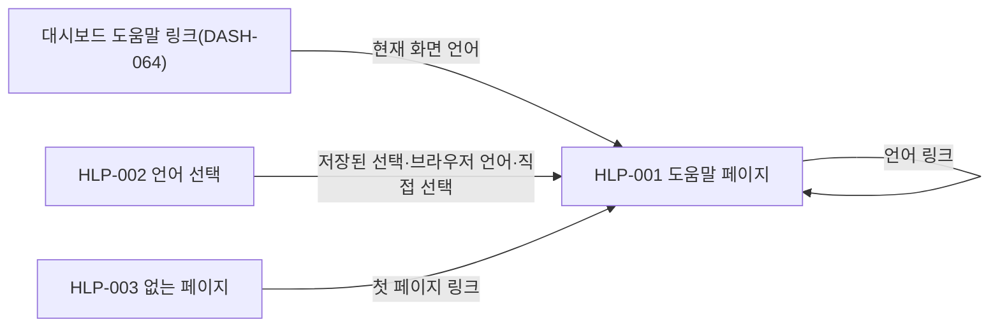

# 도움말 사이트 화면 스펙

운영자가 GitHub Pages의 도움말 사이트에서 한국어 또는 영어 페이지를 읽는 화면 동작을 정의한다. 운영자는 사이트 루트에서 언어를 고르거나 자동으로 이동하고, 목차·검색·이전·다음으로 장을 오가며, 같은 페이지를 다른 언어로 바꿔 읽는다. 시각 구성은 HTML 시안이 보여 주며, 시안은 동작·상태·검증의 기준이 아니다.

| 항목 | 값 |
| --- | --- |
| 상태 | Active(사용자 결정 2026-11-12(Q231)). 시안과 디자인 확장은 사용자 결정 2026-11-12(Q228), 사이트 문구는 Q230으로 채택 |
| 관련 요구사항 | [PRD](../requirements/PRD.md) FR-09, AC-53·AC-55 |
| 관련 계약 | 없음. 이 사이트는 관리 API를 호출하지 않는다. |
| 관련 아키텍처 문서 | [코드 지도](../architectures/code-map.md), [xtask 모듈 설계](../architectures/xtask.md) |
| 관련 ADR | 없음 |
| 디자인 원본 | 없음 |
| HTML 시안 | [도움말 사이트 시안](../design/mockups/help-site.html) |
| 디자인 기준과 코드 적용 규칙 | [디자인 기준의 도움말 사이트 확장](../design/DESIGN.md#도움말-사이트-확장), [프런트엔드 컨벤션](../conventions/frontend.md) |
| 관련 컴포넌트 예시 | 없음 |

선택 기준·시나리오 소유·와이어프레임 판정은 [스펙 작성 규칙](AGENTS.md)을, HTML 시안 판정은 [디자인 문서 작성 규칙](../design/AGENTS.md#html-시안)을 따른다. 색·간격·글꼴 값은 채택된 디자인 기준을 연결한다. 시안 작성 순서는 [frontend-workflow 참고 문서](../../.agents/skills/frontend-workflow/references/frontend-workflow.md#화면별-html-시안-4단계)를 따른다.

## 1. 범위와 사용자

- 사용자: vnc-relay를 설치·설정·운영하는 운영자다. 로그인·쿠키·관리 세션이 없는 공개 사이트이므로 누구나 읽을 수 있다.
- 주소: `https://kayden-kim.github.io/vnc-relay/`. 저장소 About의 웹사이트 주소도 이 주소다(사용자 결정 2026-11-11(Q225)).
- 기준 시점: 사이트는 `main`의 도움말을 보여 준다. `main`에 push할 때마다 다시 게시한다(사용자 결정 2026-11-11(Q221)).
- 포함: 사이트 루트의 언어 선택(HLP-002), 도움말 페이지(HLP-001), 없는 페이지(HLP-003), 목차·검색·언어 전환·코드 복사·이전과 다음 장 이동.
- 제외: 페이지 본문의 내용과 작성 규칙은 [도움말 작성 규칙](../help/AGENTS.md)이 정한다. 대시보드의 도움말 링크는 [대시보드 화면 스펙](dashboard.md) DASH-064가 정한다. 빌드·검사·게시 절차는 [도움말을 빌드하고 게시하는 방법](../how-to/publish-help.md)이 정한다.
- 언어: 한국어와 영어 두 책이다(사용자 결정 2026-11-11(Q222)). 두 책은 같은 파일 이름과 같은 목차 순서를 쓴다.
- 도구: mdBook 0.5.4로 만들고, 디자인 기준의 토큰으로 테마를 입힌다(사용자 결정 2026-11-11(Q223)). mdBook의 프런트엔드 파일은 고치지 않고 싣는다(사용자 결정 2026-11-11(Q227)). 이 문서의 사이트 문구와 테마는 이 프로젝트가 더하는 파일로 만든다.

## 2. 화면 흐름

화살표는 사용자 행동이나 조건에 따른 화면 이동을 뜻한다.



| 화면 ID | 화면 이름 | 들어오는 경로 | 나가는 경로 |
| --- | --- | --- | --- |
| HLP-001 | 도움말 페이지 | `/ko/`·`/en/`과 그 아래 `<장 파일 이름>.html`, 대시보드 도움말 링크, HLP-002·HLP-003의 링크 | 같은 책의 다른 장, 다른 언어의 같은 장, 기준 문서(GitHub) |
| HLP-002 | 언어 선택 | 사이트 루트 `/` | 고른 언어의 첫 페이지 |
| HLP-003 | 없는 페이지 | 사이트 안의 없는 경로 | 두 언어의 첫 페이지 |

### 2.1 언어 선택 규칙

- 사이트 루트(HLP-002)는 대시보드 화면 언어와 같은 규칙으로 언어를 고른다. 저장된 선택이 있으면 그 언어를 쓴다. 없으면 브라우저 선호 언어 목록에서 처음 만나는 한국어(`ko`, `ko-KR` 등) 또는 영어(`en`, `en-US` 등)를 쓴다. 둘 다 없으면 영어를 쓴다. 고른 언어의 첫 페이지로 바로 이동한다.
- 저장 키는 대시보드와 같은 이름 `vnc-relay.language`다. 사이트 출처가 대시보드와 달라 값은 공유하지 않는다(이 문서의 판단, 사용자 결정 없음).
- HLP-001의 언어 링크나 HLP-002의 언어 링크를 고르면 그 언어를 저장한다. 다른 경로로 들어온 페이지(예: 대시보드 링크)는 저장하지 않는다.
- 언어 링크는 다른 언어의 같은 파일 이름 페이지로 이동한다. 절 위치(`#…`)는 유지하지 않는다. 절 이름이 언어마다 다르기 때문이다. 스크립트를 쓸 수 없으면 다른 언어의 첫 페이지로 이동한다.

## 3. 화면별 구성

### HLP-001 도움말 페이지

```text
+------------------------------------------------------------------------------+
| [목차] [표식] VNC Relay 도움말  main 기준                [검색] [지구 English] |
+--------------------+---------------------------------------------------------+
| 소개               | 설정                                                    |
| 설치               | 첫 문단                                                 |
| 빠른 시작          | ## 절 제목                                              |
| VNC 연결 구성      | 문단·목록·표                                            |
| > 설정 (현재)      | +----------------------------------------------[복사]+  |
| 대시보드           | | [relay.tcp_viewer]                                 |  |
| 접속 ticket        | +----------------------------------------------------+  |
| 운영               | > 참고: 인용 블록                                       |
| 문제 해결          | [그림과 대체 텍스트]                                    |
| 참조               |                                                         |
| ------------------ | [< 이전 VNC 연결 구성]              [다음 대시보드 >]   |
| 고지               |                                                         |
+--------------------+---------------------------------------------------------+
```

검색 패널은 상단 막대 아래 본문 맨 위에 열린다.

```text
+--------------------------------------------------------------------+
| 도움말 검색                                                [닫기]  |
| [인증서______________________________________________________]     |
| 두 글자 이상 입력하면 결과가 바로 바뀝니다.                         |
| 검색 결과 6건                                                      |
| 설정 › TLS 파일과 신뢰 프록시                                      |
|   … 같은 두 키를 쓴다. cert_file은 PEM [인증서] 체인이다 …         |
+--------------------------------------------------------------------+
```

| 구성요소 | 표시 내용·입력 규칙 | 사용자 행동 | 결과 | 관련 시나리오 |
| --- | --- | --- | --- | --- |
| 상단 막대 | 목차 단추(HCP-003), 표식과 사이트 이름(HCP-001), 기준 표시(HCP-002), 검색 단추(HCP-004), 언어 링크(HCP-012). 페이지와 함께 스크롤하며 본문 위에 고정하지 않는다 | 선택 | 목차 열기·닫기, 첫 페이지 이동, 첫 페이지의 기준 버전 절 이동, 검색 패널 열기, 다른 언어의 같은 장 이동 | HELP-003·HELP-005·HELP-006·HELP-010·HELP-013 |
| 목차 | 책의 `SUMMARY.md` 순서. 소개, 아홉 장, 구분선, 고지. 현재 장을 표시한다. 이름은 HCP-003 | 장 선택 | 해당 장으로 이동 | HELP-005·HELP-006 |
| 본문 | 장 제목 하나, 절 제목, 문단, 목록, 표, 코드 블록, 인용(참고·주의), 그림과 대체 텍스트 | 읽기·링크 선택 | 같은 책의 장 또는 GitHub의 기준 문서로 이동 | HELP-016 |
| 코드 복사 단추 | 코드 블록마다 하나(HCP-015) | 선택 | 코드 블록의 글자를 클립보드에 복사하고 결과를 알린다(HCP-016·HCP-017) | HELP-012 |
| 이전·다음 | 이전 장과 다음 장의 이름. 앞에 HCP-013·HCP-014. 첫 장에는 이전이, 마지막 장에는 다음이 없다 | 선택, `←`·`→` 키 | 해당 장으로 이동 | HELP-010 |
| 검색 패널 | 제목과 입력 이름(HCP-005), 도움말(HCP-006), 상태(HCP-007~HCP-010), 결과 목록, 닫기(HCP-011) | 입력, 결과 선택, 닫기, `Esc` | 입력할 때마다 결과를 다시 계산한다. 결과를 고르면 그 절로 이동한다. 닫으면 검색 단추로 초점을 돌린다 | HELP-007~HELP-010 |
| 단축키 도움말 | `?` 키로 여는 상자. 제목 HCP-023, 내용 HCP-024~HCP-027 | `?`, `Esc` | 열기, 닫기 | HELP-011 |

#### 검색 규칙

- 범위: 현재 언어 책의 모든 장이다. 장 본문을 장 제목과 절 제목(`h1`~`h3`) 단위의 절로 나눈다.
- 비교: 입력과 본문을 유니코드 NFC로 맞추고 대소문자를 구분하지 않는다. 입력을 공백으로 나눈 낱말이 모두 들어 있는 절만 결과다.
- 최소 길이: 앞뒤 공백을 뺀 입력이 2자 이상일 때만 검색한다. 2자 미만이면 결과를 지우고 도움말(HCP-006)만 보인다.
- 순서: 절 제목에 모든 낱말이 들어 있는 결과가 먼저다. 같은 묶음 안에서는 목차 순서와 본문 순서를 따른다.
- 결과 항목: 장 이름 › 절 이름 링크와 첫 낱말 주변의 발췌다. 발췌는 앞뒤 40자 안팎이며 일치한 낱말을 강조한다. 일치한 낱말이 절 제목에만 있으면 본문 첫머리를 발췌로 보이고, 제목 속 낱말을 링크에서 강조한다. 본문이 없는 절(제목 바로 뒤에 하위 절이 오는 경우)은 발췌 없이 링크만 보인다(이 문서의 판단, 사용자 결정 없음).
- 자료 불러오기: 검색 패널을 처음 열 때 같은 책의 장 페이지를 같은 출처에서 읽는다. 하나라도 실패하면 실패 상태(HCP-010)다. 패널을 다시 열면 다시 읽는다.
- mdBook 기본 검색은 쓰지 않는다. 기본 검색은 한국어 낱말을 색인에 넣지 않는다(2026-11-11 mdBook 0.5.4 빌드에서 확인). 이 검색 방식은 이 문서의 판단이다(사용자 결정 없음).

#### 사이트 문구의 언어

상단 막대, 목차 이름, 이전·다음, 코드 복사, 검색, 단축키 도움말의 문구는 페이지 언어로 보인다. mdBook이 영어로 넣는 문구(목차 이름, 이전·다음 장의 이름, 단축키 도움말)도 페이지 언어로 바꾼다. 문구는 [9절](#9-화면-문구)이 정한다.

### HLP-002 언어 선택

```text
+------------------------------------------+
|                 [표식]                   |
|      VNC Relay 도움말 / VNC Relay Help   |
|  언어를 고르십시오. / Choose a language. |
|      [한국어]          [English]         |
+------------------------------------------+
```

| 구성요소 | 표시 내용·입력 규칙 | 사용자 행동 | 결과 | 관련 시나리오 |
| --- | --- | --- | --- | --- |
| 자동 이동 | 2.1절의 규칙으로 고른 언어 | 없음 | 그 언어의 첫 페이지로 바로 이동. 이동 기록을 남기지 않아 뒤로 가기로 루트에 돌아오지 않는다 | HELP-001·HELP-002 |
| 사이트 이름·안내 | 두 언어의 HCP-019와 HCP-020 | 읽기 | 없음 | HELP-002 |
| 언어 링크 | "한국어"와 "English"(HCP-012) | 선택 | 그 언어를 저장하고 첫 페이지로 이동. 스크립트를 쓸 수 없어도 이동한다 | HELP-002 |

### HLP-003 없는 페이지

```text
+------------------------------------------------------+
| 페이지를 찾을 수 없습니다 / Page not found           |
| 설명 두 언어                                          |
| [한국어 도움말 첫 페이지]  [English help home]       |
+------------------------------------------------------+
```

| 구성요소 | 표시 내용·입력 규칙 | 사용자 행동 | 결과 | 관련 시나리오 |
| --- | --- | --- | --- | --- |
| 제목·설명 | 두 언어의 HCP-021과 HCP-022 | 읽기 | 없음 | HELP-014 |
| 첫 페이지 링크 | HCP-028 두 언어 | 선택 | 해당 언어의 첫 페이지로 이동 | HELP-014 |

없는 경로의 깊이와 관계없이 글꼴·스타일이 깨지지 않아야 한다. GitHub Pages는 사이트 안의 모든 없는 경로에 이 페이지를 HTTP 404로 보낸다.

## 4. 화면 상태

| 화면 ID | 상태 | 진입 조건 | 보이는 내용 | 가능한 행동 |
| --- | --- | --- | --- | --- |
| HLP-001 | 데스크톱·목차 펼침 | 뷰포트 폭 1080px 이상이고 저장된 목차 선택이 없거나 펼침 | 상단 막대, 왼쪽 목차, 오른쪽 본문 | 모든 행동 |
| HLP-001 | 데스크톱·목차 접힘 | 데스크톱 폭에서 목차 단추로 접음. 선택은 브라우저에 남는다 | 상단 막대와 본문 전체 폭 | 목차 펴기, 나머지 행동 |
| HLP-001 | 모바일·목차 닫힘 | 뷰포트 폭 1080px 미만으로 페이지를 엶 | 상단 막대와 본문. 목차 숨김 | 목차 열기, 나머지 행동 |
| HLP-001 | 모바일·목차 열림 | 모바일 폭에서 목차 단추를 고름 | 상단 막대 바로 아래에 펼친 목차. 본문은 목차 아래로 밀린다 | 장 선택, 목차 단추로 닫기 |
| HLP-001 | 검색 입력 전 | 검색 패널을 열었고 입력이 2자 미만 | 입력과 도움말(HCP-006) | 입력, 닫기 |
| HLP-001 | 검색 자료 불러오는 중 | 첫 열기 뒤 자료를 읽는 중에 2자 이상 입력 | 입력과 HCP-009 | 입력, 닫기 |
| HLP-001 | 검색 결과 | 일치하는 절이 있음 | 결과 수(HCP-007)와 결과 목록 | 결과 선택, 입력, 닫기 |
| HLP-001 | 검색 결과 없음 | 일치하는 절이 없음 | HCP-008 | 입력, 닫기 |
| HLP-001 | 검색 자료 실패 | 장 페이지 하나라도 읽기 실패 | HCP-010 | 닫기, 다시 열기 |
| HLP-001 | 복사 완료 | 복사 단추를 골라 클립보드 쓰기 성공 | 단추 옆 HCP-016 | 다시 복사 |
| HLP-001 | 복사 실패 | 브라우저가 클립보드 쓰기를 거절 | 단추 옆 HCP-017 | 직접 선택해 복사 |
| HLP-001 | 단축키 도움말 열림 | 입력란 밖에서 `?` | 단축키 상자 | `Esc`로 닫기 |
| HLP-002 | 기본 | 사이트 루트. 스크립트를 쓸 수 없거나 이동 전 | 사이트 이름, 안내, 언어 링크 둘 | 언어 선택 |
| HLP-003 | 기본 | 사이트 안의 없는 경로 | 제목, 설명, 첫 페이지 링크 둘 | 첫 페이지 이동 |

## 5. 입력 검증과 오류

| 대상 | 조건 | 사용자에게 보이는 결과 | 입력값 유지 여부 |
| --- | --- | --- | --- |
| 검색 입력 | 앞뒤 공백을 뺀 길이가 2자 미만 | 결과를 지우고 입력 아래 HCP-006 | 유지 |
| 검색 입력 | 일치하는 절이 없음 | 결과 자리에 HCP-008. 입력한 낱말을 그대로 넣는다 | 유지 |
| 검색 자료 | 장 페이지를 읽지 못함 | 결과 자리에 HCP-010 | 유지 |
| 코드 복사 | 브라우저가 클립보드 쓰기를 거절 | 단추 옆에 HCP-017 | 해당 없음 |

## 6. 화면 크기와 접근성

- 화면 크기별 차이: 중단점은 뷰포트 폭 1080px 하나다. 데스크톱 폭에서는 목차를 본문 옆에 두고 처음에는 펼친다. 직전에 접었으면 접힌 상태로 연다. 모바일 폭에서는 목차를 처음에 닫고, 열면 상단 막대 바로 아래에 펼친다. 본문은 목차 아래로 밀리며 목차가 본문 위에 겹치지 않는다. 이 값은 mdBook 템플릿의 목차 초기 상태 기준과 같다([디자인 기준의 예외](../design/DESIGN.md#예외)).
- 320px 폭과 200% 확대에서 페이지에 가로 스크롤이 생기지 않아야 한다. 코드 블록과 넓은 표만 자기 영역 안에서 가로 스크롤하며, 그 영역은 키보드로 스크롤할 수 있어야 한다.
- 상단 막대는 본문 위에 고정하지 않는다. 키보드 초점이 고정 머리글에 가려지지 않게 하기 위해서다.
- 랜드마크: 상단 막대는 `header`, 목차는 이름이 HCP-003인 `nav`, 본문은 `main`, 이전·다음은 이름이 HCP-018인 `nav`다.
- 목차 단추는 `aria-expanded`와 `aria-controls`로 목차의 열림 상태를 알린다. 목차를 열고 닫아도 초점은 목차 단추에 남는다. 닫힌 목차의 링크는 초점을 받지 않는다.
- 언어 링크의 글씨는 그 링크가 가리키는 언어의 `lang`과 `hreflang`을 가진다. 문서 루트의 `lang`은 책 언어다.
- 검색 패널은 `role="search"`이며 입력은 보이는 이름을 가진다. 결과 수와 상태 문구는 `role="status"`로 알린다. 결과는 링크 목록이다.
- 코드 복사 결과는 `role="status"`로 알린다.
- 모든 조작 요소는 디자인 기준의 포커스 링을 가진다. 모션은 쓰지 않는다.

## 7. 수용 테스트

테스트 코드는 `specs/`를 기준으로 한 이 문서의 상대 경로와 시나리오 ID를 메타 정보에 기록한다(예: `help-site.md:HELP-001`). 연결 방식은 [검증 기록](../AGENTS.md#검증-기록)을 따른다. 테스트 위치와 결과는 이 문서에 적지 않는다.

| 시나리오 ID | 요구사항 ID | 화면 ID | 조건과 사용자 행동 | 기대 결과 |
| --- | --- | --- | --- | --- |
| HELP-001 | FR-09 | HLP-002 | 저장된 선택 없이 브라우저 선호 언어를 `ko-KR, en`, `fr, en-US`, `fr`로 바꿔 루트를 연다 | 각각 `/ko/`, `/en/`, `/en/` 첫 페이지로 이동한다. 루트가 방문 기록에 남지 않는다 |
| HELP-002 | FR-09 | HLP-002·HLP-001 | 저장된 선택이 `en`이고 브라우저 선호가 `ko`인 상태로 루트를 연다. 다음으로 페이지의 언어 링크로 한국어를 고른 뒤 루트를 다시 연다. 스크립트를 끈 루트에서 English 링크를 고른다 | 처음은 `/en/`, 한국어를 고른 뒤에는 `/ko/`로 이동한다. 스크립트가 없으면 루트에 HCP-019·HCP-020과 두 언어 링크가 보이고 링크로 `/en/`에 이동한다 |
| HELP-003 | FR-09 | HLP-001 | `/ko/configure.html`에서 언어 링크를 고른다. 스크립트를 끈 같은 페이지에서도 고른다 | 스크립트가 있으면 `/en/configure.html`로 이동하고 `en`을 저장한다. 스크립트가 없으면 `/en/` 첫 페이지로 이동한다 |
| HELP-004 | FR-09 | HLP-001 | 두 책을 빌드한다 | 두 책의 장 파일 이름과 목차 순서가 같다. 모든 장에 제목(`h1`)이 하나이고, 문서 `lang`은 각각 `ko`·`en`이다. mdBook이 만드는 영어 404 페이지는 책 안에 남지 않는다 |
| HELP-005 | FR-09 | HLP-001 | 데스크톱 폭에서 장을 열고 목차 단추로 접었다가 편다. 접은 상태로 다른 장을 연다 | 현재 장 항목에 `aria-current="page"`. 단추의 `aria-expanded`가 바뀌고 본문 폭이 넓어지고 좁아진다. 접은 선택이 다음 장에도 유지된다 |
| HELP-006 | FR-09 | HLP-001 | 모바일 폭(390px)에서 장을 열고 목차 단추로 목차를 연 뒤 다시 닫는다 | 처음에는 목차가 닫혀 있고 링크가 초점을 받지 않는다. 열면 상단 막대 바로 아래에 목차가 펼쳐지고 본문이 그 아래로 밀린다. 목차와 본문이 겹치지 않는다. 닫으면 목차가 사라지고 초점은 목차 단추에 남는다 |
| HELP-007 | FR-09 | HLP-001 | 한국어 책에서 `인증서`, 영어 책에서 `certificate`, 두 책에서 대소문자를 바꾼 `TOML`과 낱말 두 개(`relay.toml 계정`, `relay.toml account`)를 검색하고 첫 결과를 고른다 | 결과 수와 장 이름 › 절 이름·발췌가 보이고 일치한 낱말이 강조된다. 두 낱말이 모두 든 절만 결과다. 결과를 고르면 그 장의 그 절로 이동한다 |
| HELP-008 | FR-09 | HLP-001 | 두 책에서 한 글자와 본문에 없는 낱말을 검색한다 | 한 글자는 결과 없이 HCP-006만 보인다. 없는 낱말은 그 언어의 HCP-008이 보이고 입력은 남는다 |
| HELP-009 | FR-09 | HLP-001 | 장 페이지 요청 하나를 실패시킨 뒤 검색하고, 요청을 되살린 뒤 패널을 닫았다 다시 연다 | 실패 상태에 HCP-010이 보인다. 다시 열면 자료를 다시 읽어 결과가 보인다 |
| HELP-010 | FR-09 | HLP-001 | 키보드만으로 `/`로 검색을 열고 `Esc`로 닫는다. `←`·`→`로 장을 옮긴다. 검색 입력 안에서 `←`·`→`를 누른다. `Tab`으로 상단 막대에서 본문까지 이동한다 | 검색 입력에 초점이 가고 닫으면 검색 단추로 돌아온다. 입력 밖의 `←`·`→`는 이전·다음 장으로 이동하고, 입력 안에서는 장을 옮기지 않는다. 모든 조작 요소에 초점 링이 보인다 |
| HELP-011 | FR-09 | HLP-001 | 두 책의 장에서 사이트 문구를 확인하고 `?`로 단축키 도움말을 연다 | 목차 이름·목차 단추·검색·이전·다음·복사·단축키 도움말의 글자와 접근 가능한 이름이 페이지 언어의 HCP 문구다. 한국어 페이지에 mdBook의 영어 문구가 남지 않는다 |
| HELP-012 | FR-09 | HLP-001 | 코드 블록의 복사 단추를 고른다. 클립보드 쓰기를 거절하게 한 뒤 다시 고른다 | 클립보드 내용이 코드 블록의 글자와 같고 HCP-016을 알린다. 거절되면 HCP-017을 알린다 |
| HELP-013 | FR-09 | HLP-001 | 두 책의 첫 페이지를 열고 상단 막대의 기준 표시를 고른다 | 기준 버전 절에 `main` 기준, 최신 Release 링크, 최신 Release와 다른 동작 목록이 있다. 기준 표시는 그 절로 이동한다 |
| HELP-014 | FR-09 | HLP-003 | 사이트 안의 없는 경로 `/ko/missing.html`과 `/a/b/c`를 연다 | HTTP 404와 HLP-003이 보인다. 글꼴·스타일 요청이 모두 성공한다. 두 링크가 각각 `/ko/`·`/en/` 첫 페이지로 이동한다 |
| HELP-015 | FR-09 | HLP-001·HLP-002·HLP-003 | 모든 화면을 연다 | 브라우저 요청이 모두 사이트 출처로만 간다. 글꼴·스크립트·스타일·그림을 외부에서 가져오지 않는다 |
| HELP-016 | FR-09 | HLP-001 | 두 책의 모든 링크와 그림을 확인한다 | 같은 사이트 안 링크의 페이지와 절이 있다. 그림 파일이 있고 대체 텍스트가 비어 있지 않다. 저장소 링크는 `https://github.com/kayden-kim/vnc-relay/blob/main/` 아래의 존재하는 파일을 가리킨다 |
| HELP-017 | FR-09 | HLP-001 | 두 책의 고지 페이지를 연다 | 사이트에 싣는 제3자 구성요소마다 이름·버전·라이선스·출처가 보인다. 라이선스 전문 또는 전문 위치 링크가 있다 |
| HELP-018 | FR-09 | HLP-001·HLP-002·HLP-003 | 320px 폭과 1280px 폭의 200% 확대에서 각 화면을 연다 | 페이지에 가로 스크롤이 없다. 코드 블록과 넓은 표만 자기 영역에서 가로로 스크롤한다 |

## 8. 미결정 사항

| ID | 항목 | 제약 | 확정 위치 |
| --- | --- | --- | --- |
| HELP-TBD-001 | HTML 시안과 디자인 기준의 도움말 사이트 확장 채택 | (해결) 채택한 시안과 디자인 확장으로 테마를 구현한다. 이 ID는 재사용하지 않는다 | 사용자 결정 2026-11-12(Q228) |
| HELP-TBD-002 | 9절 사이트 문구(HCP-001~HCP-028) 채택 | (해결) 9절 문구를 확정 문구로 쓴다. 이 ID는 재사용하지 않는다 | 사용자 결정 2026-11-12(Q230) |

## 9. 화면 문구

- 상태: 사용자 결정 2026-11-12(Q230)으로 모두 채택했다.
- 한국어와 English 문구는 같은 ID 아래 짝을 이룬다. HLP-002·HLP-003은 두 언어를 함께 보인다.
- `{n}`과 `{query}`는 값으로 바뀐다. `{query}`는 입력을 그대로 넣는다.

| ID | 위치 | 한국어 | English |
| --- | --- | --- | --- |
| HCP-001 | 상단 막대 사이트 이름, 책 제목 | VNC Relay 도움말 | VNC Relay Help |
| HCP-002 | 상단 막대 기준 표시 | main 기준 | Based on main |
| HCP-003 | 목차 단추와 목차 `nav` 이름 | 목차 | Contents |
| HCP-004 | 상단 막대 검색 단추 | 검색 | Search |
| HCP-005 | 검색 패널 제목과 입력 이름 | 도움말 검색 | Search help |
| HCP-006 | 검색 입력 도움말 | 두 글자 이상 입력하면 결과가 바로 바뀝니다. | Type at least two characters to see results. |
| HCP-007 | 검색 결과 수. 영어는 1건이면 `1 result` | 검색 결과 {n}건 | {n} results |
| HCP-008 | 검색 결과 없음 | ‘{query}’ 검색 결과가 없습니다. | No results for “{query}”. |
| HCP-009 | 검색 자료 불러오는 중 | 검색 자료를 불러오는 중입니다. | Loading search data. |
| HCP-010 | 검색 자료 실패 | 검색 자료를 불러오지 못했습니다. 검색을 닫았다가 다시 여십시오. | Could not load search data. Close search and open it again. |
| HCP-011 | 검색 닫기 단추 | 닫기 | Close |
| HCP-012 | 언어 링크. 링크가 가리키는 언어의 이름 | 한국어 | English |
| HCP-013 | 이전 장 앞 | 이전 | Previous |
| HCP-014 | 다음 장 앞 | 다음 | Next |
| HCP-015 | 코드 복사 단추 | 복사 | Copy |
| HCP-016 | 코드 복사 완료 | 복사했습니다. | Copied. |
| HCP-017 | 코드 복사 실패 | 복사하지 못했습니다. 코드를 직접 선택해 복사하십시오. | Could not copy. Select the code and copy it manually. |
| HCP-018 | 이전·다음 `nav` 이름 | 장 이동 | Chapter navigation |
| HCP-019 | HLP-002 사이트 이름 | VNC Relay 도움말 | VNC Relay Help |
| HCP-020 | HLP-002 안내 | 언어를 고르십시오. | Choose a language. |
| HCP-021 | HLP-003 제목 | 페이지를 찾을 수 없습니다 | Page not found |
| HCP-022 | HLP-003 설명 | 주소가 바뀌었거나 없는 페이지입니다. 도움말 첫 페이지에서 다시 찾으십시오. | The page has moved or does not exist. Start again from the help home page. |
| HCP-023 | 단축키 도움말 제목 | 단축키 | Keyboard shortcuts |
| HCP-024 | 단축키: 장 이동 | `←`·`→` 이전 장·다음 장 | `←` `→` Previous or next chapter |
| HCP-025 | 단축키: 검색 | `/` 검색 열기 | `/` Open search |
| HCP-026 | 단축키: 도움말 | `?` 이 도움말 보기 | `?` Show this help |
| HCP-027 | 단축키: 닫기 | `Esc` 검색·단축키 도움말 닫기 | `Esc` Close search or this help |
| HCP-028 | HLP-003 첫 페이지 링크 | 한국어 도움말 첫 페이지 | English help home |
